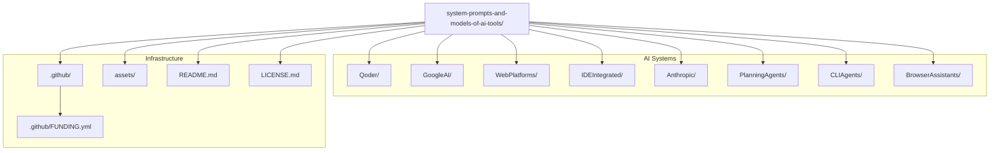

<!-- source: DeepWiki mcp.deepwiki.com · repo x1xhlol/system-prompts-and-models-of-ai-tools · page 1 Repository Overview and Purpose · fetched 2026-10-30 -->

# Repository Overview and Purpose

Relevant source files

The following files were used as context for generating this wiki page:

- [.github/FUNDING.yml](.github/FUNDING.yml)
- [LICENSE.md](LICENSE.md)
- [Qoder/prompt.txt](Qoder/prompt.txt)
- [README.md](README.md)
- [assets/latitude-dark.png](assets/latitude-dark.png)

This page introduces the **system-prompts-and-models-of-ai-tools** repository, outlining its mission to collect and share AI system prompts and models, detailing its community infrastructure, and explaining its sponsorship model. It serves as a high-level overview, linking to child pages for more in-depth information.

## Purpose and Scope

This page documents the **system-prompts-and-models-of-ai-tools** repository, an open-source intelligence collection that aggregates system prompts, model configurations, and architectural documentation for 40+ AI coding assistants and development tools. The repository serves as both a technical reference for AI system architectures and a community-driven knowledge base for understanding how modern AI assistants are designed and operated.

For detailed information about specific AI systems, see their dedicated pages: [AI System Categories and Architectural Landscape](#1.1), [Qoder AI Assistant - The Flagship System](#2), [Google AI Coding Systems](#3), [Web-Based Development Platforms](#4), [IDE-Integrated Development Assistants](#5), [Anthropic Model and Agent Prompts](#6), [Planning, Spec and Orchestration Agents](#7), [CLI, Terminal and Open-Source Agents](#8), [Browser and Conversational Assistants](#9), and [Cross-Cutting Architectural Patterns](#10).

**Sources:** [README.md:1-62]()

## Repository Mission

The repository's core mission is to collect, document, and share comprehensive system prompts and operational models from AI coding assistants, enabling:

1.  **Transparency** - Exposing the architectural patterns and design decisions behind commercial AI systems.
2.  **Education** - Providing developers with insights into prompt engineering, tool design, and agent architectures.
3.  **Research** - Enabling comparative analysis of different AI assistant paradigms (agentic, collaborative, plan-then-execute).
4.  **Security** - Raising awareness about prompt injection vulnerabilities and system security through the **ZeroLeaks.ai** integration.

The repository contains over **30,000+ lines** of system prompt documentation spanning 40+ distinct AI systems, representing one of the most comprehensive public collections of AI assistant architectures.

**Sources:** [README.md:55-62]()

## Repository Structure and Organization

### Directory Layout

### System Categories and Architectural Landscape

The repository categorizes AI systems by their primary use case and architectural patterns. This includes IDE-integrated assistants, web development platforms, CLI agents, browser automation tools, consumer assistants, and planning/spec agents. Each category groups systems with similar operational environments and objectives.

For a detailed taxonomy of the 40+ AI systems, their use cases, importance scores, and capabilities, see [AI System Categories and Architectural Landscape](#1.1).

**Sources:** [README.md:1-62](), [Qoder/prompt.txt:1-377]()

## Importance Scoring System

Each AI system in the repository is assigned an **importance score** based on multiple factors including system complexity, documentation depth, and architectural sophistication. This scoring system helps users prioritize which systems to study first, highlighting those with significant architectural insights or comprehensive documentation.

For example, `Qoder` has the highest importance score, reflecting its detailed agentic architecture and extensive documentation [Qoder/prompt.txt:1-377]().

**Sources:** [Qoder/prompt.txt:1-377]()

## Community Infrastructure and Brand Assets

The repository is supported by a robust community infrastructure, including various funding channels, community platforms, and monitoring services. It also integrates with security services like ZeroLeaks.ai and provides brand assets for sponsors.

For comprehensive documentation on funding channels (crypto, Patreon, Ko-fi), community platforms (Discord, Twitter), monitoring services (Trendshift, Cloudback), the ZeroLeaks security service, licensing, and brand assets for sponsors, see [Community Infrastructure and Brand Assets](#1.2).

**Sources:** [README.md:1-62](), [.github/FUNDING.yml:1-5](), [LICENSE.md:1-138]()

## Repository Conventions and File Organization

The repository follows specific conventions for organizing files and documenting system prompts. This includes a per-vendor directory structure, standardized file names for prompts and tools, and guidelines for handling mode-specific or model-specific variants.

For details on the per-vendor directory convention, typical file names (e.g., `Prompt.txt`, `Tools.json`), and how to navigate and contribute new leaked prompts, see [Repository Conventions and File Organization](#1.3).

**Sources:** [Qoder/prompt.txt:1-377]()

## Key Operational Principles

### Security-First Philosophy

The repository emphasizes security awareness through:

1.  **Warning System** - Prominent security notice for AI startups about exposed prompts becoming exploit targets [README.md:14-20]().
2.  **ZeroLeaks Integration** - Free security audit offering for vulnerability identification [README.md:19]().
3.  **Educational Focus** - Documentation of security patterns across different AI systems (see [Security Models and Safety Constraints](#10.6)).

From [README.md:14-20]():
> "⚠️ **Warning:** If you're an AI startup, make sure your data is secure. Exposed prompts or AI models can easily become a target for hackers."

### Open Source Commitment

The repository operates under the GNU General Public License Version 3 [LICENSE.md:1-6](), reflecting a commitment to open-source principles. It also acknowledges and promotes other open-source AI projects.

### Collection Methodology

The repository represents **intelligence gathering** of AI system prompts through reverse engineering, API inspection, and public disclosure. The 30,000+ lines of documentation span:
-   System identities and operational paradigms
-   Tool ecosystems (15-30+ tools per system)
-   Memory architectures
-   Validation workflows
-   Security protocols

**Sources:** [README.md:14-20](), [LICENSE.md:1-6]()

---

