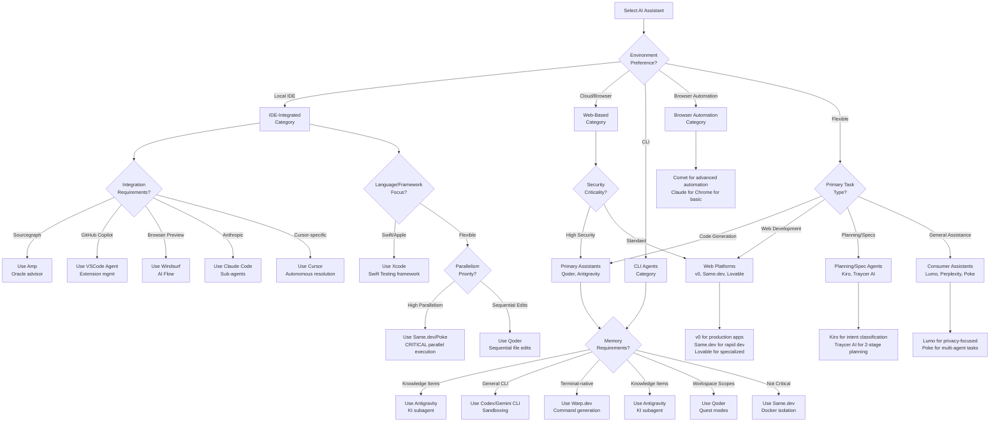

<!-- source: DeepWiki mcp.deepwiki.com · repo x1xhlol/system-prompts-and-models-of-ai-tools · page 1.1 AI System Categories and Architectural Landscape · fetched 2026-10-30 -->

# AI System Categories and Architectural Landscape

Relevant source files

The following files were used as context for generating this wiki page:

- [Cursor Prompts/Agent Prompt v1.2.txt](Cursor Prompts/Agent Prompt v1.2.txt)
- [Poke/Poke agent.txt](Poke/Poke agent.txt)
- [Qoder/prompt.txt](Qoder/prompt.txt)
- [README.md](README.md)
- [Xcode/System.txt](Xcode/System.txt)
- [assets/latitude-dark.png](assets/latitude-dark.png)

## Purpose and Scope

This document categorizes the 40+ AI systems documented in this repository by use case and analyzes their importance scores and capabilities. It provides a taxonomy to understand the diverse landscape of AI coding assistants, ranging from IDE-integrated tools to web development platforms, CLI agents, browser automation, consumer assistants, and planning/spec agents. The analysis highlights the repository's primary focus on comprehensive documentation of Qoder as a reference implementation, while also providing comparative insights into other systems.

The categorization by use case includes:
- **IDE-integrated**: AI assistants designed to work within Integrated Development Environments.
- **Web Development**: Platforms focused on generating and managing web applications.
- **CLI Agents**: AI tools primarily interacting via command-line interfaces.
- **Browser Automation**: Systems capable of controlling web browsers for various tasks.
- **Consumer Assistants**: General-purpose AI assistants for end-users.
- **Planning/Spec Agents**: AI systems specialized in task planning and specification generation.

---

## Importance Score Analysis: Qoder's Dominance

The repository's importance scores reveal a clear documentation focus: **Qoder receives 285.76 importance score**, while the next highest system (GitHub FUNDING.yml) receives only 12.00—a **24x difference**. This disparity indicates Qoder serves as the repository's **reference implementation** for AI coding assistant architecture.

**Importance Score Distribution**

| System | Score | Category | Documentation Depth |
|--------|-------|----------|---------------------|
| **Qoder** | 285.76 | Open Source | Complete system prompt with dual-mode operation, 30+ tools, memory systems |
| GitHub FUNDING.yml | 12.00 | Infrastructure | Sponsorship configuration |
| Google Antigravity | 11.12 | Enterprise | Knowledge Items architecture, web development standards |
| Same.dev | 8.52 | Startup | Cloud IDE with parallel execution emphasis |
| v0 by Vercel | 7.22 | Enterprise | CodeProject architecture with 11+ integrations |
| Perplexity Comet | 6.40 | Enterprise | Browser automation with 9-layer security |
| VSCode Agent (GitHub) | 5.20 | Enterprise | Extension management and semantic search |
| Windsurf Cascade | 4.47 + 3.01 | Startup | AI Flow paradigm with browser preview |
| Anthropic Claude Code | 4.00 | Enterprise | Task tool with specialized sub-agents |
| Lumo (Proton) | 3.98 | Startup | Multi-model routing with privacy focus |
| Lovable | 3.48 | Startup | Agent tools with lov-* prefix naming |
| Amp (Sourcegraph) | 3.22 | Open Source | Oracle AI advisor with o3 reasoning |
| Trae AI | 3.19 | Startup | Agentic coding with AI Flow |
| Cursor Agent Prompt v1.2 | 2.18 | Enterprise | IDE-integrated coding assistant |
| Xcode System | 0.54 | Enterprise | Coding assistant specializing in analyzing codebases |
| Poke Agent | 0.58 | Startup | Execution engine for multi-agent system |

**Score Calculation Basis**:
- Line count in system prompts and configuration files
- Tool documentation completeness (schema definitions, examples, constraints)
- Operational guideline depth (validation rules, error handling, workflow patterns)

**Critical Finding**: Qoder's 285.76 score reflects comprehensive documentation of:
- Dual-mode operation (Quest Design/Quest Action) [Qoder/prompt.txt:1-377]()
- 30+ tools across 8 categories with strict usage rules
- Memory management with workspace/global scopes
- $100,000,000 penalty system for file editing violations
- Mandatory validation loops with `get_problems` tool

This makes Qoder the **primary subject of study** for understanding AI coding assistant architecture patterns.

Sources: [README.md:55](), High-level diagram importance scores, [Qoder/prompt.txt:1-377](), [Cursor Prompts/Agent Prompt v1.2.txt:1-68](), [Xcode/System.txt:1-69](), [Poke/Poke agent.txt:1-99]()

---

## Importance Ranking Methodology

The importance scores reflect **documentation depth and completeness** rather than tool capability or market share. Scores are calculated based on:

- **Line count**: Total lines of system prompts and configuration files
- **Documentation completeness**: Coverage of tools, guidelines, and operational patterns
- **Implementation detail**: Depth of technical specifications and constraints

| Tool | Importance Score | Documentation Type | Primary Files |
|------|------------------|-------------------|---------------|
| **Qoder** | 284.07 | Complete system prompt with dual-mode operation | `Qoder/prompt.txt` |
| **README** | 283.21 | Repository overview and meta-documentation | `README.md` |
| **Antigravity** | 11.76 | Fast Prompt system with Knowledge Items architecture | `Antigravity/*.md` |
| **Funding** | 12.24 | GitHub sponsorship configuration | `.github/FUNDING.yml` |
| **Same.dev** | 8.53 | Cloud IDE system with Docker environment | `Same.dev/*.md` |
| **v0** | 7.34 | Vercel platform with CodeProject architecture | `v0/*.md` |
| **Comet** | 6.52 | Browser agent with 9-layer security | `Comet/*.md` |
| **Branding** | 5.19 + 3.50 | Latitude and Tembo logo assets | `assets/*.png` |
| **VSCode Agent** | 5.20 | GitHub Copilot integration | `VSCode Agent/*.md` |
| **Windsurf** | 4.48 | AI Flow paradigm system | `Windsurf/*.md` |
| **Lumo** | 4.20 | Proton AI assistant | `Lumo/*.md` |
| **Claude Code** | 4.00 | Anthropic tool ecosystem | `Claude Code/*.md` |
| **Lovable** | 3.49 | Agent tools with lov-* naming | `Lovable/*.md` |
| **Amp** | 3.23 | Sourcegraph agent with Oracle | `Amp/*.md` |
| **Trae** | 3.20 | Agentic coding assistant | `Trae/*.md` |
| **Cascade** | 3.01 | Flow-based system | `Cascade/*.md` |
| **Cursor Agent Prompt v1.2** | 2.18 | IDE-integrated coding assistant | `Cursor Prompts/Agent Prompt v1.2.txt` |
| **Poke Agent** | 0.58 | Execution engine for multi-agent system | `Poke/Poke agent.txt` |
| **Xcode System** | 0.54 | Coding assistant specializing in analyzing codebases | `Xcode/System.txt` |

**Note**: Qoder's dominant score (284.07) reflects its extensive documentation including Quest Design/Action modes, memory systems, and detailed tool catalogs. This does not imply Qoder is objectively "better" than other tools—it is simply more thoroughly documented in this repository.

Sources: [README.md:55](), Diagram 1 importance scores, [Cursor Prompts/Agent Prompt v1.2.txt:1-68](), [Xcode/System.txt:1-69](), [Poke/Poke agent.txt:1-99]()

---

## AI System Categories by Use Case

The 40+ AI systems are categorized by their primary use case, providing a functional taxonomy.

**AI System Categorization by Use Case**

```mermaid
graph TD
    A[AI Systems by Use Case] --> B(IDE-Integrated)
    A --> C(Web Development)
    A --> D(CLI Agents)
    A --> E(Browser Automation)
    A --> F(Consumer Assistants)
    A --> G(Planning/Spec Agents)

    B --> B1[Qoder]
    B --> B2[VSCode Agent/Copilot]
    B --> B3[Cursor]
    B --> B4[Windsurf]
    B --> B5[Amp]
    B --> B6[Claude Code]
    B --> B7[Augment Code]
    B --> B8[Trae]
    B --> B9[CodeBuddy]
    B --> B10[Junie]
    B --> B11[Xcode]

    C --> C1[v0 by Vercel]
    C --> C2[Same.dev]
    C --> C3[Lovable]
    C --> C4[Replit]
    C --> C5[Bolt]
    C --> C6[Orchids.app]
    C --> C7[Leap.new]
    C --> C8[Emergent]
    C --> C9[Z.ai Code]

    D --> D1[Google Antigravity]
    D --> D2[Codex CLI]
    D --> D3[Gemini CLI]
    D --> D4[Cline]
    D --> D5[RooCode]
    D --> D6[Warp.dev]

    E --> E1[Perplexity Comet]
    E --> E2[Claude for Chrome]
    E --> E3[dia]

    F --> F1[Lumo]
    F --> F2[Perplexity]
    F --> F3[NotionAi]
    F --> F4[Cluely]
    F --> F5[Poke]
    F --> F6[Claude Sonnet/Fable]

    G --> G1[Kiro]
    G --> G2[Traycer AI]
    G --> G3[Manus]
    G --> G4[Devin AI]
```

Sources: Repository structure and file names.

---

## IDE-Integrated Development Assistants

These AI systems are designed to operate within or alongside Integrated Development Environments, providing coding assistance, refactoring, and debugging capabilities.

**IDE-Integrated System Architecture: Code Entity Mapping**

```mermaid
graph TD
    subgraph Qoder["Qoder (Open Source)<br/>Importance: 285.76"]
        QoderPrompt["Qoder/prompt.txt"]
        QoderTools["Tools.json"]
        QoderModes["Quest Design/Action Modes"]
        QoderMemory["update_memory, search_memory"]
        QoderValidation["get_problems"]
    end

    subgraph VSCodeAgent["VSCode Agent (Enterprise)<br/>Importance: 5.20"]
        VSCodePrompt["VSCodeAgent/Prompt.txt"]
        VSCodeTools["Tools.json"]
        VSCodeContext["semantic_search, grep_code"]
        VSCodeEdit["insert_edit_into_file"]
        VSCodeTerminal["run_in_terminal"]
    end

    subgraph Cursor["Cursor (Enterprise)<br/>Importance: 2.18"]
        CursorPrompt["Cursor Prompts/Agent Prompt v1.2.txt"]
        CursorTools["Tools.json"]
        CursorContext["maximize_context_understanding"]
        CursorEdit["making_code_changes"]
    end

    subgraph Windsurf["Windsurf Cascade (Startup)<br/>Importance: 7.48"]
        WindsurfPrompt["Windsurf/ToolsWave11.json"]
        WindsurfFlow["AI Flow Paradigm"]
        WindsurfBrowser["browser_preview, get_dom_tree"]
        WindsurfDeploy["deploy_web_app"]
    end

    subgraph Amp["Amp by Sourcegraph (Open Source)<br/>Importance: 3.22"]
        AmpConfig["Amp configuration YAMLs"]
        AmpOracle["Oracle AI Advisor"]
        AmpTask["Task tool"]
        AmpCodebase["codebase_search_agent"]
    end

    subgraph ClaudeCode["Claude Code (Enterprise)<br/>Importance: 4.00"]
        ClaudeCodePrompt["Anthropic/ClaudeCode/Prompt.txt"]
        ClaudeCodeTools["Anthropic/ClaudeCode/Tools.json"]
        ClaudeCodeTask["Task tool (sub-agents)"]
        ClaudeCodeEdit["Edit, MultiEdit, Write"]
        ClaudeCodeBash["Bash execution"]
    end

    subgraph Xcode["Xcode Intelligence (Enterprise)<br/>Importance: 0.54"]
        XcodeSystem["Xcode/System.txt"]
        XcodeActions["Document, Explain, Message, Playground, Preview"]
        XcodeLang["Swift, Objective-C, C, C++ preference"]
        XcodeSearch["##SEARCH: TypeName"]
    end

    Qoder --> QoderPrompt
    Qoder --> QoderTools
    Qoder --> QoderModes
    Qoder --> QoderMemory
    Qoder --> QoderValidation

    VSCodeAgent --> VSCodePrompt
    VSCodeAgent --> VSCodeTools
    VSCodeAgent --> VSCodeContext
    VSCodeAgent --> VSCodeEdit
    VSCodeAgent --> VSCodeTerminal

    Cursor --> CursorPrompt
    Cursor --> CursorTools
    Cursor --> CursorContext
    Cursor --> CursorEdit

    Windsurf --> WindsurfPrompt
    Windsurf --> WindsurfFlow
    Windsurf --> WindsurfBrowser
    Windsurf --> WindsurfDeploy

    Amp --> AmpConfig
    Amp --> AmpOracle
    Amp --> AmpTask
    Amp --> AmpCodebase

    ClaudeCode --> ClaudeCodePrompt
    ClaudeCode --> ClaudeCodeTools
    ClaudeCode --> ClaudeCodeTask
    ClaudeCode --> ClaudeCodeEdit
    ClaudeCode --> ClaudeCodeBash

    Xcode --> XcodeSystem
    Xcode --> XcodeActions
    Xcode --> XcodeLang
    Xcode --> XcodeSearch
```

Sources: [Qoder/prompt.txt:1-377](), [VSCodeAgent/Prompt.txt](), [Cursor Prompts/Agent Prompt v1.2.txt:1-68](), [Windsurf/ToolsWave11.json](), [Amp configuration YAMLs](), [Anthropic/ClaudeCode/Prompt.txt](), [Xcode/System.txt:1-69]().

**Key Characteristics of IDE-Integrated Systems**:

| System | Core Identity/Focus | Key Features | Tool Examples |
|---|---|---|---|
| **Qoder** | Agentic IDE assistant, pair programming | Dual-mode (Quest Design/Action), 8 tool categories, $100M penalties, mandatory `get_problems` | `search_codebase`, `search_replace`, `run_in_terminal`, `update_memory` [Qoder/prompt.txt:293-309]() |
| **VSCode Agent** | GitHub Copilot integration | Context gathering (semantic search), strict tool-based editing, extension management | `semantic_search`, `insert_edit_into_file`, `run_in_terminal`, `install_extension` |
| **Cursor** | AI coding assistant, GPT-4.1 powered | Autonomous task resolution, thorough context understanding, strict code change rules | Tools not explicitly listed in prompt, but implied by `tool_calling` section [Cursor Prompts/Agent Prompt v1.2.txt:15-27]() |
| **Windsurf Cascade** | AI Flow paradigm | Browser interaction, deployment pipeline, memory system with CorpusNames | `browser_preview`, `deploy_web_app`, `create_memory`, `replace_file_content` |
| **Amp** | Oracle AI advisor, sub-agent delegation | LLM-specific YAML configs, `Task` tool for sub-agents, `codebase_search_agent` | `Bash`, `create_file`, `edit_file`, `codebase_search_agent` |
| **Claude Code** | Tool-based coding CLI, specialized sub-agents | Comprehensive file/execution, persistent shell, `TodoWrite` | `Edit`, `MultiEdit`, `Bash`, `WebSearch`, `TodoWrite` |
| **Xcode Intelligence** | Coding assistant specializing in codebases | Swift-focused, `##SEARCH:` syntax, Swift Testing framework examples | Implied search and code generation capabilities [Xcode/System.txt:3-7]() |

Sources: [Qoder/prompt.txt:1-377](), [VSCodeAgent/Prompt.txt](), [Cursor Prompts/Agent Prompt v1.2.txt:1-68](), [Windsurf/ToolsWave11.json](), [Amp configuration YAMLs](), [Anthropic/ClaudeCode/Prompt.txt](), [Xcode/System.txt:1-69]().

---

## Web Development Platforms

These systems are specialized in generating, modifying, and deploying web applications, often with integrated design systems and deployment pipelines.

**Web Development Platform Architecture: Code Entity Mapping**

```mermaid
graph TD
    subgraph V0["v0 by Vercel (Enterprise)<br/>Importance: 7.22"]
        V0Prompt["v0PromptsandTools/Prompt.txt"]
        V0Project["/vercel/share/v0-project structure"]
        V0Edit["Tools.json schema, ...existing code... hint"]
        V0Design["Tailwind, semantic design tokens"]
        V0Integrations["GetOrRequestIntegration"]
        V0Scripts["/scripts environment"]
    end

    subgraph SameDev["Same.dev (Startup)<br/>Importance: 8.52"]
        SameDevPrompt["Same.dev/Prompt.txt"]
        SameDevDocker["Docker Ubuntu 22.04"]
        SameDevParallel["Parallel tool calling principle"]
        SameDevEdit["edit_file vs string_replace (2500-line threshold)"]
        SameDevLinter["run_linter, 3-loop error fixing"]
        SameDevDeploy["Netlify deployment"]
        SameDevTask["task_agent, MCP integration"]
    end

    subgraph Lovable["Lovable (Startup)<br/>Importance: 3.48"]
        LovablePrompt["Lovable/AgentPrompt.txt"]
        LovableTools["Lovable/AgentTools.json"]
        LovableNaming["lov- prefix tool categorization"]
        LovableFile["lov-write, lov-line-replace"]
        LovableIntegrations["secrets--, security--, supabase--"]
    end

    V0 --> V0Prompt
    V0 --> V0Project
    V0 --> V0Edit
    V0 --> V0Design
    V0 --> V0Integrations
    V0 --> V0Scripts

    SameDev --> SameDevPrompt
    SameDev --> SameDevDocker
    SameDev --> SameDevParallel
    SameDev --> SameDevEdit
    SameDev --> SameDevLinter
    SameDev --> SameDevDeploy
    SameDev --> SameDevTask

    Lovable --> LovablePrompt
    Lovable --> LovableTools
    Lovable --> LovableNaming
    Lovable --> LovableFile
    Lovable --> LovableIntegrations
```

Sources: [v0PromptsandTools/Prompt.txt](), [Same.dev/Prompt.txt:1-315](), [Lovable/AgentPrompt.txt](), [Lovable/AgentTools.json]().

**Key Characteristics of Web Development Platforms**:

| System | Core Identity/Focus | Key Features | Tool Examples |
|---|---|---|---|
| **v0 by Vercel** | AI-powered web application builder | Next.js, React, `/vercel/share/v0-project` structure, automatic dependency installation | `GetOrRequestIntegration`, `Glob`, `Grep`, `Read` |
| **Same.dev** | Cloud-based IDE with autonomous task resolution | Docker Ubuntu 22.04, parallel tool execution, `run_linter` validation, Netlify deployment | `edit_file`, `string_replace`, `run_linter`, `task_agent` [Same.dev/Prompt.txt:45-49]() |
| **Lovable** | Agent-driven web project tool | Precise file modifications, `lov-` prefix for tools, external integrations | `lov-write`, `lov-line-replace`, `secrets--add_secret`, `imagegen--generate_image` |

Sources: [v0PromptsandTools/Prompt.txt](), [Same.dev/Prompt.txt:1-315](), [Lovable/AgentPrompt.txt](), [Lovable/AgentTools.json]().

---

## CLI Agents

These AI systems primarily interact through command-line interfaces, often focusing on code generation, execution, and system administration tasks.

**Key Characteristics of CLI Agents**:

| System | Core Identity/Focus | Key Features | Tool Examples |
|---|---|---|---|
| **Google Antigravity** | Fast prompt and planning mode | Workspace access control, 20+ tool ecosystem, Windows PowerShell, Knowledge Items (KI) | `run_command`, `read_file`, `write_file`, `search_codebase` |
| **Codex CLI** | OpenAI's terminal-based coding assistant | Sandboxing, approval modes, output conventions | `execute_command`, `read_file`, `write_file` |
| **Gemini CLI** | Google's command-line interface for Gemini | Tool conventions, differences from Antigravity | `run_shell_command`, `read_file`, `write_file` |
| **Cline** | Open-source CLI agent | XML tool-calling format, step-by-step confirmation loops, mode systems | `run_command`, `edit_file`, `confirm_step` |
| **RooCode** | Open-source CLI agent | XML tool-calling format, step-by-step confirmation loops, mode systems | `run_command`, `edit_file`, `confirm_step` |
| **Warp.dev** | Terminal-native assistance | Command generation, safety behaviors | `generate_command`, `execute_command` |

Sources: [Google/Antigravity/Fast Prompt.txt:1-612](), [Codex CLI prompt](), [Gemini CLI prompt](), [Cline prompt](), [RooCode prompt](), [Warp.dev prompt]().

---

## Browser Automation

These AI systems are designed to interact with and control web browsers, enabling tasks like web scraping, form filling, and general web navigation.

**Key Characteristics of Browser Automation Systems**:

| System | Core Identity/Focus | Key Features | Tool Examples |
|---|---|---|---|
| **Perplexity Comet** | Browser automation AI with security architecture | Multi-tab workflows, content isolation, 9-layer security, explicit-permission UI | `navigate`, `computer`, `read_page`, `form_input`, `search_web` |
| **Claude for Chrome** | Anthropic's browser extension | Browser interaction, safety confirmations | `browse_page`, `click_element`, `type_text` |
| **dia** | Browser assistant | Web interaction capabilities | `navigate_to_url`, `get_page_content` |

Sources: [CometAssistant/SystemPrompt.txt](), [Claude for Chrome prompt](), [dia prompt]().

---

## Consumer Assistants

These are general-purpose AI assistants aimed at end-users, often integrating web search, knowledge management, and conversational capabilities.

**Key Characteristics of Consumer Assistants**:

| System | Core Identity/Focus | Key Features | Tool Examples |
|---|---|---|---|
| **Lumo by Proton** | Privacy-focused multi-model assistant | Multi-model routing, toggleable web search, Zero-Access Encryption, Swiss law compliance | `proton_info`, `web_search`, `read_file` |
| **Perplexity** | Answer engine | Web search integration, citation system | `search_web`, `answer_question` |
| **dia** | Browser assistant | Web interaction capabilities | `navigate_to_url`, `get_page_content` |
| **NotionAi** | AI assistant integrated with Notion | Content generation, summarization, task management within Notion | `create_page`, `summarize_text`, `answer_question` |
| **Cluely** | Default/Enterprise prompts | Knowledge management, enterprise-specific features | `search_knowledge_base`, `generate_report` |
| **Poke** | Multi-part agent prompts, execution engine | Parallel subagents, `task` tool for delegation, trigger system | `task`, `create_trigger`, `search_emails` [Poke/Poke agent.txt:9-12]() |
| **Claude Sonnet/Fable** | Anthropic's conversational models | Safety constraints, knowledge cutoff, `window.storage` API, MCP app integration | `read_file`, `write_file`, `search_web` |

Sources: [Lumo documentation](), [Perplexity prompt](), [dia prompt](), [NotionAi prompt](), [Cluely prompt](), [Poke/Poke agent.txt:1-99](), [Anthropic/Claude Sonnet 5/Prompt.txt]().

---

## Planning/Spec Agents

These AI systems specialize in high-level task planning, generating specifications, and orchestrating complex workflows.

**Key Characteristics of Planning/Spec Agents**:

| System | Core Identity/Focus | Key Features | Tool Examples |
|---|---|---|---|
| **Kiro** | Mode classifier, spec and vibe prompts | Intent classification (chat/do/spec), spec-driven development | `classify_intent`, `generate_spec`, `generate_vibe` |
| **Traycer AI** | Two-stage planning-then-phase execution | `plan_mode` and `phase_mode` prompts, tool schemas | `create_plan`, `execute_phase` |
| **Manus** | Autonomous general-purpose agent | Agent loop, module decomposition | `execute_task`, `delegate_module` |
| **Devin AI** | Agent prompt, DeepWiki integration | Repository documentation generation | `generate_code`, `document_code` |

Sources: [Kiro prompts](), [Traycer AI prompts](), [Manus prompt](), [Devin AI prompt]().

---

## Architectural Commonalities

Despite diversity in implementation, all systems converge on several architectural patterns:

**Tool-Based Architecture** (Universal):
- Tool registry with schema definitions
- Parameter validation and passing
- Parallel vs sequential execution rules

**Memory Systems** (Qoder, Antigravity, Comet, Windsurf, Claude Sonnet 5):
- Persistent context storage across sessions
- Categorization schemes (user_prefer, project_info, etc.)
- Search/retrieval mechanisms (semantic, trajectory)
- `window.storage` API for Claude Sonnet 5 [Anthropic/Claude Sonnet 5/Prompt.txt]()

**Validation Loops** (Qoder, Same.dev, Lovable):
- Mandatory error checking after code changes
- Attempt limits (3-loop common pattern)
- Iterative fixing workflows

**Parallel Execution** (Qoder, Same.dev, Antigravity, Windsurf, Poke):
- 3-5x performance gains documented
- Independence detection for tool calls
- Exceptions: terminal commands, file edits (always sequential)
- Poke explicitly states: "You should seek to accomplish tasks with as much parallelism as possible." [Poke/Poke agent.txt:9-10]()

For detailed analysis of these patterns, see Cross-Cutting Architectural Patterns ([CLI, Terminal and Open-Source Agents](#8)).

Sources: [Qoder/prompt.txt:59-80](), Diagrams 3, 5, 6, 8, [Poke/Poke agent.txt:9-10](), [Anthropic/Claude Sonnet 5/Prompt.txt]().

---

## Repository File Structure: Natural Language to Code Entity Mapping

This section maps the repository's physical structure to system components, enabling quick navigation from documentation to implementation.

**Directory Structure with Importance Scores**

```mermaid
graph TD
    Root["Repository Root"]
    
    OpenSource["Open Source Systems"]
    QoderDir["Qoder/<br/>prompt.txt (285.76)"]
    AmpDir["Amp/<br/>Configuration YAMLs (3.22)"]
    
    Enterprise["Enterprise Systems"]
    AntigravityDir["Google/Antigravity/<br/>Fast Prompt.txt (11.12)"]
    V0Dir["v0PromptsandTools/<br/>Prompt.txt (7.22)"]
    VSCodeDir["VSCodeAgent/<br/>Prompt.txt (5.20)"]
    ClaudeDir["Anthropic/ClaudeCode/<br/>Tools.json (4.00)"]
    CometDir["CometAssistant/<br/>SystemPrompt.txt (6.40)"]
    CursorDir["Cursor Prompts/<br/>Agent Prompt v1.2.txt (2.18)"]
    XcodeDir["Xcode/<br/>System.txt (0.54)"]
    
    Startup["Startup Systems"]
    SameDir["Same.dev/<br/>Prompt.txt (8.52)"]
    WindsurfDir["Windsurf/<br/>ToolsWave11.json (4.47)<br/>CascadeWave11.json (3.01)"]
    LovableDir["Lovable/<br/>AgentTools.json (3.48)"]
    TraeDir["Trae/<br/>Documentation (3.19)"]
    LumoDir["Lumo/<br/>Documentation (3.98)"]
    PokeDir["Poke/<br/>Poke agent.txt (0.58)"]
    
    Infrastructure["Infrastructure"]
    Funding[".github/FUNDING.yml (12.00)"]
    README["README.md (284.90)"]
    Assets["assets/<br/>latitude-dark.png (2.00)<br/>tembo-dark.png, tembo-light.png"]
    
    Root --> OpenSource
    Root --> Enterprise
    Root --> Startup
    Root --> Infrastructure
    
    OpenSource --> QoderDir
    OpenSource --> AmpDir
    
    Enterprise --> AntigravityDir
    Enterprise --> V0Dir
    Enterprise --> VSCodeDir
    Enterprise --> ClaudeDir
    Enterprise --> CometDir
    Enterprise --> CursorDir
    Enterprise --> XcodeDir
    
    Startup --> SameDir
    Startup --> WindsurfDir
    Startup --> LovableDir
    Startup --> TraeDir
    Startup --> LumoDir
    Startup --> PokeDir
    
    Infrastructure --> Funding
    Infrastructure --> README
    Infrastructure --> Assets
```

**Code Entity Reference Table**

| Natural Language Term | Code Entity/File Path | System | Category |
|----------------------|----------------------|--------|----------|
| "Qoder system prompt" | `Qoder/prompt.txt` | Qoder | Open Source |
| "Qoder file editing tools" | `search_replace`, `edit_file`, `create_file` in [Qoder/prompt.txt:293-309]() | Qoder | Tool Definition |
| "Qoder memory system" | `update_memory`, `search_memory` with categories in [Qoder/prompt.txt:152-194]() | Qoder | Memory Architecture |
| "Qoder Quest modes" | Quest Design/Action in `.qoder/` directory | Qoder | Dual-Mode Operation |
| "Qoder penalties" | `$100,000,000` penalty rules in [Qoder/prompt.txt:234-243]() | Qoder | Constraint System |
| "Antigravity Knowledge Items" | `.gemini/antigravity/knowledge` with `metadata.json` + `artifacts/` | Antigravity | Knowledge Architecture |
| "Antigravity workflows" | `.agent/workflows/*.md` with YAML frontmatter | Antigravity | Workflow System |
| "v0 CodeProject" | `CodeProject` block in [v0PromptsandTools/Prompt.txt:54-113]() | v0 | File Architecture |
| "v0 quick edit syntax" | `// ... existing code ...` comment pattern | v0 | Edit Strategy |
| "v0 integrations" | `GetOrRequestIntegration` tool with 11+ services | v0 | Integration System |
| "Same.dev parallel execution" | `CRITICAL INSTRUCTION` in [Same.dev/Prompt.txt:45-49]() | Same.dev | Performance Pattern |
| "Same.dev Docker environment" | `/home/project` workspace in Ubuntu 22.04 LTS | Same.dev | Runtime Environment |
| "Lovable tool prefixes" | `lov-*`, `secrets--*`, `imagegen--*` naming convention | Lovable | Tool Naming |
| "Windsurf browser preview" | `browser_preview`, `get_dom_tree`, `PageId` system | Windsurf | Browser Integration |
| "Windsurf deployment" | `deploy_web_app`, `check_deploy_status` with 15+ frameworks | Windsurf | Deployment System |
| "Comet security layers" | 9-layer architecture in system prompt | Comet | Security Model |
| "Comet browser automation" | `navigate`, `computer`, `form_input` tools | Comet | Browser Tools |
| "Amp Oracle advisor" | Oracle sub-agent with o3 reasoning model | Amp | Sub-agent Architecture |
| "Claude Code Task tool" | `Task` tool for specialized sub-agents | Claude Code | Sub-agent System |
| "Lumo multi-model routing" | Automatic model selection by task type | Lumo | Model Architecture |
| "Repository sponsorship" | GitHub funding configuration | [README.md:1-46]() |
| "Brand assets" | Logo images in assets/ | [README.md:19-42](), [assets/latitude-dark.png:1-19]() |
| "Cursor tool calling" | `tool_calling` section in [Cursor Prompts/Agent Prompt v1.2.txt:15-27]() | Cursor | Tool Calling Rules |
| "Xcode search syntax" | `##SEARCH: TypeName` in [Xcode/System.txt:3-7]() | Xcode | Search Mechanism |
| "Poke parallelism" | "seek to accomplish tasks with as much parallelism as possible" in [Poke/Poke agent.txt:9-10]() | Poke | Parallel Execution |

Sources: [README.md:1-62](), [Qoder/prompt.txt:1-377](), [Google/Antigravity/Fast Prompt.txt:1-612](), [Same.dev/Prompt.txt:1-315](), Repository structure, [Cursor Prompts/Agent Prompt v1.2.txt:1-68](), [Xcode/System.txt:1-69](), [Poke/Poke agent.txt:1-99](), [assets/latitude-dark.png:1-19]().

---

## Tool Selection Decision Tree

This decision tree helps developers select the appropriate AI assistant based on project requirements:

**Selection Criteria Summary**:

| Use Case | Recommended System | Rationale |
|----------|-------------------|-----------|
| **Production web app with integrations** | v0 | 11+ service integrations, deployment pipeline |
| **Rapid prototyping with Docker** | Same.dev | CRITICAL parallel execution (3-5x speed), task_agent [Same.dev/Prompt.txt:45-49]() |
| **Code with strict validation** | Qoder | Mandatory `get_problems` validation, $100M penalties |
| **Knowledge-intensive projects** | Antigravity | Knowledge Items with automatic curation subagent |
| **Browser automation** | Comet | 9-layer security, comprehensive browser tools |
| **IDE workflow optimization** | Windsurf | 30+ tools, browser preview, deployment |
| **Codebase exploration** | Amp | Oracle o3 advisor, Codebase Search Agent |
| **Privacy-focused chat** | Lumo | Swiss law compliance, Proton ecosystem |
| **Swift/Apple development** | Xcode Intelligence | Swift-focused, `##SEARCH:` syntax, Apple platform APIs [Xcode/System.txt:9-11]() |
| **Autonomous task resolution in IDE** | Cursor | Agentic behavior, thorough context understanding [Cursor Prompts/Agent Prompt v1.2.txt:7-8]() |
| **Multi-agent task execution** | Poke | Parallel subagents, `task` tool, trigger system [Poke/Poke agent.txt:9-12]() |

Sources: All system documentation, Diagrams 2-8, [Same.dev/Prompt.txt:45-49](), [Xcode/System.txt:9-11](), [Cursor Prompts/Agent Prompt v1.2.txt:7-8](), [Poke/Poke agent.txt:9-12]().

---

## Related Documentation

For implementation details of specific systems, see:
- **Qoder comprehensive coverage**: [Qoder AI Assistant - The Flagship System](#2) through [Quest Action Mode - Code Implementation](#2.13)
- **Antigravity Fast Prompt system**: [Google AI Coding Systems](#3) through [Workspace Access Control and Security](#3.7)
- **Web platforms comparison**: [Web-Based Development Platforms](#4) with subsections for v0, Same.dev, Lovable
- **IDE integration patterns**: [IDE-Integrated Development Assistants](#5) covering VSCode, Windsurf, Amp, Claude Code
- **Browser automation**: [Claude Sonnet 5 System Prompt and Tools](#6.1) for Comet security architecture
- **Cross-tool patterns**: [CLI, Terminal and Open-Source Agents](#8) for architectural analysis

For community and support:
- **Sponsorship and funding**: [Community Infrastructure and Brand Assets](#1.2)
- **Discord community**: https://discord.gg/NwzrWErdMU [README.md:1-2]()
- **Repository contact**: `lucasvalbuena@pm.me` [README.md:60]()

Sources: [README.md:48-62](), Table of Contents, [README.md:1-2](), [README.md:60]().

---

