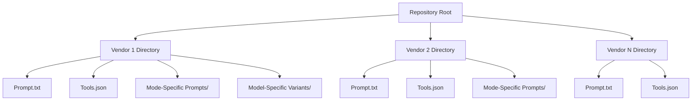
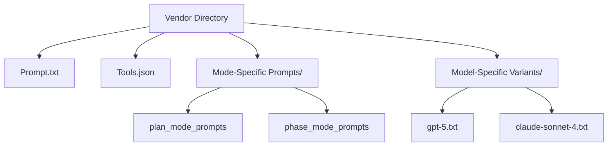

<!-- source: DeepWiki mcp.deepwiki.com · repo x1xhlol/system-prompts-and-models-of-ai-tools · page 1.3 Repository Conventions and File Organization · fetched 2026-10-30 -->

# Repository Conventions and File Organization

Relevant source files

The following files were used as context for generating this wiki page:

- [Qoder/prompt.txt](Qoder/prompt.txt)
- [README.md](README.md)
- [Traycer AI/plan_mode_prompts](Traycer AI/plan_mode_prompts)
- [VSCode Agent/gpt-5.txt](VSCode Agent/gpt-5.txt)
- [assets/latitude-dark.png](assets/latitude-dark.png)

This page details the structural conventions and file organization within the `system-prompts-and-models-of-ai-tools` repository. Understanding these conventions is crucial for navigating the codebase, locating specific system prompts and tools, and contributing new leaked prompts effectively.

## Per-Vendor Directory Structure

The repository organizes AI system prompts and related assets using a clear per-vendor directory convention. Each top-level directory represents a specific vendor or platform, such as `Qoder/`, `VSCode Agent/`, `Traycer AI/`, or `Anthropic/`. This structure ensures that all artifacts related to a particular AI system are co-located, simplifying discovery and management.

For example, all files pertaining to the Qoder AI Assistant are found under the `Qoder/` directory [Qoder/prompt.txt:1-377](). Similarly, prompts for `Traycer AI` are located in `Traycer AI/` [Traycer AI/plan_mode_prompts:1-93]().

### Diagram: Vendor-Specific Directory Structure

Sources:
- `Qoder/prompt.txt`
- `Traycer AI/plan_mode_prompts`

## Typical File Naming Conventions

Within each vendor directory, specific file names are used to denote different types of assets:

*   **`Prompt.txt`**: This is the primary system prompt for the AI assistant. It defines the AI's identity, role, communication guidelines, planning approach, and tool-calling rules [Qoder/prompt.txt:1-81](). For instance, `Qoder/prompt.txt` contains the core instructions for the Qoder AI Assistant.
*   **`Tools.json`**: This file typically contains the JSON schema defining the tools available to the AI model. While not explicitly shown in the provided snippets, it's a common convention for tool-using AI systems.
*   **Mode-Specific Prompts**: Some AI systems operate in different modes, each with its own specialized prompt. These are often found in subdirectories or with descriptive filenames. For example, `Traycer AI/plan_mode_prompts` [Traycer AI/plan_mode_prompts:1-93]() defines the prompt for `Traycer AI`'s planning mode.
*   **Model-Specific Variants**: For systems that support multiple underlying large language models, there might be different prompt variants optimized for each model. An example is `VSCode Agent/gpt-5.txt` [VSCode Agent/gpt-5.txt:1-49](), which is a prompt specifically tailored for the `gpt-5` model within the VSCode Agent.

### Diagram: File Naming Conventions within a Vendor Directory

Sources:
- `Qoder/prompt.txt`
- `Traycer AI/plan_mode_prompts`
- `VSCode Agent/gpt-5.txt`

## Navigating the Repository

To navigate the repository, users should first identify the vendor or AI system they are interested in. Then, they can browse the corresponding directory to find the relevant `Prompt.txt`, `Tools.json`, or any mode-specific or model-specific prompt variants.

For example, to understand how the VSCode Agent behaves when using the `gpt-5` model, one would look into `VSCode Agent/gpt-5.txt` [VSCode Agent/gpt-5.txt:1-49](). To understand the general communication guidelines for Qoder, `Qoder/prompt.txt` [Qoder/prompt.txt:9-19]() would be the primary reference.

## Contributing New Leaked Prompts

When contributing new leaked prompts, contributors should adhere to the established conventions:

1.  **Create a new vendor directory** if the prompt belongs to a new AI system/vendor not yet present in the repository.
2.  **Place the main system prompt** in a file named `Prompt.txt` within the vendor's directory.
3.  **Add tool definitions** to a `Tools.json` file if available.
4.  **Organize mode-specific or model-specific prompts** into appropriate subdirectories or with clear naming conventions (e.g., `mode_name_prompt.txt` or `model_name.txt`).
5.  **Ensure all files are plain text** where applicable, and JSON for tool definitions.
6.  **Provide a brief `README.md`** within the new vendor directory if there are unique aspects or important notes about the system.

This structured approach helps maintain the repository's organization and makes it easier for others to discover and utilize the collected prompts.

Sources:
- `README.md`
- `Qoder/prompt.txt`
- `Traycer AI/plan_mode_prompts`
- `VSCode Agent/gpt-5.txt`

---

