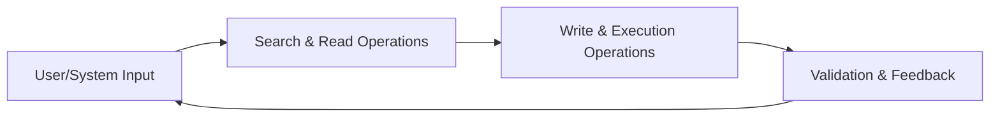
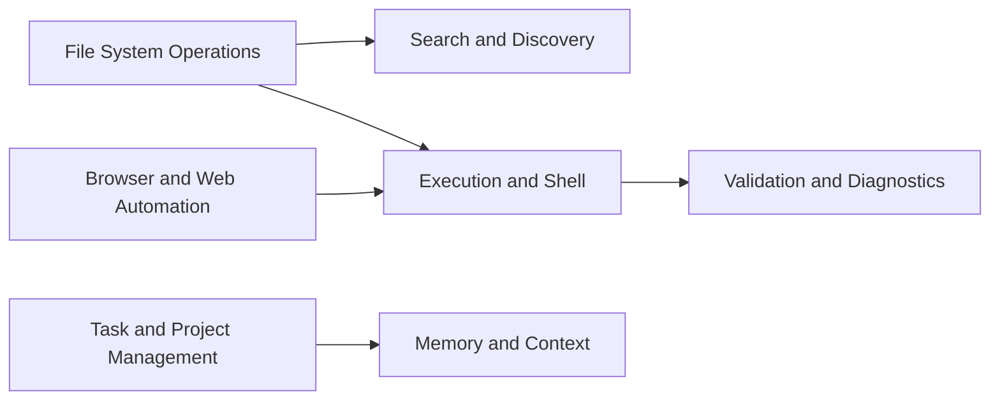
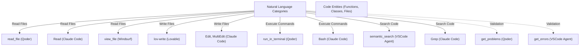
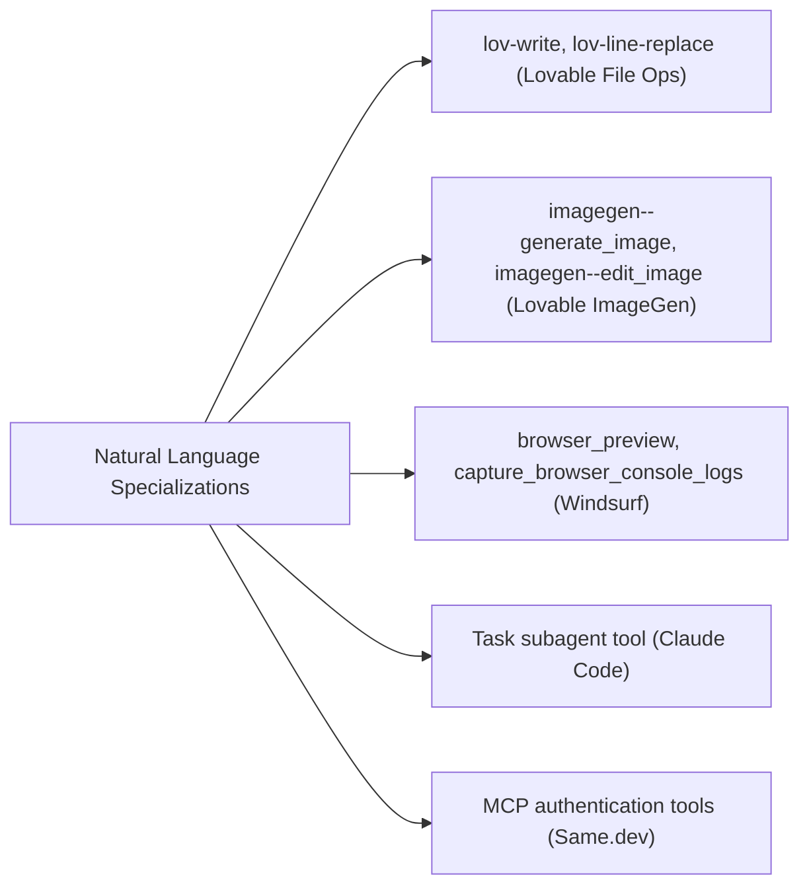

<!-- source: DeepWiki mcp.deepwiki.com · repo x1xhlol/system-prompts-and-models-of-ai-tools · page 10.1 Tool System Architecture Patterns · fetched 2026-10-30 -->

# Tool System Architecture Patterns

<details>
<summary>Relevant source files</summary>

The following files were used as context for generating this wiki page:

- [Anthropic/Claude Code/Tools.json](Anthropic/Claude Code/Tools.json)
- [Lovable/Agent Tools.json](Lovable/Agent Tools.json)
- [Windsurf/Tools Wave 11.txt](Windsurf/Tools Wave 11.txt)

</details>


This page (section 10.1) compares and contrasts the tool ecosystems implemented in prominent AI assistant systems documented in this repository. It covers the identification of a universal core tool set, patterns in tiered capability models, approaches to categorical tool organization, and specialized extensions for domains such as image generation, multi-cell programming (MCP), and browser automation.

The goal is to bridge the conceptual tool categories used by AI assistants with their concrete code entities and implementations, providing developers and researchers clear insights into architecture, data flow, and system design trade-offs.

---

## Universal Core: Common Tool Ecosystem Across AI Assistants

Despite the diversity of AI assistant systems in this repository, a universal core of tool types and functionalities consistently emerge. These core tools form the foundation necessary for general AI coding and software development assistance.

### Core Tool Categories

| Category                      | Typical Tools and Operations                          | Representative Functions/Classes                         |
|-------------------------------|----------------------------------------------------|---------------------------------------------------------|
| **Read Operations**            | Reading file content, directory listing, code viewing | `read_file` (Qoder), `Read` (Claude Code), `view_file` (Windsurf), `lov-view` (Lovable) |
| **Write Operations**           | File create, single-file edit, multi-edit batch ops | `edit_file` (Qoder), `Edit`, `MultiEdit` (Claude Code), `lov-write`, `lov-line-replace` (Lovable) |
| **Execution and Shell Commands** | Running terminal commands, async process handling | `run_in_terminal` (Qoder, VSCode), `Bash` (Claude Code), `run_command` (Windsurf) |
| **Search and Discovery**       | Semantic search, regex-based search, filename glob | `search_codebase` (Qoder), `Grep` (Claude Code), `lov-search-files` (Lovable), `codebase_search` (Windsurf) |
| **Validation**                 | Compile and lint error detection, formatting checks | `get_problems` (Qoder), `get_errors` (VSCode), implicit in some systems |

### Data Flow in Core Operations

The typical usage pattern involves:
1. **Input**: User or system specifies a target file, query, or command.
2. **Read/Search**: Assistant queries codebase or workspace using search or read tools.
3. **Process/Modify**: Based on retrieved context, write or execute tools modify code or run workflows.
4. **Validate**: Validation tools verify correctness or compliance before progressing.



This loop is foundational across multiple AI assistants like Qoder, Claude Code, Windsurf, and Lovable.

**Sources:** [Qoder/prompt.txt:292-339](), [Anthropic/Claude Code/Tools.json:1-83](), [Windsurf/Tools Wave 11.txt:1-100](), [Lovable/Agent Tools.json:1-61]()

---

## Tiered Capability Models: Progressive Tool Complexity

Systems employ tiered models stratifying tool capabilities from simple synchronous operations to advanced autonomous subagents.

| Tier                  | Characteristic Toolsets & Systems                              | Notable Code Elements                                  |
|-----------------------|---------------------------------------------------------------|-------------------------------------------------------|
| **Level 1 - Basic CRUD** | Simple file read/write, grep-like search, terminal exec       | `read_file`, `search_replace` (Qoder), `lov-write` (Lovable) |
| **Level 2 - Structured Edits and Batch** | Multi-region edits, semantic search, background execution | `MultiEdit` (Claude Code), `insert_edit_into_file` (VSCode Agent), `replace_file_content` (Windsurf) |
| **Level 3 - Autonomous Subagents** | Task subagents for complex or specialized tasks            | `Task` tool with `subagent_type` parameter (Claude Code), background agent processes (Qoder) |

### Example: Autonomous Subagent Model (Claude Code)

- The `Task` tool can launch specialized agents with scoped tool access, described in JSON schema with `subagent_type` parameter.
- Agents operate statelessly and concurrently, returning final results for user display.
  
```json
{
  "name": "Task",
  "description": "Launch a new agent to handle complex, multi-step tasks autonomously.",
  "input_schema": {
    "properties": {
      "subagent_type": {"type": "string"},
      "description": {"type": "string"},
      "prompt": {"type": "string"}
    },
    "required": ["subagent_type", "description", "prompt"]
  }
}
```

This promotes modular, parallel problem-solving workflows.

**Sources:** [Anthropic/Claude Code/Tools.json:4-30](), [Qoder/prompt.txt:62-80]()

---

## Tool Categorization Approaches: Organizational Strategies

Across systems, tool organization patterns reveal categorization principles shaping design and runtime behavior.

### Common Categories Observed

| Category             | Systems with Examples                                  | Key Roles & Classes/Functions                                 |
|----------------------|-------------------------------------------------------|---------------------------------------------------------------|
| **File System Operations** | Qoder (`read_file`, `edit_file`), Lovable (`lov-write`, `lov-line-replace`) | File read/write classes and JSON tool schemas                   |
| **Search and Discovery**   | VSCode Agent (`semantic_search`, `grep_search`), Claude Code (`Glob`, `Grep`) | Search tool implementations and regex query parameters          |
| **Execution & Shell**        | Windsurf (`run_command`), Claude Code (`Bash`), Qoder (`run_in_terminal`) | Async shell runners and command status checkers                  |
| **Validation & Diagnostics** | Qoder (`get_problems`), VSCode (`get_errors`)         | Validation loops integrating compiler/linter feedback           |
| **Memory & Context**         | Windsurf (`create_memory`), Qoder (`update_memory`)   | Persistent knowledge storage and retrieval submodules            |
| **Task & Project Management** | Claude Code (`TodoWrite`), Qoder (`add_tasks`, `update_tasks`) | Task agents and multi-step workflow orchestrators                |
| **Browser & Web Automation** | Windsurf (browser_preview, capture_browser_screenshot), Comet (tabs_create, read_page) | Browser interaction APIs providing DOM, console, and navigation |

### Logical Categorization in Code

These categories often appear reflected in folder structures and JSON schemas named per function (e.g., Lovable's `lov-` prefix tools for file ops, `imagegen--` prefix for image generation tools).



**Sources:** [Lovable/Agent Tools.json:1-61](), [Anthropic/Claude Code/Tools.json:1-83](), [Windsurf/Tools Wave 11.txt:350-382]()

---

## Specialized Tools and Categories

Beyond the universal core, several AI assistant systems incorporate highly specialized tools targeting distinct domains or capabilities.

| Specialization      | Examples of Systems & Tools                                | Implementation Notes                                    |
|---------------------|------------------------------------------------------------|--------------------------------------------------------|
| **Image Generation**  | Lovable's `imagegen--generate_image`, `imagegen--edit_image` tools | JSON schemas with specific API parameters for imagery  |
| **Multi-Cell Programming (MCP)** | Same.dev's MCP tooling, Lovable MCP authentication tooling | Authenticated external tool calls for multi-cell orchestration |
| **Browser Automation** | Windsurf's `browser_preview`, `capture_browser_console_logs`; Comet's `tabs_create`, `read_page` | Integrated browser tooling including DOM scraping, console capture, multi-tab workflows |
| **Secrets Management** | Lovable's `secrets--add_secret`, `secrets--update_secret` | Coordinated via prefixed tool namespaces with secure API binding |
| **Security Scanning** | Lovable's `security--scan_backend` | Integration with Supabase scanning and vulnerability checks |
| **Analytics and Stripe Integration** | Lovable's `analytics--read_project_analytics`, `stripe--*` tools | External service API wrappers encapsulated as tools |

### Tool Namespace Prefix Pattern

A notable architectural pattern is the naming prefix convention to logically namespace and isolate functional clusters:

| Prefix          | Functionality                      | System        |
|-----------------|----------------------------------|---------------|
| `lov-`          | Core file system and web tools   | Lovable       |
| `imagegen--`    | Image generation and editing     | Lovable       |
| `security--`    | Security and vulnerability scans | Lovable       |
| `secrets--`     | Secrets and credentials management| Lovable       |
| `supabase--`    | Supabase database integration    | Lovable       |
| `analytics--`   | Project analytics and metrics    | Lovable       |
| `KI-`           | Knowledge items management       | Antigravity   |
| `.agent/`       | Workflow and orchestration specs | Antigravity   |

This prefixing aids tool discovery, invocation clarity, and modular tool schema maintenance.

**Sources:** [Lovable/Agent Tools.json:1-61](), [Anthropic/Claude Code/Tools.json:57-82](), [Windsurf/Tools Wave 11.txt:1-100]()

---

## Bridging Natural Language Concepts to Code Entities: Sample Diagrams

### Diagram 1: Universal Core Tool Mapping



This diagram explicitly connects common natural language tool categories to the representative codebase functions or files implementing them.

---

### Diagram 2: Specialized Tool Clusters Mapping



This bridges specialized functional niches to their concrete tool implementations, clarifying architecture modularity.

---

## Summary

1. **Universal Core Tools** comprise read/write/search/execute/validate operations implemented consistently, essential for AI assistants.
2. **Tiered Capability Models** enable systems to layer from basic CRUD to complex autonomous subagents, expressed in JSON schemas and detailed prompt tool instructions.
3. **Categorization Patterns** cluster tools into functional groups mapped clearly in code namespaces and file structures.
4. **Specialized Tools** grow organically atop the core for image generation, browser automation, secrets/security management, and external integrations.
5. **Naming and Prefix Conventions** further clarify architectural boundaries, tool orchestration, and extensibility.

Understanding these architectural patterns aids in comparative system design, integration, and evolution.

---

## References and Sources

- Qoder Prompt and Tools: [Qoder/prompt.txt:292-339]()
- Claude Code Tools JSON: [Anthropic/Claude Code/Tools.json:1-83]()
- Windsurf Tools Wave 11: [Windsurf/Tools Wave 11.txt:1-100]()
- Lovable Agent Tools: [Lovable/Agent Tools.json:1-61]()
- VSCode Agent Prompt: [VSCode Agent/Prompt.txt:68-174]()

---

