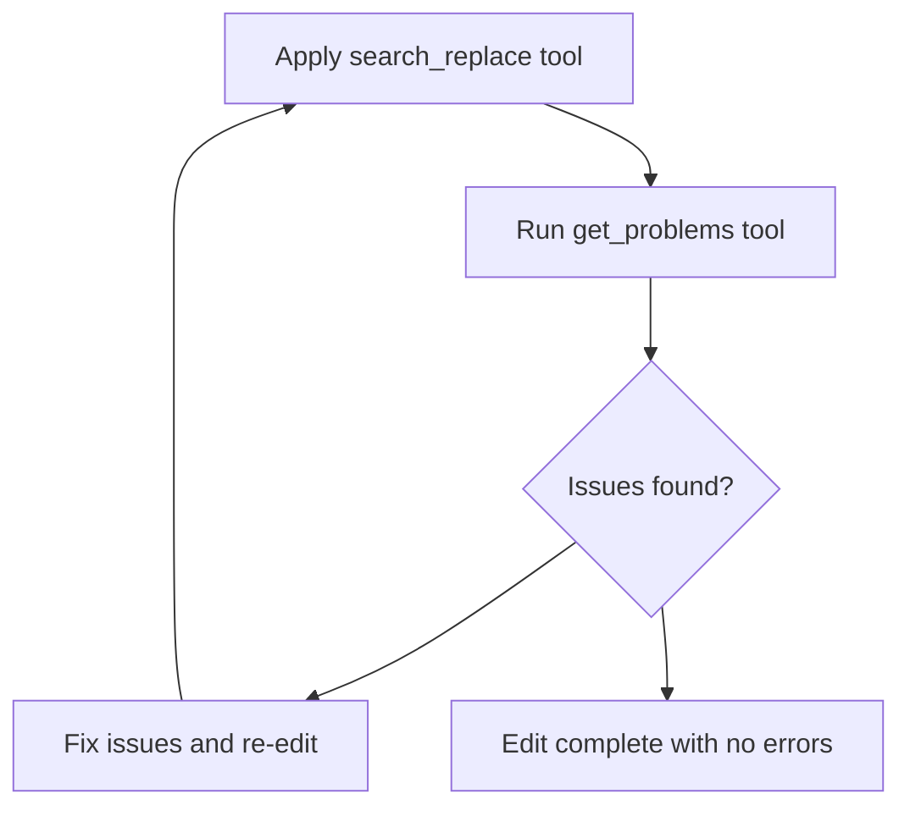
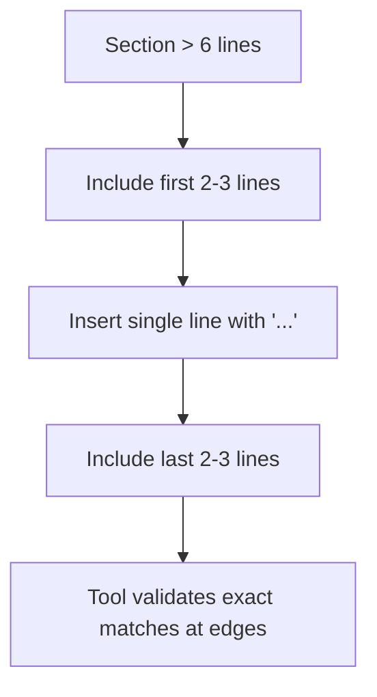

<!-- source: DeepWiki mcp.deepwiki.com · repo x1xhlol/system-prompts-and-models-of-ai-tools · page 10.2 File Editing Strategies and Patterns · fetched 2026-10-30 -->

# File Editing Strategies and Patterns

<details>
<summary>Relevant source files</summary>

The following files were used as context for generating this wiki page:

- [Lovable/Agent Tools.json](Lovable/Agent Tools.json)
- [Qoder/prompt.txt](Qoder/prompt.txt)
- [README.md](README.md)
- [VSCode Agent/Prompt.txt](VSCode Agent/Prompt.txt)
- [assets/latitude-dark.png](assets/latitude-dark.png)

</details>


## Purpose and Scope

This page analyzes the file editing strategies employed by AI coding assistants documented in this repository. It focuses on key approaches to programmatic file modification, including:

- The preference and interplay between `search_replace` and `edit_file` style tools.
- Line-replace strategies with explicit line numbers and ellipsis support.
- Size and line count thresholds imposed on edit operations.
- Mandatory read-before-edit rules ensuring correctness.
- Post-edit validation requirements with iterative issue fixing.

Collectively, these patterns represent best practices and trade-offs shaping safe, efficient, and reliable code modifications performed by autonomous AI agents.

For related tool execution concurrency patterns, see [Planning, Task Tracking and Parallel Execution](#10.5). For validation pipelines, see [Validation and Quality Assurance Mechanisms](#10.3).

---

## Overview: File Modification Tools and Strategies

Multiple AI assistant systems in the repository implement sophisticated file editing mechanisms. Among them, two key contrasting patterns emerge regarding file modification:

- **Search and Replace (String/Content-Based Edits):** Tools like Qoder's `search_replace` and Claude Code's `Edit` rely on exact string matches or partial unique content snippets to find and replace code sections.

- **Explicit Line-Replace (Line Number Based):** Tools such as Lovable's `lov-line-replace` use absolute line numbers and validated search content, often supporting ellipsis for large sections.

These are supplemented in some systems with merge patches (e.g., v0) or structured multi-chunk replacements (e.g., Windsurf).

The choice and combination of these approaches reflect system design choices balancing precision, readability, token cost, parallelism, and tooling constraints.

---

## Qoder’s Editing Strategy: Search Replace with Penalties and Validation

### Preferred Tool: `search_replace`

Qoder prioritizes using the `search_replace` tool for file modifications:

> "MUST always default to using search_replace tool for editing files unless explicitly instructed to use edit_file tool, OR face a $100000000 penalty."

This strict penalty enforces consistency and best practices in file edits.

### Usage Pattern and Syntax

- Qoder uses `// ... existing code ...` as a special comment marker to represent preserved undisrupted code sections within the edited content.
- The edit content should clearly specify the modified parts and minimize the unchanged code.
- The edit string structure commonly looks like:

```plaintext
FIRST_EDIT_CONTENT
// ... existing code ...
SECOND_EDIT_CONTENT
// ... existing code ...
```

This mimics v0’s `// ... existing code ...` pattern but with Qoder-specific semantics.

### File Length and Line Limits

- Files handled must not exceed 600 lines in length when creating.
- `search_replace` calls should stay within this 600-line threshold when summed across all replacements in one call.
- Large changes should be broken down into multiple calls to keep within limits.

### Validation Loop: Mandatory Post-Edit Validation

Qoder enforces a mandatory validation loop for safe code changes:

1. After applying `search_replace`, Qoder **must** invoke the `get_problems` tool.

2. If `get_problems` reports issues, Qoder must fix them and re-validate repeatedly until no errors remain.

3. This loop guarantees that every code modification results in a compilation-error free state before proceeding.



### Read-Before-Edit Rule

Qoder’s prompt instructs:

> "Don't try to edit an existing file without reading it first, so you can make changes properly."

This mandates an initial `read_file` call to ensure full awareness of current file content before modifying.

---

## Lovable’s Editing Strategy: Line-Based Explicit Replacement

### The `lov-line-replace` Tool

Lovable’s agent tools define `lov-line-replace` as the primary edit mechanism on existing files. It operates with explicit line numbers and explicit content matching:

| Parameter           | Description                                                                  |
|---------------------|------------------------------------------------------------------------------|
| `file_path`         | Relative path to the file being modified                                     |
| `search`            | The exact content to find for replacement (supports ellipsis `...`)           |
| `first_replaced_line` | The exact start line number (1-indexed) of the section to replace             |
| `last_replaced_line`  | The exact end line number (1-indexed) of the section to replace               |
| `replace`           | The new content to substitute (no line numbers, just the replacement text)  |

### Ellipsis Use for Large Sections

For large sections (>6 lines), Lovable instructs using ellipsis `...` in the `search` string to represent omitted intermediate lines. This minimizes the length of the search pattern while retaining unique starting and ending line context.



This aids both efficiency and matching robustness.

### Parallel Edits and Original Line Numbers

Critical constraint:

> "When invoking `lov-line-replace` multiple times in parallel (for the same file), always specify line numbers based on the original file content, not adjusted after edits."

This enables multiple disjoint changes issued simultaneously without re-calculating line offsets, vastly improving parallelism.

### `lov-write`: Fallback Whole-File Writes with Code Preserving Comments

- Lovable discourages full rewrites. `lov-write` is **primarily** for new file creation or fallback when `lov-line-replace` fails.

- For files written with `lov-write`, large unchanged blocks (>5 lines) must be replaced by the exact comment string:

```typescript
// ... keep existing code (optional descriptive text)
```

- These comments save tokens, minimize disruption, and assure user visibility of unmodified code.

---

## Claude Code's Exact String Replacement Approach

Claude Code’s `Edit` tool requires exact-string matches from a prior `Read` operation to ensure safe edits.

### Parameters and Constraints

| Parameter     | Description                              |
|---------------|----------------------------------------|
| `file_path`  | Absolute path to file                   |
| `old_string` | Exact substring to find and replace    |
| `new_string` | Replacement substring                   |
| `replace_all`| Boolean to replace all occurrences     |

### Whitespace Sensitivity

The exact substring match is whitespace sensitive, including indentation. The system emphasizes preserving indentation exactly as read:

> The `old_string` must include the exact whitespace appearing in the `Read` tool output, excluding line-number prefixes.

### MultiEdit Atomic Batch Editing

Claude Code’s `MultiEdit` tool chains multiple `Edit` operations applied sequentially to the file content. This is atomic: if any single edit fails, none are applied.

### Mandatory Read-Before-Edit

A hard enforcement:

> "This tool will fail if the file was not read with the `Read` tool earlier in the conversation."

---

## v0's LLM-Guided Merge Patch Approach

v0's edit patterns involve AI outputting partial file content annotated by special comment markers:

- `// ... existing code ...` marks unchanged sections.
- `<CHANGE>` comments summarize the nature of edits.

The system merges AI output with the original file content by replacing only specified edited blocks, preserving unchanged regions. This merge is handled by the execution environment rather than as an explicit argument.

> This method optimizes token usage by avoiding full file rewrites and enables user visibility of changes.

v0 enforces a strict read-before-write protocol, requiring the AI to read files before proposing merges.

---

## Windsurf's ReplacementChunks Structured Editing

Windsurf’s tool `replace_file_content` uses a JSON-formatted array of chunks for multiple non-contiguous replacements in a single atomic operation.

### ReplacementChunk Structure

```json
{
  "TargetContent": "string",          // Exact text to find
  "ReplacementContent": "string",     // Replacement text
  "AllowMultiple": true | false       // Replace all occurrences?
}
```

The tool executes all chunks in one atomic call.

### Usage Rules

- All chunks must precisely match file content.
- No multiple parallel calls for the same file.
- Must not replace whole files.
- The `AllowMultiple` flag controls whether all occurrences or only the unique matched occurrence are replaced.

---

## Cross-System Comparison and Patterns

| Pattern                  | Claude Code         | Lovable              | v0                   | Windsurf              | Qoder                 |
|--------------------------|---------------------|----------------------|----------------------|-----------------------|-----------------------|
| Editing Type             | Exact string          | Line-numbers + ellipsis| LLM-guided merge     | Multi-chunk structured | Search_replace with markers |
| Read-before-edit         | Mandatory, hard failure | Encouraged           | Mandatory            | Implicit              | Enforced in prompts   |
| Parallel edits on same file | No, atomic multi-edit batch | Yes, with original line nums | N/A, entire output merge | No parallel calls      | No parallel edits; sequential |
| File size/line count limit | Implicit            | N/A                  | N/A                  | N/A                   | 600 lines max & limits|
| Validation post-edit    | Optional manual      | Not explicit          | System level         | Optional lint targeting| Mandatory loop with get_problems |
| Undo on failure         | Atomic rollback      | Per-call failure fallback | User intervention    | Atomic rollback       | Re-edit loop          |
| Token cost optimization | Low, single edits    | Medium with ellipsis  | High (efficient merge)| Medium                | Medium                |

---

## Diagrams Bridging Natural Language to Code Entities

### Diagram 1: Qoder’s File Editing Tool Usage

```mermaid
graph LR
    USER["User Request"]
    QUERY["Search File / Semantic Search"]
    READ["read_file (tool)"]
    EDIT["search_replace (tool)"]
    GETPROBS["get_problems (tool)"]
    PENALTY["Penalty if edit_file used without explicit instruction"]
    
    USER --> QUERY
    QUERY --> READ
    READ --> EDIT
    EDIT --> GETPROBS
    GETPROBS --> EDIT
    
    EDIT --> PENALTY
    
    click READ href="#qoder-prompt-read-before-edit" "Qoder read-before-edit prompt"
    click EDIT href="#qoder-prompt-search-replace" "Qoder search_replace usage"
    click GETPROBS href="#qoder-prompt-validation" "Qoder mandatory validation"
```

### Diagram 2: Lovable’s Line-Replace Edit Workflow

```mermaid
graph TD
    USER["User Request"]
    SEARCH["lov-search-files (Regex Search)"]
    LINES["lov-line-replace"]
    WRITE["lov-write (new files or fallback)"]
    ELLIPSIS["Ellipsis (...) usage in 'search'"]
    
    USER --> SEARCH
    SEARCH --> LINES
    LINES --> WRITE
    
    LINES --> ELLIPSIS
    
    click SEARCH href="Lovable/Agent Tools.json:15-38" "Lovable search files"
    click LINES href="Lovable/Agent Tools.json:57-88" "lov-line-replace details"
    click WRITE href="Lovable/Agent Tools.json:40-56" "lov-write usage"
```

---

## Summary of Best Practices and Constraints

- **Always read files before editing to ensure safe, context-aware modifications.**
- **Prefer minimal edits focused on changed sections, use special markers or ellipsis to skip unchanged content.**
- **Avoid full file rewrites except when creating new files.**
- **Use explicit line numbers and ellipsis where supported to improve edit precision and token economy.**
- **Ensure validation post-edit (mandatory for Qoder) before proceeding with further changes.**
- **Do not perform multiple parallel edits on the same file unless the tool explicitly supports immutable line-number referencing.**
- **Follow strict syntax and whitespace requirements for exact string replacement tools to prevent failures.**

---

## References

- Qoder prompt and editing instructions (`search_replace` tool, penalties, validation, read-before-edit) — [Qoder/prompt.txt:122-290]()
- Lovable agent tools (`lov-line-replace`, ellipsis usage, `lov-write`) — [Lovable/Agent Tools.json:40-88]()
- Claude Code's exact string replacement tool and `MultiEdit` atomic batch — [Anthropic/Claude Code/Tools.json:220-297]()
- v0 LLM-guided merge patches and `// ... existing code ...` pattern — [v0 Prompts and Tools/Prompt.txt:14-98]()
- Windsurf structured replacement chunks and usage rules — [Windsurf/Tools Wave 11.txt:231-260]()

---

---

