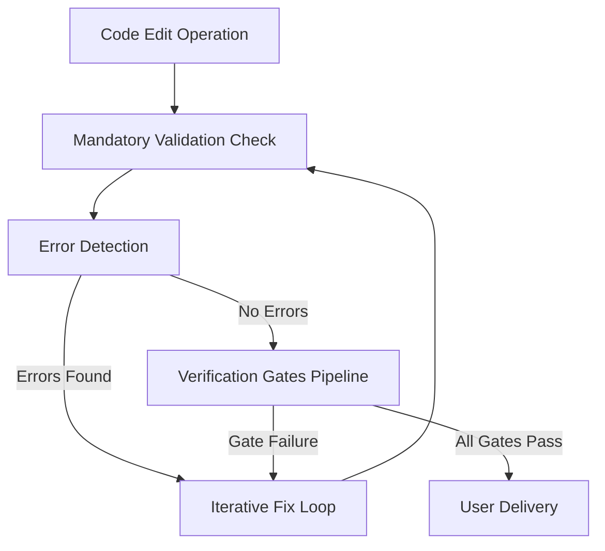
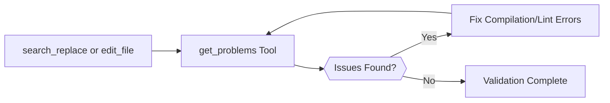
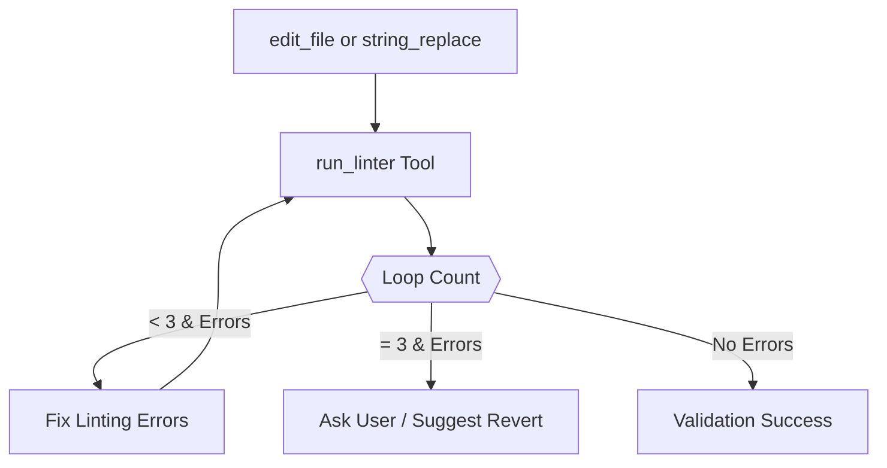
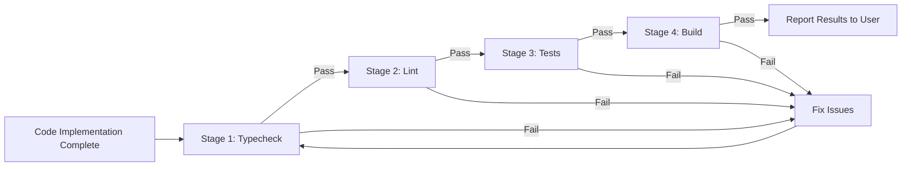
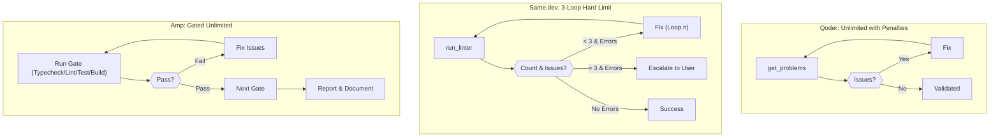
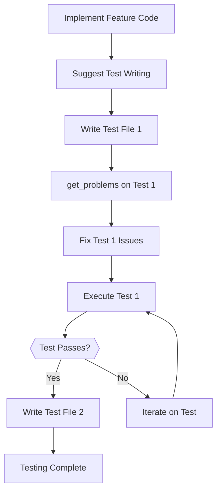
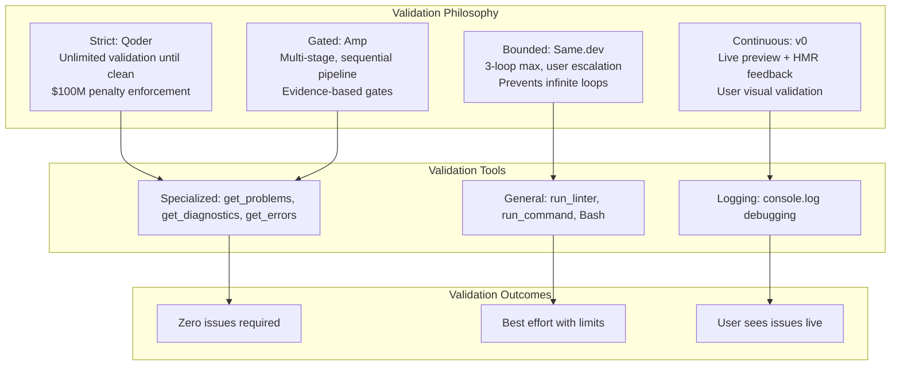
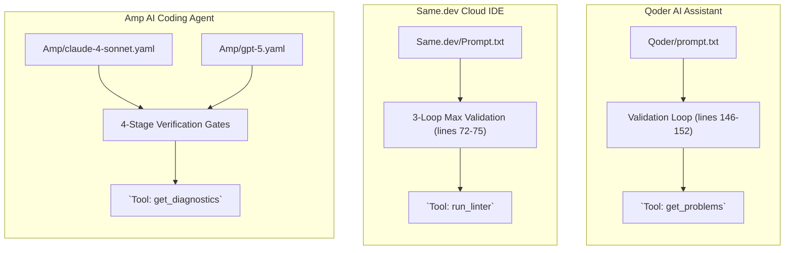

<!-- source: DeepWiki mcp.deepwiki.com · repo x1xhlol/system-prompts-and-models-of-ai-tools · page 10.3 Validation and Quality Assurance Mechanisms · fetched 2026-10-30 -->

# Validation and Quality Assurance Mechanisms

<details>
<summary>Relevant source files</summary>

The following files were used as context for generating this wiki page:

- [Amp/gpt-5.yaml](Amp/gpt-5.yaml)
- [Amp/view-thread-yaml.png](Amp/view-thread-yaml.png)
- [Qoder/prompt.txt](Qoder/prompt.txt)
- [README.md](README.md)
- [Same.dev/Prompt.txt](Same.dev/Prompt.txt)
- [assets/latitude-dark.png](assets/latitude-dark.png)

</details>


This page documents the validation and quality assurance mechanisms implemented across various AI coding assistant systems in the repository. It provides a detailed comparison of mandatory post-edit validation workflows, iteration control strategies, verification gate sequences, and error handling patterns that collectively ensure code correctness before delivery to users.

Validation is a critical quality gate bridging code generation and user output. It involves immediate detection and correction of errors following any code modification and may incorporate iterative loops and multi-stage verification pipelines as part of its architecture.

---

## Overview of Validation Architecture

Validation workflows in these AI assistants comprise three core components:

- **Immediate Post-Edit Validation:** Every code edit triggers an immediate error detection run.
- **Iterative Error Correction Loops:** Systems repeat fixing and validation until code is error-free or an iteration limit is reached.
- **Comprehensive Verification Pipelines:** Code must pass through multiple sequential quality gates before final user delivery.

The following diagram illustrates this generic validation architecture and data flow:



**Validation Workflow Architecture**

Sources: [Qoder/prompt.txt:146-152](), [Same.dev/Prompt.txt:72-75](), [Amp/claude-4-sonnet.yaml:50-57](), [v0 Prompts and Tools/Prompt.txt:302-360]()

---

## Mandatory Post-Edit Validation

### Qoder: `get_problems` Pipeline

Qoder enforces the strictest validation regime with an explicit **mandatory `get_problems` tool call after all code edits**, combined with a severe penalty structure for violations.

**Key Details:**

- **When:** After every code edit (search_replace or edit_file)
- **What:** Calls `get_problems` to retrieve compile or lint errors on modified files
- **Loop:** Repeats fix + validate cycles until zero errors remain
- **Enforcement:** $100 million penalty for skipping validation or wrong tool usage



This validation policy is explicit in the prompt text, requiring **no exceptions** regardless of code size or task complexity:

- *"MANDATORY FINAL STEP: After completing ALL code changes, no matter how small or seemingly straightforward, you MUST: Use get_problems to validate the modified code"*
- *"If any issues are found, fix them and validate again"*
- *"Continue until get_problems shows no issues"*

Sources: [Qoder/prompt.txt:146-152](), [Qoder/prompt.txt:198-210](), [Qoder/prompt.txt:263-265]()

---

### v0: Linter Validation with Real-Time Feedback

v0 uses **console logging combined with linter validation and live preview (hot module replacement, HMR).**

Key features:
- Uses `console.log("[v0] ...")` for detailed debug instrumentation.
- After edits, automatic linter validation runs.
- Preview environment provides immediate visual feedback to users.
- Deploy steps read configuration files such as `tools.json` before operations.
- Live preview effectively serves as continuous validation feedback loop.

This approach allows rapid detection of runtime and compilation errors during development via user interaction with UI.

Sources: [v0 Prompts and Tools/Prompt.txt:76-95](), [v0 Prompts and Tools/Prompt.txt:271-275]()

---

### Same.dev: `run_linter` with 3-Loop Iteration Limit

Same.dev adopts a **bounded validation iteration** approach to balance quality and practical resource use by enforcing:

- **Mandatory `run_linter` calls after significant edits**
- **Maximum of 3 validation-fix loops per file**
- After 3 failed attempts, it stops automatic retries and **asks the user for guidance or suggests rollback/revert.**



This is explicitly documented in the prompt:

> *"DO NOT loop more than 3 times on fixing linter errors on the same file. On the third time, you should stop and ask user what to do next. If user doesn't know, suggest them to revert or contact Same support."*

This prevents AI from entering infinite or futile correction cycles.

Sources: [Same.dev/Prompt.txt:72-75](), [Same.dev/Prompt.txt:236-239]()

---

## Verification Gate Sequences for Multi-Stage Validation

### Amp: Four-Stage Sequential Quality Gate Pipeline

Amp enforces a comprehensive multi-stage verification process for code correctness, passing code through these gates sequentially:

1. **Typecheck:** Static typing checks (TypeScript, Rust, Go, etc.)
2. **Lint:** Style and quality rule enforcement
3. **Tests:** Unit and integration test execution
4. **Build:** Final compilation and bundling verification



Additional requirements and notes:
- Calls the `get_diagnostics` tool after task completion.
- Searches `AGENTS.md` or codebase for relevant commands if unknown.
- Reports completion evidence with formatted counts (e.g., "148/148 tests passed").
- Editing must not suppress error messages or override type rules.

Quote from Amp prompt:

> *"After completing a task, you MUST run the get_diagnostics tool and any lint and typecheck commands (e.g., pnpm run build, pnpm run check, cargo check, go build, etc.) that were provided to you to ensure your code is correct."*

Sources: [Amp/claude-4-sonnet.yaml:50-57](), [Amp/gpt-5.yaml:333-343]()

---

### Windsurf: SafeToAutoRun Flag for Validation Commands

Windsurf integrates a **security-driven control flag named SafeToAutoRun**:

- Commands marked SafeToAutoRun are executed automatically without explicit user permission (typically safe validations like linting).
- Commands not flagged require user authorization (e.g., deployment or destructive operations).
- This mechanism helps secure validation commands and prevent unexpected side-effects.

Sources: [Same.dev/Prompt.txt:73]()

---

## Iteration Limit Strategies Across Systems

| System   | Iteration Limit       | Exit Strategy                       | Enforcement                   |
|----------|----------------------|-----------------------------------|------------------------------|
| **Qoder** | Unlimited (No limit)  | Continue until zero issues remain  | $100M penalty for non-compliance |
| **Same.dev** | Maximum 3 loops       | Ask user/suggest revert            | Hard stop after third loop    |
| **v0**    | Context dependent (continuous preview) | User visual feedback              | Real-time via preview UI      |
| **Amp**   | Unlimited per gate    | Sequential gate re-runs            | Must pass all gates           |



**Rationale for Approaches:**

- **Qoder:** Assumes validation tools are trustworthy and infinite iteration leads to correctness; economic penalties deter ignoring this.
- **Same.dev:** Recognizes stuck scenarios requiring human judgment; provides escape hatch to avoid wasted tokens.
- **Amp:** Segments validation concerns for precise fixes; comprehensive but potentially longer validation cycles.
- **v0:** Continuous feedback with real-time interactive user validation suited for web UI development.

Sources: [Qoder/prompt.txt:146-152](), [Same.dev/Prompt.txt:72-75,186-187](), [Amp/claude-4-sonnet.yaml:50-57,333-343]()

---

## Validation Tool Taxonomy

| System | Primary Validation Tool(s) | Capabilities                     | Scope           |
|--------|----------------------------|--------------------------------|-----------------|
| **Qoder** | `get_problems`             | Compile/Type errors, lint warnings, diagnostics | Modified files  |
| **v0**   | `console.log("[v0]")` + Linter | Runtime debug logging, live preview with HMR    | Preview environment |
| **Same.dev** | `run_linter`             | Style, syntax linting           | Project-wide    |
| **Amp**  | `get_diagnostics` + Build/Test commands | IDE diagnostics + build/test execution | Whole workspace |
| **Windsurf** | `run_command` (with SafeToAutoRun checks) | Command status and validation execution | User commands   |
| **VSCode Agent** | `get_errors`               | TypeScript/language server errors | Modified files  |
| **Claude Code** | `Bash` + validation commands | Shell command validation        | User-defined    |

### Tool Usage Patterns

- **Qoder:** Dedicated validation tool returns structured errors; enforces strict validation post-edit.
- **v0:** Leverages runtime logging and live preview for rapid feedback.
- **Same.dev:** Runs lint commands after edits; part of edit-lint-version cycle.
- **Amp:** Combines IDE diagnostics and explicit build/test commands from project metadata.
- **Windsurf:** Uses command execution with security-flagged auto-runs for validation tasks.

Sources: [Qoder/prompt.txt:316-318](), [v0 Prompts and Tools/Prompt.txt:76-95](), [Same.dev/Prompt.txt:72-75](), [Amp/claude-4-sonnet.yaml:50-57]()

---

## Testing Integration and Validation Strategies

### Qoder: Sequential Test File Validation with Iterative Fixing

Qoder emphasizes test-driven development with iterative validation of test files themselves:

Steps:
1. Implement feature code.
2. Suggest writing tests.
3. Write one test file at a time.
4. Validate test file compilation using `get_problems`.
5. Fix any issues, then run tests.
6. Iterate test execution until passing.
7. Proceed to next test file.



Sources: [Qoder/prompt.txt:82-97](), [Qoder/prompt.txt:209-211]()

---

### Amp: Tests as a Validation Gate

In Amp's pipeline, tests constitute the **third stage** within the verification gates:

- Queries project files or `AGENTS.md` for appropriate test command.
- Runs unit and integration tests.
- Reports test coverage and pass rates in user messages.
- Does not assume any specific test framework.
- Requires successful tests to proceed to build phase.

Sources: [Amp/claude-4-sonnet.yaml:65-68](), [Amp/claude-4-sonnet.yaml:333-343]()

---

### v0: Preview as Testing Surface

v0 relies heavily on continuous web preview with HMR:

- Live preview shows UI and runtime response instantly.
- `console.log("[v0]")` provides rich contextual debug information.
- User visually validates behavior on the fly.
- Hot Reload enables rapid iteration without explicit test commands.

This approach suits UI/UX heavy projects where visual correctness is paramount.

Sources: [v0 Prompts and Tools/Prompt.txt:271-275](), [v0 Prompts and Tools/Prompt.txt:76-95]()

---

## Error Handling and Fix Patterns

### Immediate Fix Pattern (Qoder, Amp)

- Validation errors trigger immediate fix attempts.
- Validation-fix loops run without preset limits (Qoder unlimited, Amp per gate).
- Relies on deterministic validation tooling to reach error-free state.

### Bounded Retry Pattern (Same.dev)

- Limits validation fix loops to 3 iterations.
- Upon limit exhaustion, asks user for next steps.
- Provides an explicit escape hatch by suggesting revert or contacting support.

### Real-Time Feedback Pattern (v0, Windsurf)

- Validation is integrated with live preview/development environment.
- Errors manifest as UI preview discrepancies or console logs.
- Encourages user participation for detection and fixing.

---

## Security Constraints in Validation

### SafeToAutoRun Authorization (Same.dev & Windsurf)

- Distinguishes commands safe for auto-execution from those needing explicit permission.
- Applies to validation tools to prevent unintended or harmful side-effects.

### Economic Penalty Enforcement (Qoder)

- $100M penalty for:
  - Not using specialized validation tools (e.g., `get_problems`)
  - Attempting entire file rewrites instead of search_replace
  - Unnecessary splitting of code modifications
- Serves as a strong incentive for validation compliance.

### Strict Prohibition of Error Suppression (Amp)

- Validation errors must never be hidden by `as any` or `// @ts-expect-error` without explicit user directive.
- Ensures all errors are surfaced and fixed during validation.

Sources: [Same.dev/Prompt.txt:73](), [Qoder/prompt.txt:236-243](), [Amp/claude-4-sonnet.yaml:445-447]()

---

## Comparative Analysis of Validation Strategies



| Dimension              | Qoder               | v0               | Same.dev                   | Amp                          |
|------------------------|---------------------|------------------|----------------------------|------------------------------|
| Validation Trigger     | Every edit          | Continuous (preview) | After significant edits    | After task completion         |
| Validation Tools      | Specialized tools     | Debug logging + linter | General lint tool         | Multi-tools & build commands  |
| Iteration Control     | Unlimited (no hard limit) | Continuous      | Max 3 loops with user ask  | Unlimited per gate            |
| Enforcement           | Monetary penalties    | Preview feedback  | Hard stop + user escalation | Must run all verification gates |
| Testing Strategy      | Sequential test file validation | Visual preview  | Part of edit-lint-version cycle | Stage 3 of 4-stage pipeline  |
| Error Suppression     | Prohibited             | Detected visually | Address or escalate        | Explicitly prohibited         |

**Trade-offs:**

- Qoder prioritizes absolute correctness with strict loops and penalties.
- Same.dev balances code quality with iteration bounds and user intervention.
- Amp offers rich, structured quality gates but slower end-to-end delivery.
- v0 prefers fast incremental feedback suited for UI/UX-heavy dev workflows.

Sources: Aggregated from all previously cited files.

---

## Implementation Recommendations

Based on the cross-system architectural patterns, recommended validation and quality assurance principles are:

1. **Make post-edit validation mandatory and integral**, not optional.
2. **Impose bounded iteration limits with an escape hatch** (e.g., 3-5 loops) to prevent infinite fix loops.
3. **Use specialized, structured validation tools** offering file-scoped error diagnostics.
4. **Implement multi-stage verification gates** separating type checking, linting, testing, and building validations.
5. **Report validation results comprehensively with counts and details** to the user.
6. **Prohibit error hiding techniques** unless explicitly requested by users.
7. **Discover and respect project-specific validation/build/test commands** automatically.
8. **Complement batch validation with real-time feedback mechanisms** (e.g., preview environments) when applicable.

These strategies jointly ensure robust, scalable, and user-transparent validation workflows in AI coding assistants.

---

# Natural Language to Code Entity Mapping Diagrams

Below diagrams connect system names, their core validation mechanisms, and key code entities (prompt files, tool names, and main functions/classes).



```mermaid
flowchart TB
    subgraph "Validation Tools Catalog"
        Q_getProblems[`get_problems (Qoder)`]
        S_runLinter[`run_linter (Same.dev)`]
        A_getDiagnostics[`get_diagnostics (Amp)`]
        V0_debugLog[`console.log("[v0]") (v0)`]
        W_runCommand[`run_command (Windsurf)`]
    end
    
    subgraph "System to Tools"
        Qoder --> Q_getProblems
        SameDev --> S_runLinter
        Amp --> A_getDiagnostics
        v0 --> V0_debugLog
        Windsurf --> W_runCommand
    end
```

---

Sources: [Qoder/prompt.txt:146-152,198-210,263-265](), [Same.dev/Prompt.txt:72-75,236-239](), [Amp/claude-4-sonnet.yaml:50-57,65-68,333-343,445-447](), [Amp/gpt-5.yaml:1-179](), [v0 Prompts and Tools/Prompt.txt:76-95,271-275]()

---

