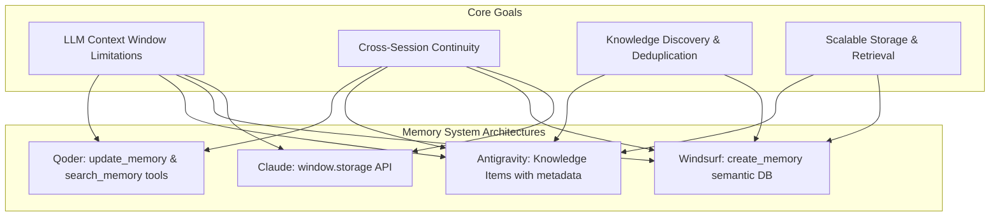
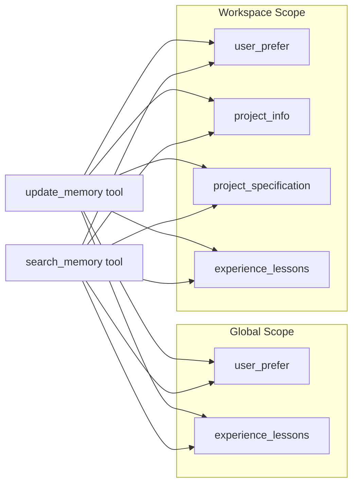
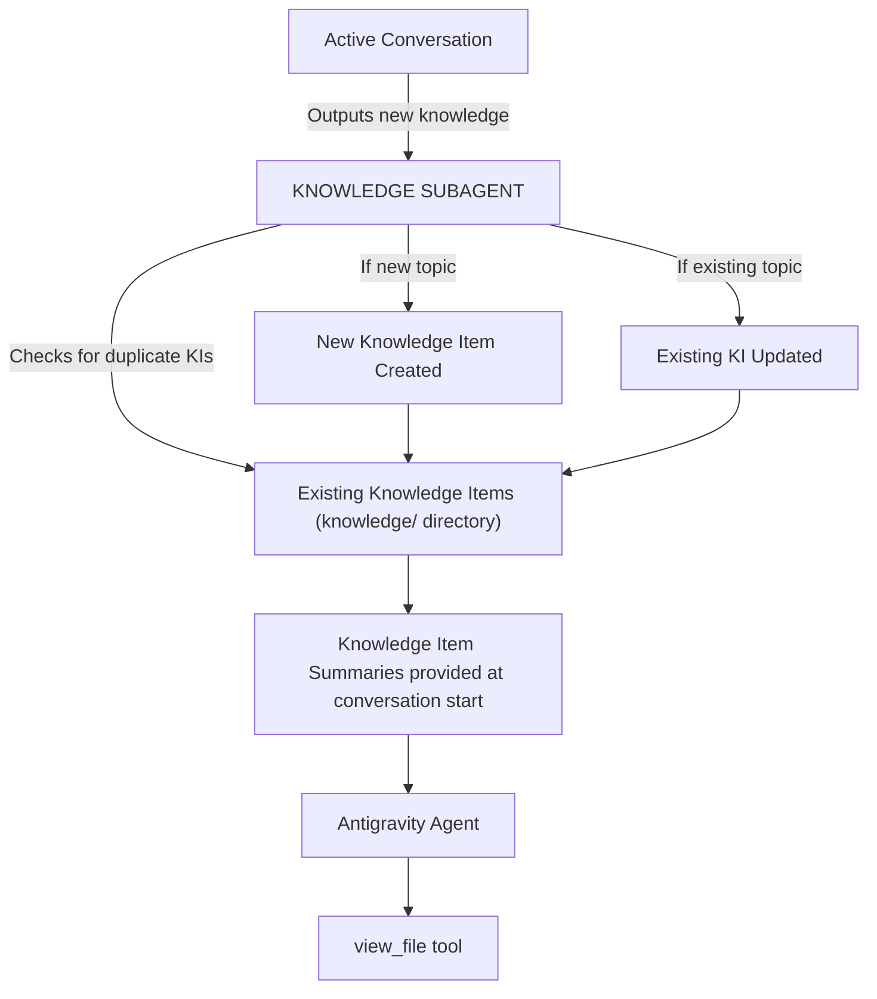
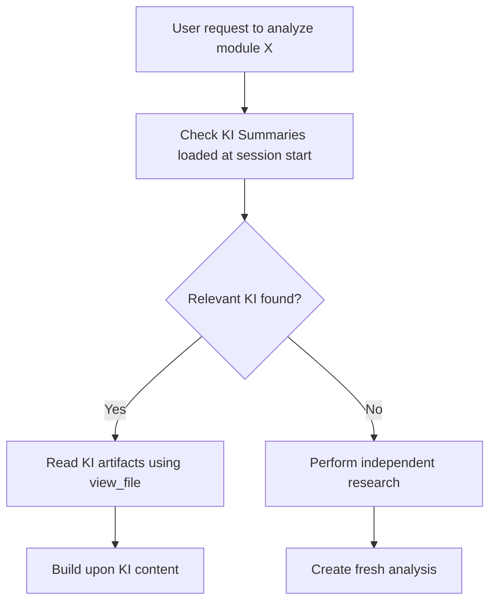
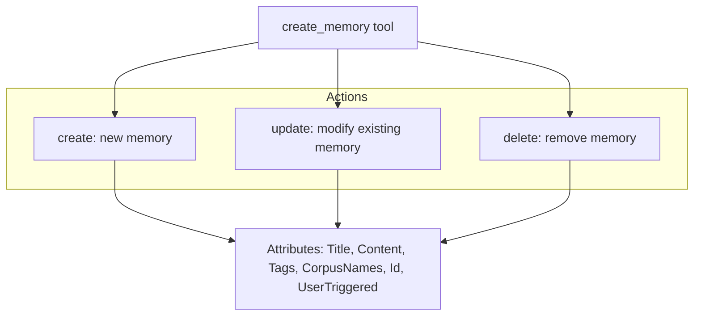
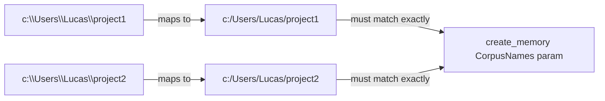
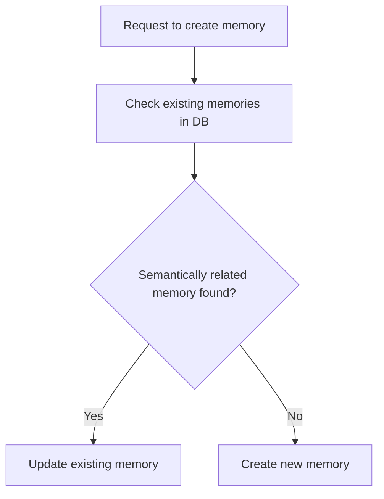
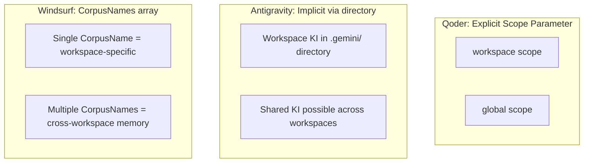
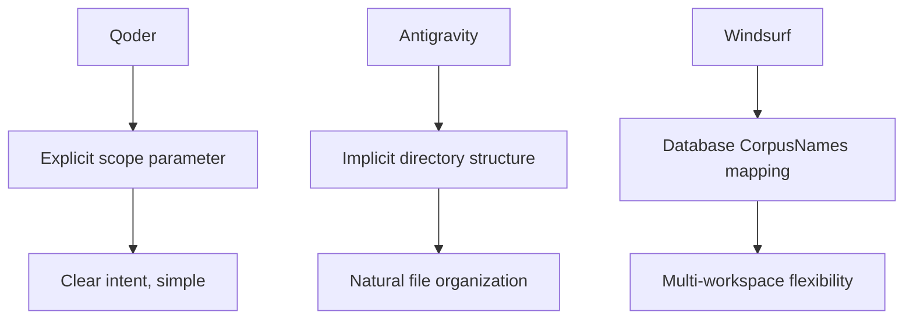
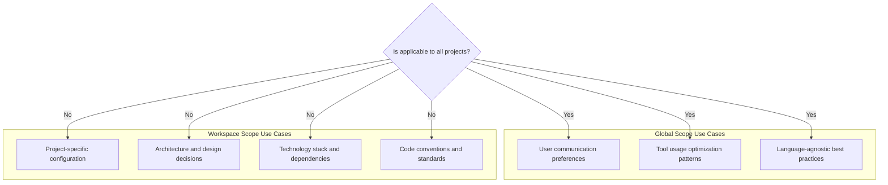

<!-- source: DeepWiki mcp.deepwiki.com · repo x1xhlol/system-prompts-and-models-of-ai-tools · page 10.4 Memory and Persistent Context Systems · fetched 2026-10-30 -->

# Memory and Persistent Context Systems

<details>
<summary>Relevant source files</summary>

The following files were used as context for generating this wiki page:

- [Anthropic/Claude Sonnet 5.txt](Anthropic/Claude Sonnet 5.txt)
- [Google/Antigravity/Fast Prompt.txt](Google/Antigravity/Fast Prompt.txt)
- [Qoder/prompt.txt](Qoder/prompt.txt)
- [README.md](README.md)
- [assets/latitude-dark.png](assets/latitude-dark.png)

</details>


This document analyzes the memory and persistent context architectures used by AI assistants in this repository to overcome the fundamental LLM context window limitations and maintain continuity across sessions. These systems enable assistants to store, retrieve, and build upon previous interactions, code patterns, and project-specific knowledge, enabling consistent and context-rich support for users.

This page covers in technical detail the memory architectures of four key systems:
- Qoder's four-category memory system
- Google's Antigravity Knowledge Items (KI)
- Windsurf's `create_memory` semantic memory API
- Anthropic Claude's window.storage mechanism (covered via Claude Sonnet 5 prompt context)

For broader related architectural patterns, see [OpenAI Codex CLI and Gemini CLI](#8.1) and [Warp.dev Terminal Agent](#8.3).

---

## Purpose and Architectural Overview

Managing memory and persistent context is vital because:

- Language models have strict context window sizes that limit history
- Users expect assistants to remember past discussions and project states
- Capturing lessons, preferences, and knowledge improves efficiency and user experience
- Avoiding redundant research saves computation and repetition

The primary memory/persistent context implementations in this repository can be summarized as:

| System        | Memory Architecture              | Scope Model                         | Storage Mechanism          | Deduplication Strategy                |
|---------------|--------------------------------|-----------------------------------|---------------------------|-------------------------------------|
| **Qoder**     | Four fixed categories with scope| Explicit `workspace` or `global`  | Tool-backed, ephemeral API | Manual search & update via tools     |
| **Antigravity** | Knowledge Items (KI) with metadata and artifacts | Implicit by workspace via `.gemini` directories | Filesystem with JSON metadata and markdown artifacts | Automated via KNOWLEDGE SUBAGENT agent |
| **Windsurf**  | Semantic memory with tags and corpus names | CorpusNames string array referencing workspaces | Database-driven, semantic | Agent-enforced semantic deduplication |
| **Claude**    | Persistent context via `window.storage` API (abstracted in prompt) | Not explicitly scoped             | Abstracted API storage      | Not fully documented in prompt       |



**Sources:** [Qoder/prompt.txt:152-175](), [Google/Antigravity/Fast Prompt.txt:99-301](), [Windsurf/Tools Wave 11.txt:57-86](), [Anthropic/Claude Sonnet 5.txt:1-43]()

---

## Qoder Memory System Architecture

Qoder's memory system is a **four-category memory design** with explicit scoping into workspace and global levels. This enables finely tuned memory usage across different projects and user preferences.

### Memory Categories

Qoder defines these four fixed memory categories used to organize persistent context:

| Category              | Description                                   | Typical Content                               | Scope Preference    |
|-----------------------|-----------------------------------------------|-----------------------------------------------|---------------------|
| `user_prefer`         | Personal info and communication style preferences | Language preferences, interaction style, user-defined options | Global or Workspace  |
| `project_info`        | Technical stack info and project environment details | Framework versions, build tools, environment variables | Workspace           |
| `project_specification` | Development standards and architectural decisions | Coding conventions, design patterns, architectural decisions | Workspace           |
| `experience_lessons`  | Pain points, error patterns, and productivity tips | Frequent errors, debugging lessons, tool usage optimizations | Global or Workspace  |

### Scope Model

Memory data can be in either:

- **Workspace Scope:** Linked to a specific project/workspace
- **Global Scope:** Applies to all projects and general user preferences



### Tools Interface

- `update_memory` supports creating, updating, and deleting memories, specifying category and scope.
- `search_memory` allows retrieval of memories by natural language queries filtered by category and scope.

### Usage Triggers for Memory Updates

Qoder instructs the agent to save persistent memory entries under these conditions:

1. When the USER explicitly requests
2. Upon discovery of common pain points or repeated errors
3. When project-specific configuration info is learned
4. When workflow improvements or best practices are identified
5. On recognizing recurring tool usage patterns or coding conventions

This promotes active learning and continuous memory growth.

**Sources:** [Qoder/prompt.txt:152-175]()

---

## Antigravity Knowledge Items (KI) System

Antigravity from Google implements a sophisticated **Knowledge Items (KI) system**, which uses a filesystem-based architecture to store curated knowledge with rich metadata and multiple artifacts per item.

### Directory Structure

```
C:\Users\Lucas\.gemini\antigravity\
├── knowledge/
│   ├── <ki-id>/
│   │   ├── metadata.json          # Contains summary, timestamps, source references
│   │   └── artifacts/              # Collection of associated documents and files
│   │       ├── architecture_overview.md
│   │       ├── implementation_patterns.md
│   │       └── ...
└── brain/
    └── <conversation-uuid>/
        ├── .system_generated/
        │   └── logs/
        │       ├── overview.txt
        │       └── task_*.txt
        └── artifacts/              # Generated artifacts from conversation
```

### Knowledge Item Lifecycle and Management

The Knowledge Items subsystem is managed by a dedicated **KNOWLEDGE SUBAGENT** responsible for detection, deduplication, and update operations:



### Mandatory KI Checking Protocol

Before performing any research or analysis, Antigravity enforces a **mandatory protocol** to check for existing relevant KIs:

1. At conversation start, KI summaries along with artifact paths are loaded into the agent context.
2. The agent MUST review KI titles and summaries to identify related knowledge.
3. Relevant KI artifacts are read via `view_file` before fresh research is performed.
4. The agent should build upon and enhance existing KIs, avoiding redundant work.



### Comparison: KI vs Conversation Logs

Antigravity distinctly separates:

| Mechanism           | Purpose                          | Usage Scenario                                  |
|---------------------|---------------------------------|-----------------------------------------------|
| **Knowledge Items**  | Curated, distilled knowledge for reuse | Before researching topics, when referencing technical concepts |
| **Conversation Logs**| Raw, chronological conversation records | When needing exact historical chat context or task logs |

### Storage and Retrieval

- KI stored on filesystem with a stable unique ID and metadata.json summarizing content.
- Artifacts provide rich supporting documentation tracked in the knowledge directory.
- Conversation logs stored by UUID with detailed logs and artifacts for full history.
- Agent uses `view_file` for granular artifact reading and semantic search tools for discovering conversation content if needed.

**Sources:** [Google/Antigravity/Fast Prompt.txt:99-301]()

---

## Windsurf Memory System Architecture

Windsurf employs a **semantic memory database** accessed via the `create_memory` tool, supporting creation, updates, and deletions with richly tagged memories associated with workspace corpus names.

### create_memory Tool Interface

The key external interface is:

```typescript
type create_memory = (_: {
  Action: "create" | "update" | "delete",
  Title: string,               // Descriptive title
  Content: string,             // Memory content
  Tags: string[],              // Tag filters in snake_case
  CorpusNames: string[],       // Array of workspace identifiers
  Id?: string,                // For update/delete actions
  UserTriggered: boolean       // Explicit user request flag
}) => any;
```

### Memory Lifecycle



### CorpusNames and Workspace Mapping

The `CorpusNames` parameter maps directly to workspace identifiers provided in the system prompt, requiring exact string matches.



### Semantic Deduplication

Before creating a new memory, the system requires semantically related memories be checked to prevent duplication. If a related memory exists, the agent updates it instead of creating a new one.



### Memory Categories in Windsurf

Six main overlapping categories tagged on memories:

1. User preferences (tool usage, communication)
2. Code snippets (patterns, utilities)
3. Technical stacks (frameworks, libraries)
4. Project structure (file/module organization)
5. Design patterns (architectural conventions)
6. Milestones (major releases/features)

These tags aid retrieval and organization.

**Sources:** [Windsurf/Tools Wave 11.txt:57-86]()

---

## Comparative Analysis of Memory Systems

### Storage Mechanism Comparison

| System      | Storage Mechanism          | Organization                 | Retrieval Method         |
|-------------|---------------------------|------------------------------|-------------------------|
| Qoder       | Ephemeral tool-based API  | Fixed 4 categories + scopes  | `search_memory` tool    |
| Antigravity | Filesystem with JSON metadata and markdown | KI directories with artifacts | `view_file` + semantic search |
| Windsurf    | Semantic database-backed  | Tags + CorpusNames array     | Semantic search (implicit)|
| Claude      | Abstract window.storage API | Not explicitly described    | Abstracted API access    |

### Scoping Models



### Deduplication Strategies

| System      | Deduplication Approach                     | Enforcement Level               |
|-------------|--------------------------------------------|--------------------------------|
| Qoder       | Manual via `search_memory` before updates | Soft/manual, agent responsibility |
| Antigravity | Automated by KNOWLEDGE SUBAGENT agent      | Enforced as mandatory workflow  |
| Windsurf    | Agent-enforced semantic similarity checks  | Hard requirement in `create_memory` calls |

### Memory Lifecycle Management

```mermaid
graph LR
    Qoder["Qoder Tools"]
    Antigravity["Antigravity Subagent"]
    Windsurf["Windsurf create_memory"]

    Qoder -->|Create/Update/Delete| update_memory
    Qoder -->|Retrieve| search_memory

    Antigravity -->|Create/Update| KNOWLEDGE SUBAGENT
    Antigravity -->|Read| view_file

    Windsurf -->|Create/Update/Delete| create_memory
    Windsurf -->|Read| semantic search via API
```

**Sources:** [Qoder/prompt.txt:152-175](), [Google/Antigravity/Fast Prompt.txt:99-301](), [Windsurf/Tools Wave 11.txt:57-86]()

---

## Implementation Patterns and Best Practices

### Pattern 1: Category-Based Organization

- **Qoder:** Four mutually exclusive, fixed categories with explicit scope semantics
- **Windsurf:** Six flexible, overlapping categories via item tags for filtering and retrieval

### Pattern 2: Artifact Storage

- **Antigravity:** Stores multiple related markdown/artifact files alongside metadata in each Knowledge Item directory enabling rich, version-controllable documentation.

Antigravity's artifact organization:

```
knowledge/<ki-id>/
├── metadata.json
└── artifacts/
    ├── architecture_overview.md
    ├── implementation_patterns.md
    ├── class_diagrams.md
    └── tests_guide.md
```

### Pattern 3: Workspace Association Models



### Pattern 4: Knowledge Discovery Workflow

Antigravity enforces mandatory discovery of existing Knowledge Items before research, which avoids duplicate effort. This contrasts with naïve agents that start fresh research ignoring existing KIs.

### Pattern 5: Memory Creation Triggers

Common triggers across systems:

- User explicit request ("Remember that I prefer TypeScript")
- Discovery of pain points in workflow or tool usage
- Learning project-specific configuration or standards
- Workflow improvements and optimizations
- Recognition of recurring patterns

**Sources:** [Qoder/prompt.txt:152-175](), [Google/Antigravity/Fast Prompt.txt:99-301](), [Windsurf/Tools Wave 11.txt:57-86]()

---

## Tool Interface Specifications

### Qoder Memory Tools

- `update_memory` tool:
  - Parameters: category (`user_prefer | project_info | project_specification | experience_lessons`), scope (`workspace | global`), content
  - Supports create, update, and delete operations

- `search_memory` tool:
  - Natural language or keyword queries
  - Returns relevant memories filtered by category and scope

### Antigravity Knowledge Discovery Tools

- `view_file` tool:
  - Reads Knowledge Item artifact files (e.g., `\knowledge\<ki-id>\artifacts\...`)
- `codebase_search`, `list_dir`, `grep_search`:
  - For broader discovery in conversation logs or other knowledge items when summaries insufficient

### Windsurf create_memory Tool

Defined type signature:

```typescript
type create_memory = (_: {
  Action: "create" | "update" | "delete",
  Content: string,
  CorpusNames: string[],
  Id?: string,
  Tags: string[],
  Title: string,
  UserTriggered: boolean,
  toolSummary?: string,
}) => any;
```

- `CorpusNames` must EXACTLY match workspace identifiers defined in system prompt.
- Deduplication check required prior to create.

**Sources:** [Qoder/prompt.txt:293-340](), [Google/Antigravity/Fast Prompt.txt:99-301](), [Windsurf/Tools Wave 11.txt:57-86]()

---

## Cross-System Memory Patterns

### Global vs Workspace Scope Usage



### Metadata-Driven Retrieval

All systems use metadata to improve retrieval relevance:

- **Qoder:** category, scope, plus query terms
- **Antigravity:** KI metadata.json summaries and artifact indexing
- **Windsurf:** tags and CorpusNames filtering combined with semantic similarity search

### Update vs Replace Behavior

| System      | Update Operation                           | Replace Operation                   |
|-------------|-------------------------------------------|-----------------------------------|
| Qoder       | `update_memory` with same category/scope | delete + create using `update_memory` |
| Antigravity | KNOWLEDGE SUBAGENT merges content         | Replace outdated KI via subagent  |
| Windsurf    | `create_memory` with Action=`update` and Id | Delete old, then create new with Action=`create` |

**Sources:** [Qoder/prompt.txt:152-175](), [Google/Antigravity/Fast Prompt.txt:99-301](), [Windsurf/Tools Wave 11.txt:57-86]()

---

## Design Tradeoffs and System Selection Criteria

### When to use Qoder's Memory System

**Strengths:**
- Simple fixed category design facilitates clear memory organization
- Explicit global and workspace scopes improve context targeting
- Direct tool-based update and search APIs simplify implementation

**Limitations:**
- Fixed category set limits flexibility for novel memory types
- No automatic deduplication or artifact storage
- Lacks rich metadata indexing

**Ideal for:** Projects requiring straightforward, scope-aware memory management with lightweight tool integration.

### When to use Antigravity's Knowledge Items

**Strengths:**
- Rich artifact-based knowledge capture supporting multiple related documents per topic
- Automated deduplication enforced by the KNOWLEDGE SUBAGENT
- Filesystem storage allows version control, easy browsing, and structured maintenance
- Mandatory KI checking workflow avoids redundant research
- Separation of curated knowledge (KIs) from raw conversation history improves clarity

**Limitations:**
- More complex storage and agent logic
- Requires dedicated subagent for KI management
- Manual agent involvement to check KI summaries at start

**Ideal for:** Complex, long-term projects requiring rich, versioned documentation and systematic knowledge reuse.

### When to use Windsurf Memory System

**Strengths:**
- Semantic deduplication requirement promotes data hygiene and relevance
- Flexible tagging system supports detailed categorization and retrieval
- Supports multiple workspaces via `CorpusNames` field enabling cross-project knowledge sharing
- Database-backed storage enables rich multimodal queries

**Limitations:**
- Strict exact matching for workspace CorpusNames requires careful management
- No explicit artifact attachment or grouping aside from tags
- Deduplication responsibility partially on the agent

**Ideal for:** Multi-project workflows needing cross-workspace knowledge sharing with semantic search and tagging flexibility.

---

**Sources:** [Qoder/prompt.txt:152-175](), [Google/Antigravity/Fast Prompt.txt:99-301](), [Windsurf/Tools Wave 11.txt:57-86](), [Anthropic/Claude Sonnet 5.txt:1-43]()

---

