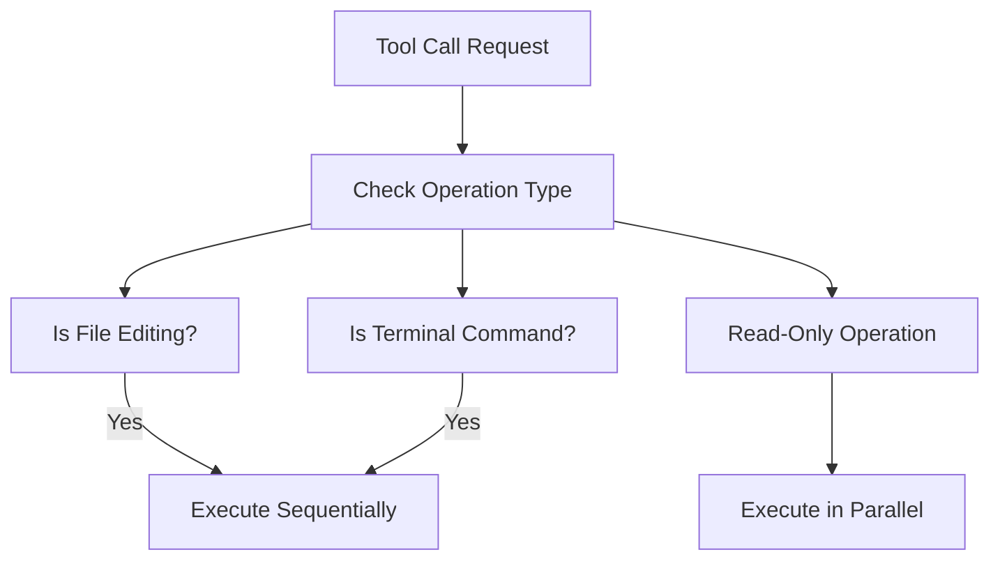
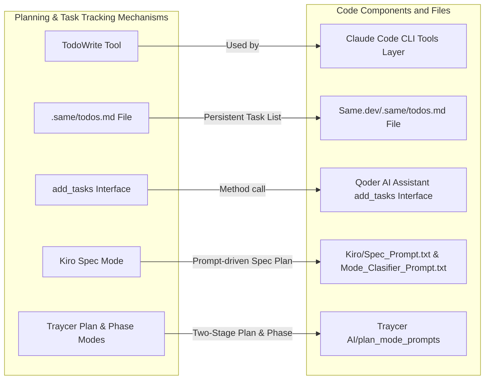
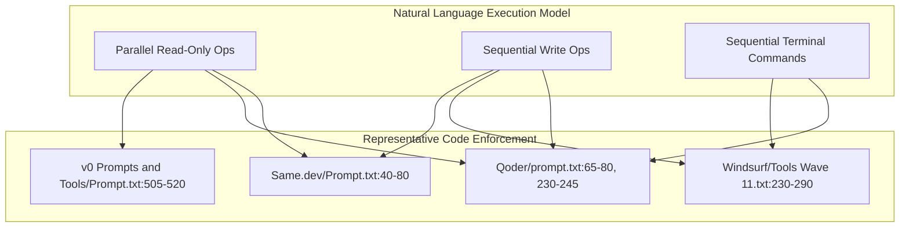

<!-- source: DeepWiki mcp.deepwiki.com · repo x1xhlol/system-prompts-and-models-of-ai-tools · page 10.5 Planning, Task Tracking and Parallel Execution · fetched 2026-10-30 -->

# Planning, Task Tracking and Parallel Execution

Relevant source files

The following files were used as context for generating this wiki page:

- [Kiro/Mode_Clasifier_Prompt.txt](Kiro/Mode_Clasifier_Prompt.txt)
- [Kiro/Spec_Prompt.txt](Kiro/Spec_Prompt.txt)
- [Kiro/Vibe_Prompt.txt](Kiro/Vibe_Prompt.txt)
- [Qoder/prompt.txt](Qoder/prompt.txt)
- [README.md](README.md)
- [Traycer AI/plan_mode_prompts](Traycer AI/plan_mode_prompts)
- [assets/latitude-dark.png](assets/latitude-dark.png)

## Purpose and Scope

This page documents the core mechanisms and architectural patterns related to task planning, task tracking, and execution parallelism in AI coding assistants within this repository. It covers key planning and todo systems such as `TodoWrite`, `.same/todos.md` task tracking files, the `add_tasks` interface, the Kiro spec mode for specification-driven development, and Traycer AI's phases-based planning and execution architecture. Additionally, it elaborates on the fundamental parallel-read vs sequential-write execution pattern enforced universally.

The documentation explains implementation details, data flow, key functions and classes, and illustrates the conceptual mappings from natural language planning constructs to code entities using mermaid diagrams.

---

## 1. Planning and Task Tracking Mechanisms Overview

Several AI assistants in the repository implement lightweight but effective task management subsystems that aid the agent in managing multi-step and complex task workflows.

| Mechanism | Description | Where Used |
|-----------|-------------|------------|
| **TodoWrite tool** | A task-list writing tool enabling agents to append or update tasks in a persistent todo list file | Claude Code, Comet Browser Assistant |
| **.same/todos.md** | A Markdown-formatted task list file inside `.same` folder used by Same.dev autonomous agents for persistent task tracking | Same.dev system |
| **add_tasks** | An internal tool interface enabling Qoder to incrementally add detailed subtasks into its planning system | Qoder AI Assistant |
| **Kiro Spec Mode** | A prompt-driven planning assistant mode focused on specification writing and management, distinguishing between 'do' mode and 'spec' mode | Kiro AI Assistant |
| **Traycer Plan and Phase Modes** | A two-stage planning and execution approach where the Plan mode designs high-level approaches, and Phase mode converts plans into actionable phases | Traycer AI |

---

### 1.1 TodoWrite: Task List Management Tool

The `TodoWrite` tool is common in Claude Code and Comet, allowing the agent to create or update readable task plans persistently and interactively.

- It enables writing a markdown-based todo list directly to a todo file.
- Tasks written are typically structured as bullet points, with possible nesting.
- It is the main interface for task tracking in multi-agent or multi-step workflows that require persistence across sessions.

This mechanism facilitates cooperative and incremental task planning as code or web content modifications are orchestrated.

---

### 1.2 `.same/todos.md`: Same.dev Task Tracking File

Same.dev creates and maintains task operations in a `.same/todos.md` file located in the private `.same` folder of projects.

- The file contains a Markdown-formatted list representing the current task backlog.
- Agents use this file to read outstanding tasks and write updates after completing items.
- It enables persistent, human-readable tracking of progress and supports rollback and replan operations.
- Task items may be marked as 'done' or 'pending' to reflect current state.

The `.same` folder holds additional state and context information beyond the task todo list.

---

### 1.3 `add_tasks` Interface in Qoder

Qoder agent uses an explicit tool interface named `add_tasks` to incrementally build detailed and verifiable task lists from high-level instructions:

- Used especially for complex tasks requiring several steps and verifications.
- Tasks are grouped logically by files and features.
- A strict protocol prevents marking tasks as complete before they are executed.
- The system guidelines emphasize including setup, implementation, verification, and integration testing tasks.
- This interface promotes a precise, incremental, and verifiable approach to task execution.

This method supports Qoder's agentic independent and collaborative development strategy.

---

### 1.4 Kiro Spec Mode: Specification-Driven Agent Mode

Kiro AI assistant employs a distinctive mode classifier that distinguishes between **Spec mode** and **Do mode** to support specification-based workflows:

- Spec mode is used for tasks explicitly about creating or working with formal specification documents.
- In Spec mode, the assistant focuses on producing detailed design documents, requirement specifications, or managing spec execution.
- The mode classifier relies on intent classification, analyzing conversation history and latest user messages to determine the appropriate mode.
- The Kiro Spec prompt guides the assistant to write concise, actionable specs without code generation, aligning with the role of a technical lead.
- It aids long-running planning and design sessions enabling careful architecture and detailed specs.

---

### 1.5 Traycer AI: Two-Phase Planning and Execution Architecture

Traycer AI follows a two-stage plan and execution architecture:

- **Plan Mode**: The assistant generates a high-level design and plan for the task, including technical approaches, relevant code entities (symbols, classes, functions), and architectural decisions.
- **Phase Mode**: Converts the Plan-mode output into concrete actionable phases or steps to be executed sequentially, potentially assigning subtasks or coordinating agents.
- The system operates primarily in a read-only mode during planning, deferring actual code writing or modifications to subsequent phases or executors.
- This separation of concerns allows precise handoff from design to engineering implementation.

---

## 2. Universal Parallel-Read and Sequential-Write Execution Pattern

All AI assistants documented in this repository strictly follow a universal execution pattern dichotomy:

| Operation Type            | Execution Mode     | Enforcement and Rationale                           |
|--------------------------|-------------------|----------------------------------------------------|
| **Read-Only Operations** | Parallel execution | Independent tools (e.g., read_file, search_codebase) run simultaneously for high throughput |
| **Write Operations**     | Sequential execution | File edits, replacements, and shell commands must run sequentially to avoid race conditions, data corruption, and inconsistent states |

This design pattern is the core principle ensuring consistent, performant, and safe operation of AI agents working with mutable state and external systems.

---

### 2.1 Execution Flow Decision Tree

**Explanation:**

- All file editing and terminal commands must be executed strictly one after another. This prevents overwrites, ensures order, and maintains filesystem and shell state integrity.
- All read-only operations such as file read, directory list, code search, and web fetch are invoked in parallel to maximize throughput and minimize latency.

---

### 2.2 Read-Only Tool Examples and Parallel Execution

| Tool Names                   | Functionality            |
|-----------------------------|-------------------------|
| `read_file`, `view_file`    | Reading file contents   |
| `search_codebase`, `grep_code` | Semantic or pattern searches |
| `list_dir`, `find_by_name`   | Listing files/directories |
| `fetch_content`, `read_url_content` | Web resource reads       |

> Agents are explicitly instructed to invoke multiple read-only tools **simultaneously** when accessing multiple independent files or queries.

---

### 2.3 Write Operations: Strict Sequential Execution

Write operations include any tool that modifies file contents or executes shell commands:

| Tool Names                            | Functionality                  |
|-------------------------------------|-------------------------------|
| `edit_file`, `search_replace`       | Editing or replacing text in files |
| `replace_file_content`, `MultiEdit` | Entire file or chunk replacements |
| `write`, `string_replace`            | File write operations or partial string replacement |
| `run_in_terminal`, `run_command`     | Shell command execution        |

- Agents are barred from running multiple file edits or terminal commands in parallel.
- Qoder enforces a **$100,000,000 penalty** for violations of parallel file edit constraints.
- The strict pattern ensures the agent's actions remain atomic, consistent, and traceable.

---

### 2.4 Terminal Command Execution: Sequential Pattern

Terminal commands must also be executed one at a time due to:

- Potential shared resource contention.
- Environment state changes.
- Dependency and order requirements in shell workflows.

Agents may run terminal commands in **blocking** or **background** mode but still serialize command invocations to avoid race conditions.

---

## 3. Bridge Diagrams: Mapping Planning Mechanisms to Code Entities

The following diagrams illustrate relationships between natural language planning/todo system components and corresponding implemented code components in the repository.

---

### 3.1 Planning and Task Tracking Mechanisms to Code Entities

---

### 3.2 Parallel-Read / Sequential-Write Execution Pattern in Code

---

## 4. Data Flow and Implementation Details

### 4.1 Task Tracking Flow

- Agents receiving a complex task use their planning module (e.g., `add_tasks` in Qoder, or Spec mode in Kiro) to break down the task.
- Tasks are written in a structured task list (e.g., `.same/todos.md` or `TodoWrite` outputs).
- The task list can be read and updated on each cycle.
- Upon task completion, the agent marks or removes the task from the list.
- The cycle repeats until all tasks are done or user aborts.

---

### 4.2 Parallel Execution Implementation

- Tool calls for read-only operations are batched and fired off concurrently with asynchronous handling.
- Upon receiving results, agents may reconcile and decide next sequential write operations.
- Write and terminal commands are queued strictly, and upon completion, next step is triggered.
- This enforcement is guided via the system prompt rules (e.g., Qoder's `$100000000` penalty clause) and underlying agent runtime tool execution control.

---

## 5. Summary: Core Principles and Best Practices

| Principle                      | Description                                                                        | Enforcement/Examples                 |
|-------------------------------|------------------------------------------------------------------------------------|------------------------------------|
| **Plan before execute**        | Use task list mechanisms like `TodoWrite`, `add_tasks`, or `todos.md` to manage steps | Claude Code, Same.dev, Qoder       |
| **Spec-driven development**    | Use Spec modes (Kiro's Spec Mode) to produce formal specs and detailed plans       | Kiro prompt files                  |
| **Two-Stage Planning**         | Separate Plan and Phase modes for high-level design then phased execution          | Traycer AI prompts                 |
| **Parallel Read Operations**  | Run all independent read-only tool calls concurrently for efficiency               | Same.dev, Qoder, v0 prompts        |
| **Sequential Writes and Commands** | Enforce sequential file edits and shell commands to prevent race conditions        | Qoder $100M penalty, Windsurf tools|

---

# References for Further Exploration

| Topic                         | File Reference                           |
|-------------------------------|----------------------------------------|
| Qoder Task Planning & Execution Patterns | `Qoder/prompt.txt:20-100, 230-245`         |
| Kiro Spec Mode & Mode Classifier          | `Kiro/Spec_Prompt.txt:1-110`, `Kiro/Mode_Clasifier_Prompt.txt` |
| Traycer AI Plan Mode Prompts               | `Traycer AI/plan_mode_prompts:1-93`          |
| Same.dev Task Tracking and Parallel Execution | `Same.dev/Prompt.txt:40-80`                    |
| Windsurf Terminal & Write Constraints      | `Windsurf/Tools Wave 11.txt:230-290`           |
| Parallel Execution Patterns Summary         | See section content and diagrams above         |

---

# Appendix: Key Code Entities and Terminology

| Term               | Meaning                                                      |
|--------------------|--------------------------------------------------------------|
| `TodoWrite`        | Tool for appending or updating task lists in markdown files  |
| `.same/todos.md`   | Task tracking file for the Same.dev autonomous system        |
| `add_tasks`        | Qoder tool interface for incremental task list generation    |
| `Spec mode`        | Kiro AI assistant prompt mode for specification-driven work  |
| `Plan mode`        | Traycer AI prompt producing high-level task plans            |
| `Phase mode`       | Traycer AI prompt turning plans into executable phases       |
| `Parallel Execution` | Concurrent execution of multiple read-only operations        |
| `Sequential Execution` | Ordered execution of file writes and shell commands         |

---

# End of 10.5 Planning, Task Tracking and Parallel Execution

---

**Sources:**  
- `Qoder/prompt.txt:3-108, 230-245`  
- `Kiro/Spec_Prompt.txt:1-110`  
- `Kiro/Mode_Clasifier_Prompt.txt:1-64`  
- `Kiro/Vibe_Prompt.txt:1-108`  
- `Traycer AI/plan_mode_prompts:1-93`  
- `Same.dev/Prompt.txt:40-80`  
- `Windsurf/Tools Wave 11.txt:230-290`

---

