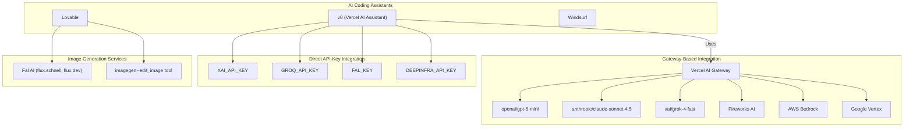
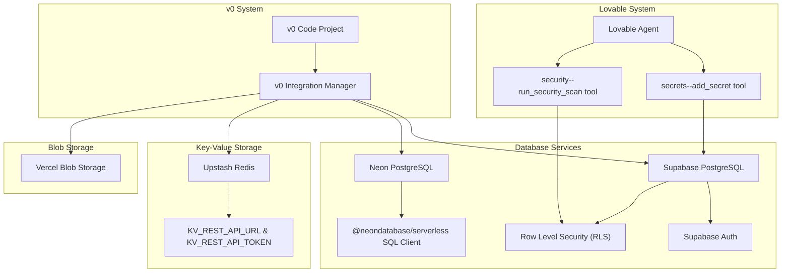
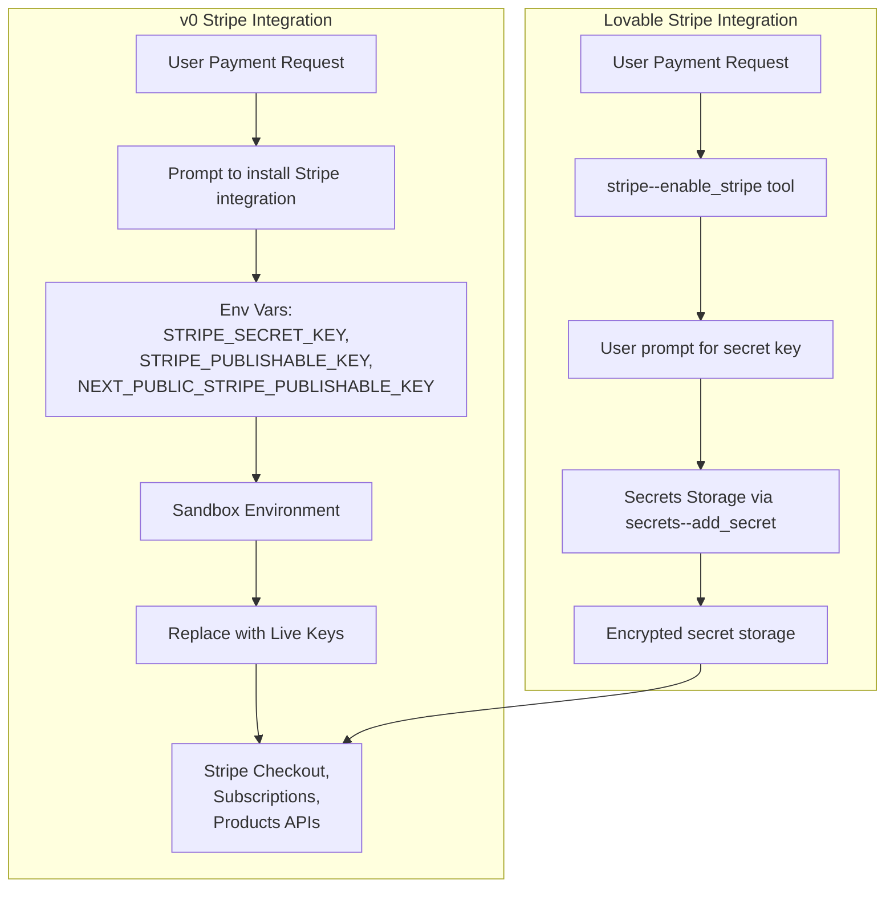
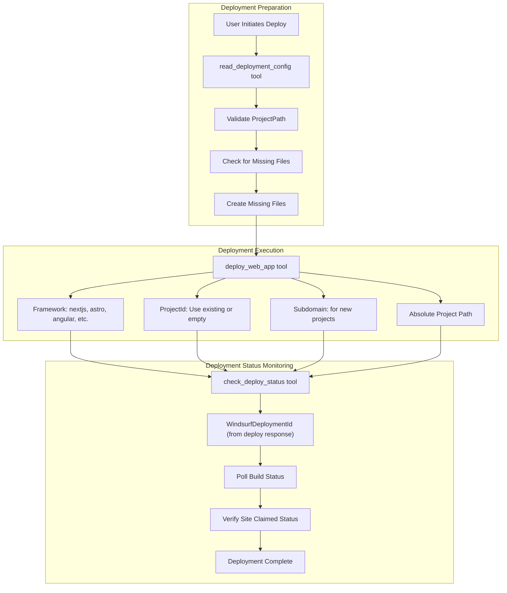
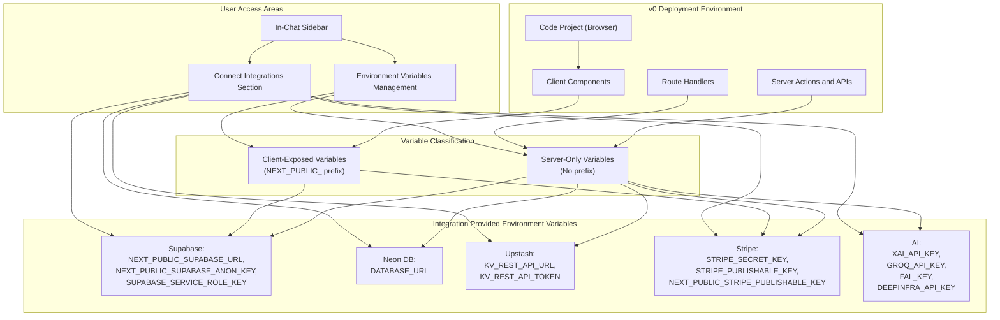
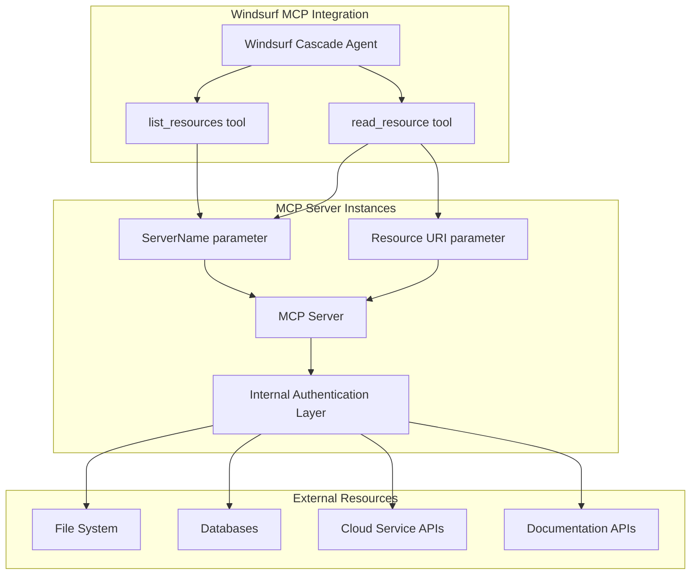
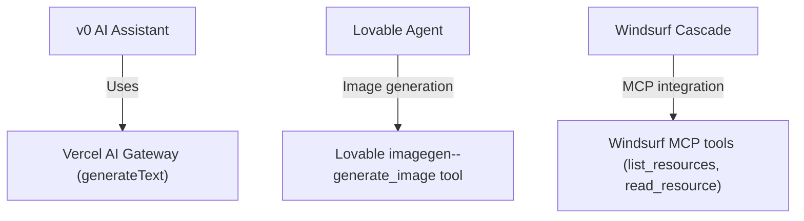
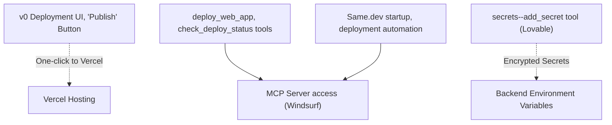

<!-- source: DeepWiki mcp.deepwiki.com · repo x1xhlol/system-prompts-and-models-of-ai-tools · page 10.7 Integration and Deployment Patterns · fetched 2026-10-30 -->

# Integration and Deployment Patterns

<details>
<summary>Relevant source files</summary>

The following files were used as context for generating this wiki page:

- [Leap.new/tools.json](Leap.new/tools.json)
- [Lovable/Agent Tools.json](Lovable/Agent Tools.json)
- [v0 Prompts and Tools/Prompt.txt](v0 Prompts and Tools/Prompt.txt)

</details>


## Purpose and Scope

This document analyzes how AI coding assistant systems integrate with external services and orchestrate deployment workflows. It covers AI model provider connections, storage backend integrations, payment system implementations, deployment pipeline architectures, environment variable management, and authentication patterns.

For tool system architectures, see [Tool System Architecture Patterns](#10.1). For security around integrations, see [Security Models and Safety Constraints](#10.6). For memory and context stored externally, see [Memory and Persistent Context Systems](#10.4).

**Sources:** [README.md:1-62](), [v0 Prompts and Tools/Prompt.txt:1-104](), [Lovable/Agent Tools.json:1-61](), [Leap.new/tools.json:1-202]()

---

## AI Model Provider Integration Architecture

AI coding assistants integrate with multiple model providers to leverage diverse capabilities and pricing plans. The systems typically use **gateway-based routing**, **direct API integration with environment keys**, or **provider-specific clients**.

### Model Provider Access Patterns Diagram



Key points:

- **Vercel AI Gateway** ([v0 Prompts and Tools/Prompt.txt:318-342]()) acts as a seamless model routing layer for OpenAI, Anthropic, xAI, Fireworks, AWS Bedrock, and Google Vertex AI, eliminating the need for API keys or provider SDKs by the agent.

- **Direct API-Key Integrations** require environment variables (e.g., `XAI_API_KEY`, `GROQ_API_KEY`) for providers not supported by the gateway. These are configured manually or via secrets management ([v0 Prompts and Tools/Prompt.txt:655-680]()).

- **Image Generation** in Lovable is handled by specialized tools like `imagegen--generate_image` with fine-grained model and dimension control ([Lovable/Agent Tools.json:299-351]()).

**Sources:** [v0 Prompts and Tools/Prompt.txt:318-342](), [v0 Prompts and Tools/Prompt.txt:655-680](), [Lovable/Agent Tools.json:299-351]()

---

## Storage and Database Integration Patterns

AI systems commonly rely on managed databases, key-value stores, and blob storage. Integration patterns emphasize security, connection reuse, and automatic environment variable provisioning.

### Storage Integration Overview Diagram



### Supabase Integration (v0)

- Client Instantiation Rules ([v0 Prompts and Tools/Prompt.txt:588-592]()):

  - Client-side code must use `createBrowserClient` from `@supabase/ssr`.
  - Server-side code uses `createServerClient` for session handling and token refresh.
  - Singleton pattern is required to avoid multiple client instances and stale connections.
  - No setup instructions should direct users to visit Supabase dashboard.

- Authentication Best Practices ([v0 Prompts and Tools/Prompt.txt:599-632]()):

  - Email/password authentication encouraged by default.
  - Redirect URLs for email confirmation should be provided with environment fallback.
  - Avoid client-side useEffect for auth checks; handle in server components.
  - Enforce Row Level Security (RLS) for all data access.

### Lovable Supabase Security Scanning

Lovable provides backend scanning tools to identify unprotected data and assist with RLS policies ([Lovable/Agent Tools.json:407-434]()):

| Tool | Description                       |
|-------|--------------------------------|
| `security--run_security_scan` | Runs full security audit of backend |
| `security--get_security_scan_results` | Fetches scan results, optionally forcing rerun |
| `security--get_table_schema` | Analyze database table schemas |
| `supabase--docs-search` | Search Supabase docs for RLS and auth info |
| `supabase--docs-get` | Retrieve full documentation pages |

### Neon PostgreSQL Integration (v0)

- Use exclusively `@neondatabase/serverless` package ([v0 Prompts and Tools/Prompt.txt:644-648]()).
- Instantiate SQL client using connection string from `DATABASE_URL` env variable.
- Execute queries with tagged template literals.
- Do not use `@vercel/postgres` package or Vercel default Postgres integrations.

### Upstash Redis Integration (v0)

- Requires two environment variables configured: `KV_REST_API_URL` and `KV_REST_API_TOKEN` ([v0 Prompts and Tools/Prompt.txt:650-653]()).
- Automatically integrated by v0 when Upstash Redis is added as service.

**Sources:** [v0 Prompts and Tools/Prompt.txt:547-653](), [Lovable/Agent Tools.json:230-285](), [Lovable/Agent Tools.json:407-434]()

---

## Payment System Integration

Stripe is the primary payment processor integrated within v0 and Lovable with distinct workflows for setup and secret management.

### Stripe Integration Workflow Diagram



**v0 Stripe Integration** ([v0 Prompts and Tools/Prompt.txt:577-587](), [v0 Prompts and Tools/Prompt.txt:682-687]()):

- Mandatory prompt to install Stripe integration prior to building payment UI.
- Environment variables automatically configured for secret and publishable keys at server/client runtime.
- Provides sandbox environment for initial testing; live keys replace sandbox keys for production.

**Lovable Stripe Integration** ([Lovable/Agent Tools.json:399-406](), [Lovable/Agent Tools.json:230-241]()):

- Agent calls `stripe--enable_stripe` tool to trigger Stripe setup.
- Secure UI prompt collects secret key; never ask users directly in chat.
- Keys stored encrypted via `secrets--add_secret` tool.
- Secret keys available transparently as environment variables in backend code.

**Critical Security Constraint**: Secrets must only be collected using the `secrets--add_secret` tool interface.

**Sources:** [v0 Prompts and Tools/Prompt.txt:577-587](), [v0 Prompts and Tools/Prompt.txt:682-687](), [Lovable/Agent Tools.json:230-241](), [Lovable/Agent Tools.json:399-406]()

---

## Deployment Pipeline Architectures

Deployment varies across systems with distinct orchestrations for preparing, executing, and monitoring web app deployments.

### Windsurf Deployment Pipeline Diagram



**Deployment Steps** ([Windsurf/Tools Wave 11.txt:88-100](), [Windsurf/Tools Wave 11.txt:27-33](), [Windsurf/Tools Wave 11.txt:195-201]()):

1. **Configuration Validation**: `read_deployment_config` reads and verifies project state, returns missing required files.

2. **Missing File Fixes**: All missing files MUST be created before proceeding.

3. **Deployment Execution**: `deploy_web_app` deploys the project specifying framework, project ID (existing or empty for new), subdomain (only for new sites), and absolute project path.

4. **Status Monitoring**: `check_deploy_status` polls the build and verifies if the site is claimed; only run after deployment. Uses the `WindsurfDeploymentId` returned from deploy.

**Supported Frameworks** include nextjs, astro, angular, hugo, sveltekit, jekyll, among others (17 total).

**Constraints**:

- No local build required; source files alone suffice.
- Re-deployments must use the same ProjectId.
- Subdomain used only for new site deployments.

### v0 Vercel Deployment

In v0 ([v0 Prompts and Tools/Prompt.txt:847-873]()):

- One-click deployment to Vercel via in-UI "Publish" button.
- Handles environment variable setup and build configuration automatically.
- Supports optional GitHub repo connection from project Settings sidebar.
- Alternative distribution via ZIP download or CLI tools.
- No manual deployment tool invocation required, enabling zero config experience.

### Same.dev Deployment Flow

Same.dev automates project startup, dependency installation, and deployment sequencing ([Same.dev/Prompt.txt:168-178](), high-level diagrams):

- Uses a `startup` tool to prepare projects.
- Automatically executes deployment upon successful builds.
- Maintains versioning with sequential production releases.
- Suggests next tasks including deployment steps using `suggestions` tool.

**Sources:** [Windsurf/Tools Wave 11.txt:27-33](), [v0 Prompts and Tools/Prompt.txt:847-873]()

---

## Environment Variable Management Strategies

Effective environment variable management enforces strict access control scopes, separates secrets from client-safe data, and leverages integration-managed provisioning.

### Variable Scoping Diagram in v0



**Key Details** ([v0 Prompts and Tools/Prompt.txt:446-460]()):

- Environment variables use only Vercel runtime environment; no support for `.env` files.
- Server components and APIs have access to all environment variables.
- Client-side code can only access variables prefixed with `NEXT_PUBLIC_`.
- Dependency versions are strictly controlled by v0 to avoid conflicts.
- Integration environment variables are provisioned automatically upon connecting a service.

**Integration Variable Examples** ([v0 Prompts and Tools/Prompt.txt:531-543]()):

```plaintext
SUPABASE_SERVICE_ROLE_KEY=eyJ...

NEXT_PUBLIC_SUPABASE_URL=https://xyz.supabase.co
NEXT_PUBLIC_SUPABASE_ANON_KEY=eyJ...

DATABASE_URL=postgresql://...

KV_REST_API_URL=https://...
KV_REST_API_TOKEN=...

STRIPE_SECRET_KEY=sk_test_...
NEXT_PUBLIC_STRIPE_PUBLISHABLE_KEY=pk_test_...

XAI_API_KEY=xai-...
GROQ_API_KEY=gsk_...
FAL_KEY=...
DEEPINFRA_API_KEY=...
```

### Lovable Encrypted Secrets Management

Lovable uses a dedicated encrypted secrets mechanism:

- Tools: `secrets--add_secret` and `secrets--update_secret` ([Lovable/Agent Tools.json:230-255]()).
- Secrets can only be collected through secure UI prompts triggered by tool calls; agents must never request secrets via chat text.
- Secrets are automatically exposed as environment variables for backend code.
- This pattern avoids direct exposure of sensitive keys and ensures auditability.

**Usage example**:

```json
{
  "tool": "secrets--add_secret",
  "parameters": {
    "secret_name": "STRIPE_API_KEY"
  }
}
```

Triggers UI prompt and stores the encrypted secret.

**Sources:** [v0 Prompts and Tools/Prompt.txt:446-460](), [v0 Prompts and Tools/Prompt.txt:531-543](), [Lovable/Agent Tools.json:230-255]()

---

## External Service Authentication Patterns

External service access involves secure authentication mediated by environment variables or specialized MCP server authentication.

### MCP Server Authentication Workflow



- **list_resources tool** lists accessible resources from a configured MCP server ([Windsurf/Tools Wave 11.txt:171-177]()).
- **read_resource tool** fetches a specific resource by URI ([Windsurf/Tools Wave 11.txt:203-211]()).
- MCP handles secure authentication internally; credentials configured during server setup.
- Authentication failures reported via tool response; no explicit key passing on each call.

### Lovable Supabase Documentation Access Tools

Lovable provides tools for accessing Supabase documentation with search and document retrieval interfaces ([Lovable/Agent Tools.json:256-285]()):

| Tool               | Description                          | Parameters                                            |
|--------------------|----------------------------------|-----------------------------------------------------|
| `supabase--docs-search` | Searches docs indexed by query    | `query` (string), `max_results` (optional, default 5) |
| `supabase--docs-get`    | Retrieves full doc page by slug | `slug` (string)                                       |

Usage pattern:
1. Query relevant policies or features with `supabase--docs-search`.
2. Extract slug from results.
3. Fetch detailed markdown content with `supabase--docs-get`.

### Web Search and Content Fetching

- Same.dev’s `task_agent` delegates complex authentication and multi-step service calls ([Same.dev system overview]()).

- Lovable’s `websearch--web_search` supports category filters and domain-specific queries; `lov-fetch-website` saves website content in multiple formats ([Lovable/Agent Tools.json:109-126](), [Lovable/Agent Tools.json:352-380]()).

**Sources:** [Windsurf/Tools Wave 11.txt:171-211](), [Lovable/Agent Tools.json:109-126](), [Lovable/Agent Tools.json:256-285](), [Lovable/Agent Tools.json:352-380]()

---

## Integration Configuration Comparison Matrix

| Integration Aspect      | v0 (Vercel)                  | Lovable                        | Windsurf                   |
|------------------------|------------------------------|------------------------------|----------------------------|
| **AI Model Providers**  | Gateway (no API key): OpenAI, Anthropic, xAI, Fireworks, Bedrock, Vertex | Fal AI (imagegen), Image editing | No gateway; direct with MCP support |
|                        | Direct API keys: XAI, Groq, Fal, DeepInfra |                            |                            |
| **Database/Storage**    | Supabase, Neon, Upstash, Vercel Blob (auto env vars) | Supabase (secrets--, security-- tools) | No direct database integration |
| **Payments**            | Stripe with sandbox + live keys | Stripe setup via secrets-- tool | Not supported            |
| **Deployment**          | Vercel one-click deployment   | No native deployment tools   | deploy_web_app + check_deploy_status for 17 frameworks |
| **Security**            | Environment vars + RLS encouraged | Encrypted secrets + security scans | Uses environment vars; MCP controls |
| **External Services**   | No MCP support                | Supabase docs search, web search | MCP server with resource tools, web search |

This comparison outlines architectural trade-offs:

- v0 favors integrated platform ease with gateway and automatic env var management.
- Lovable emphasizes security best practices with encrypted secrets and deep Supabase tooling.
- Windsurf targets multi-framework deployments and MCP server extensibility.

**Sources:** [v0 Prompts and Tools/Prompt.txt:318-687](), [Lovable/Agent Tools.json:1-437](), [Windsurf/Tools Wave 11.txt:1-383]()

---

## Integration Anti-Patterns and Security Considerations

### Critical Anti-Patterns

| Issue                        | Description                                         | Reference                   |
|------------------------------|----------------------------------------------------|-----------------------------|
| Direct Secret Exposure       | Asking user to input API keys in chat is forbidden | [Lovable/Agent Tools.json:230-241]() |
| Unsecured Database Access    | Client access without RLS or service-role key leaks | [v0 Prompts and Tools/Prompt.txt:637-639]() |
| Using Wrong Packages         | Using `@vercel/postgres` with Neon is disallowed   | [v0 Prompts and Tools/Prompt.txt:644-648]() |
| Unmanaged Environment Vars  | Manually configuring secrets or hardcoding keys   | [v0 Prompts and Tools/Prompt.txt:532-543]() |
| Improper Deployment Steps   | Skipping `read_deployment_config` before deploy    | [Windsurf/Tools Wave 11.txt:88-100]() |

### Security Service Integrations

- **ZeroLeaks AI Security** ([README.md:62]()) is recommended for prompt and internal tool leak detection, providing free AI-driven security auditing for startups.

- **Latitude AI Platform** ([README.md:21-44]()) sponsors the repository offering an open-source AI engineering platform for production stability.

---

# Summary Diagrams Bridging Systems with Code Entities

### Diagram 1: Natural Language AI Systems and Key Code Entities



### Diagram 2: Deployment and Integration Tool Invocations



---

This detailed analysis of integration and deployment patterns reveals layers of complexity and specialized tooling across AI coding assistants. Systems reflect different balances of automation, extensibility, and security, shaped by their platform and architectural mandates.

**Sources:** [README.md:1-62](), [v0 Prompts and Tools/Prompt.txt:1-104](), [v0 Prompts and Tools/Prompt.txt:318-873](), [Lovable/Agent Tools.json:1-437](), [Leap.new/tools.json:1-202](), [Windsurf/Tools Wave 11.txt:1-383]()

---

