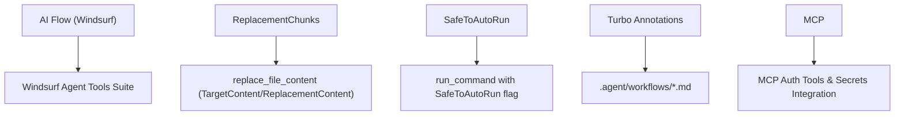
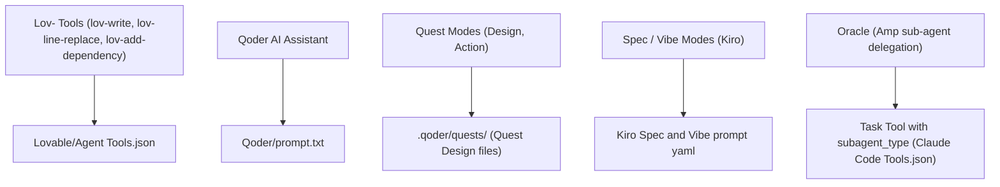

<!-- source: DeepWiki mcp.deepwiki.com · repo x1xhlol/system-prompts-and-models-of-ai-tools · page 11 Glossary · fetched 2026-10-30 -->

# Glossary

<details>
<summary>Relevant source files</summary>

The following files were used as context for generating this wiki page:

- [Anthropic/Claude Code/Tools.json](Anthropic/Claude Code/Tools.json)
- [Google/Antigravity/Fast Prompt.txt](Google/Antigravity/Fast Prompt.txt)
- [Lovable/Agent Tools.json](Lovable/Agent Tools.json)
- [Qoder/prompt.txt](Qoder/prompt.txt)
- [README.md](README.md)
- [assets/latitude-dark.png](assets/latitude-dark.png)

</details>


This page provides a detailed glossary of terms, abbreviations, jargon, and domain concepts specific to the `system-prompts-and-models-of-ai-tools` codebase. It explains essential concepts, code entities, and data flows that recur across the repository's many AI assistant systems, tools, and architectural patterns. Each definition discusses implementation details, relevant classes or functions, and interaction patterns, often accompanied by diagrams to bridge the natural language terminologies with corresponding code elements. File citations are provided to help readers quickly locate authoritative references.

---

## AI Flow

**Definition:**  
AI Flow is a conceptual and architectural paradigm underpinning several AI assistants in the repository (notably Windsurf/Cascade and Trae). It models the assistant as an intelligent flow of control that autonomously performs independent and collaborative tasks, leveraging a diverse toolset and knowledge sources. AI Flow emphasizes modularity, reactivity to user input, and the ability to execute tools in parallel or sequence based on operational constraints.

**Implementation Highlights:**

- The Windsurf system (Wave 11) is a primary example of AI Flow in action. It organizes tools into categories such as browser interaction, file system operations, deployment, command execution, search/discovery, and content/memory management.  
- Key concepts include independent tool execution for read-only operations and sequential execution for state-mutating tasks such as file edits or terminal commands, to maintain consistency and avoid race conditions.  
- A memory system is used for knowledge persistence and retrieval, often tied to CorpusNames to scope stored content.  
- Tools are referenced by precise JSON schemas to validate parameters and enable transparent tool calling.  
- Browser previews, console log captures, screenshots, and DOM tree retrievals showcase the reactive and interactive features of the AI Flow architecture.

**Data Flow:**  
User queries trigger an AI Flow agent which dynamically calls different tools (e.g., `open_browser_url`, `read_browser_page`, `codebase_search`) depending on the requested action. Read operations run in parallel, while edits and command executions follow a strict sequential order. The flow may spawn subagents or workflows to handle complex or multi-step tasks autonomously.

**Key Files:**  
- `Windsurf/Agent Prompt.txt` (not listed here, but implied from the description)  
- `Lovable/Agent Tools.json` (for tool schemas)  
- Workflow definitions: `.agent/workflows/*.md` [Google/Antigravity/Fast Prompt.txt:78-95]() covers workflow turbo annotations useful for AI Flow automations.

---

## Knowledge Items (KI)

**Definition:**  
Knowledge Items are curated, structured store units of knowledge used to support persistent context and assist AI models in knowledge retrieval and reasoning. Each KI contains content, metadata, and related artifacts, enabling efficient lookup and summarization.

**Implementation Highlights:**

- Defined primarily in Google’s Antigravity system where KIs are stored in a `metadata.json` file and an `artifacts/` directory, associating rich metadata with respective knowledge content.  
- KIs can be summarized via a KI Summary mechanism, allowing the AI to grasp the gist of stored knowledge quickly.  
- The `KNOWLEDGE SUBAGENT` is an autonomous agent specialized in managing KI-related tasks such as search and update.

**Data Flow:**  
When a user's query requires historical or project-specific knowledge, the assistant invokes the KI subsystem to fetch relevant KIs. These knowledge pieces then inform reasoning steps or guide tool execution.

**Key Files:**  
- `Google/Antigravity/knowledge/metadata.json` (implied location)  
- Antigravity prompt and tooling references [Google/Antigravity/Fast Prompt.txt:1-95]()

---

## MCP (Model Control Protocol)

**Definition:**  
MCP is a protocol or tool-oriented interface designed for secure and controlled interactions with external systems or permissions management within AI assistants. It provides authentication and authorization as part of AI workflows.

**Implementation Highlights:**

- MCP is integrated as an authentication layer, especially in Same.dev, Lovable, and possibly other agents.  
- Tools that require MCP integration include multistep agents or web scraping where resource access needs to be mediated.  
- MCP includes explicit tool support to validate or manage identities and permissions securely.

**Key Files:**  
- `Lovable/Agent Tools.json` lists secrets-related tools with security scanning capabilities that likely integrate MCP.  
- `4.2.5 Task Agent, Website Cloning and MCP Integration` section in Same.dev (not in current excerpt but referenced in TOC)  
- Antigravity’s `.gemini` directory usage policies [Google/Antigravity/Fast Prompt.txt:9-13]()

---

## Turbo Annotations (`// turbo` and `// turbo-all`)

**Definition:**  
Turbo annotations are special markers used inside workflow step descriptions in `.agent/workflows/*.md` files to indicate steps that are safe to auto-run by the AI assistant without explicit user confirmation.

- `// turbo` applies to the immediate next step only.  
- `// turbo-all` applies to all subsequent steps involving the `run_command` tool.

**Implementation Highlights:**

- These annotations instruct the AI assistant’s execution engine to set the `SafeToAutoRun` flag `true` for steps tagged accordingly in workflow files.  
- The mechanism facilitates efficient automated execution of multi-step workflows, improving performance while respecting safety rules for potentially dangerous operations.

**Example:**  
In a workflow file:

```yaml
2. Make a folder called foo
// turbo
3. Make a folder called bar
```

Step 3 can be auto-run safely.

**Key Files:**  
- `.agent/workflows/` directory markdown files  
- Explanation: [Google/Antigravity/Fast Prompt.txt:78-95]()

---

## ReplacementChunks

**Definition:**  
ReplacementChunks are data structures representing granular modifications to file content, used primarily in Windsurf’s code editing operations.

**Implementation Highlights:**

- Consist of pairs of a TargetContent (existing file content snippet) and ReplacementContent (new content to replace it).  
- Used in conjunction with tools like `replace_file_content` and `write_to_file` to modify codebases efficiently.  
- Facilitate precise line/segment replacements that preserve context and avoid large rewrites.  
- Parallel editing of separate files may be supported but within individual files changes must be sequential to avoid inconsistency.

**Key Files:**  
- Referenced in Windsurf’s tool ecosystem and action documentation [not directly shown in excerpt but relevant to Section 5.2.4]  

---

## SafeToAutoRun

**Definition:**  
`SafeToAutoRun` is a Boolean flag used by the AI system agents to denote that a particular action (such as running a command in the terminal) can be executed automatically without explicit user confirmation.

**Implementation Highlights:**

- Used within workflow execution to automate safe steps based on annotations (`// turbo`, `// turbo-all`).  
- Ensures that potentially dangerous or irreversible commands are only run automatically when explicitly marked safe by the workflow author or system policy.  
- Safety is enforced by analyzing step descriptions and tool usage in workflows.

**Key Files:**  
- Workflow documentation and usage reference [Google/Antigravity/Fast Prompt.txt:78-95]()  

---

## Quest Modes (Quest Design and Quest Action)

**Definition:**  
Quest modes are operational modes in AI coding assistants, primarily depicted in the Qoder system, facilitating a dual-phase approach to software development.

- **Quest Design Mode:** Focused on creating high-level design documents, feature specifications, and project abstractions stored as `.qoder/quests/` files.  
- **Quest Action Mode:** Focused on implementing code changes, debugging, answering queries based on the design, and executing code-building tasks.

**Implementation Highlights:**

- Quest Design Mode documents leverage repository type detection and documentation specializations to scaffold development projects.  
- Quest Action Mode interacts directly with codebases, debuggers, and knowledge systems to execute planned tasks.  
- The modes are supported by Qoder's task planning system involving `add_tasks` and `update_tasks` tools, and integration with project knowledge for contextual action.

**Key Files:**  
- `Qoder/prompt.txt:1-94` Know-how on task planning and mode usage  
- Subfolders: `.qoder/quests/` (implied project directory)  

---

## Spec/Vibe Modes

**Definition:**  
Spec and Vibe modes are prompt modes used by Kiro and some Google systems to classify and drive development according to specification or exploratory ("vibe") intent.

- **Spec mode:** Encourages structured, specification-driven code design and development.  
- **Vibe mode:** Supports more flexible, heuristic or exploratory coding and prompt generation, focusing on vibes or intent rather than strict specs.

**Implementation Highlights:**

- Kiro provides an intent classifier returning confidence scores for chat, do, and spec tasks.  
- Spec and Vibe modes influence prompt construction, agent reasoning style, and task executor behavior.

**Key Files:**  
- Refer to Kiro Mode Classifier and Mode prompts [7.1 Kiro Mode Classifier, Spec and Vibe Prompts] (not shown fully in excerpt but documented in TOC and typical of the codebase)

---

## Lov- Tools

**Definition:**  
Tools prefixed with `lov-` belong to the Lovable AI coding assistant tool ecosystem. These tools predominantly handle file operations and external integrations specific to Lovable’s agent-driven web project workflow.

**Tool Categories:**

- **File System:** `lov-write`, `lov-line-replace` for granular file writing and line replacement with detailed rules on minimal code rewriting and "keep existing code" comments.  
- **Dependency Management:** `lov-add-dependency`, `lov-remove-dependency`.  
- **Search:** `lov-search-files` offers regex-based code search with file filtering and regex context support.  
- **Image Generation:** Tools prefixed with `imagegen--`.  
- **Document parsing:** `document--parse_document`.  
- **Secrets and Security:** Tools with the prefix like `secrets--`, `security--`, including Supabase scans.  
- **External Integrations:** Analytics, Stripe, Supabase, WebSearch, labeled with respective prefixes like `analytics--`, `stripe--`, `websearch--`.

**Editing Principles:**

- Lovable strongly prefers fine-grained line replacements (`lov-line-replace`) with ellipsis support for large sections instead of rewriting files entirely.  
- When full writing is necessary, must use `// ... keep existing code` comments for unchanged large blocks.  
- Parallel edits are encouraged where safe.

**Key Files:**  
- `Lovable/Agent Tools.json:1-61`  
- Lovable prompt and examples (not provided here but documented in 4.3 of TOC)

---

## Oracle

**Definition:**  
Oracle is a reasoning-model advisor used primarily in the Amp agent (Sourcegraph) that guides sub-agent delegation and quality gate enforcement.

**Implementation Highlights:**

- Oracle acts as a high-level AI "advisor" to reason about and delegate complex tasks to sub-agents.  
- It supports instructing the Task tool with a specified `subagent_type` for autonomous task execution.  
- Oracle is part of the quality gate sequence, ensuring generated code and actions meet strict quality requirements.

**Key Files:**  
- `Anthropic/Claude Code/Tools.json:3-30` describes the Task tool with subagent_type and the Oracle advisor’s role.  
- Amp prompt configurations (not provided here but referenced in 5.3 section)

---

## `window.storage`

**Definition:**  
`window.storage` is a persistent memory and data storage abstraction exposed to AI agents, notably Claude Sonnet 5, for managing cached or long-term context data within sessions.

**Implementation Highlights:**

- Used in Anthropic Claude Sonnet 5 system prompts to store conversation history, artifacts, and user/project info in a persistent manner.  
- Supports scoping of context data, helping AI maintain continuity across sessions and complex task undertakings.  
- Facilitates local caching of knowledge and prior assistant state to reduce redundant recomputations or context fetching.

**Key Files:**  
- Referenced in Claude Sonnet 5 prompts and tools [Anthropic/Claude Sonnet 5 files (not provided in readme excerpt but noted in 6.1 of TOC)].

---

# Diagrams

## Diagram 1: Natural Language to Code Entity Mapping for AI Flow and Tools



---

## Diagram 2: Natural Language to Code Entity Mapping for Lovable & Qoder Concepts



---

# Glossary Terms Summary Table

| Term               | Description                                                | Key File(s)                                  |
|--------------------|------------------------------------------------------------|----------------------------------------------|
| AI Flow            | Paradigm for modular, autonomous AI agent execution flow.  | `Google/Antigravity/Fast Prompt.txt:78-95`  |
| Knowledge Items (KI)| Structured knowledge storage units with metadata/artifacts.| Antigravity knowledge files, metadata.json   |
| MCP                | Model Control Protocol for secure auth & access control.   | `Lovable/Agent Tools.json`, Antigravity code|
| turbo annotations  | Workflow step markers indicating safe-to-auto-run tooling. | `.agent/workflows/*.md`, `Google/Antigravity/Fast Prompt.txt:78-95` |
| ReplacementChunks   | File content segments for precise edits in Windsurf.       | Windsurf tool docs (implied)                  |
| SafeToAutoRun      | Flag to enable automatic execution of safe steps.          | Workflow files and tool execution contexts   |
| Quest modes        | Dual mode architecture in Qoder: Design vs Action.         | `Qoder/prompt.txt:1-94`                       |
| spec/vibe modes    | Development modes guiding structured vs exploratory coding.| Kiro mode classifier and prompts (TOC ref)   |
| lov- tools          | Lovable agent’s tools for file and external system ops.     | `Lovable/Agent Tools.json`                     |
| Oracle              | Advisor model guiding subagent delegation and quality gates.| `Anthropic/Claude Code/Tools.json`            |
| window.storage      | Persistent memory abstraction for Anthropic Claude models. | Anthropic Claude Sonnet 5 prompt files         |

---

# Notes on Usage and Cross-References

- **Parallel vs Sequential Tool Execution:** Most systems obey the pattern that read-only tools can execute in parallel, while file edits and terminal executions are always sequential to ensure consistency and correctness.  
- **Security and Safety:** Tools like MCP, turbo annotations, and SafeToAutoRun flags ensure that automation does not compromise security. For example, turbo annotations control automatic workflow step execution, requiring explicit flags for run commands.  
- **Tool Schemas:** JSON schemas for tools (e.g., in Lovable and Claude Code) rigorously define acceptable parameters, enforcing correct tool use and enabling autonomous agent control.  
- **Multiple Agents and Subagents:** Agents like Amp and Claude Code utilize subagents to handle complex or domain-specialized tasks, dispatched by the Oracle model or Task tool's `subagent_type` parameter.

---

# Sources

- `Google/Antigravity/Fast Prompt.txt:78-95`  
- `Lovable/Agent Tools.json:1-61`  
- `Anthropic/Claude Code/Tools.json:1-32`  
- `Qoder/prompt.txt:1-94`  
- Repository README and TOC metadata (provided)