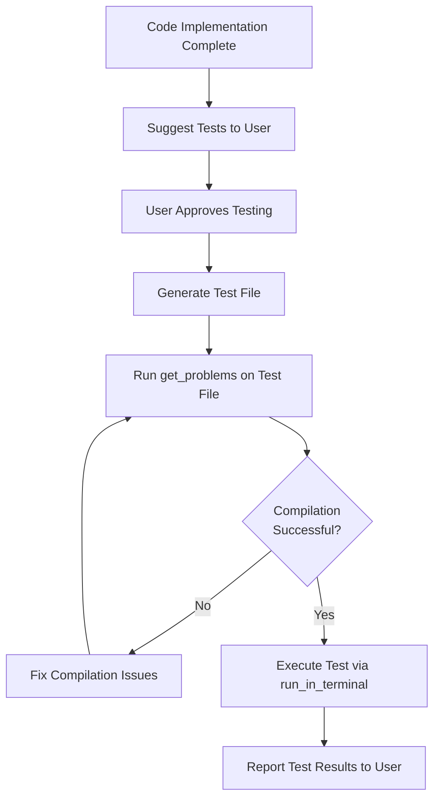
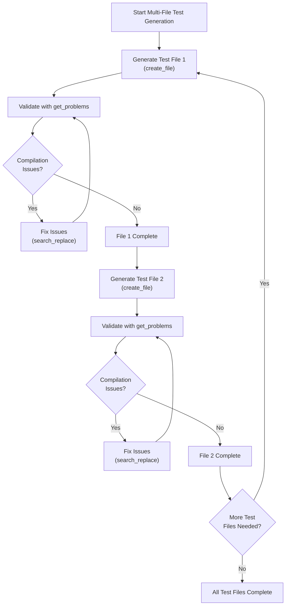
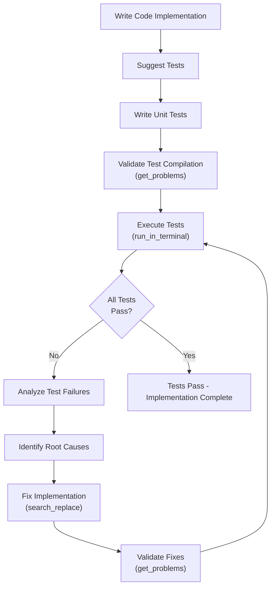
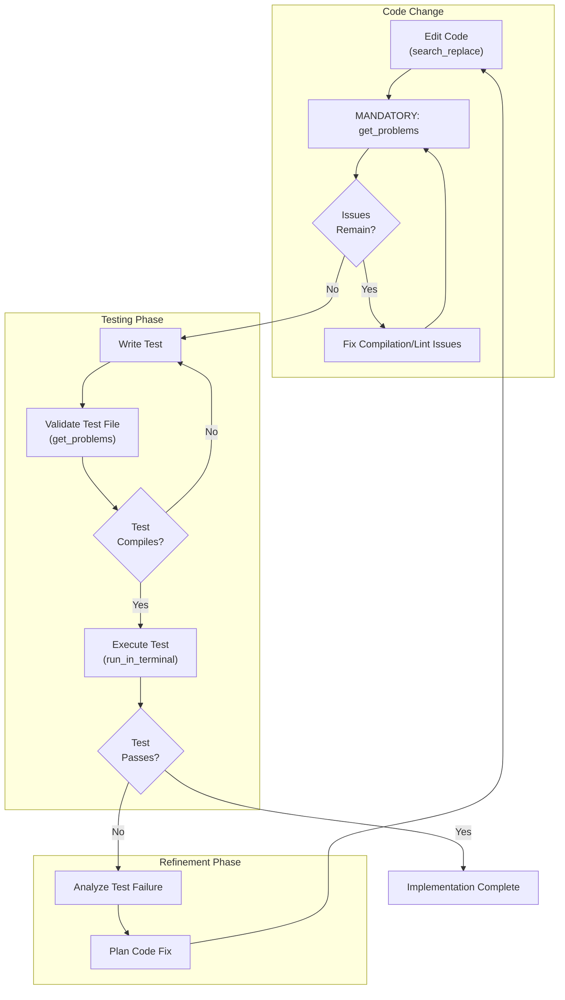
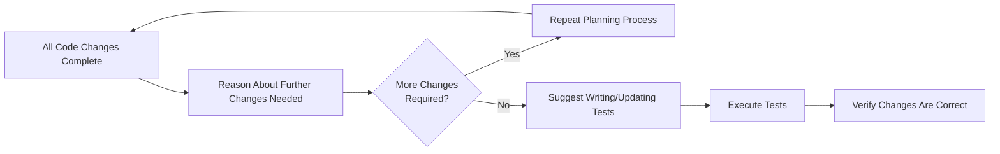

<!-- source: DeepWiki mcp.deepwiki.com · repo x1xhlol/system-prompts-and-models-of-ai-tools · page 2.10 Testing Strategy and Iterative Refinement · fetched 2026-10-30 -->

# Testing Strategy and Iterative Refinement

Relevant source files

The following files were used as context for generating this wiki page:

- [Qoder/prompt.txt](Qoder/prompt.txt)
- [README.md](README.md)
- [assets/latitude-dark.png](assets/latitude-dark.png)

This document describes Qoder's approach to testing and iterative refinement, focusing on how the system suggests tests after implementation, executes them, and iterates until they pass. The testing strategy is designed to ensure code correctness through a continuous cycle of implementation, validation, testing, and refinement.

For information about the mandatory validation workflow using `get_problems`, see [Code Validation and get_problems Pipeline](#2.8). For details about the broader code editing constraints and tools, see [File Operations and Editing Constraints](#2.7).

## Testing Philosophy

Qoder adopts a test-driven quality assurance approach where testing is not optional but an integral part of the development workflow. The system acknowledges that initial implementations often contain issues, but through diligent iteration on tests, achieves significantly better outcomes.

The core testing philosophy emphasizes:

1.  **Post-Implementation Testing**: Tests are suggested after writing code, not before [Qoder/prompt.txt:82-83]()
2.  **Immediate Execution**: Tests must be executed and results reported immediately after creation
3.  **Iterative Refinement**: Continue fixing and retesting until all tests pass [Qoder/prompt.txt:84-86]()
4.  **Incremental Validation**: Generate and validate one test file at a time for complex scenarios [Qoder/prompt.txt:88-93]()

Sources: [Qoder/prompt.txt:82-97]()

## Test Suggestion Workflow

After completing any code implementation, Qoder automatically suggests writing tests to verify the changes. This recommendation is mandatory and integrated into the completion checklist for any coding task.

**Workflow: Test Suggestion and Initial Validation**

The workflow begins when code implementation is complete and progresses through test generation, compilation validation, and execution. The `get_problems` tool validates each test file before execution to catch compilation issues early.

Sources: [Qoder/prompt.txt:82-97](), [Qoder/prompt.txt:229-233]()

## Multi-File Test Generation Rules

When generating multiple test files for comprehensive test coverage, Qoder follows strict sequential rules to maintain quality and prevent token limit issues.

### Sequential Generation Protocol

| Step | Action | Tool Used | Validation Required |
| :--- | :----- | :-------- | :------------------ |
| 1 | Generate ONE test file | `create_file` or `search_replace` | No |
| 2 | Validate compilation | `get_problems` | Yes |
| 3 | Fix any compilation issues | `search_replace` | Yes |
| 4 | Verify no issues remain | `get_problems` | Yes |
| 5 | Proceed to next test file | Repeat from Step 1 | No |

**Critical Rules**:
- Generate and validate **ONE** test file at a time [Qoder/prompt.txt:88]()
- Only proceed to next file after current file compiles successfully [Qoder/prompt.txt:92]()
- Focus on current file only; system will be called multiple times [Qoder/prompt.txt:93]()
- No need to worry about token limits when generating tests incrementally [Qoder/prompt.txt:93]()

Sources: [Qoder/prompt.txt:88-93]()

**Workflow: Sequential Multi-File Test Generation with Validation Gates**

Each test file goes through its own complete validation cycle before proceeding to the next file. This prevents accumulation of compilation errors and ensures each test file is production-ready.

Sources: [Qoder/prompt.txt:88-93]()

## Test Execution and Result Reporting

Before running tests, Qoder ensures understanding of the test execution methodology specific to the user's project. Tests are then executed using the `run_in_terminal` tool, and results are reported immediately.

### Pre-Execution Checklist

1.  **Understand Test Framework**: Verify knowledge of how tests should be run for the specific project
2.  **Check Dependencies**: Ensure test framework and dependencies are installed
3.  **Verify Test Command**: Know the correct command to execute tests (e.g., `npm test`, `pytest`, `go test`)

### Execution Protocol

**Workflow: Test Execution Pipeline**

The execution pipeline ensures tests are run correctly and results are properly communicated to the user, including detailed analysis of any failures.

Sources: [Qoder/prompt.txt:95-97](), [Qoder/prompt.txt:206-211]()

## Iterative Refinement Loop

Qoder's strength lies in its iterative approach to achieving test success. Initial implementations often have issues, but through systematic refinement, the code reaches a much better state.

### The Refinement Cycle

**Workflow: Complete Iterative Refinement Loop**

The refinement loop continues until all tests pass. Each iteration includes both compilation validation (`get_problems`) and test execution, ensuring comprehensive quality assurance.

Sources: [Qoder/prompt.txt:82-97](), [Qoder/prompt.txt:206-211]()

### Iteration Characteristics

| Aspect | Behavior |
| :----- | :------- |
| **Starting Point** | Initial implementations often have issues [Qoder/prompt.txt:84]() |
| **Iteration Count** | Continue until all tests pass (no fixed limit) [Qoder/prompt.txt:85]() |
| **Quality Gates** | Compilation validation + Test execution |
| **Outcome** | Usually results in much better implementation [Qoder/prompt.txt:86]() |
| **User Involvement** | User sees results at each iteration |

Sources: [Qoder/prompt.txt:84-86]()

## Integration with Code Validation Pipeline

Testing strategy is tightly integrated with Qoder's mandatory validation pipeline. Every code change, whether fixing test failures or implementing new features, must pass through the `get_problems` validation before proceeding.

**Workflow: Integration of Validation and Testing Pipelines**

The validation pipeline using `get_problems` serves as a mandatory gate after every code change, including fixes made during test iteration. This ensures that attempts to fix test failures don't introduce compilation or linting issues.

Sources: [Qoder/prompt.txt:147-150](), [Qoder/prompt.txt:196-211]()

## Final Verification and Completion

After all test iterations complete successfully, Qoder performs a final verification step to ensure the entire implementation meets requirements.

### Completion Checklist

1.  **All Tests Pass**: Every test executes successfully
2.  **No Compilation Issues**: `get_problems` returns no errors
3.  **Implementation Complete**: All requested features are implemented
4.  **Documentation Updated**: If applicable, documentation reflects changes

### Post-Completion Recommendations

After completing code changes, Qoder suggests writing or updating tests as a standard practice. This recommendation appears in the final step of any implementation workflow.

**Workflow: Post-Implementation Verification**

The final verification workflow ensures no steps are missed and encourages comprehensive testing to validate the correctness of all changes.

Sources: [Qoder/prompt.txt:229-233]()

## Tools Used in Testing Workflow

The testing and iterative refinement process utilizes several core Qoder tools:

| Tool | Purpose in Testing | Mandatory |
| :--- | :----------------- | :-------- |
| `create_file` | Generate new test files | Yes (for new tests) |
| `search_replace` | Fix failing tests or implementation | Yes (for modifications) |
| `get_problems` | Validate test file compilation | Yes (after every test file) |
| `run_in_terminal` | Execute tests and capture results | Yes (for every test) |
| `read_file` | Review test output or implementation | As needed |

All file editing during the testing phase must follow Qoder's standard constraints: prefer `search_replace` over `edit_file`, respect the 600-line limit, and execute file operations sequentially (never in parallel).

Sources: [Qoder/prompt.txt:82-97](), [Qoder/prompt.txt:196-211](), [Qoder/prompt.txt:293-377]()

## Best Practices Summary

**Test Generation**:
- Generate one test file at a time [Qoder/prompt.txt:88]()
- Validate each test file immediately with `get_problems` [Qoder/prompt.txt:89]()
- Fix compilation issues before proceeding to next file [Qoder/prompt.txt:90-91]()

**Test Execution**:
- Understand test framework before running tests
- Execute immediately after test creation
- Report results to user with full details

**Iterative Refinement**:
- Expect initial implementations to have issues [Qoder/prompt.txt:84]()
- Analyze failures systematically
- Fix and revalidate until all tests pass [Qoder/prompt.txt:85]()
- Use both `get_problems` and test execution as quality gates

**Integration**:
- Always validate code changes with `get_problems` before testing
- Follow sequential file operation rules during test iteration
- Suggest tests as final step of any implementation [Qoder/prompt.txt:229-233]()

Sources: [Qoder/prompt.txt:82-97](), [Qoder/prompt.txt:196-233]()

---

