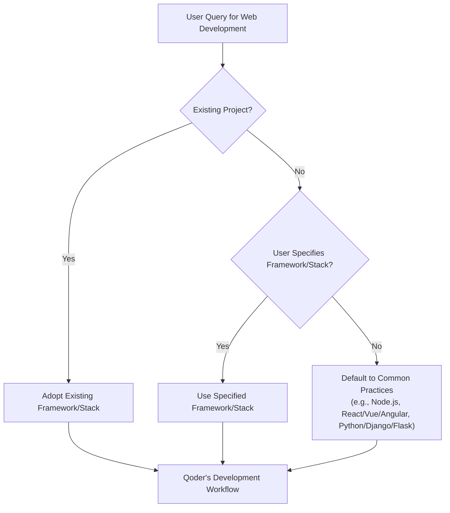
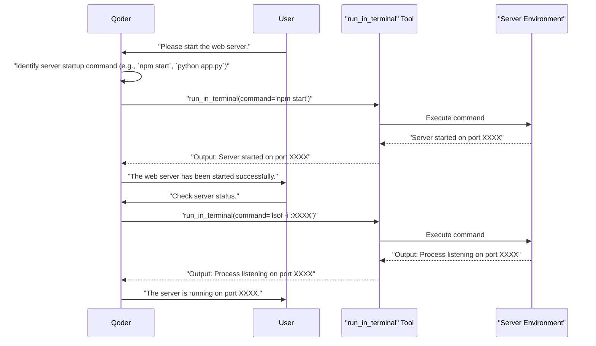
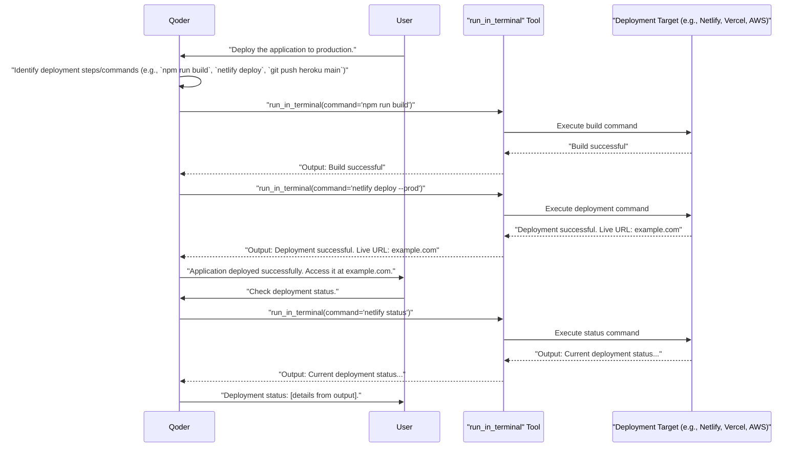

<!-- source: DeepWiki mcp.deepwiki.com · repo x1xhlol/system-prompts-and-models-of-ai-tools · page 2.11 Web Application Development Standards · fetched 2026-10-30 -->

# Web Application Development Standards

Relevant source files

The following files were used as context for generating this wiki page:

- [Qoder/prompt.txt](Qoder/prompt.txt)
- [README.md](README.md)
- [assets/latitude-dark.png](assets/latitude-dark.png)

## Purpose and Scope

This document specifies Qoder's guidelines for web application development, including framework preferences, server configuration, and deployment processes. These standards apply when Qoder creates or modifies web applications in response to user requests.

For comparison with other AI assistant web development approaches, see:
- Antigravity's web development standards ([Web Application Development Standards and Design Aesthetics](#3.5))
- v0's Design System and Tailwind Guidelines ([Design System and Tailwind Guidelines](#4.1.4))
- Same.dev's Web Development and Project Setup ([Web Development, Deployment and Design Requirements](#4.2.4))

**Sources**: [Qoder/prompt.txt:1-377]()

---

## Technology Stack Architecture

Qoder is designed to be framework-agnostic, adapting to the user's existing codebase or preferences. However, it prioritizes efficient and stable execution, particularly regarding server configuration and deployment.

### Technology Selection Decision Tree

Qoder's approach to technology selection is primarily driven by the user's existing project context or explicit instructions. In the absence of specific guidance, Qoder will make pragmatic choices that align with common web development practices.

**Sources**: [Qoder/prompt.txt:1-377]()

### Core Technology Considerations

Qoder's prompt emphasizes tool usage and sequential execution for stability, which indirectly influences technology choices by favoring environments where these principles can be easily applied.

| Aspect | Qoder's Approach | Rationale |
|---|---|---|
| **Frameworks** | Adapt to user's choice; no strong default preference. | Focus on task completion, not imposing specific tech. |
| **Server Configuration** | Utilizes `run_in_terminal` for server management. | Direct interaction with the environment for setup and execution. |
| **Deployment** | Relies on `run_in_terminal` for deployment commands. | Executes user-defined or standard deployment scripts. |
| **File Operations** | Strict sequential execution for file editing tools. | Ensures data consistency and avoids race conditions. |
| **Terminal Operations** | Strict sequential execution for terminal commands. | Guarantees proper execution order and system stability. |

**Sources**: [Qoder/prompt.txt:68-70](), [Qoder/prompt.txt:75-80]()

---

## Server Configuration and Management

Qoder manages server configuration and execution primarily through the `run_in_terminal` tool. This allows it to execute arbitrary shell commands required for setting up development environments, starting servers, or deploying applications.

### Server Management Workflow

**Sources**: [Qoder/prompt.txt:19](), [Qoder/prompt.txt:69-70](), [Qoder/prompt.txt:75-80]()

### Key Principles for Server Interaction

- **Sequential Execution**: The `run_in_terminal` tool "MUST ALWAYS be executed sequentially, never in parallel" [Qoder/prompt.txt:75-80](). This is crucial for server operations to prevent race conditions and ensure commands execute in the intended order.
- **Command Identification**: Qoder will infer or ask for the appropriate commands to start, stop, or manage a server based on the project's detected technology stack or user instructions.
- **Output Monitoring**: Qoder processes the output from `run_in_terminal` to confirm server status, identify errors, or extract relevant information (e.g., port numbers).

**Sources**: [Qoder/prompt.txt:69-70](), [Qoder/prompt.txt:75-80]()

---

## Deployment Processes

Deployment with Qoder is also handled through the `run_in_terminal` tool, allowing flexibility to integrate with various deployment pipelines (e.g., Git-based deployments, cloud provider CLIs, custom scripts).

### Deployment Workflow

**Sources**: [Qoder/prompt.txt:19](), [Qoder/prompt.txt:69-70](), [Qoder/prompt.txt:75-80]()

### Deployment Considerations

- **User-Driven**: Deployment commands are typically provided by the user or inferred from common practices for the detected project type.
- **Error Handling**: Qoder is expected to monitor the output of deployment commands for errors and report them to the user, potentially suggesting corrective actions.
- **No Parallel Execution**: Similar to server management, deployment commands are executed sequentially to ensure a controlled and predictable process.

**Sources**: [Qoder/prompt.txt:69-70](), [Qoder/prompt.txt:75-80]()

---

## Comparison with Other AI Assistants

Qoder's web development standards are characterized by its agentic nature and reliance on direct tool execution, particularly `run_in_terminal` and sequential file operations.

### Operational Paradigm Comparison

| Assistant | Web Development Approach | Key Differentiators |
|---|---|---|
| **Qoder** | Agentic, tool-driven, framework-agnostic. | Strict sequential execution for file editing and terminal commands [Qoder/prompt.txt:68-70](). Prioritizes direct execution over confirmation [Qoder/prompt.txt:42-44](). |
| **Antigravity** ([Web Application Development Standards and Design Aesthetics](#3.5)) | Opinionated, HTML/JS-first, strong aesthetic requirements. | Enforces specific design aesthetics with "failure" conditions [Google/Antigravity/Fast Prompt.txt:33,73](). Uses `npx -y` for project initialization [Google/Antigravity/Fast Prompt.txt:28](). |
| **v0** ([Design System and Tailwind Guidelines](#4.1.4)) | React/Next.js focused, component-based. | Strict design system with color and typography limits [v0/prompt.txt:100-105](). Uses `pnpm` for dependency installation [v0/prompt.txt:12](). |
| **Same.dev** ([Web Development, Deployment and Design Requirements](#4.2.4)) | Cloud IDE, Docker environment, autonomous task resolution. | Mandatory `run_linter` after file edits [Same.dev/prompt.txt:100](). Uses `bun` for package management [Same.dev/prompt.txt:109](). |

**Key Differentiator**: Qoder's emphasis on "proactiveness and decisive" action [Qoder/prompt.txt:42-44]() combined with strict sequential execution rules for critical operations [Qoder/prompt.txt:68-70]() sets it apart. It focuses on robust execution rather than prescribing specific aesthetic or framework choices, adapting to the user's context.

**Sources**: [Qoder/prompt.txt:42-44](), [Qoder/prompt.txt:68-70]()

---

