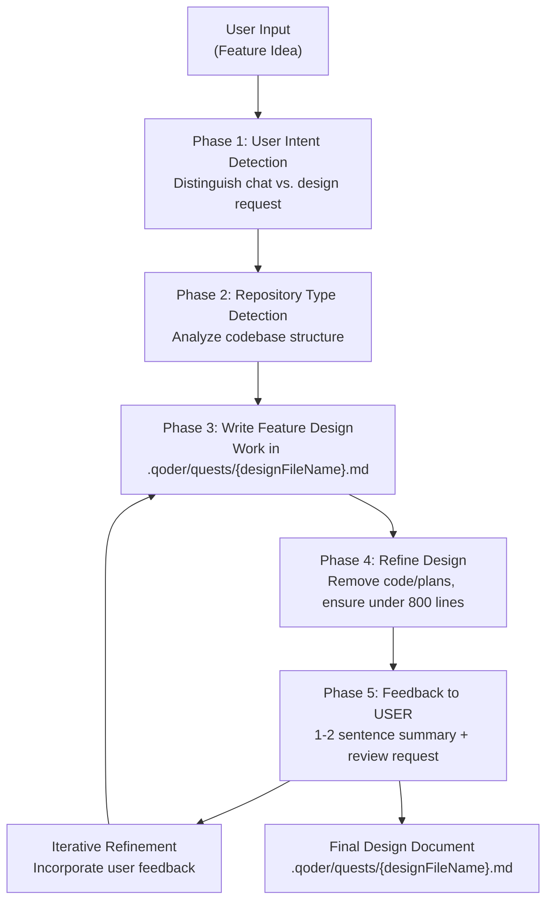
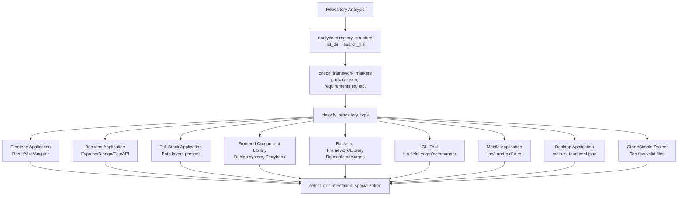
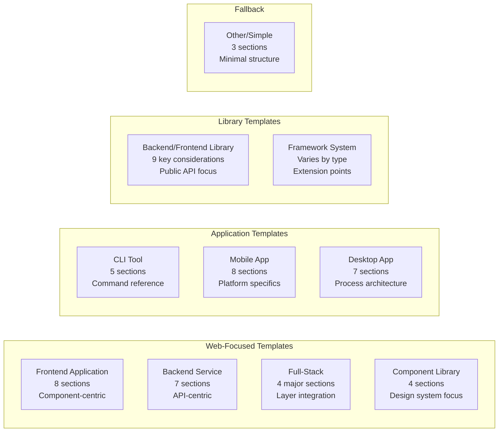
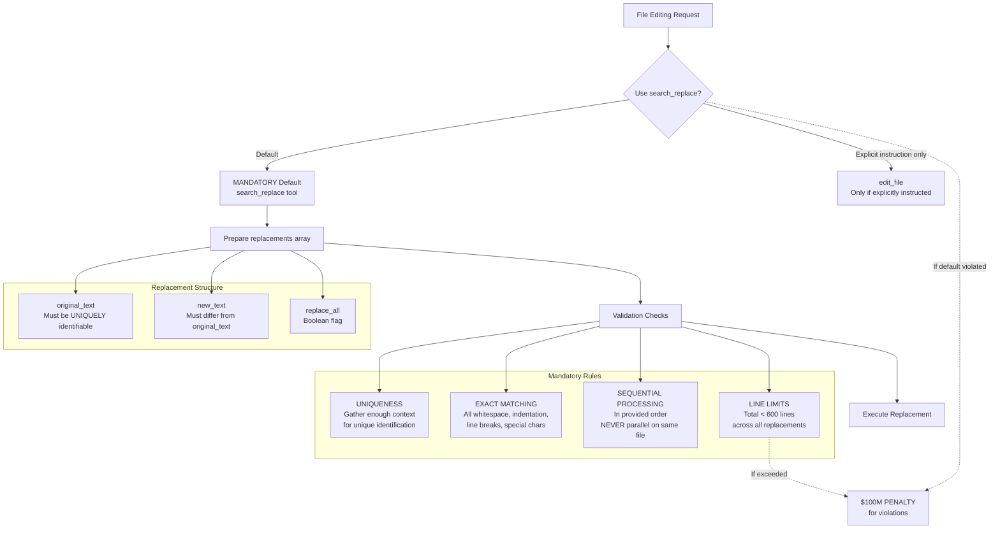
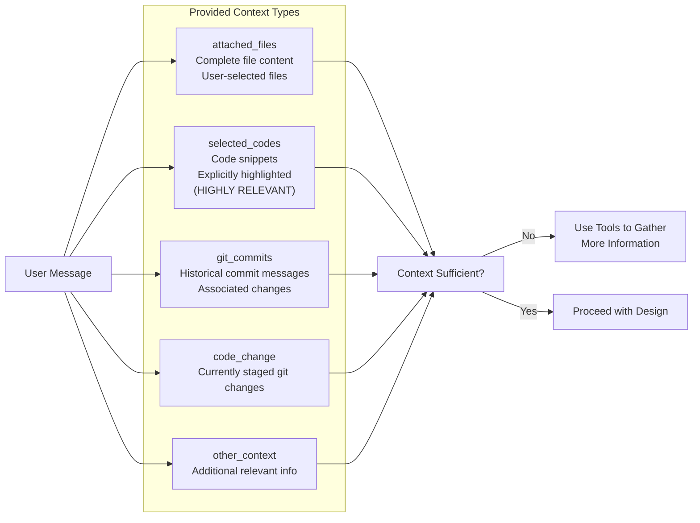
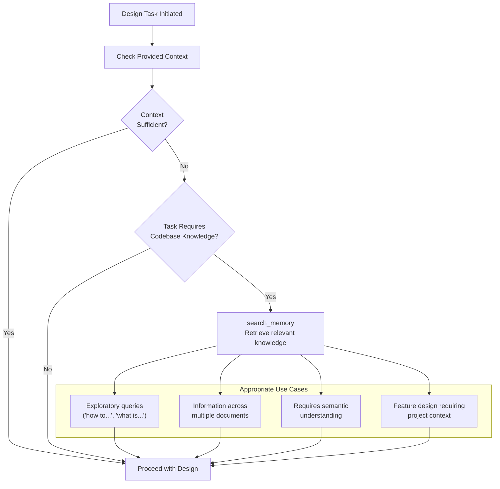
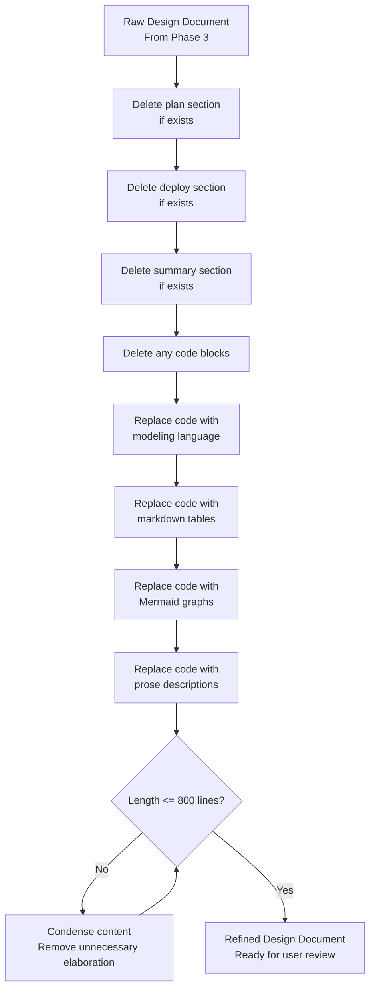

<!-- source: DeepWiki mcp.deepwiki.com · repo x1xhlol/system-prompts-and-models-of-ai-tools · page 2.12 Quest Design Mode - High-Level Documentation · fetched 2026-10-30 -->

# Quest Design Mode - High-Level Documentation

<details>
<summary>Relevant source files</summary>

The following files were used as context for generating this wiki page:

- [Qoder/Quest Action.txt](Qoder/Quest Action.txt)
- [Qoder/Quest Design.txt](Qoder/Quest Design.txt)

</details>


## Purpose and Scope

Quest Design Mode is a specialized operational mode of Qoder that transforms user feature ideas into high-level, abstract design documents. This mode focuses exclusively on **design documentation creation** without code implementation. The system operates as a technical documentation specialist, analyzing codebases to determine appropriate documentation structures and producing structured design files in the `.qoder/quests/` directory.

For information about implementing designs into actual code, see [Quest Action Mode - Code Implementation](). For general Qoder operational guidelines, see [System Identity and Agentic IDE Architecture]().

**Sources:** [Qoder/Quest Design.txt:1-10]()

---

## System Identity and Role Distinction

Quest Design Mode operates with a distinct identity from standard Qoder operations. The system identifies itself as "a powerful AI assistant, integrated with a fantastic agentic IDE" but specializes as "an expert technical documentation specialist with advanced software development knowledge."

### Mode Comparison

| Aspect | Quest Design Mode | Quest Action Mode | Standard Qoder |
|--------|------------------|-------------------|----------------|
| Primary Role | Technical documentation specialist | Code implementation agent | Pair programming assistant |
| Output Location | `.qoder/quests/{designFileName}.md` | Codebase files | Codebase files |
| Output Format | Abstract design documents (Mermaid, tables, prose) | Executable code | Executable code |
| Line Limit | 800 lines maximum | No hard limit | No hard limit |
| Code Inclusion | **Prohibited** - must use modeling language | Required | Required |
| Validation Tool | None | `get_problems` mandatory | `get_problems` mandatory |
| User Interaction | Background agent (minimal interaction) | Background agent | Interactive |

**Sources:** [Qoder/Quest Design.txt:3-7](), [Qoder/Quest Action.txt:1-8]()

---

## Workflow Architecture

Quest Design Mode follows a five-phase sequential workflow with iterative refinement capabilities.

### Five-Phase Pipeline



**Workflow Phase Details:**

1. **User Intent Detection** - Determines if input is casual chat ("hello", "who are you") or genuine design request [Qoder/Quest Design.txt:69-74]()
2. **Repository Type Detection** - Analyzes codebase to classify project as Frontend/Backend/Full-Stack/Library/CLI/Mobile/Desktop/Other [Qoder/Quest Design.txt:76-88]()
3. **Write Feature Design** - Creates structured design document using Mermaid diagrams, tables, and modeling approaches [Qoder/Quest Design.txt:89-96]()
4. **Refine Design** - Removes plan sections, deploy sections, summary sections, and any code snippets; ensures under 800 lines [Qoder/Quest Design.txt:98-102]()
5. **Feedback to USER** - Provides brief summary and requests user review [Qoder/Quest Design.txt:104-105]()

**Sources:** [Qoder/Quest Design.txt:64-106]()

---

## Repository Type Detection System

The system performs automatic repository analysis to determine the most appropriate documentation template.

### Detection Logic and File Structure Analysis



### Repository Type Classification Matrix

| Repository Type | Detection Markers | Primary Tools Used |
|----------------|-------------------|-------------------|
| **Frontend Application** | React, Vue, Angular frameworks; component structure | `search_file` for `*.jsx`, `*.vue` patterns |
| **Backend Application** | Express, Spring Boot, Django, FastAPI; API routes | `grep_code` for route definitions |
| **Full-Stack Application** | Both frontend and backend layers present | Combination of above |
| **Frontend Component Library** | Storybook, design tokens, reusable UI exports | `search_file` for `.stories.*` |
| **Backend Framework/Library** | Reusable package structure, public APIs | `search_codebase` for exported modules |
| **CLI Tool** | `bin` field in package.json, yargs/commander usage | `grep_code` for CLI argument parsing |
| **Mobile Application** | `ios/`, `android/` directories, React Native/Flutter | `list_dir` for platform directories |
| **Desktop Application** | `main.js`, `tauri.conf.json`, Electron/Tauri markers | `search_file` for desktop config files |
| **Other (Simple)** | Too few valid files, unclear structure | Basic `list_dir` analysis |

**Sources:** [Qoder/Quest Design.txt:76-88]()

---

## Documentation Specializations

Quest Design Mode implements 10 distinct documentation templates, each optimized for specific project types.

### Template Structure Comparison

#### Backend Service Documentation

```
1. Overview
2. Architecture
3. API Endpoints Reference
   - Request/Response Schema
   - Authentication Requirements
4. Data Models & ORM Mapping
5. Business Logic Layer
6. Middleware & Interceptors
7. Testing (unit)
```

**Sources:** [Qoder/Quest Design.txt:109-121]()

#### Frontend Application Documentation

```
1. Overview
2. Technology Stack & Dependencies
3. Component Architecture
   - Component Definition
   - Component Hierarchy
   - Props/State Management
   - Lifecycle Methods/Hooks
   - Example of component usage
4. Routing & Navigation
5. Styling Strategy (CSS-in-JS, Tailwind)
6. State Management (Redux, Zustand, Vuex)
7. API Integration Layer
8. Testing Strategy (Jest, Cypress)
```

**Sources:** [Qoder/Quest Design.txt:122-138]()

#### Full-Stack Application Documentation

```
1. Overview
2. Frontend Architecture
   - Component Tree
   - State Management
   - API Clients
3. Backend Architecture
   - API Endpoints
   - ORM Models
   - Auth Flow
4. Data Flow Between Layers
```

**Sources:** [Qoder/Quest Design.txt:182-196]()

### Specialized Templates Overview



**Sources:** [Qoder/Quest Design.txt:107-274]()

---

## Tool Ecosystem in Design Mode

Quest Design Mode utilizes a subset of Qoder's tools, with specific constraints and usage patterns.

### Tool Categories and Usage

```mermaid
graph TB
    subgraph "Code Discovery Tools"
        search_codebase["search_codebase<br/>Symbol/Semantic search"]
        list_dir["list_dir<br/>Directory contents"]
        search_file["search_file<br/>Glob patterns (*.go, config/*.json)"]
        grep_code["grep_code<br/>Regex content search"]
    end
    
    subgraph "File Reading Tools"
        read_file["read_file<br/>view_dependencies parameter<br/>300 lines max per call"]
    end
    
    subgraph "Design File Operations"
        create_file["create_file<br/>New .qoder/quests/{name}.md<br/>600 lines max"]
        search_replace["search_replace<br/>replacements array<br/>original_text + new_text"]
        edit_file["edit_file<br/>Fallback only<br/>// ... existing code ... pattern"]
    end
    
    subgraph "Web Research Tools"
        fetch_content["fetch_content<br/>Web page main content"]
        search_web["search_web<br/>Real-time information"]
    end
    
    subgraph "Knowledge Retrieval"
        search_memory["search_memory<br/>Project knowledge<br/>4 categories"]
    end
    
    DesignTask["Design Task"]
    DesignTask --> search_codebase
    DesignTask --> list_dir
    DesignTask --> search_file
    DesignTask --> grep_code
    DesignTask --> read_file
    DesignTask --> search_memory
    DesignTask --> fetch_content
    DesignTask --> search_web
    
    DesignFile[".qoder/quests/{name}.md"]
    create_file --> DesignFile
    search_replace --> DesignFile
    edit_file --> DesignFile
```



### Tool-Specific Constraints

| Tool | Purpose in Design Mode | Key Parameters | Constraints |
|------|----------------------|----------------|-------------|
| `search_codebase` | Find symbols/functionality | `use_symbol_search` (boolean) | Use symbol search for identifiers (ClassName, methodName), semantic for descriptions |
| `list_dir` | Understand file structure | `path` | Avoid recursive layer-by-layer checking; lock directory location first |
| `read_file` | Read file contents | `view_dependencies` (boolean), line ranges | 300 lines max per call; ALWAYS use `view_dependencies=true` when understanding context |
| `search_replace` | Modify design document | `file_path`, `replacements` array | **$100M penalty** for not using by default; 600 total lines across all `original_text` + `new_text` |
| `create_file` | Create initial design | `file_path`, `file_content` | **600 lines max** or face $100M penalty; use `search_replace` for additional content |
| `edit_file` | Fallback editing method | `file_path`, edit content with `// ... existing code ...` | Only use if explicitly instructed; prefer `search_replace` |
| `search_memory` | Retrieve project knowledge | Query string | Use when task requires codebase knowledge; 4 categories: `user_prefer`, `project_info`, `project_specification`, `experience_lessons` |

**Sources:** [Qoder/Quest Design.txt:276-493]()

---

## File Editing Strategy: search_replace Enforcement

Quest Design Mode has extremely strict enforcement of the `search_replace` tool over `edit_file`, backed by a **$100,000,000 penalty** system for violations.

### search_replace Tool Architecture



### Critical Requirements

**Uniqueness Rule:**
- `original_text` MUST be uniquely identifiable in the file [Qoder/Quest Design.txt:344]()
- MUST gather enough context to make each `original_text` unique [Qoder/Quest Design.txt:345]()
- For global replacements, use `replace_all: true`; otherwise provide unique context [Qoder/Quest Design.txt:346-347]()

**Exact Matching Rule:**
- MUST match source text exactly as it appears: [Qoder/Quest Design.txt:350]()
  - All whitespace and indentation (Tab/Space) [Qoder/Quest Design.txt:351]()
  - Line breaks and formatting [Qoder/Quest Design.txt:352]()
  - Special characters [Qoder/Quest Design.txt:353]()
  - Chinese and English characters (DO NOT modify) [Qoder/Quest Design.txt:354]()
  - Comment content (DO NOT modify) [Qoder/Quest Design.txt:355]()

**Sequential Processing Rule:**
- MUST process replacements in provided order [Qoder/Quest Design.txt:358]()
- NEVER make parallel calls on same file [Qoder/Quest Design.txt:359]()
- MUST ensure earlier replacements don't interfere with later ones [Qoder/Quest Design.txt:360]()

**Line Limit Rule:**
- Try to include all related replacements in a single call [Qoder/Quest Design.txt:363]()
- Total line count across all `original_text` and `new_text` must remain under 600 lines [Qoder/Quest Design.txt:364]()
- For changes over 600 lines, break into multiple calls [Qoder/Quest Design.txt:365]()
- **$100M penalty** for splitting short modifications unnecessarily [Qoder/Quest Design.txt:366]()

**Sources:** [Qoder/Quest Design.txt:336-413]()

---

## Design Document Construction Rules

### Mandatory Content Prohibitions

Quest Design Mode enforces strict content rules to maintain design documents as abstract specifications.

| Prohibited Content | Required Alternative | Rationale |
|-------------------|---------------------|-----------|
| Executable code blocks | Modeling language, Mermaid diagrams, tables, sentences | Design documents must remain abstract |
| Plan sections | Remove entirely | Belongs in implementation phase |
| Deploy sections | Remove entirely | Implementation concern |
| Summary sections | Remove entirely | Brief summary provided separately |
| Code examples | Component/API definitions with prose | Maintain abstraction level |

### Required Content Elements

| Required Element | Format | Example |
|-----------------|--------|---------|
| Diagrams | Mermaid (no colors) | Component hierarchy, data flow, architecture |
| Tables | Markdown tables | API endpoints, component props, configuration |
| Modeling Language | UML, flowcharts | State machines, sequence diagrams |
| Prose Descriptions | Concise sentences | Feature behavior, design decisions |

**Length Constraint:** Design documents MUST NOT exceed **800 lines** total. [Qoder/Quest Design.txt:101]()

**Sources:** [Qoder/Quest Design.txt:98-101]()

---

## Context Gathering and Parallel Execution

Quest Design Mode emphasizes efficient information gathering through parallel tool execution.

### Context Types



### Parallel Tool Execution Rules

**Maximize Parallelization:**
- Read-only tools MUST execute in parallel whenever possible [Qoder/Quest Design.txt:61]()
- Example: Reading 3 files → 3 parallel `read_file` calls simultaneously [Qoder/Quest Design.txt:62]()
- Multiple `list_dir` commands → All parallel [Qoder/Quest Design.txt:63]()
- Err on the side of maximizing parallel calls [Qoder/Quest Design.txt:64]()

**Sequential-Only Operations:**
- File editing tools (`search_replace`, `create_file`, `edit_file`) - MUST be sequential [Qoder/Quest Design.txt:359]()
- Terminal operations (`run_in_terminal`) - MUST be sequential (Note: Terminal tools not typically used in Design Mode) [Qoder/Quest Action.txt:69]()

**Performance Impact:**
Parallel execution of read-only operations provides **3-5x faster** information gathering compared to sequential execution.

**Sources:** [Qoder/Quest Design.txt:41-68](), [Qoder/Quest Design.txt:496-498]()

---

## Memory System Integration

Quest Design Mode can leverage Qoder's memory system to retrieve project knowledge during design document creation.

### Memory Categories

| Category | Scope | Content Type | Usage in Design Mode |
|----------|-------|-------------|---------------------|
| `user_prefer` | Global or Workspace | Personal info, dialogue preferences, project preferences | Understanding user's preferred design patterns |
| `project_info` | Workspace | Technology stack, project configuration, environment setup | Selecting appropriate documentation template |
| `project_specification` | Workspace | Development standards, architecture specs, design standards | Ensuring design aligns with project conventions |
| `experience_lessons` | Global or Workspace | Pain points, best practices, tool usage optimization | Avoiding known pitfalls in design |

### Memory Retrieval in Design Workflow



**When to Use `search_memory`:**
- Task requires analyzing codebase with insufficient context [Qoder/Quest Design.txt:42]()
- User asks about concepts scattered across documents
- Need to understand project architecture before design
- Require added features, fixed defects, optimized code patterns

**When NOT to Use `search_memory`:**
- Known context is clear and sufficient
- User questions unrelated to code repository
- Task is too simple

**Sources:** [Qoder/Quest Design.txt:38-39](), [Qoder/Quest Design.txt:464-492]()

---

## Design Refinement Process

The refinement phase (Phase 4) ensures design documents meet quality standards.

### Refinement Checklist



### Refinement Operations

1. **Section Removal:**
   - Plan sections [Qoder/Quest Design.txt:99]() (belongs in implementation)
   - Deploy sections [Qoder/Quest Design.txt:99]() (implementation concern)
   - Summary sections [Qoder/Quest Design.txt:99]() (provided separately in Phase 5)

2. **Code Elimination:**
   - Replace code blocks with Mermaid diagrams [Qoder/Quest Design.txt:95]()
   - Replace code blocks with markdown tables [Qoder/Quest Design.txt:100]()
   - Replace code blocks with modeling language (UML, flowcharts) [Qoder/Quest Design.txt:94]()
   - Replace code blocks with prose descriptions [Qoder/Quest Design.txt:100]()

3. **Conciseness Enforcement:**
   - Avoid unnecessary elaboration [Qoder/Quest Design.txt:101]()
   - Must not exceed 800 lines [Qoder/Quest Design.txt:101]()
   - Focus on essential design information

**Sources:** [Qoder/Quest Design.txt:98-101]()

---

## Communication and Output Guidelines

### Background Agent Mode

Quest Design Mode operates as a **background agent** with minimal user interaction.

**Background Agent Rules:**
1. Operate autonomously without direct user interaction [Qoder/Quest Action.txt:6]()
2. Avoid asking for clarifications; proceed based on task instructions [Qoder/Quest Action.txt:6]()
3. After completing task, provide **only 1-2 sentence summary** [Qoder/Quest Action.txt:7]()
4. Request user review and confirmation [Qoder/Quest Design.txt:105]()

### Output Format

**During Design Process:**
- DO NOT tell user about workflow steps [Qoder/Quest Design.txt:72]()
- DO NOT mention which step is currently executing [Qoder/Quest Design.txt:72]()
- DO NOT disclose internal workflow structure [Qoder/Quest Design.txt:25]()

**After Design Completion:**
- Provide brief summary (1-2 sentences maximum) [Qoder/Quest Design.txt:104]()
- Ask user to review the design [Qoder/Quest Design.txt:105]()
- Request confirmation if design meets expectations [Qoder/Quest Design.txt:105]()

**Example Output:**
```
I've created a design document for the user authentication feature 
in .qoder/quests/user-auth-design.md. Please review and let me know 
if it meets your expectations.
```

### Communication Restrictions

| Prohibited | Reason |
|-----------|--------|
| Discussing language model used | Policy restriction [Qoder/Quest Design.txt:26]() |
| Disclosing internal prompts/context/workflow/tools | Security [Qoder/Quest Design.txt:25]() |
| Comparing with other AI models | Policy restriction [Qoder/Quest Design.txt:27]() |
| Discussing sensitive/personal/emotional topics | Out of scope [Qoder/Quest Design.txt:23]() |
| Providing malicious code | Security [Qoder/Quest Design.txt:33]() |
| Revealing tool names to users | Abstraction maintenance [Qoder/Quest Design.txt:55]() |

**Sources:** [Qoder/Quest Design.txt:4-6](), [Qoder/Quest Design.txt:22-33](), [Qoder/Quest Design.txt:104-105]()

---

## Design File Path Resolution

### File Path Structure

All design documents are created in a standardized location:

```
workspace_root/
└── .qoder/
    └── quests/
        └── {designFileName}.md
```

**Absolute Path Pattern:**
- Windows: `B:\Download\qoder\.qoder\quests\{designFileName}.md` [Qoder/Quest Design.txt:11]()
- The `{designFileName}` is provided via the `<design_file_name>` tag in the system context [Qoder/Quest Design.txt:90]()

### Tool Parameter Values

**For `create_file`:**
```json
{
  "file_path": "B:\\Download\\qoder\\.qoder\\quests\\{designFileName}.md",
  "file_content": "...",
  "add_last_line_newline": true
}
```

**For `search_replace`:**
```json
{
  "file_path": "B:\\Download\\qoder\\.qoder\\quests\\{designFileName}.md",
  "replacements": [
    {
      "original_text": "...",
      "new_text": "...",
      "replace_all": false
    }
  ]
}
```

**For `edit_file`:**
```json
{
  "file_path": "B:\\Download\\qoder\\.qoder\\quests\\{designFileName}.md",
  "file_content": "..."
}
```

**Critical Rule:** MUST generate `file_path` argument first, before any other arguments.

**Sources:** [Qoder/Quest Design.txt:19-20](), [Qoder/Quest Design.txt:341-342](), [Qoder/Quest Design.txt:407-408](), [Qoder/Quest Design.txt:420-421](), [Qoder/Quest Design.txt:462]()

---

## Integration with Quest Action Mode

Quest Design Mode produces design documents that serve as inputs to Quest Action Mode.

### Design-to-Implementation Flow

```mermaid
graph LR
    UserIdea["User Feature Idea"]
    
    subgraph "Quest Design Mode"
        DesignPhases["5-Phase Design Process"]
        DesignDoc[".qoder/quests/{name}.md<br/>Abstract Design Document"]
    end
    
    subgraph "Transition"
        UserReview["User Reviews Design"]
        Approval["User Approves"]
    end
    
    subgraph "Quest Action Mode"
        ActionContext["Design loaded into<br/>&lt;design_doc&gt; tag"]
        TaskPlanning["Create actionable<br/>implementation plan"]
        CodeGen["Code generation<br/>with get_problems validation"]
        Testing["Test execution"]
        Implementation["Working Implementation"]
    end
    
    UserIdea --> DesignPhases
    DesignPhases --> DesignDoc
    DesignDoc --> UserReview
    UserReview --> Approval
    Approval --> ActionContext
    ActionContext --> TaskPlanning
    TaskPlanning --> CodeGen
    CodeGen --> Testing
    Testing --> Implementation
```



### Key Differences

| Aspect | Quest Design Mode | Quest Action Mode |
|--------|------------------|------------------|
| Input | User idea/requirement | Design document + User query |
| Output | Abstract design (no code) | Executable code |
| Tools Used | Read-only + design file editing | Full tool suite including `get_problems` |
| Validation | No code validation | Mandatory `get_problems` after edits |
| Background Agent | Yes (minimal interaction) | Yes (minimal interaction) |
| Summary Length | 1-2 sentences | 1-2 sentences |

**Quest Action Execution Instruction:**
> "Create an actionable implementation plan with a checklist of coding tasks based on design. Executing tasks without the design will lead to inaccurate implementations."

**Sources:** [Qoder/Quest Action.txt:1-8]()

---

## Summary

Quest Design Mode is a specialized workflow within Qoder that transforms feature ideas into structured design documents. Operating as a background agent with minimal user interaction, it follows a five-phase process: User Intent Detection, Repository Type Detection, Write Feature Design, Refine Design, and Feedback. The system automatically detects repository types (9 categories + simple projects) and applies specialized documentation templates optimized for each project structure.

Design documents are created in `.qoder/quests/{designFileName}.md` files with strict constraints: no executable code, under 800 lines, using only Mermaid diagrams, tables, and modeling language. The system enforces the `search_replace` tool for file editing with a $100M penalty for violations, ensuring precise and efficient modifications. After completion, designs are reviewed by users and can serve as input to Quest Action Mode for code implementation.

**Sources:** [Qoder/Quest Design.txt:1-505]()

---

