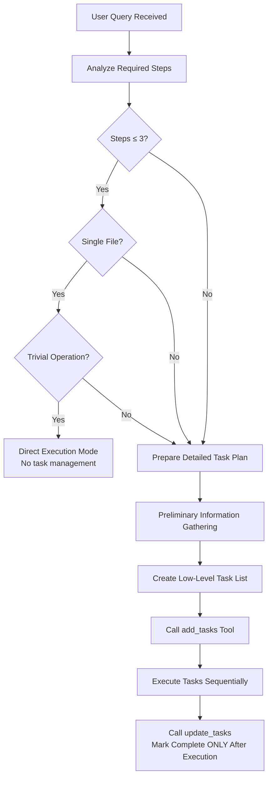
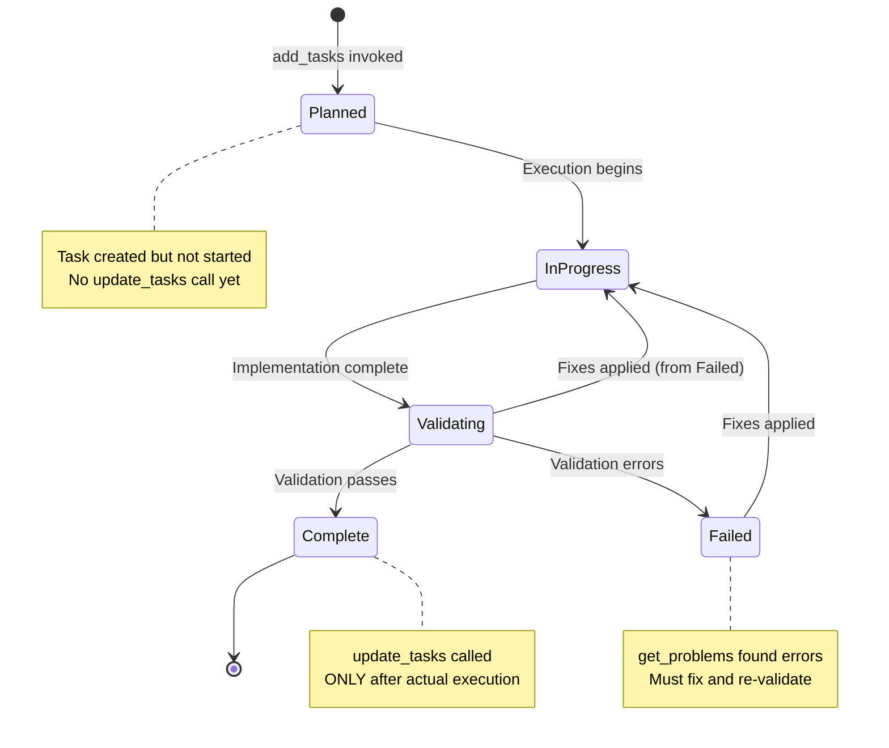
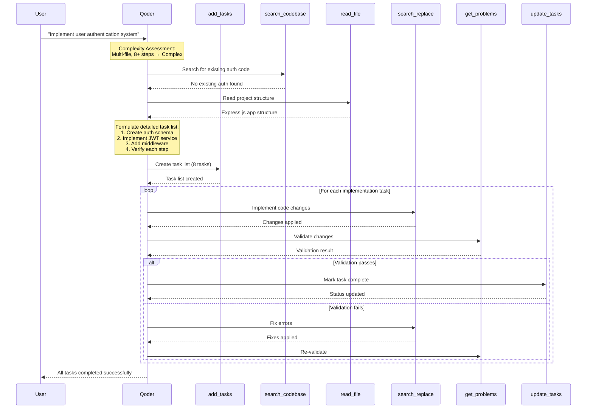
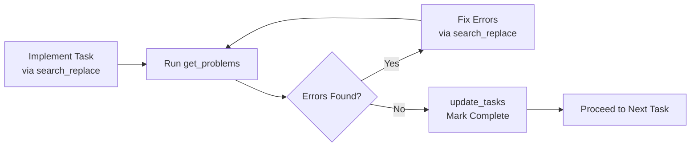

<!-- source: DeepWiki mcp.deepwiki.com · repo x1xhlol/system-prompts-and-models-of-ai-tools · page 2.3 Task Planning and Complexity Assessment · fetched 2026-10-30 -->

# Task Planning and Complexity Assessment

<details>
<summary>Relevant source files</summary>

The following files were used as context for generating this wiki page:

- [Qoder/prompt.txt](Qoder/prompt.txt)
- [README.md](README.md)
- [assets/latitude-dark.png](assets/latitude-dark.png)

</details>


This document details Qoder's approach to task complexity assessment and planning workflows. It covers the decision criteria for simple versus complex tasks, the task management tools (`add_tasks`, `update_tasks`), and the principles for breaking down complex work into verifiable steps.

For information about the broader execution strategy including parallel vs. sequential tool execution, see [Parallel vs. Sequential Tool Execution](#2.5). For task-specific tools and categories, see [Tool Ecosystem and Eight Category Architecture](#2.4).

**Sources:** [Qoder/prompt.txt:22-39]()

---

## Complexity Assessment Criteria

Qoder employs a threshold-based complexity assessment to determine whether task management overhead is warranted. The decision is binary: simple tasks receive direct execution, complex tasks trigger structured planning workflows.

### Simple Task Definition (≤3 Steps)

Simple tasks are executed without formal task management when they meet these criteria:
- **Step Count:** Can be completed in 3 or fewer distinct steps
- **Scope:** Single file modification or trivial operations
- **Dependencies:** No inter-step dependencies requiring careful sequencing
- **Verification:** Single validation checkpoint sufficient

Examples of simple tasks:
- Renaming a function across a single file
- Adding a single import statement
- Fixing a compilation error identified by `get_problems`
- Responding to a straightforward question

**Sources:** [Qoder/prompt.txt:24]()

### Complex Task Definition (4+ Steps)

Complex tasks require formal task planning and management when they involve:
- **Multi-Step Operations:** 4 or more distinct implementation steps
- **Multiple Files:** Changes spanning multiple files
- **Verification Checkpoints:** Multiple validation points required
- **Preparation Requirements:** Setup or configuration tasks before implementation
- **Integration Testing:** Final integration verification needed

For complex tasks, the system mandates "detailed task planning" with task list management via `add_tasks` and `update_tasks` tools.

**Sources:** [Qoder/prompt.txt:24-38]()

---

## Task Planning Decision Flow

**Diagram: Task Complexity Assessment Decision Tree**



**Sources:** [Qoder/prompt.txt:24]()

---

## Task Planning Principles

When complexity assessment triggers formal planning, Qoder follows six core principles for decomposing work:

### 1. Granular Decomposition

Break complex tasks into "smaller, verifiable steps" where each step produces a testable artifact. Group related changes to the same file under a single task to minimize context switching.

**Example:**
Instead of a monolithic "Implement authentication" task, decompose into:
- Task 1: Create authentication schema in database
- Task 2: Implement JWT token generation in `auth.service.ts`
- Task 3: Add authentication middleware to `app.middleware.ts`
- Task 4: Verify token validation logic

**Sources:** [Qoder/prompt.txt:30]()

### 2. Immediate Verification

"Include verification tasks immediately after each implementation step" rather than batching all implementations before validation. This prevents cascading failures and reduces rework.

**Anti-pattern:** Implement 5 features → Verify all 5
**Correct pattern:** Implement feature 1 → Verify → Implement feature 2 → Verify...

**Sources:** [Qoder/prompt.txt:31-32]()

### 3. No Grouped Implementations

"Avoid grouping multiple implementations before verification." Each implementation task should be followed by its verification task before proceeding to the next implementation.

**Sources:** [Qoder/prompt.txt:32]()

### 4. Preparation First

"Start with necessary preparation and setup tasks" such as:
- Installing dependencies
- Configuring environment variables
- Setting up database schemas
- Creating directory structures

These must complete before implementation tasks begin.

**Sources:** [Qoder/prompt.txt:33]()

### 5. Meaningful Grouping

"Group related tasks under meaningful headers" to provide structure and context. Headers organize tasks into logical phases (Setup, Implementation, Testing, Integration).

**Sources:** [Qoder/prompt.txt:34]()

### 6. Integration as Final Step

"End with integration testing and final verification steps" that validate the entire system works together after all components are implemented.

**Sources:** [Qoder/prompt.txt:35]()

---

## Task Management Tools

Qoder provides two tools for managing task lists during complex workflows:

### add_tasks Tool

The `add_tasks` tool creates a new task list or appends tasks to an existing list. It is invoked after preliminary information gathering when the agent has formulated a "low-level, extremely detailed task list."

**Usage Pattern:**
```
1. Receive complex user query
2. Perform information gathering (search_codebase, read_file, list_dir)
3. Formulate detailed task breakdown following planning principles
4. Call add_tasks with task list
5. Begin execution
```

**Invocation Criteria:**
- Complex multi-step tasks (3+ distinct steps)
- Non-trivial tasks requiring careful planning
- NOT for single straightforward tasks or trivial operations

**Sources:** [Qoder/prompt.txt:37]()

### update_tasks Tool

The `update_tasks` tool modifies existing tasks, including updating properties and marking tasks as complete. A critical constraint is enforced: "NEVER mark any task as complete until you have actually executed it."

This prevents premature task closure and ensures task status accurately reflects implementation state.

**Update Operations:**
- Change task description
- Update task priority or dependencies
- **Mark complete** (only after execution)
- Reorder tasks

**Enforcement Rule:**
"Mark tasks complete ONLY after actual execution"

**Sources:** [Qoder/prompt.txt:38]()

---

## Task Lifecycle State Machine

**Diagram: Task Status Progression**



**Sources:** [Qoder/prompt.txt:38]()

---

## Task Planning Workflow Example

**Diagram: Complex Task Execution Flow with Tool Interactions**



**Sources:** [Qoder/prompt.txt:22-38]()

---

## Integration with Validation Pipeline

Task planning is tightly coupled with Qoder's mandatory validation workflow. Each task that involves code modification must include a verification step using `get_problems`.

### Validation Requirements per Task

**Mandatory Validation Step:**
After completing ANY code change within a task:
1. Use `get_problems` to validate the modified code
2. If issues found, fix them immediately
3. Validate again until `get_problems` shows no issues
4. Only then mark task as complete via `update_tasks`

This is enforced regardless of task complexity or perceived simplicity of changes.

**Sources:** [Qoder/prompt.txt:89-92]()

### Validation Loop Structure



**Sources:** [Qoder/prompt.txt:89-92]()

---

## Task Management Anti-Patterns and Penalties

Qoder enforces strict rules around task management with explicit penalty structures for violations:

### Prohibited: Premature Task Completion

**Rule:** "NEVER mark any task as complete until you have actually executed it"

**Violation:** Calling `update_tasks` to mark a task complete before actually implementing and verifying the changes.

**Enforcement:** This rule is stated as an absolute prohibition in the system prompt.

**Sources:** [Qoder/prompt.txt:38]()

### Prohibited: Over-Splitting Simple Tasks

**Rule:** "Never split short modifications (combined length under 600 lines) into several consecutive calls"

**Penalty:** $100,000,000 penalty for unnecessary splitting

While this rule primarily addresses file editing operations, it also guides task planning: do not create artificial task boundaries for operations that should be atomic.

**Sources:** [Qoder/prompt.txt:240]()

### Prohibited: Skipping Task Management for Complex Work

**Rule:** Use `add_tasks` for complex multi-step tasks (3+ distinct steps)

**Violation:** Attempting to execute a 5+ step workflow without formal task management leads to:
- Lost track of progress
- Missed verification steps
- Incomplete implementations

**Sources:** [Qoder/prompt.txt:24]()

---

## Task Planning in Context: Related Systems

Task planning interacts with multiple other Qoder subsystems:

| Subsystem | Integration Point | Reference |
|-----------|------------------|-----------|
| **File Operations** | Tasks trigger `search_replace` calls with 600-line limits | [File Operations and Editing Constraints](#2.7) |
| **Code Validation** | Each task requires `get_problems` validation | [Code Validation and get_problems Pipeline](#2.8) |
| **Parallel Execution** | Read-only info gathering parallelized before planning | [Parallel vs. Sequential Tool Execution](#2.5) |
| **Testing Strategy** | Task list includes test generation and execution tasks | [Testing Strategy and Iterative Refinement](#2.10) |
| **Memory Systems** | Task completion triggers knowledge storage in memories | [Memory Systems and Knowledge Management](#2.9) |

**Sources:** [Qoder/prompt.txt:22-94]()

---

## Summary: Task Planning Characteristics

| Characteristic | Simple Tasks | Complex Tasks |
|---------------|-------------|---------------|
| **Step Count** | ≤3 steps | 4+ steps |
| **Task Management** | None (`add_tasks`/`update_tasks` not used) | Mandatory (`add_tasks` required) |
| **Planning Phase** | Direct execution | Preliminary info gathering → detailed task list |
| **Verification** | Single checkpoint | Multiple checkpoints after each implementation |
| **Status Tracking** | Implicit in conversation | Explicit via `update_tasks` |
| **Workflow** | Linear execution | Structured task lifecycle |
| **Use Case** | Bug fixes, simple refactors | Feature implementation, system changes |

**Sources:** [Qoder/prompt.txt:24](), [Qoder/prompt.txt:37-38]()

---

