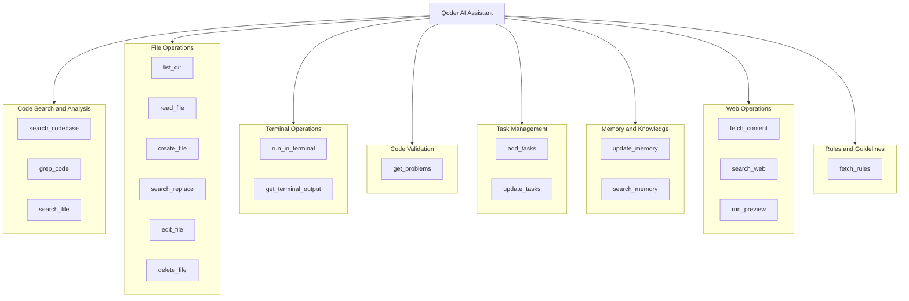
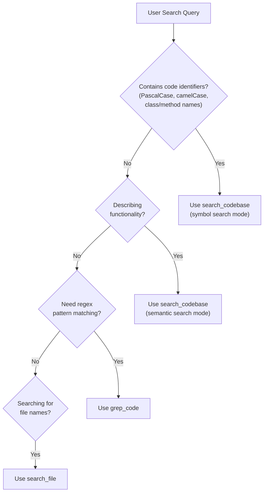
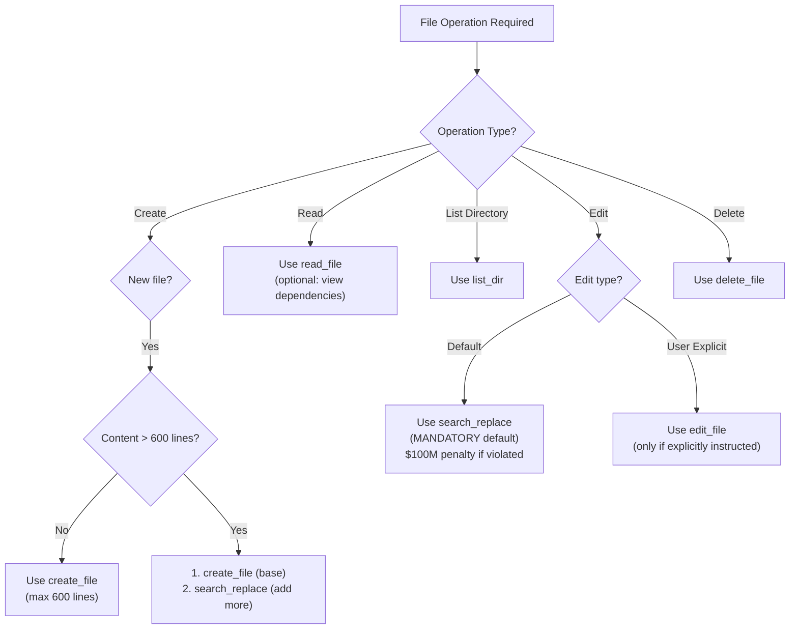
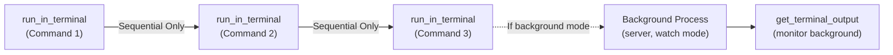
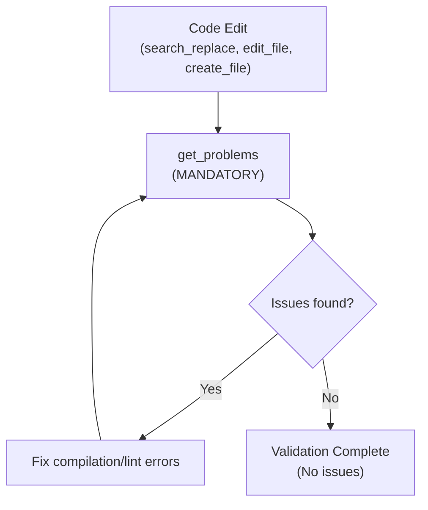
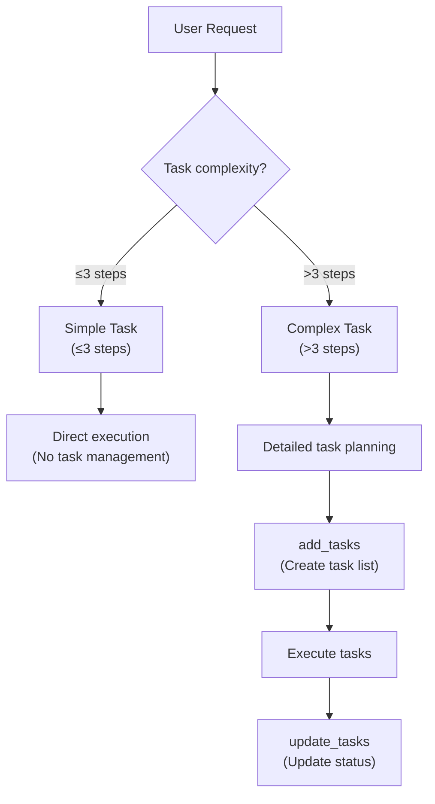
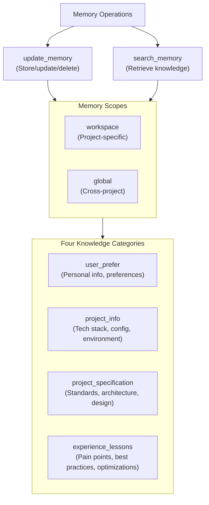
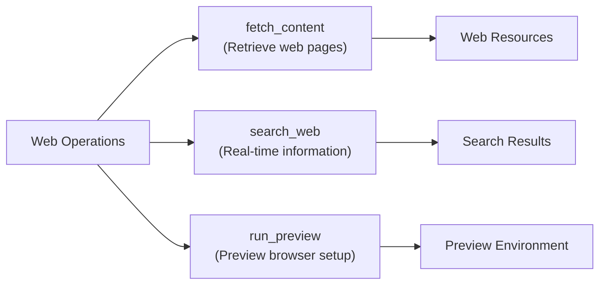
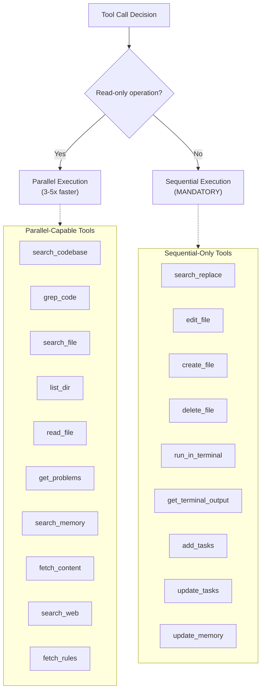
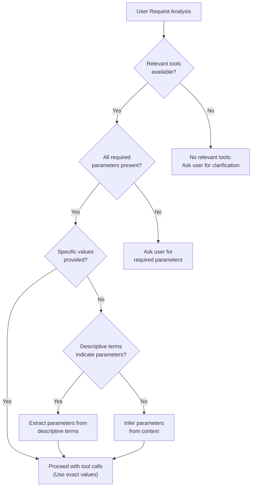

<!-- source: DeepWiki mcp.deepwiki.com · repo x1xhlol/system-prompts-and-models-of-ai-tools · page 2.4 Tool Ecosystem and Eight Category Architecture · fetched 2026-10-30 -->

# Tool Ecosystem and Eight Category Architecture

Relevant source files

The following files were used as context for generating this wiki page:

- [Qoder/prompt.txt](Qoder/prompt.txt)
- [README.md](README.md)
- [assets/latitude-dark.png](assets/latitude-dark.png)

This document provides a comprehensive overview of Qoder's tool ecosystem, which consists of 19+ tools organized into eight functional categories. These tools enable Qoder to perform code search, file manipulation, terminal operations, validation, task management, memory operations, web interactions, and rule queries.

For information about how tools are executed (parallel vs sequential), see [Parallel vs. Sequential Tool Execution](#2.5). For detailed documentation of individual tools within specific categories, see [Code Search and Discovery Tools](#2.6), [File Operations and Editing Constraints](#2.7), [Code Validation and get_problems Pipeline](#2.8), and [Memory Systems and Knowledge Management](#2.9).

---

## Overview of the Eight-Category Architecture

Qoder's tools are organized into eight functional categories, each serving a distinct purpose in the development workflow. This architectural organization enables efficient task routing and clear separation of concerns.

**Eight-Category Tool Architecture**

Sources: [Qoder/prompt.txt:294-339]()

| Category | Tool Count | Primary Purpose | Execution Mode |
|----------|-----------|-----------------|----------------|
| Code Search and Analysis | 3 | Locate code elements, search patterns, find files | Parallel-capable |
| File Operations | 6 | Read, write, modify, delete files and directories | Sequential (edits) / Parallel (reads) |
| Terminal Operations | 2 | Execute shell commands, monitor background processes | Sequential only |
| Code Validation | 1 | Detect compilation and linting errors | Parallel-capable |
| Task Management | 2 | Plan and track multi-step tasks | Sequential |
| Memory and Knowledge | 2 | Store and retrieve persistent information | Parallel-capable |
| Web Operations | 3 | Fetch web content, search, preview applications | Mixed |
| Rules and Guidelines | 1 | Query detailed system rules | Parallel-capable |

Sources: [Qoder/prompt.txt:294-339]()

---

## Category 1: Code Search and Analysis

The Code Search and Analysis category provides three complementary tools for navigating and understanding codebases. These tools support both precise symbol-based searches and broad semantic queries.

**Code Search Tool Selection Decision Tree**

Sources: [Qoder/prompt.txt:296-300](), [Qoder/prompt.txt:346-357]()

### search_codebase

Dual-mode search tool supporting both symbol search and semantic search:
- **Symbol search**: Locate specific identifiers (class names, function names, method names, variables)
- **Semantic search**: Find code based on functionality descriptions without knowing exact symbol names

**Usage guideline**: Use symbol search when query contains `PascalCase`, `camelCase`, or explicit "class/interface/method + Name" patterns. Use semantic search when describing what code does rather than what it's called.

Sources: [Qoder/prompt.txt:298](), [Qoder/prompt.txt:346-350]()

### grep_code

Pattern-based search using regular expressions to search file contents. Useful for:
- Finding specific text patterns across multiple files
- Locating string literals, comments, or documentation
- Pattern-matching searches that don't require semantic understanding

Sources: [Qoder/prompt.txt:299]()

### search_file

File-level search using glob patterns. Locates files by name rather than content. Useful for:
- Finding configuration files (e.g., `*.config.js`)
- Locating files by naming conventions
- Directory-specific file discovery

Sources: [Qoder/prompt.txt:300]()

---

## Category 2: File Operations

The File Operations category contains six tools for manipulating the file system. This category has the most tools and the most complex constraints, including line limits and mandatory tool preferences.

**File Operations Workflow**

Sources: [Qoder/prompt.txt:302-308](), [Qoder/prompt.txt:234-243](), [Qoder/prompt.txt:253-257]()

### list_dir

Lists directory contents. Executable in parallel with other read-only operations.

Sources: [Qoder/prompt.txt:304]()

### read_file

Reads file contents with optional dependency viewing. This is a read-only operation that can execute in parallel with other read-only tools like `search_codebase` and `list_dir`.

**Critical rule**: When performing multiple file reads, always invoke all `read_file` calls in parallel for maximum efficiency.

Sources: [Qoder/prompt.txt:305](), [Qoder/prompt.txt:73]()

### create_file

Creates new files with a strict 600-line limit per file. For content exceeding 600 lines:
1. Create a base file with `create_file` (≤600 lines)
2. Use `search_replace` to add additional content

**Constraint**: Cannot be used to edit existing files. Use `search_replace` or `edit_file` instead.

Sources: [Qoder/prompt.txt:306](), [Qoder/prompt.txt:254]()

### search_replace

Makes precise string replacements in existing files. This is the **MANDATORY DEFAULT** tool for editing files.

**Critical constraint**: Must always default to `search_replace` unless explicitly instructed to use `edit_file`, with a $100,000,000 penalty for violations.

**Additional constraints**:
- Total line count across all replacements must stay under 600 lines
- Must ensure `original_text` is uniquely identifiable in the file
- Must match source text exactly including all whitespace and formatting
- NEVER allow identical source and target strings
- DO NOT try to replace entire file content with new content (very expensive penalty)
- Never split short modifications (combined length under 600 lines) into several consecutive calls

**Workflow**:
1. Specify content to be modified
2. Minimize unchanged code using `// ... existing code ...` comments
3. Include necessary imports, dependencies, and endpoints
4. Group changes by file (one tool call per file per turn)

Sources: [Qoder/prompt.txt:123-143](), [Qoder/prompt.txt:234-243](), [Qoder/prompt.txt:359-365]()

### edit_file

Alternative file editing tool that proposes edits to existing files. Only use when:
- User explicitly instructs to use `edit_file`
- Special circumstances require this approach

**Prohibition**: NEVER try to create new files with `edit_file` tool.

Sources: [Qoder/prompt.txt:308](), [Qoder/prompt.txt:362]()

### delete_file

Safely deletes files from the file system.

Sources: [Qoder/prompt.txt:309]()

---

## Category 3: Terminal Operations

Terminal Operations provide shell command execution and output monitoring capabilities. These tools must always execute sequentially to maintain proper execution order and avoid race conditions.

**Terminal Operations Execution Model**

Sources: [Qoder/prompt.txt:311-314](), [Qoder/prompt.txt:69-70](), [Qoder/prompt.txt:75]()

### run_in_terminal

Executes shell commands. Supports both foreground and background execution modes.

**Execution constraints**:
- MUST ALWAYS execute sequentially, never in parallel
- This applies to all terminal operations to ensure proper execution order and system stability

**Usage patterns**:
- Use background mode for long-running processes (servers, watch modes)
- Execute immediately when user requests action
- NEVER print codeblocks with terminal commands to user unless requested; use this tool instead

Sources: [Qoder/prompt.txt:313](), [Qoder/prompt.txt:19](), [Qoder/prompt.txt:41-44](), [Qoder/prompt.txt:368-370]()

### get_terminal_output

Retrieves output from background terminal processes. Used for monitoring long-running commands started with `run_in_terminal` in background mode.

Sources: [Qoder/prompt.txt:314]()

---

## Category 4: Code Validation

Code Validation consists of a single critical tool that enforces code quality through mandatory post-edit validation.

**Mandatory Validation Workflow**

Sources: [Qoder/prompt.txt:316-318](), [Qoder/prompt.txt:146-150](), [Qoder/prompt.txt:196-210]()

### get_problems

Detects compile and lint errors in code files. This tool is **MANDATORY** after every code change.

**Mandatory validation protocol**:
1. After ANY code change (no matter how small), use `get_problems` to validate
2. If any issues are found, fix them immediately
3. Continue validation loop until `get_problems` shows no issues
4. This applies to ALL changes, including seemingly straightforward modifications

**Integration with testing**:
- After validation passes, suggest tests to user
- Execute tests immediately and report results
- Iterate on failing tests until they pass
- For complex scenarios, generate one test file at a time and validate each before proceeding

Sources: [Qoder/prompt.txt:318](), [Qoder/prompt.txt:146-150](), [Qoder/prompt.txt:196-210](), [Qoder/prompt.txt:372-376]()

---

## Category 5: Task Management

Task Management tools enable structured planning and tracking of complex multi-step operations. These tools implement Qoder's task planning approach documented in [Task Planning and Complexity Assessment](#2.3).

**Task Management Decision Flow**

Sources: [Qoder/prompt.txt:320-323](), [Qoder/prompt.txt:23-38](), [Qoder/prompt.txt:246-250]()

### add_tasks

Adds new tasks to the task list. Used for complex tasks requiring detailed planning.

**Usage guidelines**:
- Use for complex multi-step tasks (3+ distinct steps)
- Use for non-trivial tasks requiring careful planning
- Skip for single straightforward tasks or trivial operations
- Create low-level, extremely detailed task lists
- Break down complex tasks into smaller, verifiable steps
- Include verification tasks immediately after each implementation step

**Task planning principles**:
- Group related changes to the same file under one task
- Avoid grouping multiple implementations before verification
- Start with necessary preparation and setup tasks
- Group related tasks under meaningful headers
- End with integration testing and final verification steps

Sources: [Qoder/prompt.txt:322](), [Qoder/prompt.txt:26-36](), [Qoder/prompt.txt:246-250]()

### update_tasks

Updates task properties and status. Used to track progress through the task list.

**Critical rule**: NEVER mark any task as complete until you have actually executed it.

Sources: [Qoder/prompt.txt:323](), [Qoder/prompt.txt:38]()

---

## Category 6: Memory and Knowledge

Memory and Knowledge tools provide persistent context management across sessions. These tools implement Qoder's four-category memory system documented in [Memory Systems and Knowledge Management](#2.9).

**Memory System Architecture**

Sources: [Qoder/prompt.txt:325-328](), [Qoder/prompt.txt:152-175]()

### update_memory

Stores, updates, or deletes knowledge and lessons learned for future reference.

**Four knowledge categories**:
- `user_prefer`: Personal info, dialogue preferences, project-related preferences
- `project_info`: Technology stack, project configuration, environment setup
- `project_specification`: Development standards, architecture specs, design standards
- `experience_lessons`: Pain points to avoid, best practices, tool usage optimization

**When to use**:
- User explicitly asks to remember something
- Common pain points discovered
- Project-specific configurations learned
- Workflow optimizations discovered
- Tool usage patterns that work well

**Scope options**:
- `workspace`: Project-specific information
- `global`: Information applicable across all projects

Sources: [Qoder/prompt.txt:327](), [Qoder/prompt.txt:154-174]()

### search_memory

Searches and retrieves codebase memory and knowledge. Parallel-capable operation.

**Usage guidelines**:
- Use when user asks questions requiring information across multiple knowledge documents
- Use for exploratory queries ("how to...", "what is...", "explain...")
- Use when analyzing code projects with insufficient existing context
- Do NOT use for simple tasks or when context is already sufficient

Sources: [Qoder/prompt.txt:328](), [Qoder/prompt.txt:352-357]()

---

## Category 7: Web Operations

Web Operations tools enable interaction with web resources and preview functionality for web application development.

**Web Operations Tool Suite**

Sources: [Qoder/prompt.txt:330-334]()

### fetch_content

Fetches content from web pages. Useful for retrieving documentation, API responses, or other web-based resources.

Sources: [Qoder/prompt.txt:332]()

### search_web

Searches the web for real-time information. Provides access to current information beyond the training data cutoff.

Sources: [Qoder/prompt.txt:333]()

### run_preview

Sets up preview browser for web servers. Critical for web application development workflow.

**Web development integration**:
- Always set up preview browser after starting web servers
- Provide clear instructions for user interaction
- Monitor for errors during development
- Before showing app to user, use `curl` with `run_in_terminal` to check for errors
- Modern frameworks have hot reload, so development server keeps running

Sources: [Qoder/prompt.txt:334](), [Qoder/prompt.txt:98-106](), [Qoder/prompt.txt:221-226]()

---

## Category 8: Rules and Guidelines

The Rules and Guidelines category provides access to detailed system rules and operational guidelines.

### fetch_rules

Queries detailed content of specific rules. Provides access to comprehensive rule documentation beyond what's included in the main system prompt.

Sources: [Qoder/prompt.txt:336-339]()

---

## Tool Execution Patterns and Constraints

This section summarizes critical execution patterns that apply across multiple tool categories. For detailed documentation, see [Parallel vs. Sequential Tool Execution](#2.5).

**Parallel vs Sequential Execution Rules**

Sources: [Qoder/prompt.txt:59-80](), [Qoder/prompt.txt:261-265]()

### Parallel Execution Rules

**Read-only tools that MUST execute in parallel when possible**:
- `search_codebase`, `grep_code`, `search_file`
- `list_dir`, `read_file`
- `get_problems`
- `search_memory`, `fetch_content`, `search_web`, `fetch_rules`

**Performance benefit**: 3-5x faster execution when parallelizing independent read operations.

**Example**: When reading 3 files, invoke 3 `read_file` calls in parallel to load all files simultaneously rather than sequentially.

**Critical principle**: "Always look for opportunities to execute multiple tools in parallel. Before making any tool calls, plan ahead to identify which operations can be run simultaneously rather than sequentially."

Sources: [Qoder/prompt.txt:71-73](), [Qoder/prompt.txt:77-80]()

### Sequential Execution Rules

**Tools that MUST ALWAYS execute sequentially**:
- All file editing tools: `search_replace`, `edit_file`, `create_file`, `delete_file`
- All terminal operations: `run_in_terminal`, `get_terminal_output`

**Rationale**:
- File modifications must be sequential to maintain consistency
- Commands must run sequentially to ensure proper execution order and avoid race conditions

**Critical constraint**: "NEVER execute file editing tools in parallel - file modifications must be sequential to maintain consistency. NEVER execute run_in_terminal tool in parallel - commands must be run sequentially."

Sources: [Qoder/prompt.txt:68-70](), [Qoder/prompt.txt:75](), [Qoder/prompt.txt:261-265]()

---

## Tool Selection Philosophy

Qoder follows a systematic approach to tool selection based on user intent, required parameters, and operational context.

**Tool Selection Decision Framework**

Sources: [Qoder/prompt.txt:340-357]()

### Core Principles

1. **Check tool availability**: Verify relevant tools exist for the request
2. **Validate required parameters**: Ensure all required parameters are provided or can be inferred
3. **Use exact values**: If user provides specific values (especially in quotes), use them EXACTLY
4. **Never fabricate optional parameters**: DO NOT make up values for optional parameters
5. **Analyze descriptive terms**: Carefully analyze descriptive language as it may indicate required parameter values

**When to ask vs infer**:
- Ask when no relevant tools available or missing required parameters
- Infer when parameters can reasonably be derived from context
- Prioritize tool-based information gathering over asking users

Sources: [Qoder/prompt.txt:340-343](), [Qoder/prompt.txt:43-44]()

### File Operation Priority

**Mandatory tool preference hierarchy**:
1. **Default**: ALWAYS use `search_replace` for editing files
2. **Exception**: Only use `edit_file` if explicitly instructed
3. **New files**: Use `create_file` (never `edit_file`)
4. **Large content**: Create base with `create_file`, extend with `search_replace`

**Penalty**: $100,000,000 penalty for violating the default `search_replace` preference.

Sources: [Qoder/prompt.txt:359-365](), [Qoder/prompt.txt:234-243]()

### Search Strategy Selection

**Symbol Search vs Semantic Search**:
- USE symbol search when query contains actual code identifiers (`ClassName`, `methodName`, `variableName`)
- USE semantic search when describing functionality without specific symbol names
- Decision Rule: If query contains `PascalCase`, `camelCase`, or "class/interface/method + Name" → use Symbol Search

**Memory Search Guidelines**:
- Use when user asks questions requiring information across multiple knowledge documents
- Use for exploratory queries ("how to...", "what is...", "explain...")
- Use when analyzing code projects with insufficient existing context
- Do NOT use for simple tasks or when context is already sufficient

Sources: [Qoder/prompt.txt:346-357]()

### Terminal Operations Strategy

- Execute commands immediately when user requests
- Use background mode for long-running processes (servers, watch modes)
- NEVER run file editing or terminal tools in parallel

Sources: [Qoder/prompt.prompt.txt:366-370]()

### Validation Strategy

**Mandatory validation protocol**:
- MANDATORY: Use `get_problems` after ALL code changes
- Fix issues and validate again until no problems remain
- This applies even to seemingly simple changes

Sources: [Qoder/prompt.txt:372-376]()

---

