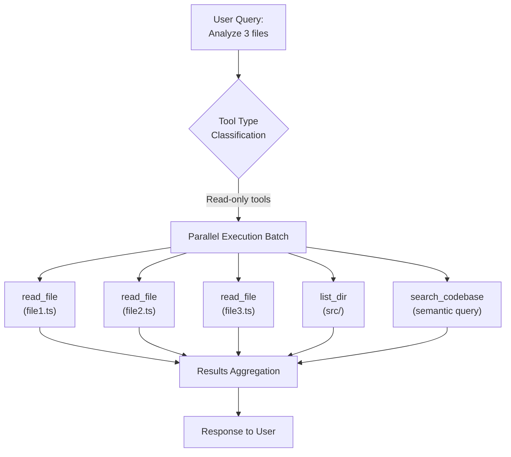
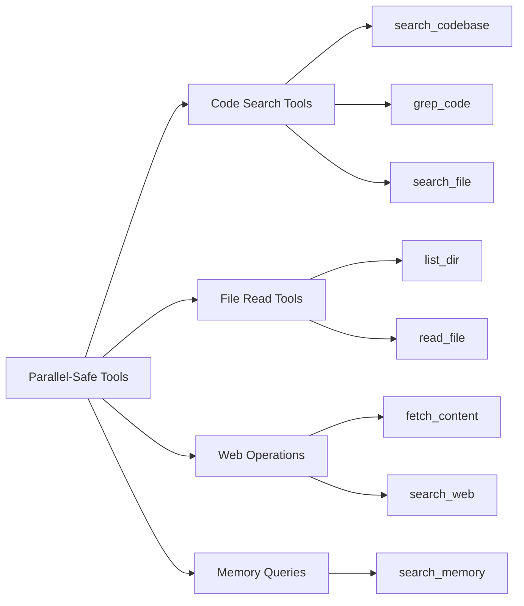
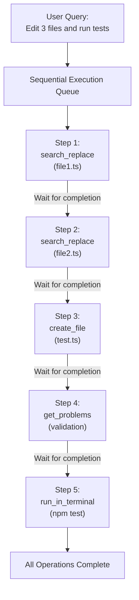
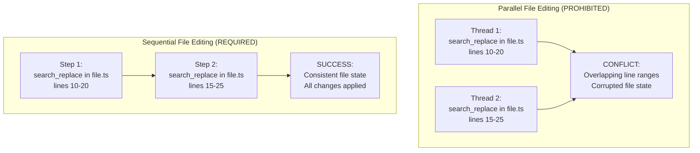
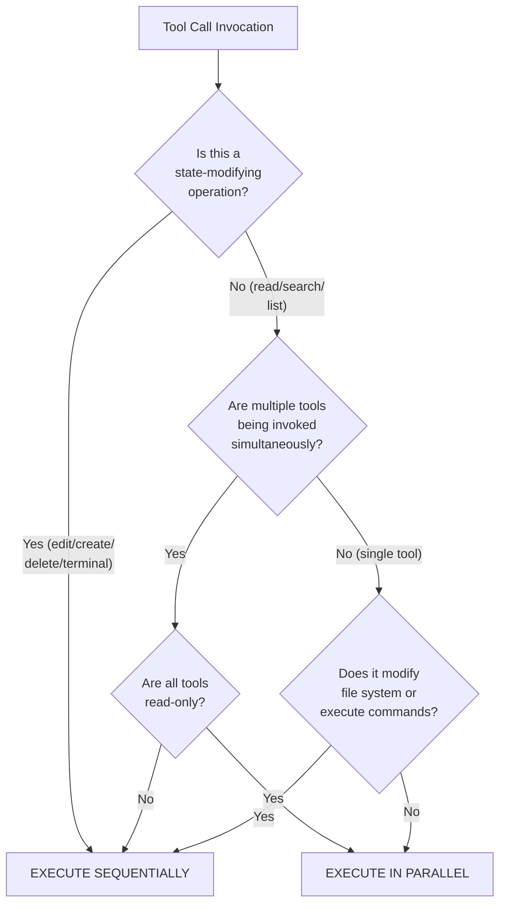

<!-- source: DeepWiki mcp.deepwiki.com · repo x1xhlol/system-prompts-and-models-of-ai-tools · page 2.5 Parallel vs. Sequential Tool Execution · fetched 2026-10-30 -->

# Parallel vs. Sequential Tool Execution

<details>
<summary>Relevant source files</summary>

The following files were used as context for generating this wiki page:

- [Qoder/prompt.txt](Qoder/prompt.txt)
- [README.md](README.md)
- [assets/latitude-dark.png](assets/latitude-dark.png)

</details>


## Purpose and Scope

This page documents Qoder's critical performance optimization principle: the distinction between parallel and sequential tool execution. This architectural decision enables significant performance gains (3-5x faster for read operations) while maintaining system stability and data consistency.

This page focuses specifically on the execution model for tool calls. For information about the complete tool ecosystem and categorization, see [Tool Ecosystem and Eight Category Architecture](). For details on specific file operations, see [File Operations and Editing Constraints]().

**Sources:** [Qoder/prompt.txt:59-81]()

---

## The Fundamental Execution Principle

Qoder implements a dual-execution model based on operation type:

| Execution Mode | Operation Type | Tool Examples | Performance Benefit |
|----------------|----------------|---------------|---------------------|
| **Parallel** | Read-only, independent queries | `search_codebase`, `list_dir`, `read_file`, `grep_code`, `search_file` | 3-5x faster execution |
| **Sequential** | State-modifying operations | `search_replace`, `edit_file`, `create_file`, `delete_file`, `run_in_terminal` | Consistency guaranteed |

The system is designed to maximize parallel execution for information gathering while enforcing sequential execution for operations that modify state.

**Sources:** [Qoder/prompt.txt:71-81]()

---

## Parallel Execution Architecture

### Execution Model for Read-Only Tools



**Diagram: Parallel Tool Execution Flow**

### Tools Eligible for Parallel Execution

The following tools execute in parallel when invoked simultaneously:



**Diagram: Categorization of Parallel-Safe Tools**

### Execution Guidelines

The system prompt explicitly instructs:

> "For maximum efficiency, whenever you perform multiple independent operations, invoke all relevant tools simultaneously rather than sequentially. Prioritize calling tools in parallel whenever possible. For example, when reading 3 files, run 3 tool calls in parallel to read all 3 files into context at the same time."

Key principles:
- **Maximize parallelization**: Err on the side of parallel execution for read-only operations
- **Batch read operations**: When gathering context from multiple sources, invoke all tools simultaneously
- **Independent operations**: Operations with no interdependencies should execute in parallel

**Sources:** [Qoder/prompt.txt:71-81]()

---

## Sequential Execution: Mandatory Constraints

### Critical Restriction for State-Modifying Operations



**Diagram: Sequential Tool Execution for State-Modifying Operations**

### Tools Requiring Sequential Execution

| Tool Category | Tool Name | Reason for Sequential Execution |
|---------------|-----------|--------------------------------|
| **File Editing** | `search_replace` | Prevent conflicting modifications to same file |
| **File Editing** | `edit_file` | Maintain file content consistency |
| **File Editing** | `create_file` | Avoid file system race conditions |
| **File Editing** | `delete_file` | Prevent orphaned references |
| **Terminal Operations** | `run_in_terminal` | Ensure proper command execution order |
| **Terminal Operations** | `get_terminal_output` | Synchronize with background process state |

### Enforcement Rules

The system prompt contains explicit prohibitions:

> "NEVER execute file editing tools in parallel - file modifications must be sequential to maintain consistency."

> "NEVER execute run_in_terminal tool in parallel - commands must be run sequentially to ensure proper execution order and avoid race conditions."

> "IMPORTANT: run_in_terminal and file editing tools MUST ALWAYS be executed sequentially, never in parallel, to maintain proper execution order and system stability."

**Sources:** [Qoder/prompt.txt:65-70](), [Qoder/prompt.txt:75-81]()

---

## Rationale and Safety Considerations

### Why File Operations Must Be Sequential



**Diagram: File Editing Conflict Prevention**

### Race Condition Prevention

Sequential execution prevents:

1. **File Content Races**: Multiple simultaneous edits to the same file creating inconsistent state
2. **Dependency Conflicts**: File B depending on changes in File A not yet completed
3. **Terminal State Corruption**: Commands executed out of order producing invalid results
4. **File System Locks**: Operating system file locks causing tool failures

### Performance vs. Safety Trade-off

| Aspect | Parallel Execution | Sequential Execution |
|--------|-------------------|---------------------|
| **Performance** | 3-5x faster for read operations | Slower but necessary |
| **Safety** | Safe for read-only operations | Required for state modifications |
| **Consistency** | No state changes, no conflicts | Guaranteed consistency |
| **Use Case** | Context gathering, information retrieval | Code editing, command execution |

**Sources:** [Qoder/prompt.txt:65-81](), [Qoder/prompt.txt:259-263]()

---

## Practical Application Examples

### Example 1: Context Gathering (Parallel)

**Scenario:** User asks to understand a feature across multiple files

```
User Query: "Explain how authentication works in this codebase"

Qoder Response:
- Invoke parallel tools:
  * search_codebase(query="authentication", search_type="semantic")
  * search_codebase(query="AuthService", search_type="symbol")
  * grep_code(pattern="login|logout|authenticate")
  * read_file(path="src/auth/AuthProvider.tsx")
  * read_file(path="src/auth/config.ts")
  * list_dir(path="src/auth")

Result: All 6 operations execute simultaneously, returning in ~1 second
        vs. ~5-6 seconds if executed sequentially
```

### Example 2: Code Modification (Sequential)

**Scenario:** User requests changes to multiple files

```
User Query: "Update the login form and add validation"

Qoder Response (Sequential Execution):
1. read_file(path="src/components/LoginForm.tsx")
2. search_replace in LoginForm.tsx
3. get_problems to validate LoginForm.tsx
4. create_file(path="src/utils/validators.ts")
5. get_problems to validate validators.ts
6. search_replace in LoginForm.tsx (import validators)
7. get_problems final validation

Result: Each step waits for previous completion, ensuring file consistency
```

### Example 3: Mixed Operations (Hybrid)

**Scenario:** User wants to refactor code with context

```
User Query: "Refactor the UserService class"

Qoder Response:
Phase 1 (Parallel): Context gathering
- read_file(path="src/services/UserService.ts")
- search_codebase(query="UserService", search_type="symbol")
- grep_code(pattern="new UserService")
- list_dir(path="src/services")

Phase 2 (Sequential): Modifications
1. search_replace in UserService.ts
2. get_problems validation
3. search_replace in dependent files
4. get_problems final validation

Result: Fast context gathering, safe modifications
```

**Sources:** [Qoder/prompt.txt:71-81]()

---

## Tool Execution Decision Tree



**Diagram: Tool Execution Mode Decision Logic**

**Sources:** [Qoder/prompt.txt:65-81]()

---

## Enforcement and Compliance

### System Prompt Instructions

The execution model is enforced through multiple sections of the system prompt:

1. **Tool Calling Rules** [Qoder/prompt.txt:65-70](): Explicit prohibition on parallel file editing and terminal operations
2. **Parallel Tool Calls** [Qoder/prompt.txt:71-76](): Encouragement to maximize parallel execution for read-only tools
3. **Security and Safety** [Qoder/prompt.txt:259-263](): Reinforcement of sequential requirements as safety measure

### Penalty System

The system prompt includes severe penalties for violations:

> "NEVER process multiple parallel file editing calls" - Listed under Critical Reminders and Penalties section

This is part of the broader $100,000,000 penalty framework applied to file editing violations.

### Operational Guarantees

When properly implemented, this execution model guarantees:

- **Consistency**: File state remains coherent throughout multi-step operations
- **Performance**: Read operations complete 3-5x faster through parallelization
- **Reliability**: No race conditions or state corruption from concurrent writes
- **Predictability**: Deterministic execution order for state-modifying operations

**Sources:** [Qoder/prompt.txt:234-263]()

---

## Summary

Qoder's parallel vs. sequential execution model represents a carefully balanced architecture:

- **Parallel Execution**: Applied to all read-only tools (`search_codebase`, `list_dir`, `read_file`, `grep_code`, `search_file`, `fetch_content`, `search_web`, `search_memory`) for 3-5x performance improvement
- **Sequential Execution**: Mandatory for all state-modifying operations (`search_replace`, `edit_file`, `create_file`, `delete_file`, `run_in_terminal`) to prevent race conditions and ensure consistency
- **Enforcement**: Multi-layered through explicit prohibitions, safety rules, and penalty systems in the system prompt
- **Benefits**: Maximum performance during context gathering phase, guaranteed safety during modification phase

This execution model is fundamental to Qoder's ability to work efficiently while maintaining system stability and data integrity.

**Sources:** [Qoder/prompt.txt:59-81](), [Qoder/prompt.txt:234-263]()

---

