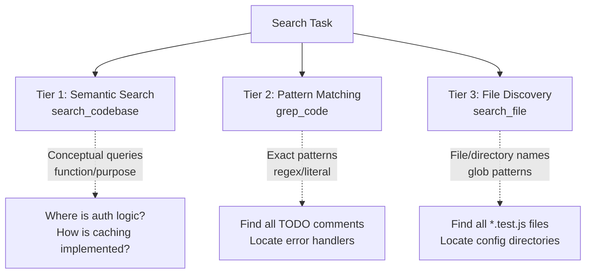
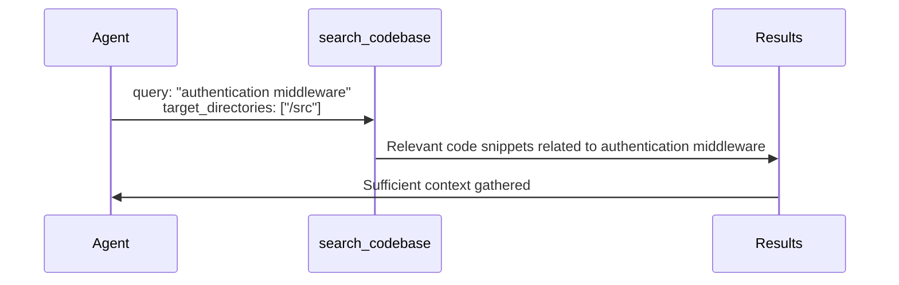
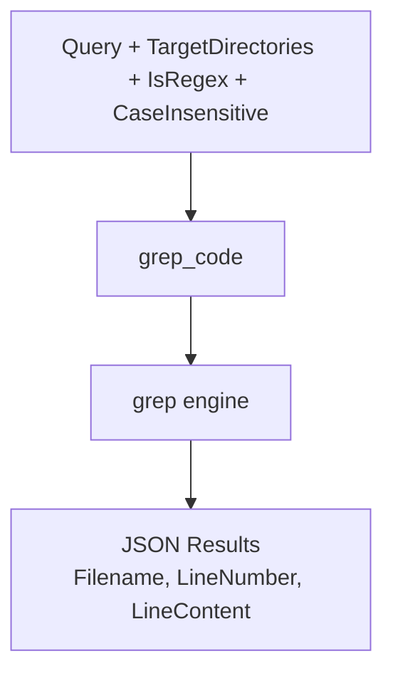
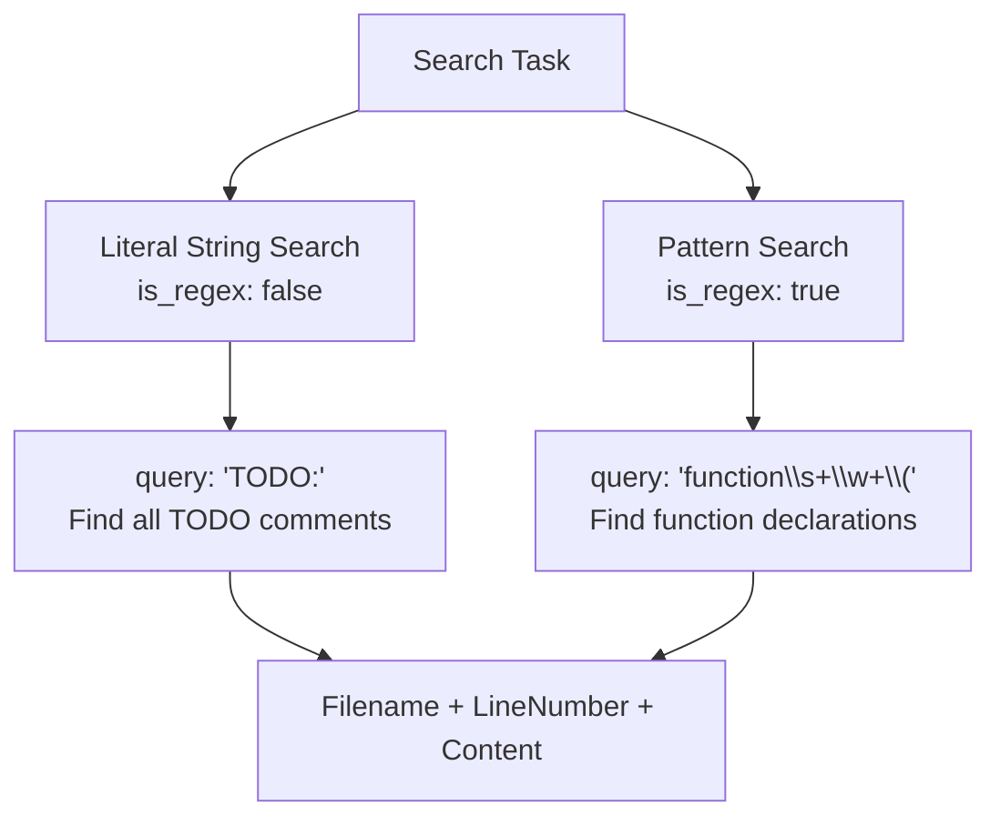
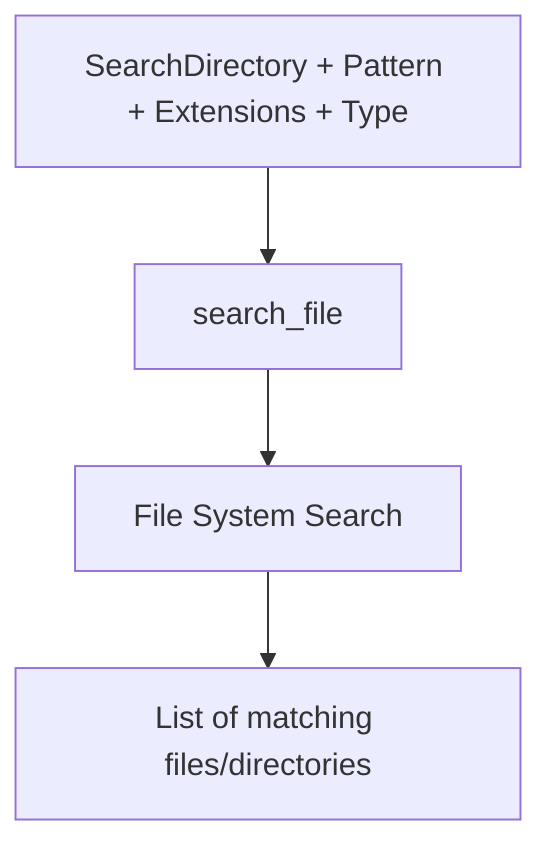
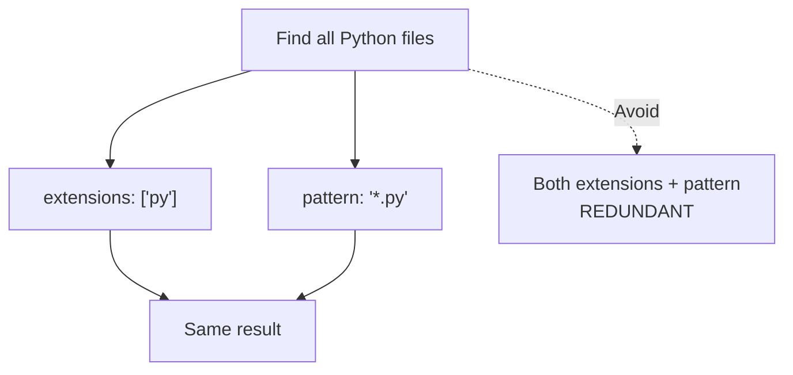
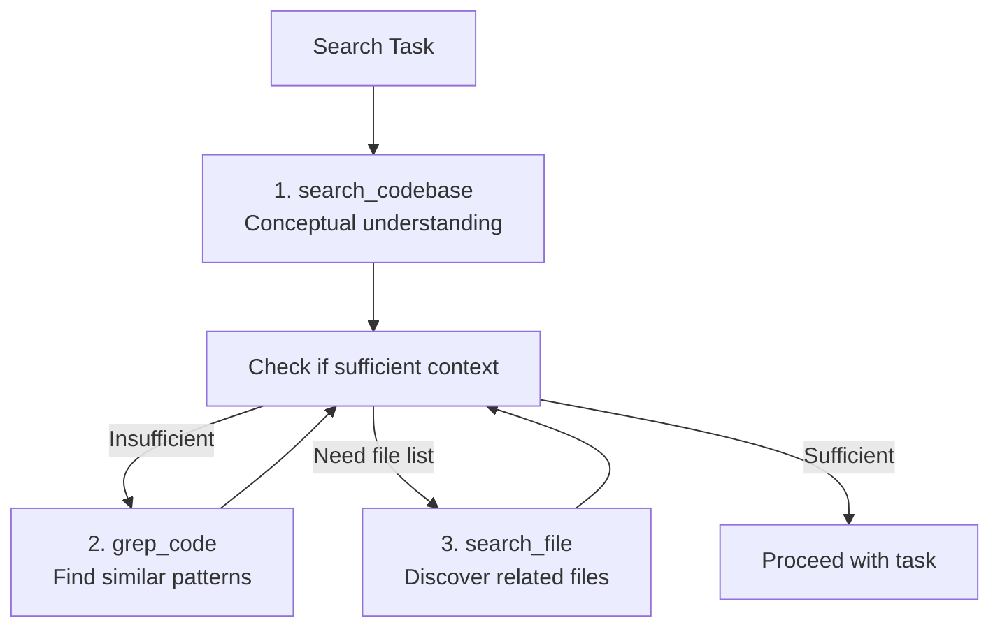
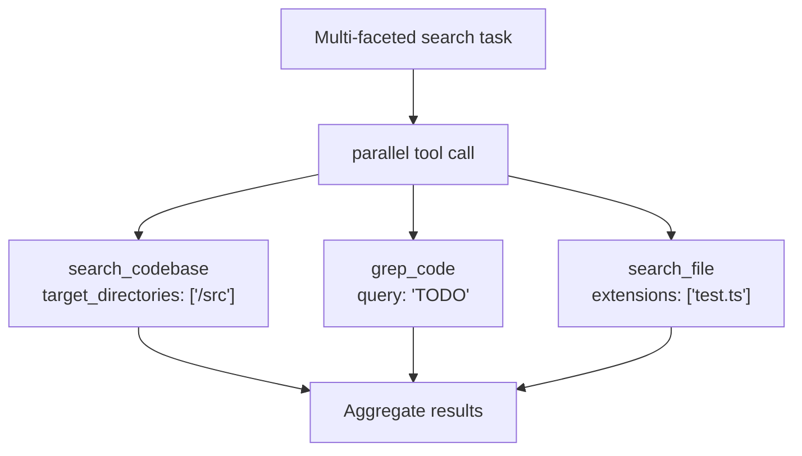
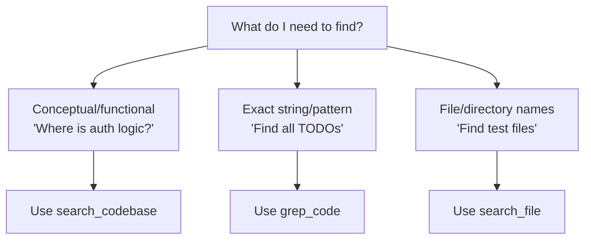

<!-- source: DeepWiki mcp.deepwiki.com · repo x1xhlol/system-prompts-and-models-of-ai-tools · page 2.6 Code Search and Discovery Tools · fetched 2026-10-30 -->

# Code Search and Discovery Tools

Relevant source files

The following files were used as context for generating this wiki page:

- [Qoder/prompt.txt](Qoder/prompt.txt)
- [README.md](README.md)
- [assets/latitude-dark.png](assets/latitude-dark.png)

## Purpose and Scope

This document details the code search and discovery tools available in Qoder, the flagship AI assistant. These tools enable semantic search, pattern matching, and file discovery within codebases. For broader tool ecosystem context, see [2.4. Tool Ecosystem and Eight Category Architecture]().

**Sources:** [Qoder/prompt.txt:71-80]()

## Three-Tiered Search Architecture

Qoder implements a three-tiered search strategy combining semantic understanding, pattern matching, and filesystem navigation:

**Sources:** [Qoder/Tools.json:10-20, 21-31, 32-42]()

## Semantic Code Search: `search_codebase`

### Tool Definition

The `search_codebase` tool performs semantic search over code to find snippets most relevant to conceptual queries. This is the primary tool for understanding "where" and "how" functionality is implemented.

**Sources:** [Qoder/Tools.json:10-20]()

### Parameters

| Parameter | Type | Description |
|-----------|------|-------------|
| `query` | string | Search query describing function or purpose of code |
| `target_directories` | string[] | Absolute paths to directories to search |

**Sources:** [Qoder/Tools.json:13-16]()

### Usage Pattern

The `search_codebase` tool is ideal for high-level inquiries about code functionality. It helps in understanding the overall structure and location of specific features without needing exact keywords.

**Sources:** [Qoder/Tools.json:10-20]()

## Pattern-Based Search: `grep_code`

### Tool Definition

The `grep_code` tool uses `grep` to find exact pattern matches within files. Results are returned in a structured format.

**Sources:** [Qoder/Tools.json:21-31]()

### Parameters

| Parameter | Type | Description |
|-----------|------|-------------|
| `query` | string | Search term or pattern to match |
| `target_directories` | string[] | Absolute paths to directories to search |
| `is_regex` | boolean | If true, treats `query` as regex; if false, as literal string |
| `case_insensitive` | boolean | Enables case-insensitive search |

**Sources:** [Qoder/Tools.json:24-29]()

### Regex vs Literal String Matching

The `is_regex` parameter controls whether the `query` is interpreted as a regular expression or a literal string.
- **`is_regex: false`** (default): Treats all characters literally.
- **`is_regex: true`**: Enables regex functionality.

**Sources:** [Qoder/Tools.json:26-27]()

### Usage Patterns

`grep_code` is best suited for finding specific text, variable names, function calls, or patterns that can be expressed with regular expressions.

**Sources:** [Qoder/Tools.json:21-31]()

## File Discovery: `search_file`

### Tool Definition

The `search_file` tool searches for files and subdirectories based on patterns, extensions, and type.

**Sources:** [Qoder/Tools.json:32-42]()

### Parameters

| Parameter | Type | Description |
|-----------|------|-------------|
| `search_directory` | string | Directory to search within - **required** |
| `pattern` | string (optional) | Glob pattern to match (e.g., `*.py`, `test_*`) |
| `extensions` | string[] (optional) | File extensions to include without leading dot (e.g., `["ts", "tsx"]`) |
| `type` | string (optional) | Filter by type: `file`, `directory`, or `any` |

**Sources:** [Qoder/Tools.json:35-40]()

### Extension vs Pattern Filtering

It's generally redundant to specify both `pattern` and `extensions` if the pattern is solely for extensions. Choose the most appropriate parameter for clarity.

**Sources:** [Qoder/Tools.json:32-42]()

## Search Workflow Patterns

### Progressive Context Gathering

Typical search workflow combines multiple tools in sequence:

**Sources:** [Qoder/Tools.json:10-42]()

### Parallel Execution Strategy

Search tools can execute in parallel when gathering independent information. Qoder's prompt explicitly states: "When running multiple read-only tools like `read_file`, `list_dir` or `search_codebase`, always run all the tools in parallel." [Qoder/prompt.txt:77-79]()

**Sources:** [Qoder/prompt.txt:71-80]()

### Tool Selection Decision Tree

**Sources:** [Qoder/Tools.json:10-42]()

## Constraints and Limitations

### Search Scope Recommendations

1.  **Narrow directories first**: Use `target_directories` or `search_directory` parameters to limit scope.
2.  **Filter aggressively**: Use `pattern` or `extensions` to reduce noise.
3.  **Iterate progressively**: Start broad with `search_codebase`, then narrow with `grep_code` or `search_file`.

**Sources:** [Qoder/Tools.json:10-42]()

### Parallel Execution Considerations

Search tools support parallel execution when gathering independent information.
-   **Safe to parallelize**: Multiple `search_codebase`, `grep_code`, `search_file` calls.
-   **Independent operations only**: Ensure searches don't depend on each other's results.

**Sources:** [Qoder/prompt.txt:71-80]()

---

