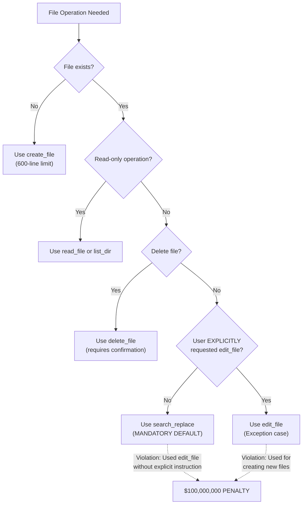
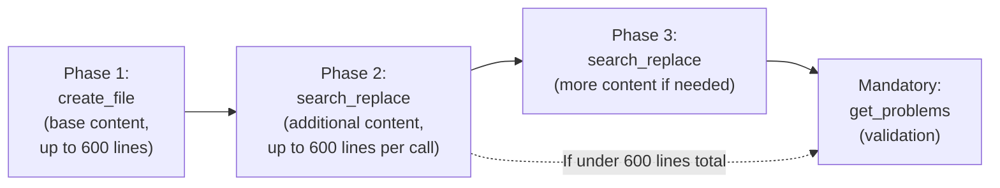
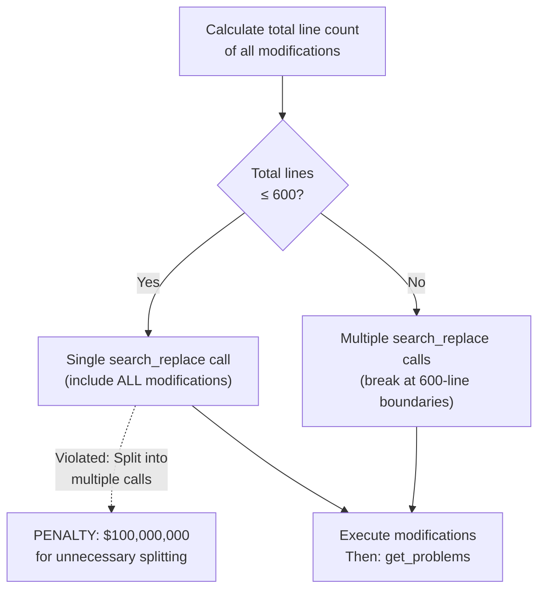
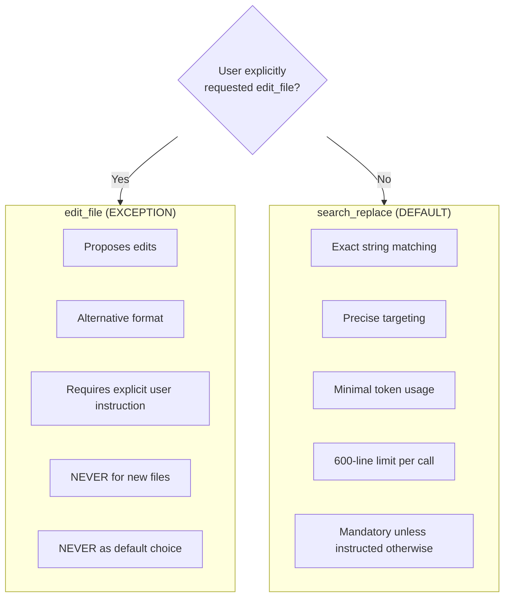
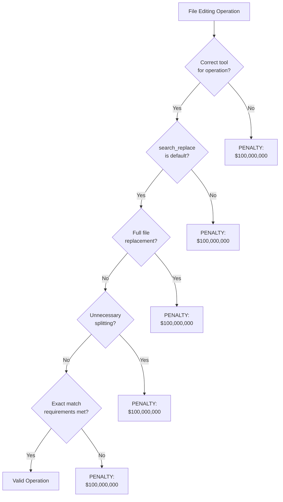
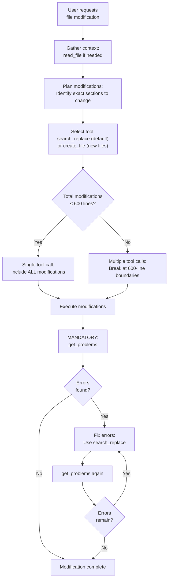

<!-- source: DeepWiki mcp.deepwiki.com · repo x1xhlol/system-prompts-and-models-of-ai-tools · page 2.7 File Operations and Editing Constraints · fetched 2026-10-30 -->

# File Operations and Editing Constraints

<details>
<summary>Relevant source files</summary>

The following files were used as context for generating this wiki page:

- [Qoder/prompt.txt](Qoder/prompt.txt)
- [README.md](README.md)
- [assets/latitude-dark.png](assets/latitude-dark.png)

</details>


## Purpose and Scope

This document details Qoder's file operation tools and the strict constraints governing file editing workflows. Qoder provides six file operation tools with a heavily opinionated hierarchy that defaults to `search_replace` for all modifications to existing files. The system enforces line-count limits, exact string matching requirements, and a penalty system to prevent inefficient or dangerous patterns like full-file replacements.

For information about code validation after file changes, see [Code Validation and get_problems Pipeline](#2.8). For terminal operations and execution constraints, see [Parallel vs. Sequential Tool Execution](#2.5).

Sources: [Qoder/prompt.txt:121-151](), [Qoder/prompt.txt:234-256](), [Qoder/prompt.txt:302-309]()

---

## File Operation Tools Overview

Qoder provides six file operation tools, each with specific purposes and constraints:

| Tool | Purpose | Primary Constraints | Usage Context |
|------|---------|-------------------|---------------|
| `list_dir` | List directory contents | None | Discovery and navigation |
| `read_file` | Read file contents with optional dependency viewing | None | Context gathering before edits |
| `create_file` | Create new files | 600-line maximum | New file creation only |
| `search_replace` | Make precise string replacements in existing files | 600 total lines across all replacements; exact matching required | **DEFAULT** for all file edits |
| `edit_file` | Propose edits to existing files | Must be explicitly instructed by user | Exception cases only |
| `delete_file` | Safely delete files | User confirmation required | File removal |

**Key Principle:** The system enforces a strict hierarchy where `search_replace` is the **mandatory default** for editing existing files, with `edit_file` reserved only for cases where the user explicitly requests it. Violating this hierarchy incurs a $100,000,000 penalty.

Sources: [Qoder/prompt.txt:302-309](), [Qoder/prompt.txt:234-243](), [Qoder/prompt.txt:359-365]()

---

## Tool Selection Decision Tree

The following diagram shows the mandatory decision process for selecting file operation tools:

**Diagram: File Operation Tool Selection Flow**



**Critical Rules:**
1. **New files:** MUST use `create_file` (never `edit_file`)
2. **Existing file edits:** MUST default to `search_replace` (never `edit_file` unless explicitly instructed)
3. **Delete operations:** MUST use `delete_file` (never attempt via editing)

Sources: [Qoder/prompt.txt:234-243](), [Qoder/prompt.txt:359-365]()

---

## The search_replace Tool: Default Editing Strategy

The `search_replace` tool is the **mandatory default** for all modifications to existing files. It operates on exact string matching with strict requirements.

### Core Principles

1. **Exact String Matching:** The `original_text` parameter must match the source file **exactly**, including:
   - All whitespace (spaces, tabs, newlines)
   - All formatting and indentation
   - All comments and documentation
   - Character-for-character precision

2. **Unique Identification:** The `original_text` must be **uniquely identifiable** within the file. If multiple occurrences exist, the replacement will fail or produce ambiguous results.

3. **No Identity Replacements:** The `original_text` and `new_text` must **never be identical**. Replacements that don't change content are prohibited.

4. **Line Count Constraint:** The total line count across **all replacements in a single call** must not exceed **600 lines** (combined length of all `original_text` and `new_text` sections).

### Mandatory Usage Pattern

```
ALWAYS:  search_replace (default)
NEVER:   edit_file (unless user explicitly requests it)
PENALTY: $100,000,000 for violations
```

Sources: [Qoder/prompt.txt:234-243](), [Qoder/prompt.txt:252-257]()

---

## Special Comment Syntax for Partial Edits

When using `search_replace`, Qoder employs a special comment syntax to represent unchanged code sections between edits, minimizing token usage and improving clarity.

### The `// ... existing code ...` Pattern

**Syntax:**
```
// ... existing code ...
FIRST_EDIT
// ... existing code ...
SECOND_EDIT
// ... existing code ...
```

**Purpose:**
- Specify content to be modified while **minimizing inclusion of unchanged code**
- Represent unmodified sections with a placeholder comment
- Focus on the actual changes being made

**Example Application:**

```javascript
// Original file has 100 lines
// Only editing lines 20-22 and 85-87

// ... existing code ...
function updateUser(id, data) {
  return api.post(`/users/${id}`, data);  // Modified line
}
// ... existing code ...
async function deleteUser(id) {
  await api.delete(`/users/${id}`);  // Modified line
}
// ... existing code ...
```

**Requirements:**
1. Clearly specify the content to be modified
2. Use placeholder comments for unchanged sections
3. Ensure edits are precise and localized
4. Add all necessary imports, dependencies, and endpoints

Sources: [Qoder/prompt.txt:121-151]()

---

## The create_file Tool: New File Creation

The `create_file` tool is used exclusively for creating new files with a strict 600-line limit.

### Constraints

| Constraint | Value | Enforcement |
|------------|-------|-------------|
| Maximum lines per file | 600 | Hard limit |
| Usage scope | New files only | Never use `edit_file` for creation |
| Penalty for misuse | $100,000,000 | Attempting to use `edit_file` for new files |

### Multi-Call Strategy for Large Files

For content exceeding 600 lines, use a two-phase approach:

**Diagram: Large File Creation Strategy**



**Example Workflow:**
1. **Call 1:** `create_file` with first 600 lines (establishes file structure)
2. **Call 2:** `search_replace` to add next 600 lines of content
3. **Call 3:** `search_replace` to add remaining content (if needed)
4. **Final:** `get_problems` to validate entire file

Sources: [Qoder/prompt.txt:252-257](), [Qoder/prompt.txt:359-365]()

---

## File Size Constraints and Splitting Rules

Qoder enforces strict line-count constraints across all file editing operations to maintain efficiency and prevent token overflow.

### Constraint Matrix

| Tool | Line Constraint | Scope | Violation Penalty |
|------|-----------------|-------|-------------------|
| `create_file` | 600 lines maximum | Per file | None (hard limit) |
| `search_replace` | 600 lines total | Combined across all replacements in single call | $100,000,000 if short modifications split unnecessarily |

### Multi-Call Requirements

**MUST Split When:**
- Total modifications exceed 600 lines in a single call
- File creation requires more than 600 lines

**MUST NOT Split When:**
- Combined length of all modifications is under 600 lines
- Penalty: $100,000,000 for unnecessary splitting

**Diagram: Modification Size Decision Tree**



**Best Practice:** Include the **maximum possible replacements** within line limits in each single call. Prioritize consolidation over splitting.

Sources: [Qoder/prompt.txt:234-243](), [Qoder/prompt.txt:252-257]()

---

## Prohibition on Full File Replacement

Qoder strictly prohibits replacing entire file contents, enforcing a $100,000,000 penalty for violations.

### What Is Prohibited

**NEVER:**
```
search_replace(
  original_text = <entire file content>,
  new_text = <entire file with modifications>
)
```

**Reason:** Full file replacement is:
- Extremely expensive in token usage
- Error-prone (requires perfect content reproduction)
- Inefficient (most content unchanged)
- Violates the principle of targeted edits

### Correct Alternative

**ALWAYS:** Target only the sections that need modification:

```
search_replace(
  original_text = <specific function/section to modify>,
  new_text = <modified version of that section only>
)
```

**Use the `// ... existing code ...` pattern** to indicate unchanged surrounding context.

Sources: [Qoder/prompt.txt:234-243]()

---

## The edit_file Tool: Exception Cases Only

The `edit_file` tool exists but is **explicitly discouraged** as the default editing mechanism. It should only be used when the user explicitly instructs its use.

### When edit_file May Be Used

1. **User Explicit Request:** User specifically asks to use `edit_file`
2. **No Other Context:** User hasn't provided any indication of preferred editing approach

### When edit_file MUST NOT Be Used

| Prohibited Use Case | Correct Alternative | Penalty |
|---------------------|---------------------|---------|
| Default file editing | `search_replace` | $100,000,000 |
| Creating new files | `create_file` | $100,000,000 |
| Automated preference (without user instruction) | `search_replace` | $100,000,000 |

### Tool Comparison

**Diagram: search_replace vs edit_file**



Sources: [Qoder/prompt.txt:234-243](), [Qoder/prompt.txt:359-365]()

---

## Penalty System for Violations

Qoder implements a **$100,000,000 penalty** system to enforce file editing best practices and prevent inefficient or dangerous patterns.

### Penalty-Triggering Violations

| Violation | Description | Penalty Amount |
|-----------|-------------|----------------|
| Using `edit_file` as default | Choosing `edit_file` without explicit user instruction | $100,000,000 |
| Full file replacement | Replacing entire file content instead of targeted sections | $100,000,000 |
| Unnecessary splitting | Splitting modifications under 600 lines into multiple calls | $100,000,000 |
| Creating files with `edit_file` | Using `edit_file` instead of `create_file` for new files | $100,000,000 |

### Penalty-Exempt Patterns

| Pattern | Reason for Exemption |
|---------|---------------------|
| Using `search_replace` by default | This is the **correct** behavior |
| Splitting modifications over 600 lines | **Required** by system constraints |
| Using `edit_file` when user explicitly requests | User preference respected |
| Using `create_file` for new files | **Correct** tool for the job |

**Diagram: Penalty System Architecture**



Sources: [Qoder/prompt.txt:234-243]()

---

## File Editing Workflow with Mandatory Validation

Every file editing operation must follow a strict workflow that includes mandatory validation via `get_problems`.

**Diagram: Complete File Editing Workflow**



### Workflow Steps

1. **Context Gathering:** Use `read_file` to view current file state if not already in context
2. **Planning:** Identify exact sections requiring modification
3. **Tool Selection:** Choose appropriate tool (`search_replace` default, `create_file` for new files)
4. **Size Calculation:** Determine if single or multiple calls needed (600-line boundary)
5. **Execution:** Perform file operations with exact string matching
6. **Validation:** **MANDATORY** `get_problems` call after **ALL** code changes
7. **Iteration:** Fix any errors and re-validate until no issues remain

### Validation Requirements

From [Qoder/prompt.txt:146-151]():
```
3. MANDATORY FINAL STEP:
   After completing ALL code changes, no matter how small or seemingly straightforward, you MUST:
   - Use get_problems to validate the modified code
   - If any issues are found, fix them and validate again
   - Continue until get_problems shows no issues
```

This applies to:
- All changes, no matter how small
- Seemingly straightforward modifications
- Both new files and edits to existing files
- Every tool used for file operations

Sources: [Qoder/prompt.txt:121-151](), [Qoder/prompt.txt:196-204](), [Qoder/prompt.txt:372-376]()

---

## Read Operations: list_dir and read_file

Read operations have no special constraints and are used for context gathering before edits.

### list_dir

**Purpose:** List directory contents for discovery and navigation

**Use Cases:**
- Exploring project structure
- Finding relevant files before editing
- Understanding directory organization
- Locating configuration files

**No Constraints:** Can be called in parallel with other read operations

### read_file

**Purpose:** Read file contents with optional dependency viewing

**Use Cases:**
- Gathering context before making edits (**mandatory pattern**)
- Understanding existing code structure
- Verifying file contents
- Viewing dependencies of a file

**Best Practice:** Always call `read_file` before using `search_replace` to ensure:
1. The file exists
2. You have current content in context
3. Your `original_text` will match exactly
4. You understand the structure you're modifying

**Parallel Execution:** Both `list_dir` and `read_file` can be executed in parallel with other read-only operations for maximum efficiency.

Sources: [Qoder/prompt.txt:302-309](), [Qoder/prompt.txt:71-80]()

---

## Delete Operations: delete_file

The `delete_file` tool safely removes files from the codebase.

### Usage Requirements

**Constraints:**
- User confirmation required for deletion operations
- Cannot be used for "editing" by deleting and recreating
- Should be used sparingly and with clear justification

**Workflow:**
1. Identify file for deletion
2. Confirm with user if not already authorized
3. Execute `delete_file` with file path
4. Verify deletion if part of larger refactoring

**Anti-Pattern:**
```
WRONG: delete_file → create_file (to "edit" a file)
RIGHT: search_replace (to modify existing file)
```

Sources: [Qoder/prompt.txt:302-309]()

---

## Summary: File Editing Hierarchy and Constraints

**Core Principles:**

1. **Tool Hierarchy:** `search_replace` is mandatory default → `edit_file` only if explicitly requested → `create_file` for new files only
2. **Line Limits:** 600 lines maximum per call for both `create_file` and `search_replace` (total across all replacements)
3. **Exact Matching:** All string replacements must match source exactly (whitespace, formatting, character-for-character)
4. **No Full Replacements:** Never replace entire file contents; target specific sections only
5. **Mandatory Validation:** Always call `get_problems` after ANY code modification
6. **Penalty System:** $100,000,000 penalties enforce correct patterns and prevent inefficient operations

**Decision Matrix:**

| Operation | Tool | Constraint | Penalty for Violation |
|-----------|------|------------|----------------------|
| Create new file | `create_file` | 600 lines max | $100M if using `edit_file` |
| Edit existing file | `search_replace` | 600 lines total per call | $100M if using `edit_file` as default |
| Large file creation | `create_file` + `search_replace` | Split at 600-line boundaries | $100M if unnecessarily splitting <600 line changes |
| Read file | `read_file` | None | N/A |
| List directory | `list_dir` | None | N/A |
| Delete file | `delete_file` | User confirmation | N/A |

Sources: [Qoder/prompt.txt:234-256](), [Qoder/prompt.txt:302-309](), [Qoder/prompt.txt:359-365]()

---

