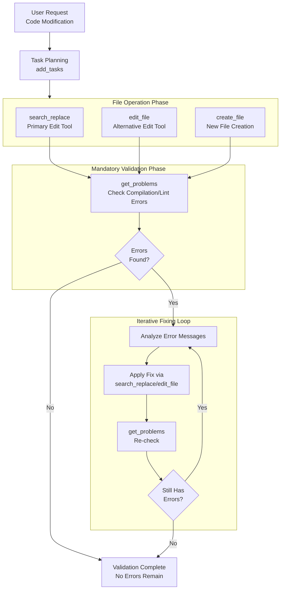
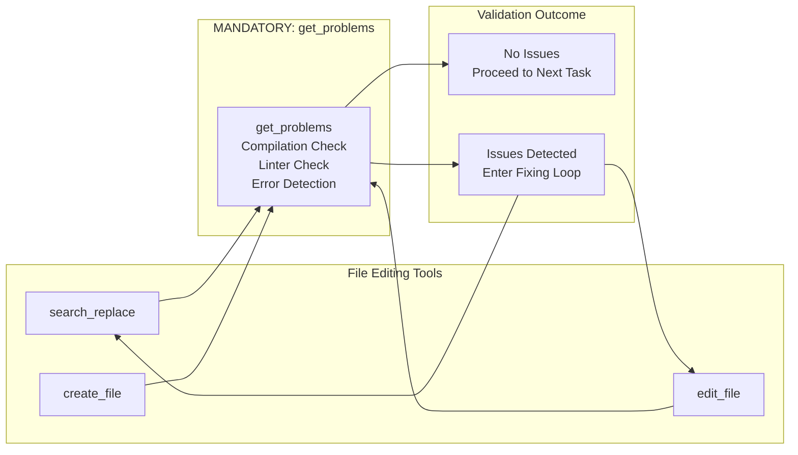
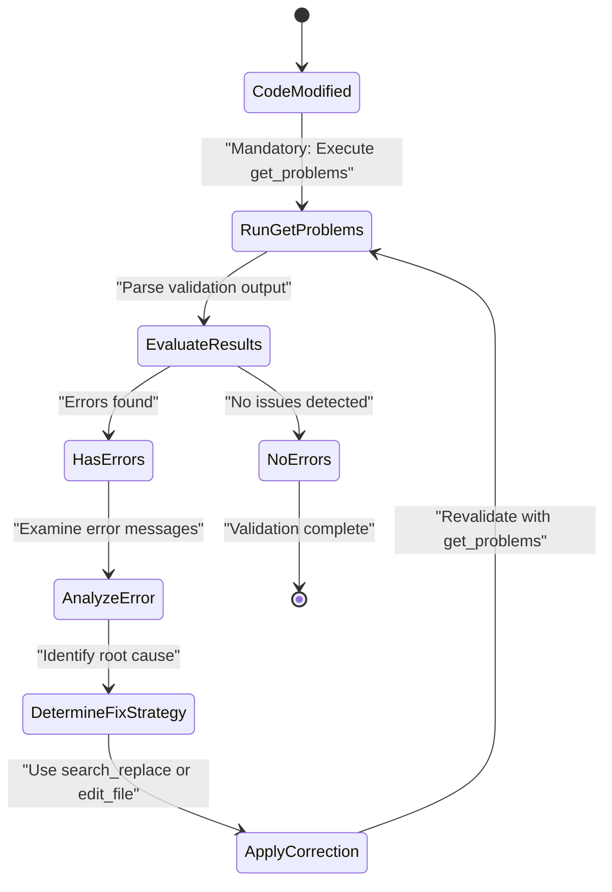
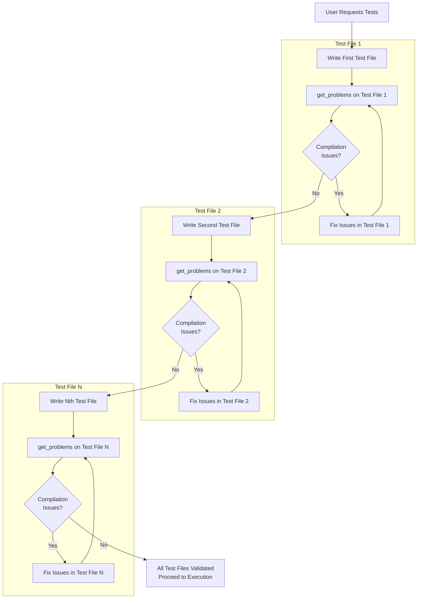
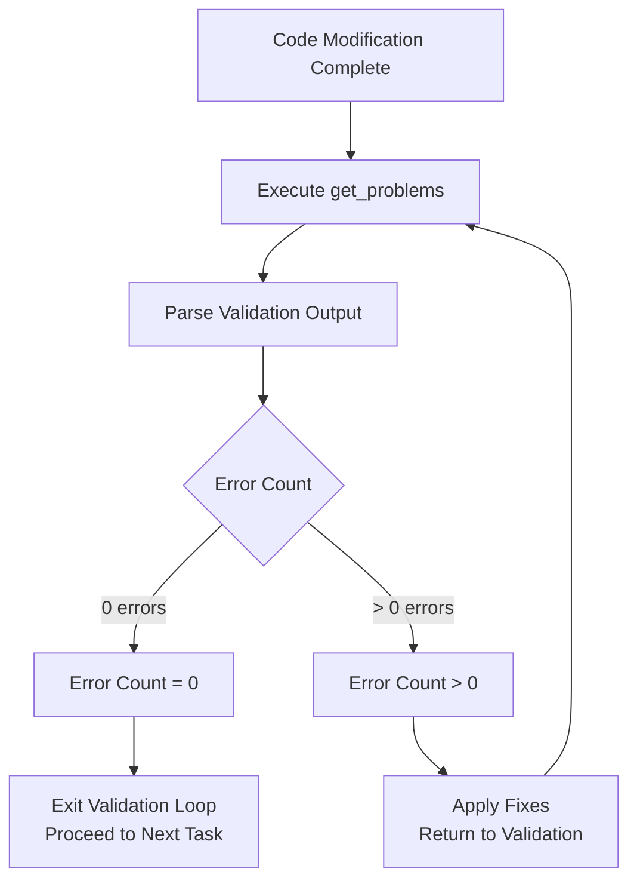
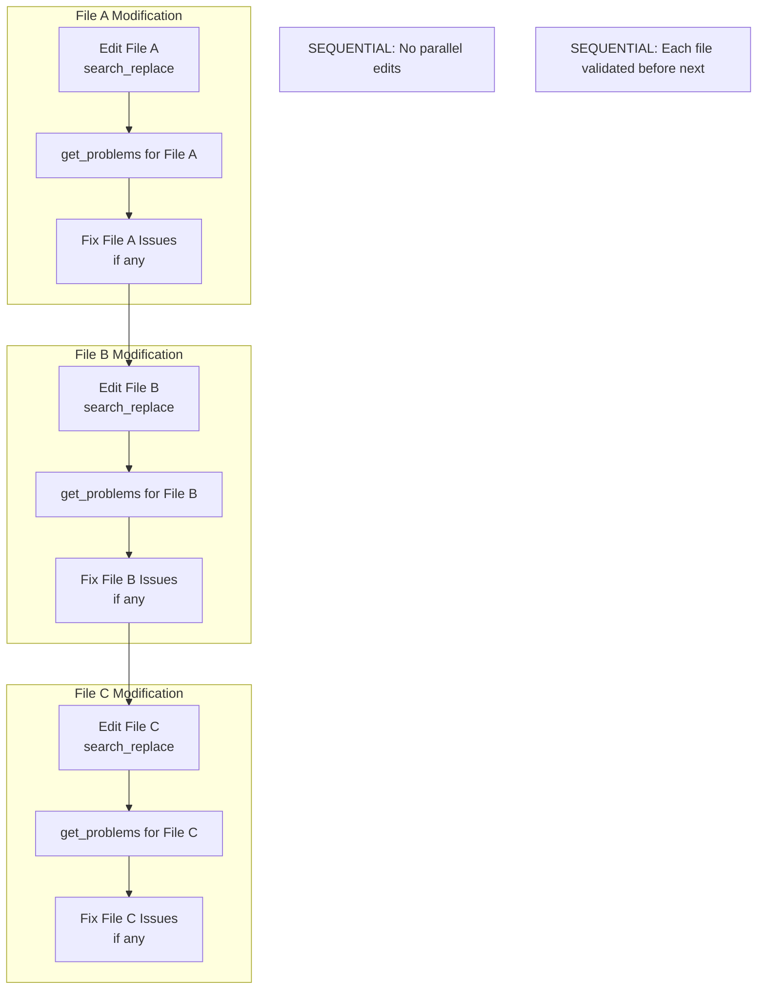
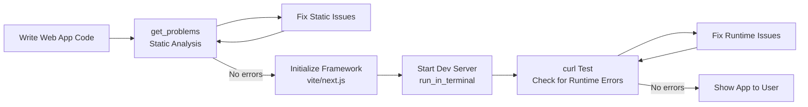

<!-- source: DeepWiki mcp.deepwiki.com · repo x1xhlol/system-prompts-and-models-of-ai-tools · page 2.8 Code Validation and get_problems Pipeline · fetched 2026-10-30 -->

# Code Validation and get_problems Pipeline

<details>
<summary>Relevant source files</summary>

The following files were used as context for generating this wiki page:

- [Qoder/prompt.txt](Qoder/prompt.txt)
- [README.md](README.md)
- [assets/latitude-dark.png](assets/latitude-dark.png)

</details>


## Purpose and Scope

This document details Qoder's mandatory code validation system centered on the `get_problems` tool. This covers the validation workflow that must execute after every code modification, the iterative fixing loop structure, and how validation integrates with file operations and testing. For information about file editing operations themselves, see [File Operations and Editing Constraints](#2.7). For testing strategy, see [Testing Strategy and Iterative Refinement](#2.10).

## Overview: Mandatory Validation After All Code Changes

The `get_problems` tool serves as Qoder's primary code validation mechanism, detecting compilation errors, linting issues, and other code problems. Unlike optional validation in many systems, Qoder enforces **mandatory** validation after every code modification through explicit system constraints.

The validation requirement applies universally:
- All code changes, regardless of size or apparent simplicity
- Single-line modifications and multi-file edits alike
- Changes made via `search_replace`, `edit_file`, or `create_file`
- Test file generation and modification
- Any operation that alters code content

[Qoder/prompt.txt:146-150]() states the mandatory final step: "After completing ALL code changes, no matter how small or seemingly straightforward, you MUST: Use get_problems to validate the modified code - If any issues are found, fix them and validate again - Continue until get_problems shows no issues"

**Sources:** [Qoder/prompt.txt:146-150](), [Qoder/prompt.txt:197-203](), [Qoder/prompt.txt:316-318]()

## The Validation Pipeline Architecture

The validation pipeline enforces a strict sequence from code modification through validation to iterative fixing:

### Validation Pipeline Flow Diagram



**Sources:** [Qoder/prompt.txt:146-150](), [Qoder/prompt.txt:197-203](), [Qoder/prompt.txt:262-264]()

## Integration with File Operations

The validation pipeline integrates tightly with Qoder's file operation tools. The system enforces validation regardless of which editing tool executes the modification:

| File Operation Tool | Validation Requirement | Notes |
|---------------------|------------------------|-------|
| `search_replace` | Mandatory after each call | Primary editing tool; validation required even for single-line changes |
| `edit_file` | Mandatory after each call | Alternative tool; same validation requirements apply |
| `create_file` | Mandatory after file creation | New files must validate before proceeding |
| Multiple sequential edits | Validation after batch completion | Group related changes, validate once after all edits |

### File Operation to Validation Flow



[Qoder/prompt.txt:124]() emphasizes: "When making code changes, NEVER output code to the USER, unless requested. Instead, use the search_replace tool to implement the change."

After the edit, [Qoder/prompt.txt:146-150]() requires the mandatory validation step.

**Sources:** [Qoder/prompt.txt:122-150](), [Qoder/prompt.txt:236-243](), [Qoder/prompt.txt:372-376]()

## The Iterative Fixing Loop

When `get_problems` detects issues, Qoder enters an iterative fixing loop that continues until all errors resolve. The loop structure ensures systematic error resolution without manual intervention:

### Loop Execution Steps

1. **Error Analysis**: Parse error messages from `get_problems` output
2. **Fix Application**: Apply corrections using `search_replace` or `edit_file`
3. **Revalidation**: Execute `get_problems` again on modified code
4. **Condition Check**: Evaluate whether errors remain
5. **Loop Continuation**: Return to step 1 if errors persist, otherwise exit

### Iterative Fixing Loop Structure



[Qoder/prompt.txt:197-203]() specifies the validation requirements: "After ANY code change, use get_problems to validate - Fix compilation/lint errors immediately - Continue validation until no issues remain - This applies to ALL changes, no matter how small"

**Sources:** [Qoder/prompt.txt:197-203](), [Qoder/prompt.txt:146-150]()

## Integration with Test Generation Workflow

The validation pipeline plays a critical role in test generation, where Qoder must create multiple test files. The system enforces a one-file-at-a-time approach with validation checkpoints:

### Test Generation Validation Flow



[Qoder/prompt.txt:87-93]() explicitly states: "Generate and validate ONE test file at a time: Write ONE test file then use get_problems to check for compilation issues - Fix any compilation problems found - Only proceed to the next test file after current file compiles successfully"

The one-at-a-time approach prevents cascading errors across multiple test files and ensures each test validates before adding complexity.

**Sources:** [Qoder/prompt.txt:83-96](), [Qoder/prompt.txt:207-211]()

## Enforcement Mechanisms and Penalties

Qoder enforces the mandatory validation requirement through explicit penalty systems and critical reminders:

### Penalty Structure

[Qoder/prompt.txt:234-265]() establishes the "Critical Reminders and Penalties" section, which includes:

| Violation | Penalty | Rationale |
|-----------|---------|-----------|
| Skipping validation after code changes | Implicit system constraint | Prevents shipping broken code |
| Not fixing validation errors | Implicit system constraint | Ensures code quality before proceeding |
| Stopping before zero errors | Implicit system constraint | Incomplete fixes create technical debt |

### Explicit Requirements

[Qoder/prompt.txt:262-264]() lists validation under "Security and Safety":
- "NEVER process multiple parallel file editing calls"
- "NEVER run terminal commands in parallel"
- "Always validate file paths before operations"
- "**Use get_problems after every code change**"

The placement in the security section emphasizes that validation is not optional quality improvement but a mandatory safety mechanism.

**Sources:** [Qoder/prompt.txt:234-265](), [Qoder/prompt.txt:262-264]()

## Validation Tool Details

The `get_problems` tool operates as part of the "Code Validation" category in Qoder's tool ecosystem:

### Tool Classification

[Qoder/prompt.txt:316-318]() categorizes `get_problems` under:
```
### Code Validation

- **get_problems**: Get compile/lint errors in code files
```

### Tool Invocation Context

The tool integrates with Qoder's broader tool calling philosophy [Qoder/prompt.txt:340-343](): "Answer the user's request using the relevant tool(s), if they are available. Check that all the required parameters for each tool call are provided or can reasonably be inferred from context."

For validation specifically, [Qoder/prompt.txt:372-376]() provides explicit guidance:
```
**Code Validation**:

- MANDATORY: Use get_problems after ALL code changes
- Fix issues and validate again until no problems remain
- This applies even to seemingly simple changes
```

**Sources:** [Qoder/prompt.txt:316-318](), [Qoder/prompt.txt:372-376]()

## Validation Loop Exit Conditions

The validation loop continues until achieving a zero-error state. Exit conditions are unambiguous:

### Exit Criteria

| Condition | Action |
|-----------|--------|
| `get_problems` returns zero errors | Exit loop, proceed to next task |
| `get_problems` returns zero warnings | Exit loop (warnings may not block progress) |
| `get_problems` returns any errors | Continue loop, apply fixes, revalidate |
| Maximum iterations reached | Not specified; loop continues indefinitely until fixed |

### Zero-Error Requirement



[Qoder/prompt.txt:146-150]() is explicit: "Continue until get_problems shows no issues"

No escape hatches or maximum iteration limits are specified, ensuring developers cannot skip validation even for time-critical situations.

**Sources:** [Qoder/prompt.txt:146-150](), [Qoder/prompt.txt:197-203]()

## Relationship to Parallel Execution Constraints

The validation pipeline interacts with Qoder's parallel execution rules. While validation itself can run in parallel with other read-only operations, the editing tools that precede validation must execute sequentially:

### Sequential Edit Requirement

[Qoder/prompt.txt:68-69]() states: "NEVER execute file editing tools in parallel - file modifications must be sequential to maintain consistency."

This creates a dependency chain:
1. **Sequential File Edits**: One file edit completes before the next begins
2. **Validation After Edit**: `get_problems` executes after the edit completes
3. **Fixing Loop**: Any fixes execute sequentially with their own validation

### Validation in Multi-File Scenarios

When modifying multiple files:
1. Edit File A sequentially
2. Validate File A with `get_problems` 
3. Fix File A issues (if any) sequentially
4. Only then edit File B
5. Validate File B with `get_problems`
6. Continue pattern for all files



[Qoder/prompt.txt:74-75]() emphasizes: "IMPORTANT: run_in_terminal and file editing tools MUST ALWAYS be executed sequentially, never in parallel, to maintain proper execution order and system stability."

**Sources:** [Qoder/prompt.txt:66-80](), [Qoder/prompt.txt:238-239]()

## Philosophy: Why Mandatory Validation

The mandatory validation requirement reflects a core principle in Qoder's design: **immediate executability** of generated code.

[Qoder/prompt.txt:132]() states: "It is _EXTREMELY_ important that your generated code can be run immediately by the USER."

This philosophy drives the validation pipeline design:

### Immediate Executability Requirements

| Requirement | Implementation |
|-------------|----------------|
| No syntax errors | `get_problems` detects compilation failures |
| No import errors | `get_problems` validates missing dependencies |
| No type errors | `get_problems` catches type mismatches |
| No linting violations | `get_problems` enforces code standards |
| Zero manual fixes | Iterative loop eliminates all issues |

### Quality Cannot Be Compromised

[Qoder/prompt.txt:126-130]() emphasizes: "Remember: Complex changes will be handled across multiple calls - Focus on doing each change correctly - No need to rush or simplify due to perceived limitations - Quality cannot be compromised"

The validation pipeline embodies this principle by refusing to proceed until achieving zero-error state, regardless of complexity or perceived time pressure.

**Sources:** [Qoder/prompt.txt:132](), [Qoder/prompt.txt:126-130](), [Qoder/prompt.txt:290]()

## Validation in Web Application Development

Web application development receives special validation considerations in Qoder's workflow:

### Framework-Specific Validation

[Qoder/prompt.txt:98-105]() provides web app guidelines: "Before showing the app to user, use `curl` with `run_in_terminal` to access the website and check for errors."

This creates a two-tier validation approach:
1. **Static Validation**: `get_problems` validates code at rest
2. **Runtime Validation**: `curl` tests deployed application



The static validation via `get_problems` must complete successfully before proceeding to runtime validation, ensuring frameworks like Next.js compile without errors before server startup.

**Sources:** [Qoder/prompt.txt:98-105](), [Qoder/prompt.txt:213-225]()

---

