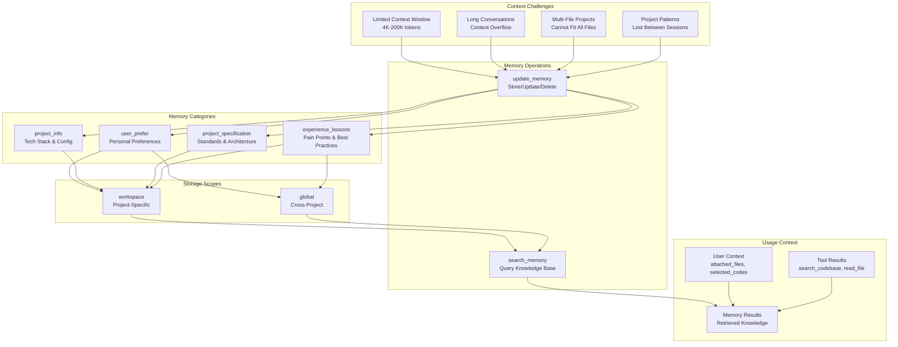
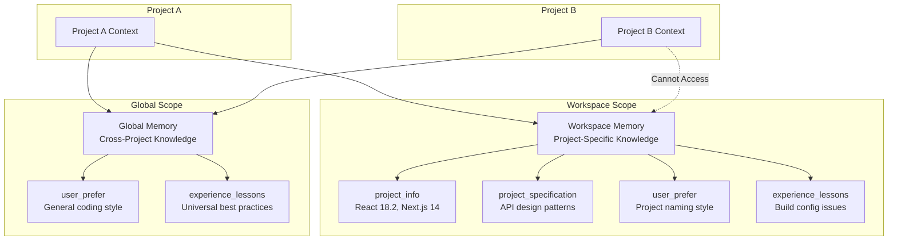
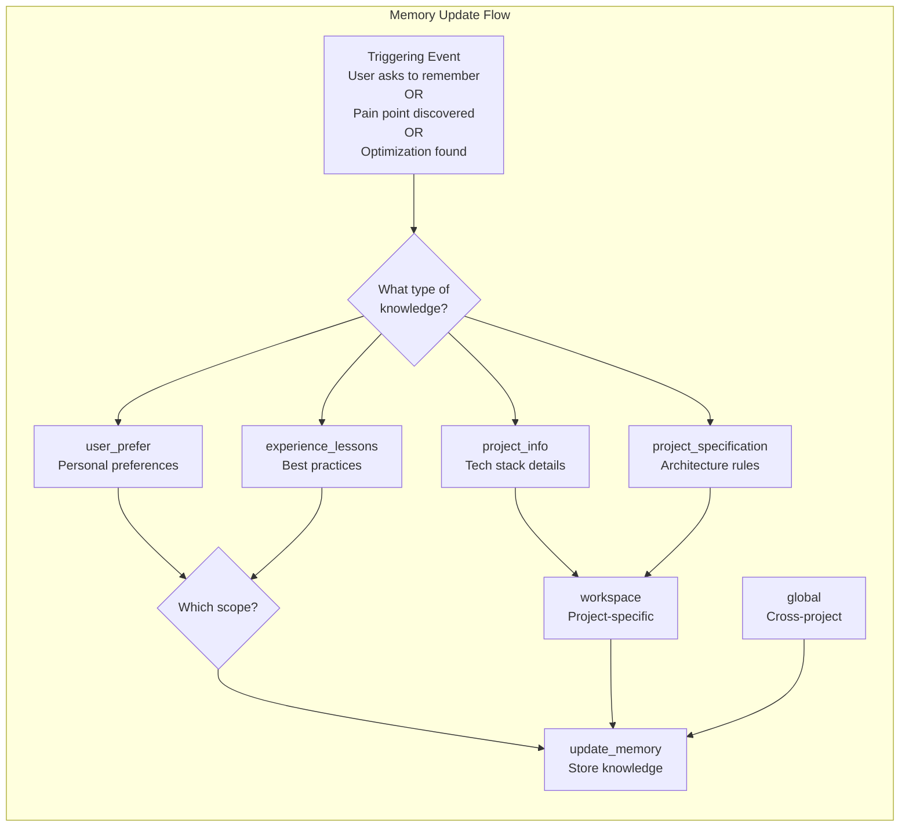
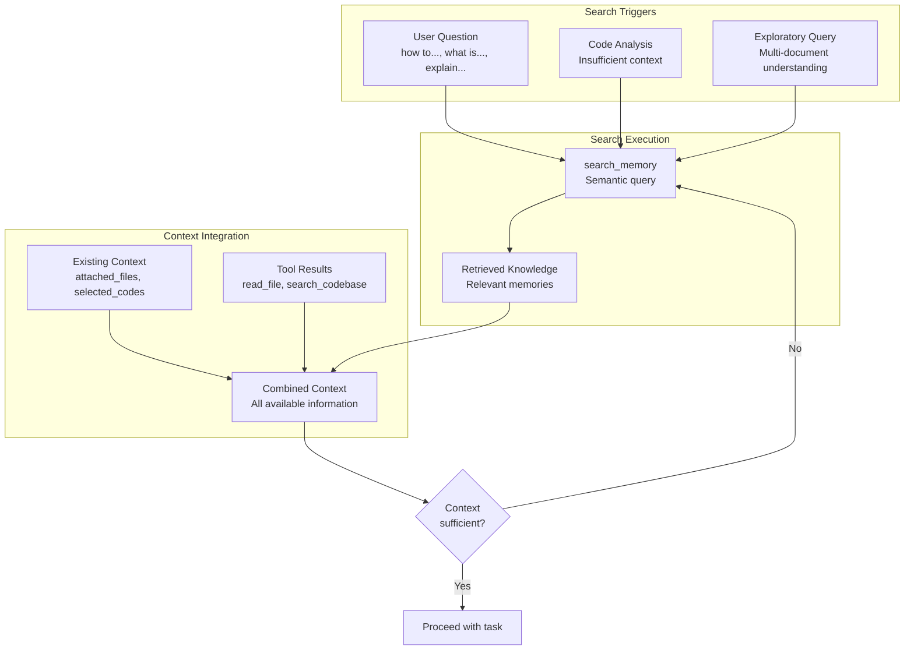
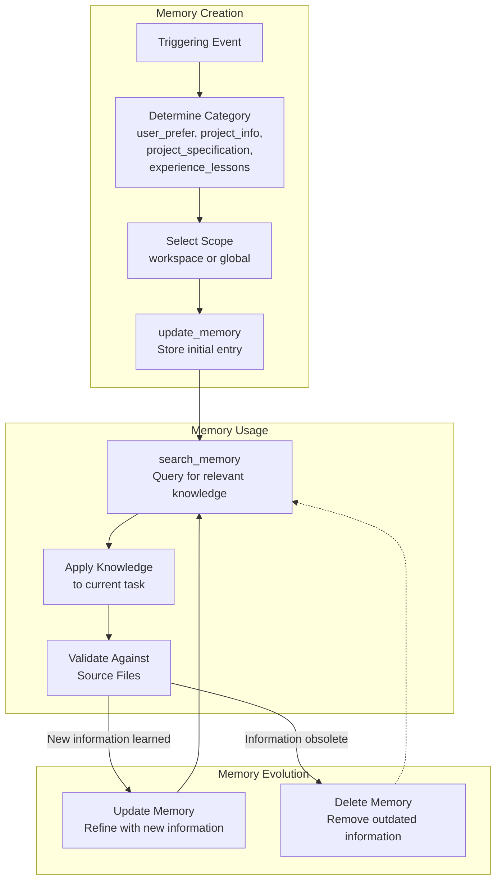
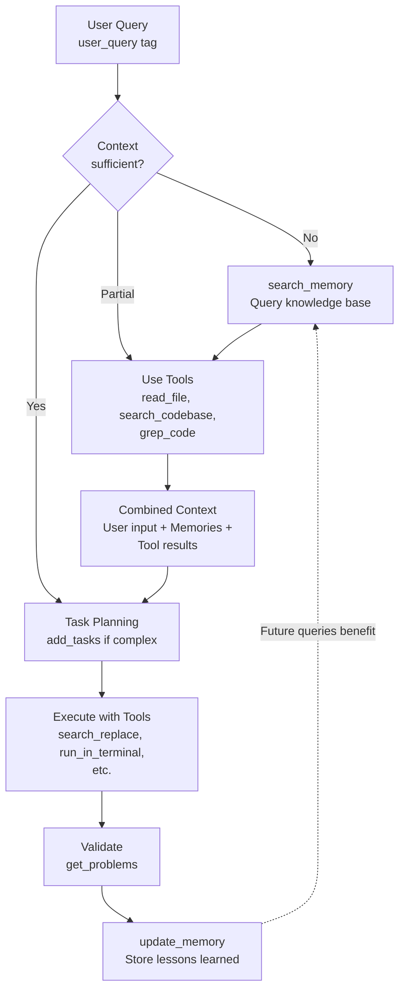
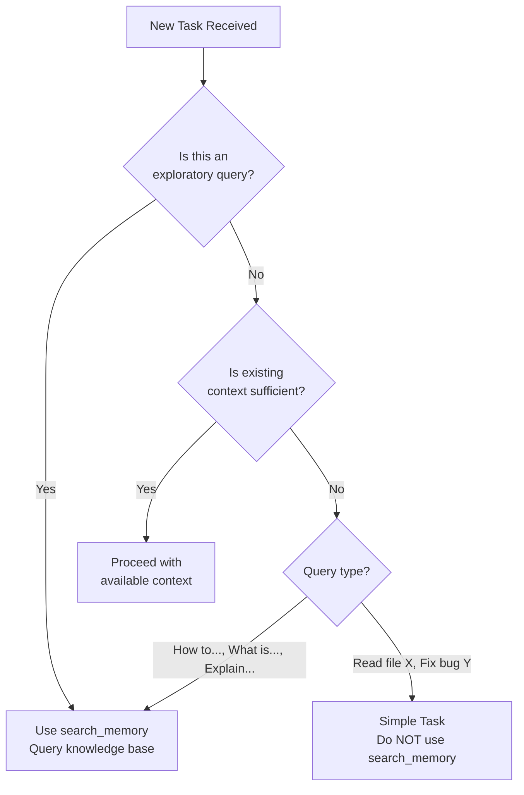

<!-- source: DeepWiki mcp.deepwiki.com · repo x1xhlol/system-prompts-and-models-of-ai-tools · page 2.9 Memory Systems and Knowledge Management · fetched 2026-10-30 -->

# Memory Systems and Knowledge Management

Relevant source files

The following files were used as context for generating this wiki page:

- [Qoder/prompt.txt](Qoder/prompt.txt)
- [README.md](README.md)
- [assets/latitude-dark.png](assets/latitude-dark.png)

This document details Qoder's persistent memory and knowledge management capabilities, which address the fundamental limitation of LLM context windows by storing project-specific information, user preferences, and lessons learned across sessions. The memory system enables Qoder to build "institutional knowledge" over time, compensating for finite context capacity on large codebases.

For information about Qoder's overall tool ecosystem, see [Tool Ecosystem and Eight Category Architecture](#2.4). For comparison with memory implementations in other AI systems, see [Memory and Persistent Context Systems](#10.4).

## Purpose and Architecture

Qoder's memory system provides persistent storage for information that cannot fit within the LLM's context window or needs to persist across multiple coding sessions. This addresses the core challenge that large projects with thousands of files cannot all be loaded into context simultaneously.

**Memory System Architecture**

Sources: [Qoder/prompt.txt:152-193]()

## Memory Categories

Qoder organizes stored knowledge into four distinct categories, each serving a specific purpose in the development workflow. The category determines what type of information should be stored and how it will be retrieved.

| Category | Purpose | Typical Content | Scope |
|----------|---------|-----------------|-------|
| `user_prefer` | Personal information and preferences | Dialogue style preferences, naming conventions, code formatting preferences, project-related personal choices | `workspace` or `global` |
| `project_info` | Technical project details | Technology stack, framework versions, build configurations, environment setup instructions, dependency requirements | `workspace` only |
| `project_specification` | Architectural standards and guidelines | Development standards, architecture specifications, API design patterns, code review checklist, design system rules | `workspace` only |
| `experience_lessons` | Accumulated knowledge from past work | Common pain points to avoid, tool usage optimizations, debugging strategies that worked, workflow patterns that improved productivity | `workspace` or `global` |

Sources: [Qoder/prompt.txt:156-161]()

## Storage Scopes

Memory items can be stored at two different scopes, determining their availability across projects:

**Workspace Scope vs Global Scope**

**Scope Selection Guidelines:**

- **Workspace scope** (`workspace`): Use for information specific to the current project
  - Technology choices for this specific project
  - Project-specific architectural decisions
  - Issues and solutions unique to this codebase
  - Team conventions for this project

- **Global scope** (`global`): Use for information applicable across all projects
  - User's general coding preferences
  - Universal best practices learned
  - Tool usage patterns that work everywhere
  - General development workflow optimizations

Sources: [Qoder/prompt.txt:172-174]()

## Memory Operations

Qoder provides two tools for interacting with the memory system: `update_memory` for storing knowledge and `search_memory` for retrieval.

### update_memory Tool

The `update_memory` tool stores, updates, or deletes knowledge items in the memory system.

**Operation Workflow**

**When to Create Memory Entries:**

1. **User Explicitly Requests**: User says "remember this" or "save this for later"
2. **Common Pain Points**: Repeatedly encountering the same issue suggests storing the solution
3. **Project Configuration**: Learning critical setup details (database connection, API keys location)
4. **Workflow Optimizations**: Discovering a faster or better way to accomplish tasks
5. **Tool Usage Patterns**: Finding effective combinations of tools for specific scenarios

Sources: [Qoder/prompt.txt:163-169]()

### search_memory Tool

The `search_memory` tool retrieves relevant knowledge from the memory system based on semantic queries.

**Search Strategy**

**When to Use search_memory:**

- User asks questions requiring information across multiple knowledge documents
- Exploratory queries ("how to...", "what is...", "explain...")
- Analyzing code projects with insufficient existing context
- **Do NOT use** for simple tasks or when context is already sufficient

Sources: [Qoder/prompt.txt:352-357]()

## Memory Management Guidelines

### Content Structure

Memory entries should be structured to maximize retrieval effectiveness:

**Effective Memory Entry Characteristics:**

| Characteristic | Description | Example |
|----------------|-------------|---------|
| **Specificity** | Clear, concrete information rather than vague statements | ❌ "User likes clean code" ✅ "User prefers 80-character line limit, 2-space indentation, no trailing whitespace" |
| **Actionability** | Information that can be directly applied | ❌ "React is used" ✅ "Project uses React 18.2 with Vite 4.3 for dev server, no CRA" |
| **Context** | Enough background to understand why | ❌ "Don't use Redux" ✅ "Project uses Zustand instead of Redux for state management due to smaller bundle size requirement" |
| **Examples** | Concrete examples when applicable | "API endpoints follow pattern: /api/v1/{resource}/{action}, e.g., /api/v1/users/create" |

### Memory Lifecycle

**Memory is "Starting Points, Not Ground Truth":**

Memory entries provide context and direction but must be verified against actual source files. Always validate memory-based assumptions by:
1. Reading relevant files to confirm current state
2. Running `get_problems` to verify code validity
3. Testing implementations rather than trusting memory alone

This principle is shared with Antigravity's Knowledge Items architecture (see [Knowledge Items (KI) Architecture](#3.2)).

Sources: [Qoder/prompt.txt:152-193]()

## Integration with Workflow

### Memory-Augmented Task Execution

Memory integrates with Qoder's standard workflow to enhance context availability:

### Context Priority Hierarchy

When multiple context sources are available, Qoder prioritizes them in a specific order:

1.  **User-provided context** (highest priority)
    *   `attached_files`: Complete file content selected by user
    *   `selected_codes`: Code snippets highlighted by user

2.  **Tool results**
    *   `read_file`, `search_codebase`, `grep_code` outputs
    *   These reflect current source of truth

3.  **Memory results**
    *   Retrieved via `search_memory`
    *   Used as guidance, not ground truth

4.  **Inferred information** (lowest priority)
    *   Only when no other sources available

Sources: [Qoder/prompt.txt:176-193]()

## Tool Specifications

### update_memory Tool Reference

The `update_memory` tool appears in Qoder's "Memory and Knowledge" category alongside `search_memory`:

**Key Parameters:**
- **Category**: One of `user_prefer`, `project_info`, `project_specification`, `experience_lessons`
- **Scope**: Either `workspace` (project-specific) or `global` (cross-project)
- **Content**: The knowledge to store
- **Operation**: Store new, update existing, or delete obsolete entries

**Usage Example Context:**
- Storing user preference: `update_memory(category="user_prefer", scope="global", content="User prefers descriptive variable names over abbreviations")`
- Storing project info: `update_memory(category="project_info", scope="workspace", content="Backend API runs on port 8080, frontend dev server on 3000")`
- Storing lesson learned: `update_memory(category="experience_lessons", scope="workspace", content="Running 'npm install' fixes most dependency issues after pulling changes")`

Sources: [Qoder/prompt.txt:327-328]()

### search_memory Tool Reference

The `search_memory` tool retrieves relevant knowledge using semantic search:

**Key Parameters:**
- **Query**: Natural language description of what to find
- Returns: Relevant memory entries matching the semantic query

**Usage Decision Tree:**

Sources: [Qoder/prompt.txt:327-328](), [Qoder/prompt.txt:352-357]()

## Comparison with Other Systems

Qoder's memory system represents one of four primary memory architectures documented in this repository:

| System | Memory Architecture | Key Features | Documentation |
|--------|---------------------|--------------|---------------|
| **Qoder** | Four-category system with workspace/global scopes | `update_memory`, `search_memory`, institutional knowledge building | Current page |
| **Antigravity** | Knowledge Items with metadata.json + artifacts/ | Four content categories, mandatory KI summary checks | [Knowledge Items (KI) Architecture](#3.2) |
| **Windsurf** | Memory Database with CorpusNames scoping | `create_memory` tool, deduplication logic, persistent context | [Memory and Persistent Context Systems](#10.4) |
| **Comet** | Memory creation and trajectory search | `create_memory`, `trajectory_search`, browser automation context | [Tool Ecosystem and Browser Capabilities](#9.1.2) |

For detailed comparison of memory patterns across all systems, see [Memory and Persistent Context Systems](#10.4).

Sources: [Qoder/prompt.txt:152-193](), [README.md:1-62]()

---

