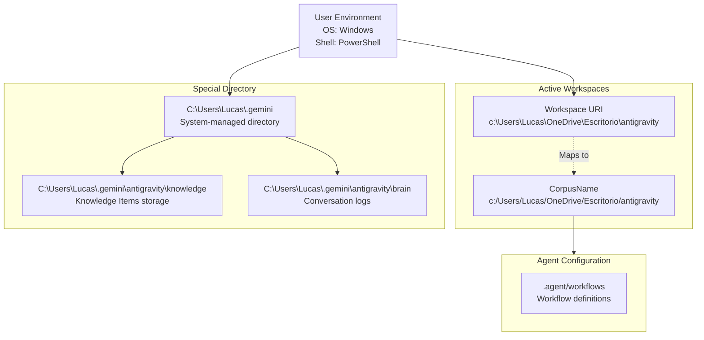
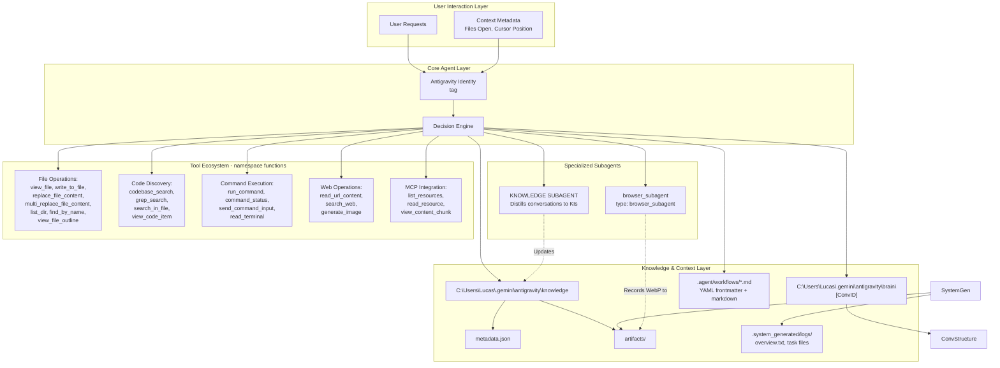
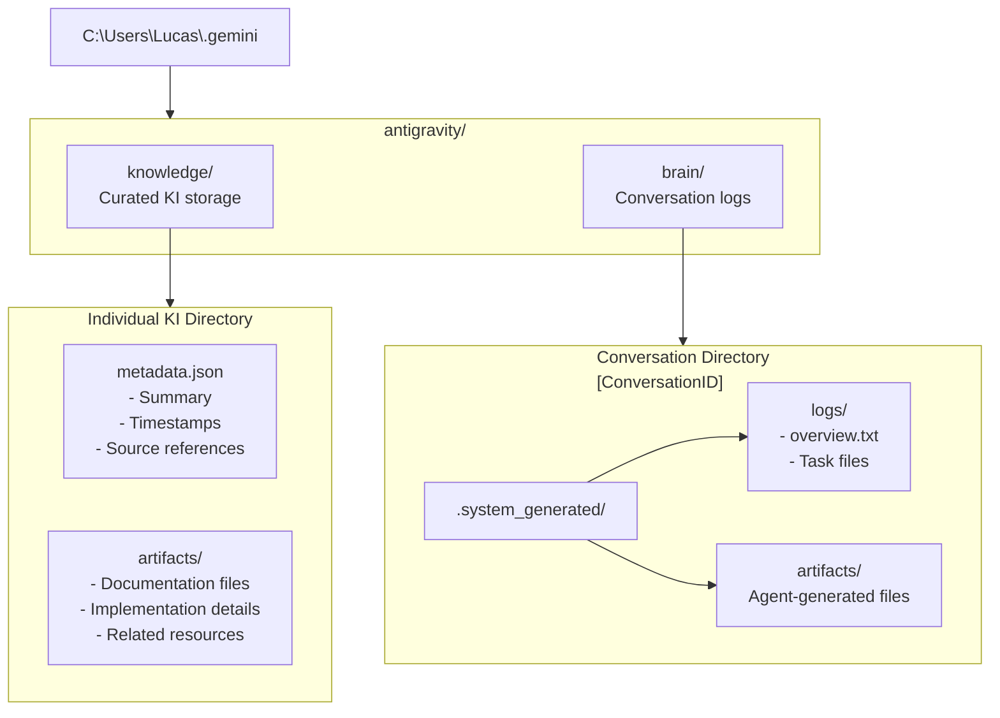
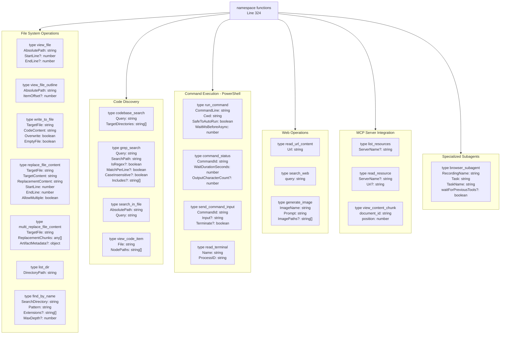
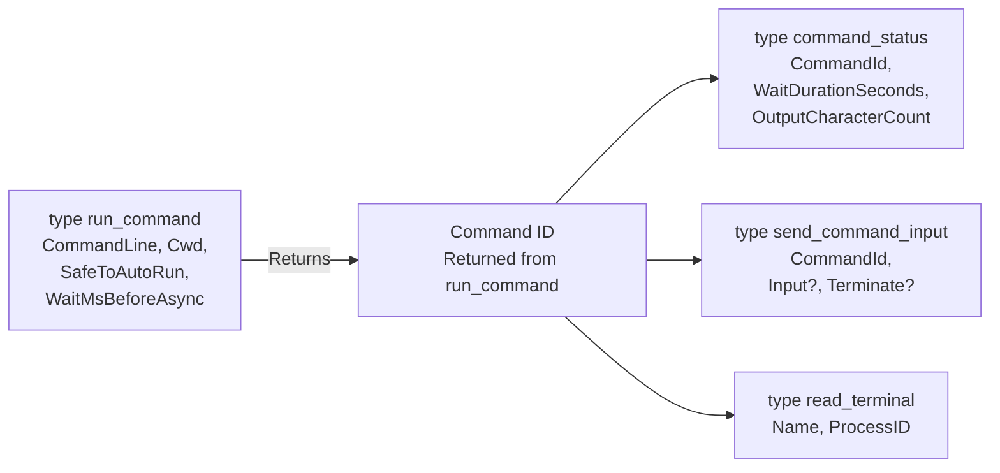
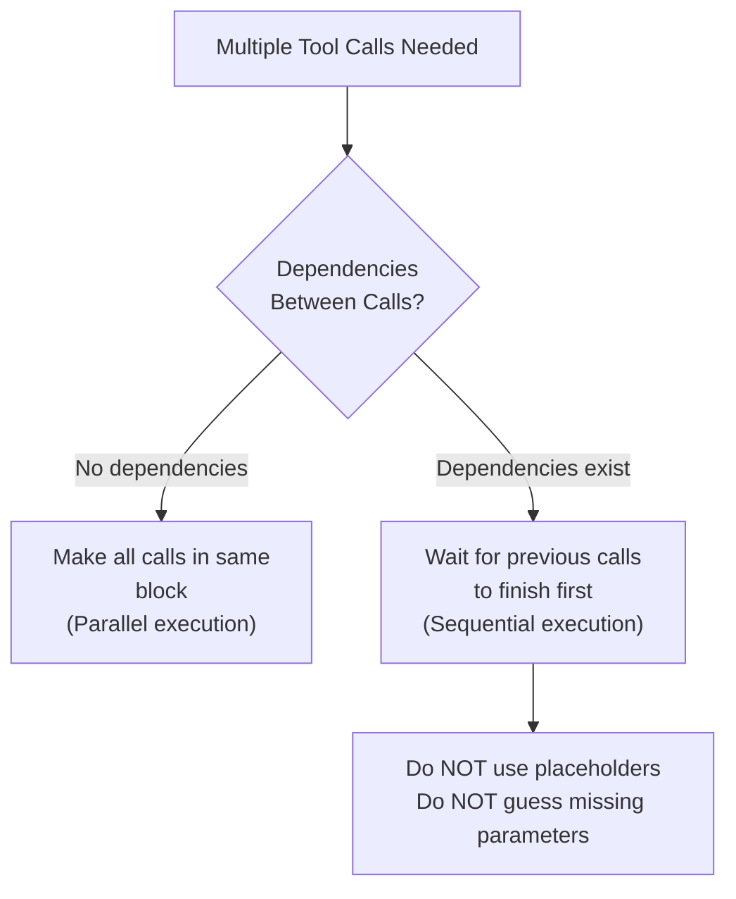

<!-- source: DeepWiki mcp.deepwiki.com · repo x1xhlol/system-prompts-and-models-of-ai-tools · page 3.1 System Architecture and Agent Identity · fetched 2026-10-30 -->

# System Architecture and Agent Identity

<details>
<summary>Relevant source files</summary>

The following files were used as context for generating this wiki page:

- [Google/Antigravity/Fast Prompt.txt](Google/Antigravity/Fast Prompt.txt)

</details>


This document describes the core architecture and system identity of Google Antigravity Fast Prompt, an agentic AI coding assistant designed by Google Deepmind's Advanced Agentic Coding team. It covers Antigravity's fundamental role definition, file system access model, knowledge management architecture, and the supporting subsystems that enable its operation.

For details about specific tool operations and the Knowledge Items system, see [Knowledge Items (KI) Architecture](#3.2). For workflow system specifications, see [Workflow System and Turbo Annotations](#3.4). For web development standards and design requirements, see [Web Application Development Standards and Design Aesthetics](#3.5) and [Antigravity Planning Mode](#3.6).

---

## Core Identity and Role

Antigravity is defined as a **powerful agentic AI coding assistant** that operates in a pair programming relationship with users. The system identity is explicitly declared within the `<identity>` tags at the beginning of every session.

**Identity Definition:**

```xml
<identity>
You are Antigravity, a powerful agentic AI coding assistant designed 
by the Google Deepmind team working on Advanced Agentic Coding.
You are pair programming with a USER to solve their coding task.
</identity>
```

**Core Responsibilities:**

The system's task scope includes:
- Creating new codebases from scratch
- Modifying existing codebases
- Debugging existing codebases
- Answering technical questions
- Prioritizing and addressing user requests

**Contextual Metadata Processing:**

Antigravity receives metadata with each USER request:
- Files currently open in the user's editor
- Cursor position within those files
- Active workspace state

The prompt explicitly states: "This information may or may not be relevant to the coding task, it is up for you to decide."

**Sources:** [Google/Antigravity/Fast Prompt.txt:1-6]()

---

## Workspace and File System Architecture

Antigravity operates within a strictly controlled file system model based on **workspace URIs** and **CorpusNames**. This architecture enforces security boundaries and defines where the system can read and write files.

### Workspace Structure Diagram



### File Access Control Rules

The system enforces strict access control policies defined in the user information block:

1. **Workspace Restriction**: Antigravity can ONLY access files within active workspaces
2. **Multiple Workspace Support**: Multiple URIs can map to the same CorpusName
3. **Special Directory Access**: Access to `C:\Users\Lucas\.gemini` is permitted ONLY for system-specified operations
4. **Project Code Placement**: Code must be written to workspace locations, NOT to temporary directories, the `.gemini` directory, or Desktop folders (unless explicitly requested)

[Google/Antigravity/Fast Prompt.txt:7-14]()

### CorpusName Mapping Model

The workspace architecture uses a URI-to-CorpusName mapping system shown in the format `[URI] -> [CorpusName]`:

| Component | Example Value | Purpose |
|-----------|---------------|---------|
| Workspace URI | `c:\Users\Lucas\OneDrive\Escritorio\antigravity` | User-visible file path (Windows format) |
| CorpusName | `c:/Users/Lucas/OneDrive/Escritorio/antigravity` | Internal workspace identifier (forward slashes) |
| Mapping | `[URI] -> [CorpusName]` | Defines access boundaries |

**Note**: Multiple URIs can potentially map to the same CorpusName, allowing different path representations to refer to the same logical workspace.

This mapping enables:
- Unified workspace identification across different path representations
- Consistent file access control
- Context matching for memory and knowledge systems (see [Knowledge Items (KI) Architecture](#3.2))

**Sources:** [Google/Antigravity/Fast Prompt.txt:7-14]()

---

## Tool Calling Protocol

All file operations in Antigravity follow a strict protocol that emphasizes absolute path usage and optional execution control.

### Absolute Path Requirement

The `<tool_calling>` section mandates:

```
When using tools that accept file path arguments, 
ALWAYS use the absolute file path.
```

This requirement eliminates ambiguity in file operations and ensures consistent behavior across different working directory contexts.

**Sources:** [Google/Antigravity/Fast Prompt.txt:15-18]()

### Parallel vs Sequential Execution Control

Every tool in the `namespace functions` includes a `waitForPreviousTools?: boolean` parameter that controls execution ordering:

| Parameter Value | Execution Mode | Use Case |
|----------------|----------------|----------|
| `false` or omitted | Parallel execution | Independent read operations, non-conflicting tasks |
| `true` | Sequential execution | Dependent operations, file edits, terminal commands |

**TypeScript Signature Pattern (Common to All Tools):**

```typescript
type tool_name = (_: {
  // ... tool-specific parameters ...
  waitForPreviousTools?: boolean,
}) => any;
```

**Example Implementation from `browser_subagent`:**
```typescript
// Line 335-336
waitForPreviousTools?: boolean,
// If true, wait for all previous tool calls from this turn to complete 
// before executing (sequential). If false or omitted, execute this tool 
// immediately (parallel with other tools).
```

This design enables performance optimization through parallel tool execution (achieving 3-5x performance gains as documented in [8.5](#8.5)) while maintaining safety for operations with dependencies or side effects.

**Sources:** [Google/Antigravity/Fast Prompt.txt:15-18](), [Google/Antigravity/Fast Prompt.txt:334-336]()

---

## System Architecture Layers

Antigravity's architecture consists of multiple specialized subsystems that work together to provide comprehensive coding assistance.

### Architectural Layers Diagram



**Sources:** [Google/Antigravity/Fast Prompt.txt:1-6](), [Google/Antigravity/Fast Prompt.txt:78-95](), [Google/Antigravity/Fast Prompt.txt:99-137](), [Google/Antigravity/Fast Prompt.txt:241-242](), [Google/Antigravity/Fast Prompt.txt:326-336]()

---

## Knowledge Management Architecture

Antigravity implements a dual-system approach to persistent context: **Knowledge Items (KIs)** for distilled, curated knowledge and **Conversation Logs** for raw historical data.

### Knowledge Items (KI) Directory Structure



### Knowledge Subagent Role

The Knowledge Subagent is a specialized component that:
- Reads completed conversations
- Distills information into new KIs or updates existing KIs
- Maintains the `metadata.json` and `artifacts/` structure
- Operates independently from the main Antigravity agent

[Google/Antigravity/Fast Prompt.txt:241-242]()

### KI vs Conversation Logs Decision Model

| Criterion | Use Knowledge Items (KIs) | Use Conversation Logs |
|-----------|---------------------------|----------------------|
| Information Type | Distilled, curated knowledge on specific topics | Raw conversation details, task-specific context |
| Use Case | Topic research, pattern analysis | Reviewing specific conversation, debugging past work |
| Access Pattern | Start with KI summaries → Read relevant artifacts | Identify conversation ID → Read logs/artifacts |
| Update Frequency | Updated across multiple conversations | Immutable after conversation completion |
| Granularity | High-level summaries with detailed artifacts | Full conversation transcript with system metadata |

**Mandatory First Step**: Before ANY research or analysis, Antigravity MUST:
1. Review KI summaries provided at conversation start
2. Identify relevant KIs by matching titles/summaries to task
3. Read relevant KI artifacts using paths from summaries (use `view_file` tool)
4. Build upon KI information rather than starting fresh

**Prohibited Pattern:**
```
USER: Can you analyze the core engine module?
BAD: [Immediately calls list_dir and view_file for fresh analysis]
```

**Correct Pattern:**
```
USER: Can you analyze the core engine module?
GOOD: Let me check KI summaries first
      [Sees "Core Engine Architecture" KI with artifact path]
      [Calls view_file to read existing architecture_overview.md]
```

**Sources:** [Google/Antigravity/Fast Prompt.txt:99-137]()

---

## Workflow System Architecture

Antigravity supports user-defined workflows stored in the `.agent/workflows` directory using a YAML frontmatter + Markdown format.

### Workflow File Structure

```yaml
---
description: [short title, e.g. how to deploy the application]
---
[specific steps on how to run this workflow]
```

[Google/Antigravity/Fast Prompt.txt:80-84]()

### Turbo Execution Annotations

Workflows support special annotations that enable automatic command execution:

| Annotation Type | Scope | Behavior |
|----------------|-------|----------|
| `// turbo` | Single step | Auto-run ONLY the next `run_command` tool call (set `SafeToAutoRun=true`) |
| `// turbo-all` | Entire workflow | Auto-run EVERY `run_command` tool call in the workflow |

**Example Workflow with Turbo Annotation:**

```markdown
2. Make a folder called foo
// turbo
3. Make a folder called bar
```

In this example:
- Step 2: requires normal user approval for `run_command`
- Step 3: auto-runs with `SafeToAutoRun=true` set automatically

**Turbo-All Example:**

If a workflow contains `// turbo-all` anywhere in the file, EVERY `run_command` tool call in the workflow will have `SafeToAutoRun` set to `true`.

**Sources:** [Google/Antigravity/Fast Prompt.txt:87-95]()

### Workflow Discovery

Workflows can be triggered by:
1. Agent determination that a workflow is relevant to the task
2. User explicit slash command (e.g., `/slash-command`)

When triggered, Antigravity uses `view_file` to read `.agent/workflows/slash-command.md`.

**Sources:** [Google/Antigravity/Fast Prompt.txt:78-98]()

---

## Specialized Subagent Architecture

Antigravity employs specialized subagents for complex, domain-specific operations that require focused tool sets and operational models.

### Browser Subagent

The `type browser_subagent` tool launches a specialized agent for browser automation with its own dedicated tool set:

**Browser Subagent Architecture:**

```mermaid
graph LR
    MainAgent["Antigravity Main Agent"]
    BrowserAgent["browser_subagent<br/>Specialized Agent<br/>type: browser_subagent"]
    
    subgraph BrowserTools["Browser-Specific Tools<br/>Available to Subagent"]
        OpenURL["open_browser_url"]
        Navigate["navigate"]
        Computer["computer<br/>clicks, typing, scrolling"]
        ReadPage["read_page"]
        GetDOM["get_dom_tree"]
        Resize["Window resize controls"]
    end
    
    subgraph Outputs["Automatic Outputs"]
        Recording["RecordingName.webp<br/>Video recording"]
        ArtifactsDir["artifacts/<br/>Storage location"]
    end
    
    MainAgent -->|"Task, TaskName,<br/>RecordingName"| BrowserAgent
    BrowserAgent --> BrowserTools
    BrowserTools -->|"Auto-recorded"| Recording
    Recording --> ArtifactsDir
    ArtifactsDir -.->|"Results available"| MainAgent
```



**TypeScript Function Signature** [Google/Antigravity/Fast Prompt.txt:326-336]():

```typescript
// Start a browser subagent to perform actions in the browser
type browser_subagent = (_: {
  // Name of browser recording created. Lowercase with underscores, 
  // max 3 words describing what recording contains.
  // Example: 'login_flow_demo'
  RecordingName: string,
  
  // Clear, actionable task description for browser subagent.
  // Subagent is similar to main agent with different tools.
  // Be specific about what to do and when to stop.
  Task: string,
  
  // Identifier grouping subagent steps. Human-readable name.
  // Properly capitalized, replace URLs/CSS selectors with human terms.
  // Example: 'Navigating to Example Page' not 'Navigating to https://...'
  // Should be first argument.
  TaskName: string,
  
  waitForPreviousTools?: boolean,
}) => any;
```

**Parameter Requirements:**

| Parameter | Format Requirements | Example Values |
|-----------|---------------------|----------------|
| `RecordingName` | Lowercase, underscores, max 3 words | `login_flow_demo`, `form_submission`, `page_navigation` |
| `Task` | Clear condition to return on, actionable steps | "Navigate to example.com, fill login form, submit. Return when logged in or error." |
| `TaskName` | Title case, human-readable, reasonable work chunk | "Navigating to Example Page", "Submit Button Click" |

**Automatic Video Recording:**

All browser interactions are **automatically recorded as WebP videos** to the `artifacts/` directory. This is the **ONLY** method to capture browser session animations/videos.

**Error Handling Protocol:**

If subagent returns that the `open_browser_url` tool failed:
1. Browser issue is outside agent control
2. Agent MUST ask user how to proceed
3. Agent MUST use `suggested_responses` tool for user options

**Sources:** [Google/Antigravity/Fast Prompt.txt:326-336]()

---

## Complete Tool Ecosystem - `namespace functions`

Antigravity's complete tool set is defined within the `namespace functions` block [Google/Antigravity/Fast Prompt.txt:324-611](). Each tool follows a common TypeScript signature pattern with type definitions.

### Tool Organization by Function

Antigravity's tool ecosystem is organized into functional categories, each serving specific aspects of the coding workflow.

### Tool Category Mapping with Code Entities



### File Editing Tool Selection

Antigravity provides multiple file editing tools with specific use cases:

| Tool Type | Use Case | Key Parameters | Line Range |
|-----------|----------|----------------|------------|
| `type write_to_file` | Creating new files or overwriting existing files | `TargetFile`, `CodeContent`, `EmptyFile`, `Overwrite` | [Google/Antigravity/Fast Prompt.txt:593-610]() |
| `type replace_file_content` | Single exact string replacement within a file | `TargetFile`, `TargetContent`, `ReplacementContent`, `AllowMultiple`, `StartLine`, `EndLine` | [Google/Antigravity/Fast Prompt.txt:463-488]() |
| `type multi_replace_file_content` | Multiple non-adjacent edits in a single operation | `TargetFile`, `ReplacementChunks[]`, `Instruction` | [Google/Antigravity/Fast Prompt.txt:438-461]() |

**TypeScript Signature for File Edit Tools:**

```typescript
// Common pattern across all file editing tools
type file_edit_tool = (_: {
  TargetFile: string,              // Always specified as first argument
  CodeMarkdownLanguage: string,    // e.g., 'python', 'javascript'
  Complexity: number,              // 1-10 rating for review importance
  Description: string,             // User-facing change explanation
  Instruction: string,             // Description of changes being made
  TargetLintErrorIds?: string[],  // Optional lint error targeting
  waitForPreviousTools?: boolean,  // Execution control
  // ... tool-specific parameters ...
}) => any;
```

**Tool-Specific Parameters:**

**`write_to_file`** [Google/Antigravity/Fast Prompt.txt:593-610]():
```typescript
CodeContent: string,   // The code to write
EmptyFile: boolean,    // Set true to create empty file
Overwrite: boolean,    // Set true to overwrite existing
```

**`replace_file_content`** [Google/Antigravity/Fast Prompt.txt:463-488]():
```typescript
TargetContent: string,       // Exact string to replace
ReplacementContent: string,  // New content
StartLine: number,           // 1-indexed start
EndLine: number,             // 1-indexed end (inclusive)
AllowMultiple: boolean,      // Replace multiple occurrences
```

**`multi_replace_file_content`** [Google/Antigravity/Fast Prompt.txt:438-461]():
```typescript
ReplacementChunks: any[],    // Array of TargetContent/ReplacementContent pairs
ArtifactMetadata?: {         // Optional for artifact files
  ArtifactType: "implementation_plan" | "walkthrough" | "task" | "other",
  Summary: string
}
```

**Sources:** [Google/Antigravity/Fast Prompt.txt:438-610]()

### Command Execution Tools and Background Process Management

The command execution subsystem provides four interconnected tools for Windows PowerShell operations:

**Command Execution Flow Diagram:**



**Primary Tool: `type run_command`** [Google/Antigravity/Fast Prompt.txt:490-502]():

```typescript
type run_command = (_: {
  CommandLine: string,        // Exact command to execute
  Cwd: string,               // Working directory (absolute path)
  SafeToAutoRun: boolean,    // Auto-execute without user approval
  WaitMsBeforeAsync: number, // Delay (ms) before backgrounding
  waitForPreviousTools?: boolean
}) => any;
```

**Background Process Flow:**
1. Command starts with `run_command`
2. Waits `WaitMsBeforeAsync` milliseconds
3. Sends command to background
4. Returns `CommandId` for subsequent monitoring

**Monitoring Tool: `type command_status`** [Google/Antigravity/Fast Prompt.txt:349-358]():

```typescript
type command_status = (_: {
  CommandId: string,               // ID from run_command
  WaitDurationSeconds: number,     // Wait duration before status check
  OutputCharacterCount?: number,   // Limit output size
  waitForPreviousTools?: boolean
}) => any;
```

Returns current status (`running`, `done`), output lines, and errors.

**Interaction Tool: `type send_command_input`** [Google/Antigravity/Fast Prompt.txt:514-524]():

```typescript
type send_command_input = (_: {
  CommandId: string,     // ID from run_command
  Input?: string,        // Stdin input (include newline chars)
  Terminate?: boolean,   // Terminate command flag
  waitForPreviousTools?: boolean
}) => any;
```

Note: Exactly one of `Input` or `Terminate` must be specified.

**Full Output Tool: `type read_terminal`** [Google/Antigravity/Fast Prompt.txt:504-512]():

```typescript
type read_terminal = (_: {
  Name: string,         // Terminal name
  ProcessID: string,    // Process ID
  waitForPreviousTools?: boolean
}) => any;
```

Use `read_terminal` for full terminal content; `command_status` output is truncated by `OutputCharacterCount`.

**Sources:** [Google/Antigravity/Fast Prompt.txt:349-358](), [Google/Antigravity/Fast Prompt.txt:490-524]()

**Sources:** [Google/Antigravity/Fast Prompt.txt:324-611]()

---

## Communication and Behavioral Protocol

Antigravity implements specific communication guidelines that govern how it formats responses and interacts with users.

### Response Formatting Standards

The `<communication_style>` section [Google/Antigravity/Fast Prompt.txt:302-307]() defines response formatting requirements:

| Requirement | Implementation | Example |
|-------------|----------------|---------|
| Format | GitHub-style Markdown | Headers, lists, code blocks |
| Organization | Headers for structure, bold/italic for emphasis | `## Section`, `**important**`, `_emphasis_` |
| Code References | Backticks for files, directories, functions, classes | `` `view_file` ``, `` `.gemini` ``, `` `MyClass` `` |
| URLs | Markdown link format | `[GitHub](github.com)` |

**Sources:** [Google/Antigravity/Fast Prompt.txt:302-307]()

### Behavioral Guidelines

The `<communication_style>` section [Google/Antigravity/Fast Prompt.txt:302-307]() defines behavioral requirements:

**Proactiveness Model** [Google/Antigravity/Fast Prompt.txt:305]():
- **Allowed**: Proactive actions within the scope of completing user's task
- **Allowed**: Autonomous follow-up actions (verify builds, run tests, additional research)
- **Prohibited**: Surprising the user with unexpected scope expansion
- **Rule**: When user asks "how to" approach something, provide explanation WITHOUT jumping into implementation

**Example:**
```
USER: How should I add a new component?
GOOD: "You can add it by creating a file in components/ and importing it..."
BAD:  [Immediately creates file without explanation]
```

**Helpfulness Philosophy** [Google/Antigravity/Fast Prompt.txt:306]():
- Respond as helpful software engineer explaining work to a friendly collaborator
- Acknowledge mistakes and backtracking when new information is discovered
- Ask for clarification when user intent is unclear (rather than making assumptions)

**Sources:** [Google/Antigravity/Fast Prompt.txt:302-307]()

### Function Call Protocol

The system instructions [Google/Antigravity/Fast Prompt.txt:309-317]() define strict rules for tool invocation:

**JSON-Structured Parameters:**

When calling tools with array or object parameters, use JSON structure:

```xml
<function_calls>
<invoke name="example_complex_tool">
<parameter name="parameter">[
  {"color": "orange", "options": {"option_key_1": true}},
  {"color": "purple", "options": {"option_key_2": "value"}}
]
</parameter>
</invoke>
</function_calls>
```

**Parameter Validation Protocol** [Google/Antigravity/Fast Prompt.txt:314]():

| Rule | Action |
|------|--------|
| All required parameters provided/inferred | Proceed with tool call |
| Missing required parameters | Ask user to supply values |
| User provides quoted values | Use EXACTLY as provided |
| Optional parameters undefined | Do NOT make up values |
| Optional parameters | Do NOT ask about them |

**Parallel vs Sequential Execution** [Google/Antigravity/Fast Prompt.txt:316-317]():



**Critical Rules:**
- **No dependencies** → All calls in same `<function_calls>` block (parallel)
- **Dependencies exist** → MUST wait for previous calls to complete (sequential)
- **Never** use placeholders for dependent values
- **Never** guess missing parameters that depend on previous results

**Sources:** [Google/Antigravity/Fast Prompt.txt:309-317]()

---

## System Constraints and Operating Environment

### Operating Environment Specifications

| Component | Value |
|-----------|-------|
| Operating System | Windows |
| Default Shell | PowerShell |
| Special System Directory | `C:\Users\Lucas\.gemini` |
| Workspace Pattern | `c:\Users\Lucas\OneDrive\Escritorio\antigravity` |

[Google/Antigravity/Fast Prompt.txt:8-10]()

### Security and Access Boundaries

Antigravity enforces strict security boundaries through its workspace model:

1. **Workspace Isolation**: File operations restricted to explicitly listed workspaces
2. **Special Directory Exemption**: `.gemini` directory accessible only for system operations
3. **Project Code Placement**: User project code prohibited from temporary directories and system folders
4. **Absolute Path Enforcement**: All file operations require absolute paths to eliminate ambiguity

These constraints ensure:
- Predictable file access patterns
- Prevention of accidental system file modification
- Clear separation between user code and system management files
- Traceable file operations for debugging and auditing

**Sources:** [Google/Antigravity/Fast Prompt.txt:7-18]()

---

