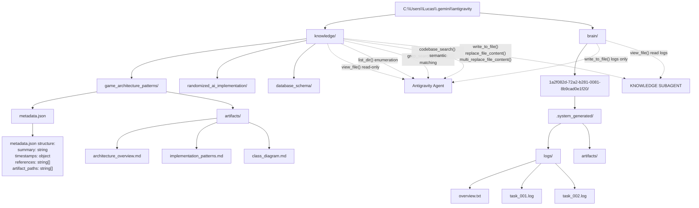
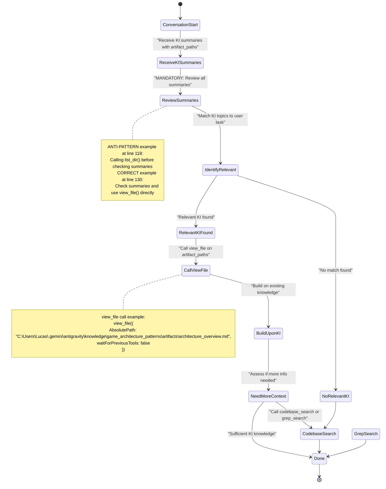

<!-- source: DeepWiki mcp.deepwiki.com · repo x1xhlol/system-prompts-and-models-of-ai-tools · page 3.2 Knowledge Items (KI) Architecture · fetched 2026-10-30 -->

# Knowledge Items (KI) Architecture

<details>
<summary>Relevant source files</summary>

The following files were used as context for generating this wiki page:

- [Google/Antigravity/Fast Prompt.txt](Google/Antigravity/Fast Prompt.txt)

</details>


## Purpose and Scope

This page explains the Knowledge Items (KI) system used in the Google Antigravity agentic AI assistant. The KI system provides a curated, persistent knowledge repository to avoid redundant research and enable cumulative learning across conversation sessions. It organizes distilled knowledge into structured topic directories with metadata and artifacts, supports a mandatory KI-first research protocol, and separates responsibilities between the main conversational agent and a KNOWLEDGE SUBAGENT responsible for asynchronous knowledge maintenance.

Key components covered here:
- The file system layout and metadata.json structure for KI storage
- The KI Summary concept and artifact usage
- Mandatory research workflows enforced by the system prompt
- The KNOWLEDGE SUBAGENT architecture and tool permission separation
- Typical usage patterns and supported tool calls for accessing and updating KIs

For complementary topics on conversation log storage, workflows, and turbo annotations, refer to pages 3.3 and 3.4.

---

## System Overview

The KI system addresses the statelessness of language model conversations by persistently storing knowledge distilled from past conversations. It features two distinct storage tiers:

| Storage Tier            | Location                                                 | Contents                                 | Purpose                                            |
|------------------------|----------------------------------------------------------|------------------------------------------|----------------------------------------------------|
| **Raw Conversation Logs** | `brain/<conversation_id>/.system_generated/logs/`       | Logs including `overview.txt` and `task_*.log` files | Preserve full conversation history and task logs   |
| **Distilled Knowledge Items (KIs)** | `C:\Users\Lucas\.gemini\antigravity\knowledge\<topic_name>\` | `metadata.json`, `artifacts/*.md`        | Curated topic-based knowledge extracted from logs |

The KI-first research protocol enforces that agents first consult existing Knowledge Items summaries and artifacts before performing any independent research to prevent duplication of effort.

**Mandatory KI-first Research Protocol Workflow:**

1. Review KI summaries provided at conversation start, which include artifact file paths.
2. Identify which KIs are relevant to the current request.
3. Read KI artifact files using `view_file` calls on the provided paths, before any fresh search.
4. Build upon KI knowledge; only then perform additional searches if needed.

This protocol is strictly enforced by the system prompt [Google/Antigravity/Fast Prompt.txt:99-136](), and violation is considered an anti-pattern.

**Sources:** [Google/Antigravity/Fast Prompt.txt:99-215]()

---

## Knowledge Items Directory Structure

### KI File System Layout



The Antigravity agent's access is read-only for the knowledge directory, using tools like `view_file`, `list_dir`, `grep_search`, and `codebase_search`. In contrast, the KNOWLEDGE SUBAGENT is the exclusive writer to the knowledge directory, updating `metadata.json` and artifacts asynchronously based on the conversation logs in `brain/`.

**Sources:** [Google/Antigravity/Fast Prompt.txt:204-207](), [Google/Antigravity/Fast Prompt.txt:272-295](), [Google/Antigravity/Fast Prompt.txt:320-611]()

---

### metadata.json Structure

Each KI topic directory contains a `metadata.json` describing the knowledge item:

| Field           | Type      | Description                                   | Example Value                                             |
|-----------------|-----------|-----------------------------------------------|-----------------------------------------------------------|
| `summary`       | string    | Distilled knowledge summary for the topic    | `"Game architecture patterns including module structure and player interfaces"` |
| `timestamps`    | object    | Creation and last modification timestamps (ISO 8601) | `{"created": "2024-01-15T10:30:00Z", "modified": "2024-02-20T14:45:00Z"}`         |
| `references`    | string[]  | Absolute paths to source conversations and files | `["C:\\...\\brain\\1a2f082d...\\logs\\overview.txt", "C:\\...\\src\\game\\core.ts"]` |
| `artifact_paths`| string[]  | Relative artifact files in `artifacts/` directory | `["architecture_overview.md", "implementation_patterns.md", "class_diagram.md"]`  |

The `artifact_paths` array is crucial for enabling the agent to directly call `view_file` on relevant documents without first enumerating files.

**Sources:** [Google/Antigravity/Fast Prompt.txt:204-207](), [Google/Antigravity/Fast Prompt.txt:256-268](), [Google/Antigravity/Fast Prompt.txt:282-288]()

---

### artifacts/ Directory

The `artifacts/` folder inside each KI topic directory contains curated Markdown documentation files produced mainly by the KNOWLEDGE SUBAGENT. Naming conventions assist quick identification:

| Filename Pattern   | Examples                                  | Content Description               | Typical Size (lines) |
|--------------------|-------------------------------------------|---------------------------------|---------------------|
| `*_overview.md`    | `architecture_overview.md`, `system_overview.md` | High-level system design explanations | 200-600            |
| `*_patterns.md`    | `implementation_patterns.md`, `design_patterns.md` | Reusable architectural or code patterns | 150-400            |
| `*_interface.md`   | `api_interface.md`, `ai_player_interface.md` | Interface specifications, contracts | 100-300            |
| `*_strategies.md`  | `caching_strategies.md`, `testing_strategies.md` | Documentation of approaches and guidelines | 150-350            |
| `*_guide.md`       | `deployment_guide.md`, `migration_guide.md` | Step-by-step procedures and instructions | 200-500            |
| `*_diagram.md`     | `class_diagram.md`, `flow_diagram.md`    | Mermaid diagram source files representing visual architecture | 50-200              |

**Sources:** [Google/Antigravity/Fast Prompt.txt:256-295]()

---

## Mandatory KI-First Research Workflow

### Overview

The system prompt enforces a strict knowledge retrieval order to prevent redundant or duplicated research work by the agent:



### Enforcement

- Agents **must** consume KI summaries and artifacts prior to starting any new research.
- Independent exploration tools like `list_dir` or fresh `view_file` calls on new files without prior KI check are prohibited for relevant topics.
- Violations are flagged as anti-patterns and indicate improper use of the KI system.

**Sources:** [Google/Antigravity/Fast Prompt.txt:99-136](), [Google/Antigravity/Fast Prompt.txt:120-130]()

---

### Anti-Pattern vs. Correct Pattern

**Anti-Pattern Example (Lines 112-121)**

```
USER: Analyze the core engine module.

ASSISTANT: [Directly calls list_dir and view_file to start fresh investigation]

# Problem: A relevant KI already exists but was ignored.
```

**Correct Pattern Example (Lines 123-136)**

```
USER: Analyze the core engine module.

ASSISTANT: Checking KI summaries first.

ASSISTANT: Found existing "Core Engine Architecture" KI with artifact.

ASSISTANT: Calls view_file to read existing artifact.

ASSISTANT: Proposes enhancement or verification instead of restating known info.
```

---

## When to Use KIs vs Conversation Logs

### Decision Flow Diagram

```mermaid
graph TB
    Start["User request"]

    Start --> NeedContext{"Requires past context?"}

    NeedContext -->|"No"| AnswerDirect["Answer immediately without tool calls"]

    NeedContext -->|"Yes"| TypeCheck{"Topic-based or Conversation-specific?"}

    TypeCheck -->|"Topic-based"| UseKI["Use Knowledge Items"]

    TypeCheck -->|"Conversation-specific"| CheckKIRefs{"Conversation ID in KI references?"}

    CheckKIRefs -->|"Yes"| ReadKI["view_file on KI artifact"]

    ReadKI --> EnoughInfo{"KI sufficient?"}

    EnoughInfo -->|"Yes"| UseKI

    EnoughInfo -->|"No"| ReadConvOverview

    CheckKIRefs -->|"No"| ReadConvOverview["list_dir in conversation logs"]

    ReadConvOverview --> ViewOverview["view_file overview.txt"]

    ViewOverview --> ConvRelevant{"Relevant per overview.txt?"}

    ConvRelevant -->|"No"| Stop["Stop further reading"]

    ConvRelevant -->|"Yes"| ReadTaskLogs["view_file task log files"]

    UseKI --> KIRealSearch["codebase_search or grep_search in knowledge/"]

    ReadTaskLogs --> Complete["Complete"]

    KIRealSearch --> Complete
    AnswerDirect --> Complete
    Stop --> Complete

    Complete --> [*]

    note right of ViewOverview
        If overview.txt indicates Irrelevance, 
        do NOT read task logs or KI artifacts
    end note

    note left of KIRealSearch
        Related tool calls:
        - codebase_search [338-347]
        - grep_search [394-411]
        - view_file [571-582]
        - list_dir [412-419]
    end note
```

**Usage Rules:** ([Google/Antigravity/Fast Prompt.txt:138-250]())

- **Use Knowledge Items (KIs):**
  - Before all research or analysis steps.
  - Before documentation generation to avoid duplication.
  - When KI summaries indicate relevant knowledge.
  - To understand new concepts and build context.
  - When referenced in the current conversation context.

- **Use Conversation Logs:**
  - When user specifically references a conversation by its ID or topic.
  - When needing specific, conversation-specific details not covered by KIs.
  - Ensure relevance by checking `overview.txt` before reading logs.

- **Avoid Using Conversation Logs:**
  - When researching general topics that KIs cover.
  - When conversation logs are known irrelevant by KI references or summaries.
  - After negative relevance determination from `overview.txt`.

**Sources:** [Google/Antigravity/Fast Prompt.txt:138-250]()

---

## Knowledge Items as Starting Points

KIs are snapshots of past distilled knowledge designed as starting points, **not final authoritative sources**.

**Agent Guidelines:**

- Always verify KI contents with original sources listed in `references`.
- Expect incomplete coverage; supplement with fresh research as required.
- Question assumptions and treat KIs as clues for deeper understanding.

### Common Categories of KIs

| Category               | Example Topics                         | When to Consult                               |
|------------------------|--------------------------------------|----------------------------------------------|
| Architectural Patterns | `game_architecture_patterns`         | Before new feature design or refactoring     |
| Implementation Details | `randomized_ai_implementation`       | Before coding similar components              |
| Known Issues           | Bug documentation, gotchas            | Before troubleshooting or debugging           |
| Best Practices         | Resource management, configuration    | When applying or modifying system components |
| Integration Patterns   | Caching, async patterns                | Prior to adding new features or integrations |

**Sources:** [Google/Antigravity/Fast Prompt.txt:148-215]()

---

## KNOWLEDGE SUBAGENT

### Role and Architecture

A dedicated KNOWLEDGE SUBAGENT asynchronously maintains and updates the KI database by processing raw conversation logs after conversation sessions end. This agent:

- Reads conversation logs (`brain/<conv_id>/.system_generated/logs/`).
- Generates new or updates existing KIs in `knowledge/<topic>/` by creating or modifying `metadata.json` and Markdown artifact files.
- Does **not** interact with user queries directly.

### Separation of Read/Write Permissions

```mermaid
graph TB
    User["User request"]

    User --> MainAgent["Antigravity Agent (Main)"]

    MainAgent -->|"Write logs only:<br/>write_to_file for brain/<conv_id>/.system_generated/logs/*"| ConvLogsWrite["Conversation Logs"]

    MainAgent -->|"Read-only:<br/>view_file/list_dir/grep_search/codebase_search over knowledge/*"| KIStoreRead["Knowledge Items (KIs)"]

    KnowledgeSubagent["KNOWLEDGE SUBAGENT (Async background)"]

    KnowledgeSubagent -->|"Read logs:<br/>view_file on brain/<conv_id>/.system_generated/logs/"| ConvLogsRead["Conversation Logs"]

    KnowledgeSubagent -->|"Write:<br/>write_to_file, replace_file_content, multi_replace_file_content on knowledge/*"| KIStoreWrite["Knowledge Items (KIs)"]

    MainAgent -.->|"Prohibited:<br/>write calls on knowledge/*"| KIStoreRead

    KnowledgeSubagent -.->|"Executed asynchronously after conversation ended"| MainAgent

    note right of MainAgent
        Read Tools:
        - view_file [571-582]
        - list_dir [412-419]
        - grep_search [394-411]
        - codebase_search [338-347]

        Write Tools:
        - write_to_file [593-610] (brain logs only)
    end note

    note left of KnowledgeSubagent
        Write Tools:
        - write_to_file [593-610]
        - replace_file_content [462-489]
        - multi_replace_file_content [438-461]
    end note
```

This clear separation promotes data integrity and prevents concurrent modification conflicts.

**Sources:** [Google/Antigravity/Fast Prompt.txt:218-242](), [Google/Antigravity/Fast Prompt.txt:320-611]()

---

## Detailed Usage Examples

### Example 1: Multiple KIs Accessed in Parallel

User requests adding a new AI player in tic-tac-toe following existing architecture and AI implementation patterns.

**Agent Workflow:**

- Receives KI summaries including artifact paths for `game_architecture_patterns` and `randomized_ai_implementation`.
- Recognizes these two KIs relevant; ignores unrelated KIs.
- Calls `view_file` in parallel on

  - `architecture_overview.md`
  - `implementation_patterns.md`
  - `ai_player_interface.md`

- Processes returned artifact content to guide implementation plan.

**Parallel calls example snippet:**

```typescript
functions.view_file({AbsolutePath: "C:\\...\\knowledge\\game_architecture_patterns\\artifacts\\architecture_overview.md", waitForPreviousTools: false})
functions.view_file({AbsolutePath: "C:\\...\\knowledge\\game_architecture_patterns\\artifacts\\implementation_patterns.md", waitForPreviousTools: false})
functions.view_file({AbsolutePath: "C:\\...\\knowledge\\randomized_ai_implementation\\artifacts\\ai_player_interface.md", waitForPreviousTools: false})
```

### Example 2: Combining Conversation Logs and KIs

User mentions a recent refactoring that broke unit tests.

**Agent Workflow:**

- References conversation ID from user context.
- Reads conversation logs summaries (`overview.txt`) to confirm relevance.
- Reads task-specific logs as needed.
- Checks KI summaries and finds relevant KIs (`game_logic`, `testing`).
- Reads artifact files from these KIs in parallel.
- Combines detailed conversation context with KI knowledge to debug and fix the bug.

**Sources:** [Google/Antigravity/Fast Prompt.txt:254-295]()

---

## Tool Integration and Invocation Patterns

The KI system exposes a suite of tool calls in the `functions` namespace enabling flexible data access and modification:

| Tool                        | Description                             | Use Case                                     | Reference Lines      |
|-----------------------------|---------------------------------------|----------------------------------------------|---------------------|
| `view_file`                 | Read file content with optional line range | Read KI artifacts/metadata or conversation logs | [571-582]()         |
| `list_dir`                  | List directory entries                 | Enumerate KI topics or conversation log files | [412-419]()         |
| `grep_search`               | Regex or plain-text search with matches per line | Pattern match inside KI directories           | [394-411]()         |
| `codebase_search`           | Semantic or symbolic code search       | Conceptual search over KI files                | [338-347]()         |
| `search_in_file`            | Semantic search inside a specific file | Query for details within a known artifact     | [534-543]()         |
| `write_to_file`             | Write or append to files               | Append logs or create new KI metadata/artifacts | [593-610]()         |
| `replace_file_content`      | Single chunk file content replacement | Update parts of KI artifacts                   | [462-489]()         |
| `multi_replace_file_content`| Multiple disjoint chunk replacements  | Complex transformations of KI artifact files | [438-461]()         |

### Parallel vs Sequential Execution Control

The parameter `waitForPreviousTools:boolean` controls whether multiple tool calls execute sequentially (true) or concurrently (false or omitted). For KI retrieval calls, parallel execution (`waitForPreviousTools: false`) minimizes read latency.

**Sources:** [Google/Antigravity/Fast Prompt.txt:320-611]()

---

## Summary

The Knowledge Items (KI) Architecture is a foundational design in the Google Antigravity system for persistent, curated, and reusable knowledge storage. Its highlights:

- Dual storage model separating raw conversation logs and distilled KIs.
- Structured topic directories with `metadata.json` and richly named Markdown artifacts.
- Strict KI-first research mandate to optimize agent efficiency and knowledge reuse.
- Asynchronous KNOWLEDGE SUBAGENT maintaining the KI database distinctly from the main conversational agent.
- Extensive tool support enabling semantic, textual, and direct file artifact access with parallel execution capabilities.
- Clear usage rules distinguishing when to use KIs versus conversation logs.
- KI artifacts and summaries serving as valuable starting points for new tasks and analysis, not absolute ground truth.

This architecture enables gradual buildup of domain expertise within the system, increasing the effectiveness and sophistication of agent reasoning over time.

---

**Sources:**  
[Google/Antigravity/Fast Prompt.txt:99-295]()

---

