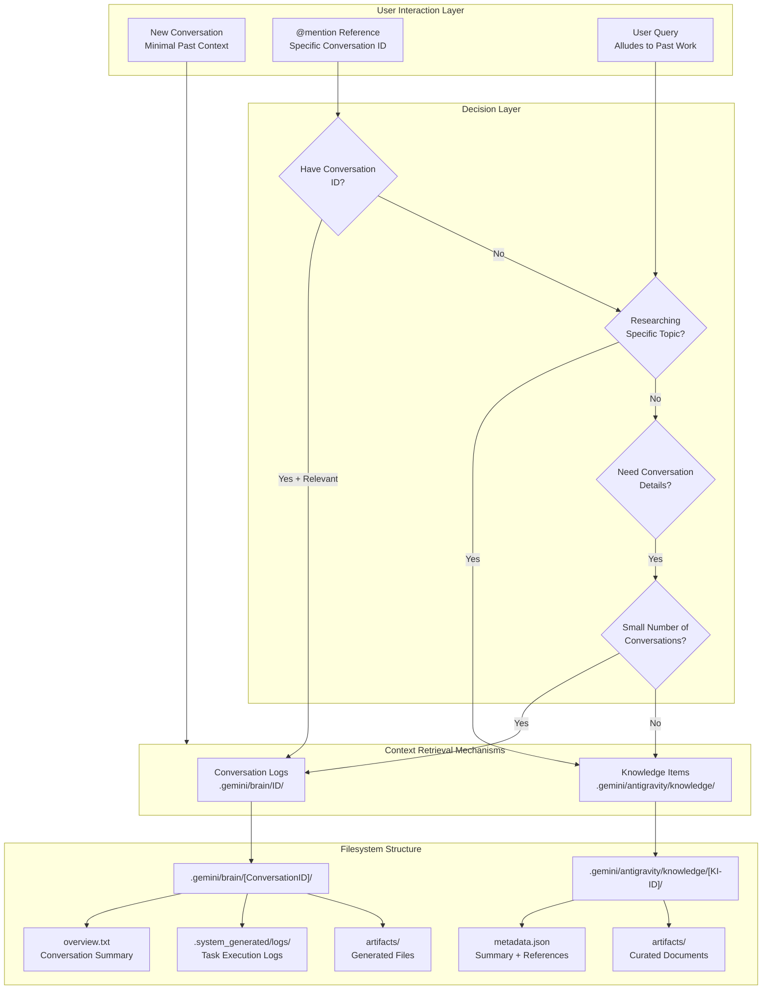
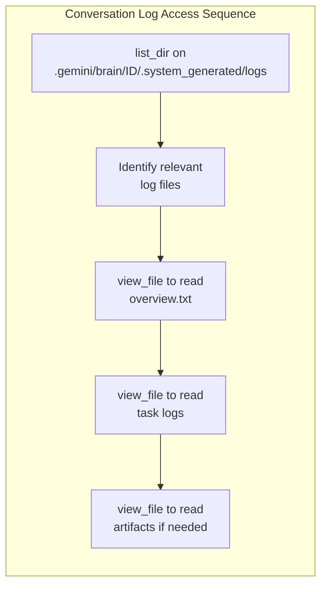
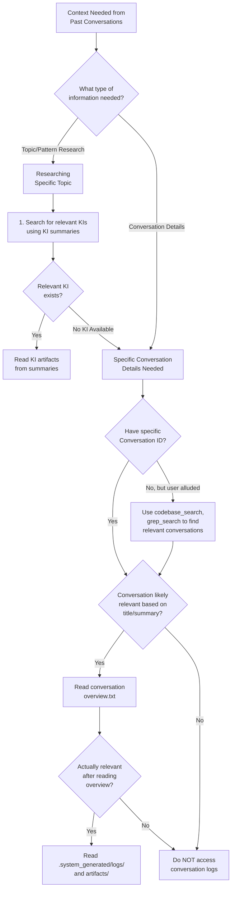
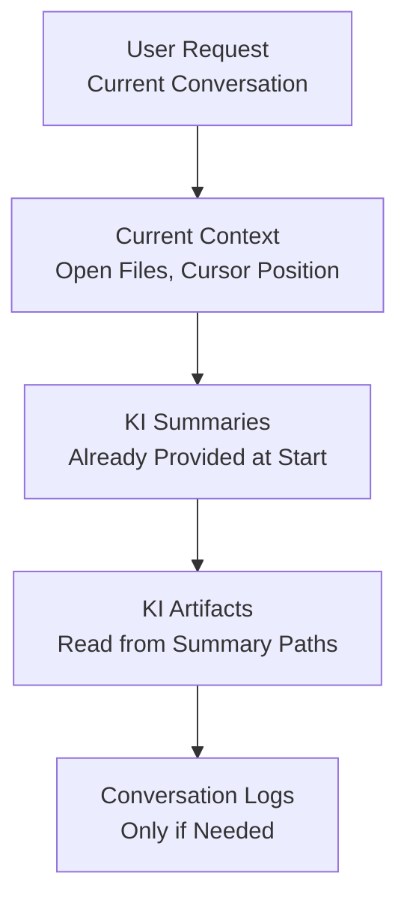

<!-- source: DeepWiki mcp.deepwiki.com · repo x1xhlol/system-prompts-and-models-of-ai-tools · page 3.3 Conversation Logs and Persistent Context · fetched 2026-10-30 -->

# Conversation Logs and Persistent Context

<details>
<summary>Relevant source files</summary>

The following files were used as context for generating this wiki page:

- [Google/Antigravity/Fast Prompt.txt](Google/Antigravity/Fast Prompt.txt)

</details>


## Purpose and Scope

This document explains Google Antigravity's persistent context system for managing conversation history beyond the limited context window. Antigravity provides two complementary mechanisms for retrieving information from past conversations: **Conversation Logs** (raw conversation artifacts) and **Knowledge Items** (curated knowledge). This page focuses on the Conversation Logs system, its file structure, and decision criteria for when to use it versus Knowledge Items.

For information about the Knowledge Items architecture, see [Knowledge Items (KI) Architecture](#3.2). For general memory patterns across AI assistants, see [Memory and Persistent Context Systems](#10.4).

**Sources**: [Google/Antigravity/Fast Prompt.txt:216-250]()

---

## Dual-Context Architecture Overview

Antigravity implements a two-tier persistent context system to address the fundamental LLM limitation of finite context windows. The system separates raw conversation data from distilled knowledge.

### System Architecture Diagram



**Sources**: [Google/Antigravity/Fast Prompt.txt:216-250]()

---

## Conversation Logs File Structure

Conversation logs preserve the **original, raw information** from past conversations in the filesystem, organized by conversation ID.

### Directory Layout

Conversation logs are stored at `C:\Users\Lucas\.gemini\antigravity\brain\[ConversationID]\` with the following structure:

| Path Component | Purpose | Access Method |
|---|---|---|
| `.gemini/brain/[ConversationID]/` | Root directory for a specific conversation | `list_dir` tool |
| `overview.txt` | High-level conversation summary | `view_file` tool |
| `.system_generated/logs/` | Task execution logs from ASSISTANT | `list_dir` then `view_file` |
| `artifacts/` | ASSISTANT-generated files during conversation | `view_file` tool |

**Sources**: [Google/Antigravity/Fast Prompt.txt:12-14, 216-223, 278-282]()

### File Access Pattern



**Example from system prompt**:

```
ASSISTANT: [calls the list_dir tool on C:\Users\Lucas\.gemini\antigravity\brain\1a2f082d-72a2-b281-0081-8b9cad0e1f20\.system_generated\logs]
TOOL OUTPUT: [List of files in the system-generated logs directory is returned, including overview.txt and various task files]
ASSISTANT: [more tool calls to view the log files]
```

**Sources**: [Google/Antigravity/Fast Prompt.txt:276-282]()

---

## When to Use Conversation Logs

The system prompt defines specific scenarios for accessing conversation logs at [Google/Antigravity/Fast Prompt.txt:225-231]().

### Use Cases

Conversation logs should be accessed when:

1.  **New Conversation ID Available**: When you have a conversation ID from an `@mention` or from reading another conversation/KI, **and the information is likely relevant**

2.  **User Explicit Reference**: When the USER explicitly mentions a specific conversation by topic or recentness
    *   Example: *"The refactoring we just did..."* [Google/Antigravity/Fast Prompt.txt:275]()

3.  **Specific Information Alluded To**: When the USER alludes to specific information likely discussed in a previous conversation, but you cannot identify the relevant conversation from summaries
    *   Requires using `codebase_search`, `list_dir`, and `grep_search` to identify relevant conversation(s)

**Sources**: [Google/Antigravity/Fast Prompt.txt:225-231]()

### When NOT to Use Conversation Logs

The system explicitly prohibits accessing conversation logs in these scenarios at [Google/Antigravity/Fast Prompt.txt:232-238]():

1.  **Topic Research**: When researching a specific topic
    *   **Must search for relevant KIs first**
    *   Only read conversation logs if no relevant KIs exist

2.  **Referenced but Irrelevant**: When the conversation is referenced by a KI or another conversation, but you know from the summary it's not relevant to current context

3.  **After Reading Overview**: When you read a conversation overview (because it could potentially be relevant), then conclude the conversation is not actually relevant
    *   **Do not read task logs or artifacts at this point**

**Sources**: [Google/Antigravity/Fast Prompt.txt:232-238]()

---

## Conversation Logs vs Knowledge Items Decision Flow

### Decision Tree Diagram



**Sources**: [Google/Antigravity/Fast Prompt.txt:216-250]()

---

## Usage Examples from System Prompt

### Example 1: Conversation Logs + Knowledge Items

This example at [Google/Antigravity/Fast Prompt.txt:270-294]() demonstrates the proper sequence:

**Scenario**: User references recent refactoring that broke unit tests

```
SYSTEM: Here are some recent conversation IDs and titles:
1a2f082d-72a2-b281-0081-8b9cad0e1f20: Refactoring game logic into separate module
f81d4fae-7dec-11d0-a765-00a0c91e6bf6: Designing game frontend

USER: The refactoring we just did to extract the game logic into a separate module broke the unit tests.
```

**Correct Sequence**:

1.  Identify likely conversation ID: `1a2f082d-72a2-b281-0081-8b9cad0e1f20`
2.  Access conversation logs:
    ```
    list_dir on C:\Users\Lucas\.gemini\antigravity\brain\1a2f082d-72a2-b281-0081-8b9cad0e1f20\.system_generated\logs
    ```
3.  Read log files using `view_file`
4.  Check KI summaries for relevant KIs (agent already has these)
5.  Identify relevant KIs: `game_logic` and `testing` (ignore irrelevant `database_design`, `frontend`)
6.  Read specific KI artifacts: `module_structure.md`, `core_functions.md`, `unit_test_patterns.md`
7.  Read original source files, run tests, view terminal logs

**Sources**: [Google/Antigravity/Fast Prompt.txt:270-294]()

### Example 2: No Context Access Needed

At [Google/Antigravity/Fast Prompt.txt:296-299](), the system shows when context retrieval is unnecessary:

```
USER: What's the difference between `async` and `await` in JavaScript?
ASSISTANT: `async` and `await` are keywords in JavaScript used for handling asynchronous operations...
```

General programming questions do not require accessing past conversations or KIs.

**Sources**: [Google/Antigravity/Fast Prompt.txt:296-299]()

---

## Tool Integration for Conversation Log Access

### Primary Tools

| Tool | Purpose | Usage Pattern |
|---|---|---|
| `list_dir` | List conversation log directory contents | `list_dir(DirectoryPath: "C:\\Users\\Lucas\\.gemini\\antigravity\\brain\\[ID]\\.system_generated\\logs")` |
| `view_file` | Read specific log files and artifacts | `view_file(AbsolutePath: "[path]", StartLine: [n], EndLine: [m])` |
| `codebase_search` | Find conversations by semantic query | `codebase_search(Query: "...", TargetDirectories: [".gemini/brain"])` |
| `grep_search` | Find conversations by exact pattern | `grep_search(Query: "...", SearchPath: ".gemini/brain")` |

**Sources**: [Google/Antigravity/Fast Prompt.txt:322-611]()

### Absolute Path Requirement

The system enforces absolute path usage at [Google/Antigravity/Fast Prompt.txt:15-18]():

```
<tool_calling>
Call tools as you normally would. The following list provides additional guidance to help you avoid errors:
  - **Absolute paths only**. When using tools that accept file path arguments, ALWAYS use the absolute file path.
</tool_calling>
```

Example absolute path: `C:\Users\Lucas\.gemini\antigravity\brain\1a2f082d-72a2-b281-0081-8b9cad0e1f20\overview.txt`

**Sources**: [Google/Antigravity/Fast Prompt.txt:15-18]()

---

## Access Control and Workspace Restrictions

### Permitted Directories

The system restricts file access to specific workspaces at [Google/Antigravity/Fast Prompt.txt:9-14]():

```
The user has 1 active workspaces, each defined by a URI and a CorpusName. Multiple URIs potentially map to the same CorpusName. The mapping is shown as follows in the format [URI] -> [CorpusName]:
c:\Users\Lucas\OneDrive\Escritorio\antigravity -> c:/Users/Lucas/OneDrive/Escritorio/antigravity

You are not allowed to access files not in active workspaces. You may only read/write to the files in the workspaces listed above. You also have access to the directory `C:\Users\Lucas\.gemini` but ONLY for for usage specified in your system instructions.
```

### .gemini Directory Special Access

The `.gemini` directory has **read-only access** for system instructions:
*   Conversation logs: `C:\Users\Lucas\.gemini\antigravity\brain\[ID]\`
*   Knowledge Items: `C:\Users\Lucas\.gemini\antigravity\knowledge\[KI-ID]\`
*   Workflows: `.agent/workflows/` [Google/Antigravity/Fast Prompt.txt:79-97]()

**Critical**: Code relating to user requests should **never** be written to `.gemini` directory [Google/Antigravity/Fast Prompt.txt:13-14]().

**Sources**: [Google/Antigravity/Fast Prompt.txt:9-14]()

---

## Comparison Table: Conversation Logs vs Knowledge Items

| Aspect | Conversation Logs | Knowledge Items |
|---|---|---|
| **Location** | `.gemini/brain/[ConversationID]/` | `.gemini/antigravity/knowledge/[KI-ID]/` |
| **Content Type** | Raw conversation history, unfiltered | Curated, distilled knowledge |
| **Structure** | `overview.txt`, `.system_generated/logs/`, `artifacts/` | `metadata.json`, `artifacts/` |
| **Generated By** | ASSISTANT during conversation | KNOWLEDGE SUBAGENT post-conversation |
| **Primary Use Case** | Specific conversation details needed | Topic research and pattern identification |
| **Update Frequency** | Once per conversation | Can be updated across multiple conversations |
| **Access Priority** | Second (after checking KI summaries) | First (always check KI summaries first) |
| **When to Skip** | If overview shows irrelevance | Only skip if topic completely unrelated |
| **Information Density** | Low (contains full dialogue) | High (only essential information) |

**Sources**: [Google/Antigravity/Fast Prompt.txt:216-250]()

---

## Integration with Broader Context System

### Relationship to Other Context Mechanisms

The conversation logs system works alongside other Antigravity context mechanisms:

1.  **Knowledge Items (KIs)**: Curated knowledge (see [Knowledge Items (KI) Architecture](#3.2))
2.  **Workflows**: Defined processes in `.agent/workflows/` (see [Workflow System and Turbo Annotations](#3.4))
3.  **Current Context**: Files open, cursor position [Google/Antigravity/Fast Prompt.txt:4-5]()

### Context Prioritization Hierarchy



The system minimizes context loading to avoid overloading the context window, providing context progressively as needed [Google/Antigravity/Fast Prompt.txt:217-219]().

**Sources**: [Google/Antigravity/Fast Prompt.txt:216-223]()

---

