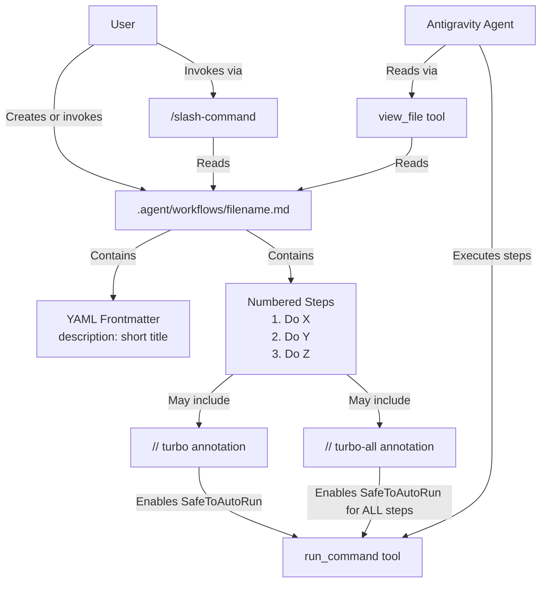
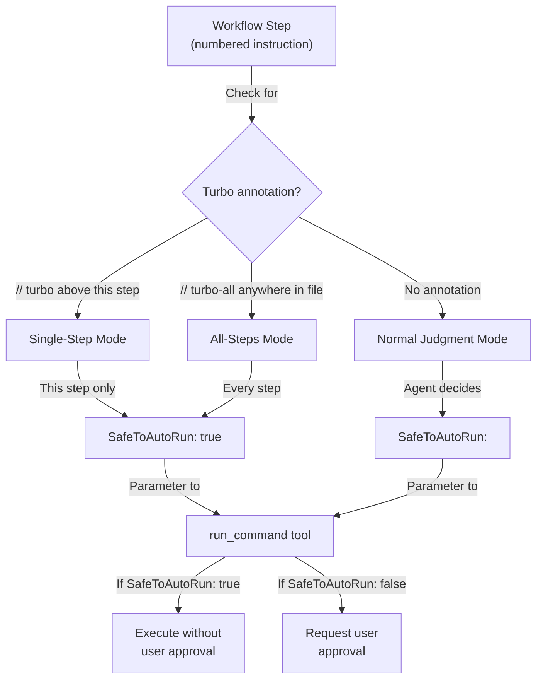
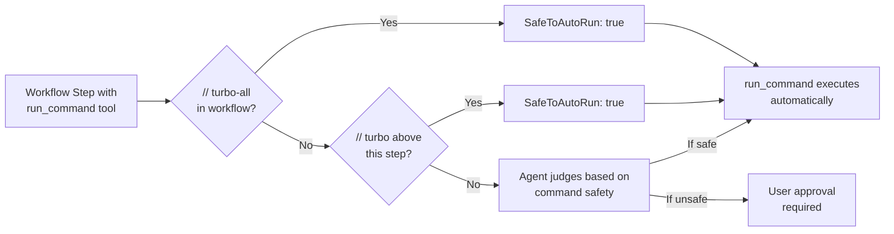
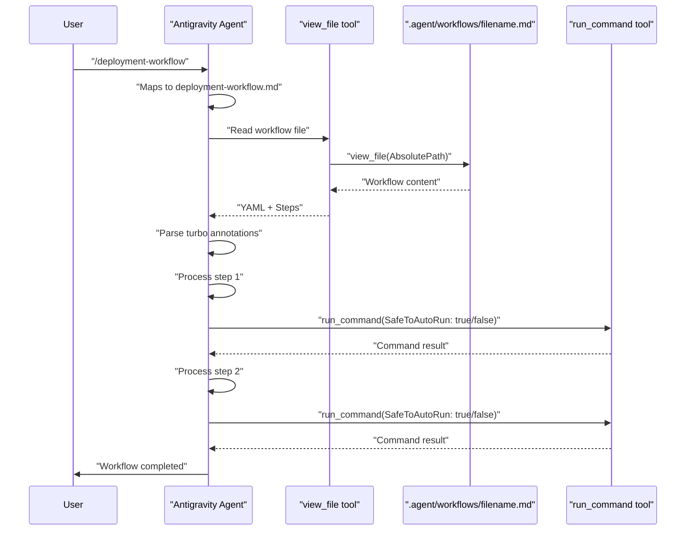
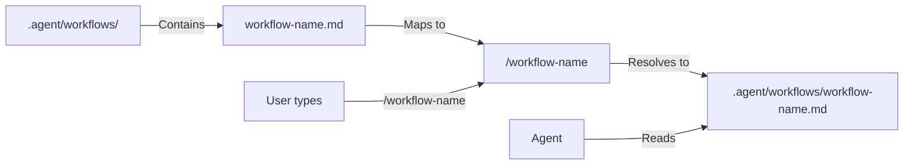
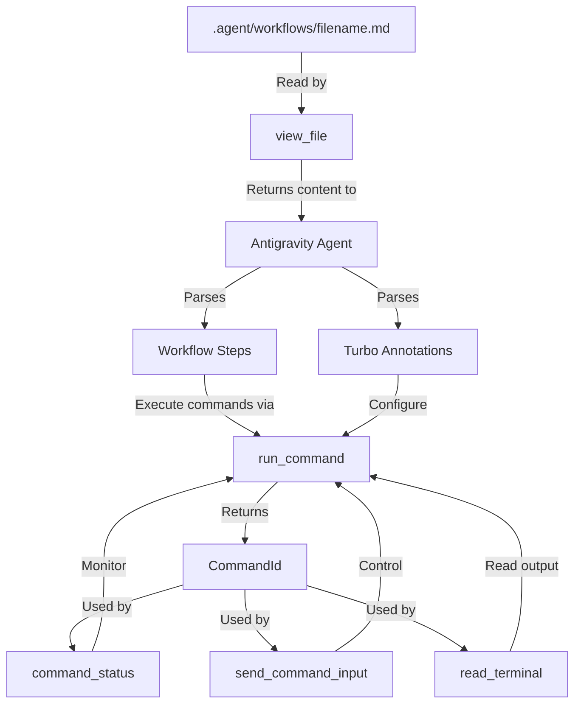

<!-- source: DeepWiki mcp.deepwiki.com · repo x1xhlol/system-prompts-and-models-of-ai-tools · page 3.4 Workflow System and Turbo Annotations · fetched 2026-10-30 -->

# Workflow System and Turbo Annotations

<details>
<summary>Relevant source files</summary>

The following files were used as context for generating this wiki page:

- [Google/Antigravity/Fast Prompt.txt](Google/Antigravity/Fast Prompt.txt)

</details>


This page documents Antigravity's workflow system, which provides a mechanism for defining reusable, well-structured procedures stored in markdown files with optional automation annotations. The workflow system enables users to create documented processes that can be partially or fully automated through turbo annotations.

For information about general Antigravity system architecture, see [System Architecture and Agent Identity](). For Knowledge Items (KI) storage, see [Knowledge Items (KI) Architecture]().

---

## Purpose and Scope

The workflow system in Antigravity serves three primary functions:

1.  **Procedural Documentation**: Store step-by-step instructions for common tasks (deployment, setup, testing, etc.)
2.  **Automation Control**: Use turbo annotations to enable safe automatic execution of specific commands
3.  **Slash Command Interface**: Allow users to invoke workflows via `/slash-command` syntax for quick access

Workflows are stored as markdown files in the `.agent/workflows/` directory and follow a specific format combining YAML frontmatter with markdown content.

**Sources:** [Google/Antigravity/Fast Prompt.txt:78-98]()

---

## Workflow File Structure

### File Format and Location

Workflows are stored in `.agent/workflows/[filename].md` using absolute paths. Each workflow file consists of two components:

1.  **YAML Frontmatter**: Contains metadata including a short description
2.  **Markdown Content**: Contains numbered steps with specific instructions

#### File Format Structure

```yaml
---
description: [short title, e.g. how to deploy the application]
---
[specific steps on how to run this workflow]
```

**Sources:** [Google/Antigravity/Fast Prompt.txt:80-84]()

### Workflow File Lifecycle Diagram



**Diagram: Workflow File Structure and Invocation Flow**

**Sources:** [Google/Antigravity/Fast Prompt.txt:78-98]()

---

## Turbo Annotations

Turbo annotations are special comments that control automatic command execution within workflows. They modify the behavior of the `run_command` tool by setting the `SafeToAutoRun` parameter.

### Single-Step Turbo (`// turbo`)

The `// turbo` annotation applies to **only the immediately following step** in the workflow. When this annotation is present above a step that involves the `run_command` tool, the agent sets `SafeToAutoRun` to `true` for that specific command.

#### Behavior Rules

1.  **Scope**: Applies to a single step only
2.  **Position**: Must appear on the line immediately before the step
3.  **Effect**: Sets `SafeToAutoRun: true` for the `run_command` tool call in that step
4.  **Fallback**: Other steps use normal judgment for the `SafeToAutoRun` parameter

#### Example Usage

```markdown
---
description: setup project dependencies
---

1. Navigate to project directory
2. Make a folder called foo
// turbo
3. Make a folder called bar
4. Install npm packages
```

In this example:
- Step 3 will auto-run without user approval
- Steps 1, 2, and 4 require agent judgment or user approval

**Sources:** [Google/Antigravity/Fast Prompt.txt:87-94]()

### Global Turbo (`// turbo-all`)

The `// turbo-all` annotation applies to **every step** in the workflow that involves the `run_command` tool. This annotation can appear anywhere in the workflow file and enables full automation.

#### Behavior Rules

1.  **Scope**: Applies to all steps in the workflow
2.  **Position**: Can appear anywhere in the workflow file
3.  **Effect**: Sets `SafeToAutoRun: true` for **EVERY** `run_command` tool call
4.  **Override**: Takes precedence over individual step judgment

#### Example Usage

```markdown
---
description: automated deployment pipeline
---

// turbo-all

1. Build the application
2. Run tests
3. Deploy to staging
4. Verify deployment
```

In this example, all four steps will auto-run without user approval.

**Sources:** [Google/Antigravity/Fast Prompt.txt:95-96]()

### Turbo Annotation Processing Flow



**Diagram: Turbo Annotation Processing Logic**

**Sources:** [Google/Antigravity/Fast Prompt.txt:87-96]()

---

## Integration with Command Execution

The turbo annotation system directly integrates with the `run_command` tool, which is the primary mechanism for executing shell commands in Antigravity's Windows PowerShell environment.

### run_command Tool Parameters

| Parameter | Type | Description | Turbo Impact |
| :---------- | :--- | :---------- | :----------- |
| `CommandLine` | string | The exact command to execute | Not affected |
| `Cwd` | string | Current working directory | Not affected |
| `SafeToAutoRun` | boolean | Execute without user approval | **Set by turbo annotations** |
| `WaitMsBeforeAsync` | number | Delay before backgrounding | Not affected |
| `waitForPreviousTools` | boolean | Sequential vs parallel execution | Not affected |

### SafeToAutoRun Decision Matrix



**Diagram: SafeToAutoRun Parameter Decision Flow**

**Sources:** [Google/Antigravity/Fast Prompt.txt:87-96]()

### Command Execution Context

The `run_command` tool operates in the following environment:
- **Operating System**: Windows
- **Shell**: PowerShell
- **Working Directory**: Specified by `Cwd` parameter
- **Execution Mode**: Foreground or background (controlled by `WaitMsBeforeAsync`)

**Sources:** [Google/Antigravity/Fast Prompt.txt:7-13]()

---

## Slash Command Interface

Workflows can be invoked using slash command syntax, which provides a user-friendly interface for triggering documented procedures.

### Invocation Pattern

When a user types `/slash-command`, the agent:

1.  Maps the command to `.agent/workflows/slash-command.md`
2.  Uses the `view_file` tool to read the workflow file
3.  Executes the steps according to the workflow and turbo annotations

### Workflow Discovery Process



**Diagram: Slash Command Execution Sequence**

**Sources:** [Google/Antigravity/Fast Prompt.txt:96-97]()

### Alternative Discovery Mechanisms

In addition to explicit slash commands, the agent may read workflows when:

1.  **Relevance Detection**: The workflow appears relevant to the current user request
2.  **Explicit Request**: The user directly asks to view or follow a specific workflow
3.  **Context Matching**: The workflow description matches the task at hand

**Sources:** [Google/Antigravity/Fast Prompt.txt:96-97]()

---

## Workflow Creation Guidelines

### When to Create Workflows

Workflows should be created for:

1.  **Repeatable Processes**: Tasks performed multiple times (deployment, testing, setup)
2.  **Multi-Step Procedures**: Complex operations requiring specific ordering
3.  **Automation Candidates**: Processes where some steps can safely auto-run
4.  **Knowledge Transfer**: Documenting standard procedures for future reference

### Best Practices

| Practice | Description | Reasoning |
| :--------- | :---------- | :-------- |
| Specific Instructions | Write clear, actionable steps | Enables reliable execution |
| Appropriate Turbo Usage | Only mark safe commands with turbo | Prevents unintended damage |
| Descriptive Filenames | Use clear, searchable names | Improves discoverability |
| Short Descriptions | Keep frontmatter concise | Enables quick scanning |
| Safety First | Reserve `// turbo-all` for truly safe workflows | Minimizes risk |

### Workflow File Naming Convention



**Diagram: Workflow File Naming and Resolution**

**Sources:** [Google/Antigravity/Fast Prompt.txt:96-97]()

---

## Tool Integration Summary

The workflow system integrates with multiple Antigravity tools:

| Tool | Purpose in Workflows |
| :--- | :------------------- |
| `view_file` | Read workflow file content |
| `run_command` | Execute shell commands with SafeToAutoRun |

### Workflow-Tool Interaction Architecture



**Diagram: Workflow System and Tool Ecosystem**

**Sources:** [Google/Antigravity/Fast Prompt.txt:78-98]()

---

## Security and Safety Considerations

### SafeToAutoRun Evaluation Criteria

When turbo annotations are not present, the agent must evaluate command safety using these criteria:

1.  **Destructive Operations**: Commands that delete, overwrite, or modify critical files
2.  **External Network Access**: Commands that upload or download from external sources
3.  **System Modifications**: Commands that change system configuration or install software
4.  **Resource Intensive**: Commands that may consume significant CPU, memory, or disk
5.  **User Context Required**: Commands whose safety depends on user-specific context

### Turbo Annotation Guidelines

| Annotation | Safe For | Unsafe For |
| :--------- | :------- | :--------- |
| `// turbo` | Single read-only operations, directory creation, simple builds | Deployments, deletions, system changes |
| `// turbo-all` | Fully automated CI/CD pipelines, read-only analysis scripts | Any workflow with user-specific decisions |
| None | All commands (agent evaluates each) | N/A |

**Sources:** [Google/Antigravity/Fast Prompt.txt:87-96]()

---

## Workflow System File Locations

### Directory Structure

```
c:/Users/Lucas/OneDrive/Escritorio/antigravity/
├── .agent/
│   └── workflows/
│       ├── deployment.md
│       ├── setup.md
│       ├── testing.md
│       └── [other-workflows].md
└── .gemini/
    └── [other Antigravity data]
```

**Note**: The `.agent/` directory is distinct from the `.gemini/` directory. Workflows are stored in `.agent/workflows/`, while other Antigravity data (like conversation logs) are stored in `.gemini/`.

**Sources:** [Google/Antigravity/Fast Prompt.txt:9-13](), [Google/Antigravity/Fast Prompt.txt:78-86]()

---

