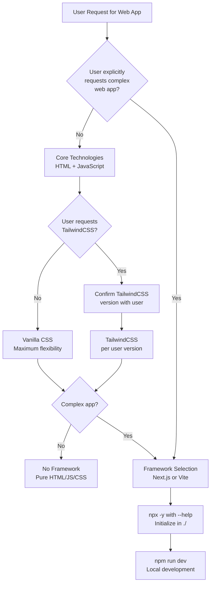
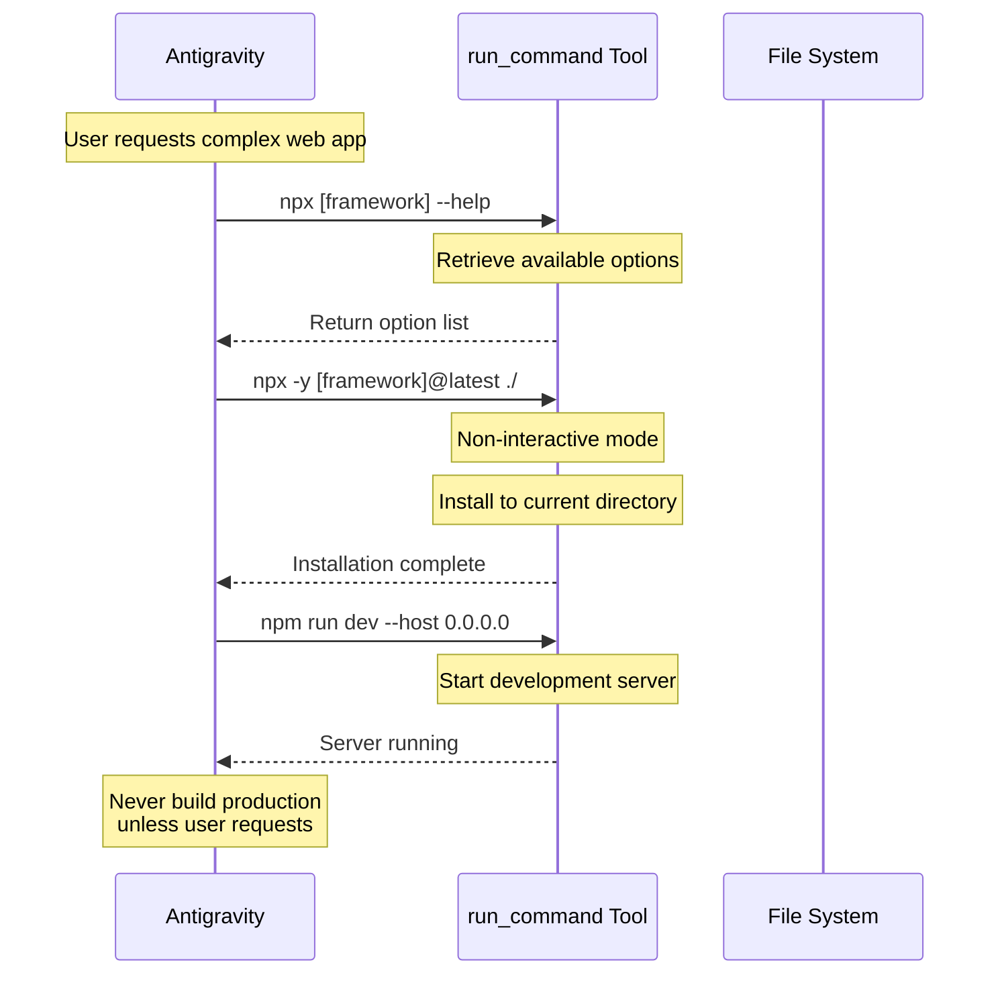
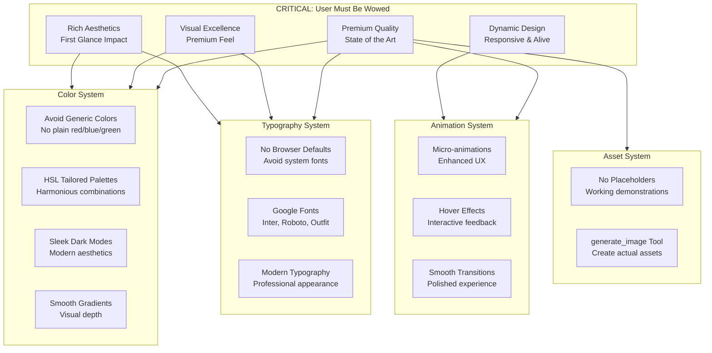
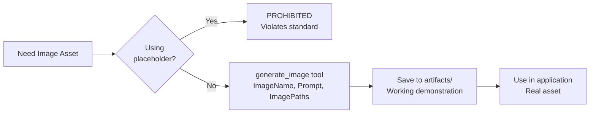
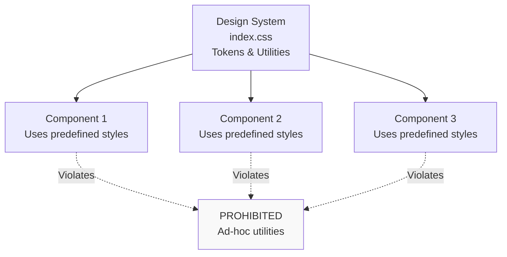
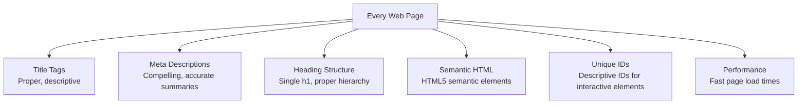
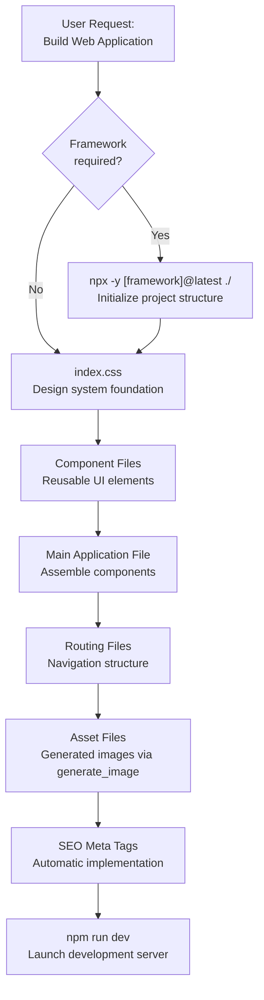

<!-- source: DeepWiki mcp.deepwiki.com · repo x1xhlol/system-prompts-and-models-of-ai-tools · page 3.5 Web Application Development Standards and Design Aesthetics · fetched 2026-10-30 -->

# Web Application Development Standards

Relevant source files

The following files were used as context for generating this wiki page:

- [Google/Antigravity/Fast Prompt.txt](Google/Antigravity/Fast Prompt.txt)

## Purpose and Scope

This document specifies Antigravity's opinionated approach to web application development, including technology stack selection, design aesthetics requirements, implementation workflow, and SEO practices. These standards apply when Antigravity creates or modifies web applications in response to user requests.

For comparison with other AI assistant web development approaches, see:
- Qoder's web development standards ([2.11]())
- v0's Design System and Tailwind Guidelines ([4.1.4]())
- Same.dev's Web Development and Project Setup ([4.2.4]())

**Sources**: [Google/Antigravity/Fast Prompt.txt:19-74]()

---

## Technology Stack Architecture

Antigravity follows a **HTML/JavaScript-first** philosophy with Vanilla CSS as the default styling approach, escalating to frameworks only when complexity demands it.

### Technology Selection Decision Tree

**Sources**: [Google/Antigravity/Fast Prompt.txt:20-30]()

### Core Technology Specifications

| Component | Technology | Rationale |
|-----------|-----------|-----------|
| Structure | HTML | Standard markup language |
| Logic | JavaScript | Core scripting language |
| Styling (Default) | Vanilla CSS | Maximum flexibility and control |
| Styling (Alternative) | TailwindCSS | Only if user explicitly requests with version confirmation |
| Framework (Complex Apps) | Next.js or Vite | Only when user explicitly requests web app |
| Package Runner | `npx -y` | Automatic script installation |
| Development Server | `npm run dev` | Local testing and development |

**Sources**: [Google/Antigravity/Fast Prompt.txt:21-30]()

### Project Initialization Protocol

When framework usage is required, Antigravity follows this initialization sequence:

**Key Requirements**:
- Use `npx -y` flag for automatic dependency installation
- Always run `--help` first to understand available options ([Google/Antigravity/Fast Prompt.txt:27]())
- Initialize in current directory with `./` path ([Google/Antigravity/Fast Prompt.txt:28]())
- Run in non-interactive mode so that the user doesn't need to input anything ([Google/Antigravity/Fast Prompt.txt:29]())
- Use `npm run dev` for local development, not production builds ([Google/Antigravity/Fast Prompt.txt:30]())

**Sources**: [Google/Antigravity/Fast Prompt.txt:25-30]()

---

## Design Aesthetics Requirements

Antigravity enforces **strict aesthetic standards** with failure to meet these requirements explicitly marked as "UNACCEPTABLE" ([Google/Antigravity/Fast Prompt.txt:33,73]()).

### Design Philosophy Hierarchy

**Sources**: [Google/Antigravity/Fast Prompt.txt:32-41]()

### Rich Aesthetics Mandate

**Requirement**: The user should be "wowed at first glance" by the design ([Google/Antigravity/Fast Prompt.txt:33]()).

**Prohibited Elements**:
- Simple, basic designs (explicitly a FAILURE condition)
- Minimum viable products (MVPs) without polish ([Google/Antigravity/Fast Prompt.txt:40]())
- Generic plain colors: red, blue, green ([Google/Antigravity/Fast Prompt.txt:35]())
- Browser default fonts ([Google/Antigravity/Fast Prompt.txt:36]())
- Placeholder images ([Google/Antigravity/Fast Prompt.txt:41]())

**Required Elements**:
- Vibrant colors ([Google/Antigravity/Fast Prompt.txt:33]())
- Dark mode support ([Google/Antigravity/Fast Prompt.txt:33]())
- Glassmorphism effects ([Google/Antigravity/Fast Prompt.txt:33]())
- Dynamic animations ([Google/Antigravity/Fast Prompt.txt:33]())

**Sources**: [Google/Antigravity/Fast Prompt.txt:33-40]()

### Visual Excellence Components

| Component | Requirement | Implementation |
|-----------|-------------|----------------|
| **Color Palette** | Curated, harmonious | HSL tailored colors, no generic RGB values |
| **Typography** | Modern, professional | Google Fonts (Inter, Roboto, Outfit), never browser defaults |
| **Gradients** | Smooth, visually appealing | CSS gradients for depth and visual interest |
| **Micro-animations** | Subtle, enhancing UX | Interactive feedback on user actions |
| **Overall Feel** | Premium, state-of-the-art | Avoid MVP aesthetic, prioritize polish |

**Sources**: [Google/Antigravity/Fast Prompt.txt:34-40]()

### Dynamic Design Principles

**Philosophy**: "An interface that feels responsive and alive encourages interaction" ([Google/Antigravity/Fast Prompt.txt:39]()).

**Implementation Mechanisms**:
- **Hover Effects**: Visual feedback on interactive elements
- **Interactive Elements**: Responsive to user input
- **Micro-animations**: "Highly effective for improving user engagement" ([Google/Antigravity/Fast Prompt.txt:39]())

**Sources**: [Google/Antigravity/Fast Prompt.txt:39]()

### Asset Generation Integration

**Requirement**: No placeholder images allowed ([Google/Antigravity/Fast Prompt.txt:41]()).

**Tool Integration**: Use `generate_image` tool to create working demonstration assets.

**Sources**: [Google/Antigravity/Fast Prompt.txt:41]()

---

## Five-Phase Implementation Workflow

Antigravity follows a systematic five-phase approach to web application construction, with each phase building on the previous.

### Implementation Phase Diagram

```mermaid
graph TB
    subgraph Phase1["Phase 1: Plan and Understand"]
        Understand["Fully understand<br/>user requirements"]
        Inspiration["Draw inspiration<br/>from modern designs"]
        Outline["Outline features<br/>for initial version"]
    end
    
    subgraph Phase2["Phase 2: Build the Foundation"]
        CreateCSS["Create/modify<br/>index.css"]
        DesignSystem["Implement core<br/>design system"]
        Tokens["Define all tokens<br/>and utilities"]
    end
    
    subgraph Phase3["Phase 3: Create Components"]
        BuildComponents["Build necessary<br/>components"]
        UsePredefined["Use predefined styles<br/>not ad-hoc utilities"]
        KeepFocused["Keep components<br/>focused and reusable"]
    end
    
    subgraph Phase4["Phase 4: Assemble Pages"]
        UpdateMain["Update main application<br/>incorporate design"]
        Routing["Ensure proper routing<br/>and navigation"]
        Responsive["Implement responsive<br/>layouts"]
    end
    
    subgraph Phase5["Phase 5: Polish and Optimize"]
        ReviewUX["Review overall<br/>user experience"]
        SmoothInteractions["Ensure smooth<br/>interactions & transitions"]
        Performance["Optimize performance<br/>where needed"]
    end
    
    Understand --> Inspiration
    Inspiration --> Outline
    
    Outline --> CreateCSS
    CreateCSS --> DesignSystem
    DesignSystem --> Tokens
    
    Tokens --> BuildComponents
    BuildComponents --> UsePredefined
    UsePredefined --> KeepFocused
    
    KeepFocused --> UpdateMain
    UpdateMain --> Routing
    Routing --> Responsive
    
    Responsive --> ReviewUX
    ReviewUX --> SmoothInteractions
    SmoothInteractions --> Performance
```

**Sources**: [Google/Antigravity/Fast Prompt.txt:43-63]()

### Phase 1: Plan and Understand

**Objectives**:
1. Fully understand user requirements ([Google/Antigravity/Fast Prompt.txt:46]())
2. Draw inspiration from modern, beautiful, dynamic web designs ([Google/Antigravity/Fast Prompt.txt:47]())
3. Outline features needed for initial version ([Google/Antigravity/Fast Prompt.txt:48]())

**Sources**: [Google/Antigravity/Fast Prompt.txt:45-48]()

### Phase 2: Build the Foundation

**Critical File**: `index.css` is the starting point for all web applications ([Google/Antigravity/Fast Prompt.txt:50]()).

**Workflow**:
1. Start by creating or modifying `index.css` ([Google/Antigravity/Fast Prompt.txt:50]())
2. Implement the core design system with all tokens and utilities ([Google/Antigravity/Fast Prompt.txt:51]())

**Design System Components**:
- Design tokens (colors, spacing, typography)
- CSS utilities (layout, display, positioning)
- Reusable style patterns

**Tool Usage**: `write_to_file` tool for creating `index.css`.

**Sources**: [Google/Antigravity/Fast Prompt.txt:49-51]()

### Phase 3: Create Components

**Principles**:
- Build necessary components using the design system ([Google/Antigravity/Fast Prompt.txt:53]())
- **Requirement**: All components MUST use predefined styles, not ad-hoc utilities ([Google/Antigravity/Fast Prompt.txt:54]())
- Keep components focused and reusable ([Google/Antigravity/Fast Prompt.txt:55]())

**Component Architecture**:

**Sources**: [Google/Antigravity/Fast Prompt.txt:52-55]()

### Phase 4: Assemble Pages

**Objectives**:
1. Update the main application to incorporate design and components ([Google/Antigravity/Fast Prompt.txt:57]())
2. Ensure proper routing and navigation ([Google/Antigravity/Fast Prompt.txt:58]())
3. Implement responsive layouts ([Google/Antigravity/Fast Prompt.txt:59]())

**Sources**: [Google/Antigravity/Fast Prompt.txt:56-59]()

### Phase 5: Polish and Optimize

**Quality Assurance Steps**:
1. Review the overall user experience ([Google/Antigravity/Fast Prompt.txt:61]())
2. Ensure smooth interactions and transitions ([Google/Antigravity/Fast Prompt.txt:62]())
3. Optimize performance where needed ([Google/Antigravity/Fast Prompt.txt:63]())

**Sources**: [Google/Antigravity/Fast Prompt.txt:60-63]()

---

## SEO Best Practices

Antigravity **automatically implements** SEO best practices on every page without user request ([Google/Antigravity/Fast Prompt.txt:66]()).

### SEO Implementation Requirements

**Sources**: [Google/Antigravity/Fast Prompt.txt:65-72]()

### SEO Component Specifications

| Component | Requirement | Implementation |
|-----------|-------------|----------------|
| **Title Tags** | Proper, descriptive tags for each page | `<title>` element with meaningful description |
| **Meta Descriptions** | Compelling summaries of page content | `<meta name="description">` with accurate content summary |
| **Heading Structure** | Single `<h1>` per page with proper hierarchy | One `<h1>` followed by proper `<h2>`, `<h3>` nesting |
| **Semantic HTML** | Appropriate HTML5 semantic elements | `<header>`, `<nav>`, `<main>`, `<article>`, `<section>`, `<footer>` |
| **Unique IDs** | Descriptive IDs for browser testing | All interactive elements have unique, meaningful `id` attributes |
| **Performance** | Fast page load times | Optimization for speed and efficiency |

**Sources**: [Google/Antigravity/Fast Prompt.txt:67-72]()

### Critical Reminder

**Enforcement**: "If your web app looks simple and basic then you have FAILED!" ([Google/Antigravity/Fast Prompt.txt:73]())

This statement appears twice in the system prompt:
1. At the beginning of Design Aesthetics ([Google/Antigravity/Fast Prompt.txt:33]())
2. At the end of SEO Best Practices ([Google/Antigravity/Fast Prompt.txt:73]())

This repetition emphasizes the **non-negotiable nature** of aesthetic requirements.

**Sources**: [Google/Antigravity/Fast Prompt.txt:73]()

---

## File Creation Sequence

When building a complete web application, Antigravity follows this file creation sequence:

**Tool Utilization**:
- `run_command` for `npx` and `npm run dev`
- `write_to_file` for creating files
- `generate_image` for asset creation

**Sources**: [Google/Antigravity/Fast Prompt.txt:19-74]()

---

## Comparison with Other AI Assistants

### Technology Stack Comparison

| Assistant | Core Approach | CSS Default | Framework Usage |
|-----------|---------------|-------------|-----------------|
| **Antigravity** | HTML/JavaScript + Vanilla CSS | Vanilla CSS (avoid Tailwind unless requested) | Next.js/Vite only for complex apps |
| **Qoder** ([2.11]()) | Similar approach | Varies by project | Framework-agnostic |
| **v0** ([4.1.4]()) | React/Next.js focused | Tailwind CSS mandatory | Next.js default |
| **Same.dev** ([4.2.4]()) | Framework-agnostic | shadcn/ui mandatory | Multiple frameworks |

### Design Philosophy Comparison

| Assistant | Aesthetic Standard | Customization Requirement |
|-----------|-------------------|---------------------------|
| **Antigravity** | **CRITICAL**: User must be "wowed" | No MVPs, premium designs only |
| **v0** ([4.1.4]()) | 3-5 color maximum, no prominent purple | Avoid default shadcn/ui |
| **Same.dev** ([4.2.5]()) | Pixel-perfect cloning | MUST customize shadcn/ui |

**Key Differentiator**: Antigravity is the only assistant with **explicit failure conditions** for aesthetic quality ([Google/Antigravity/Fast Prompt.txt:33,73]()).

**Sources**: [Google/Antigravity/Fast Prompt.txt:19-74]()

---

