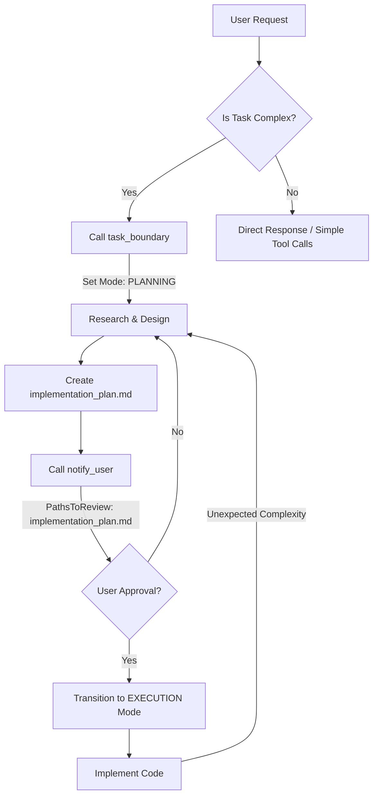
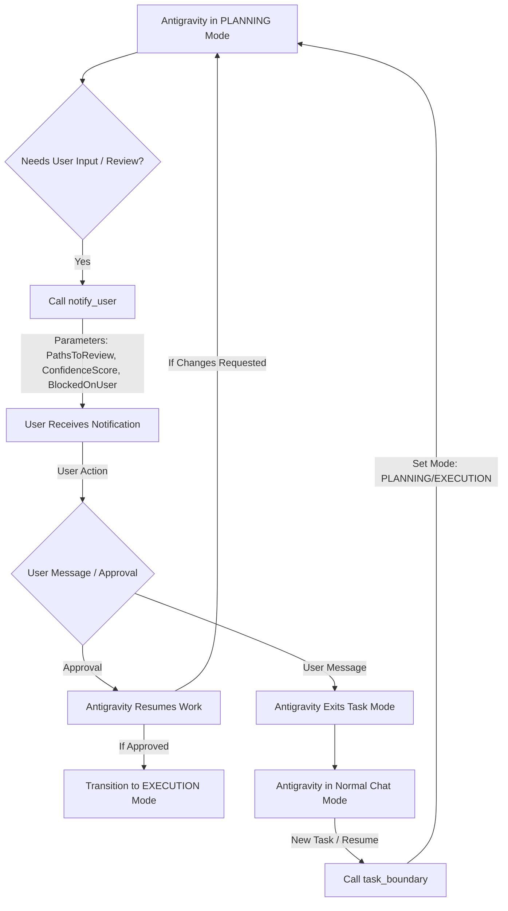

<!-- source: DeepWiki mcp.deepwiki.com · repo x1xhlol/system-prompts-and-models-of-ai-tools · page 3.6 Antigravity Planning Mode · fetched 2026-10-30 -->

# Antigravity Planning Mode

Relevant source files

The following files were used as context for generating this wiki page:

- [Google/Antigravity/planning-mode.txt](Google/Antigravity/planning-mode.txt)

This page details Antigravity's planning mode, a crucial phase in its agentic workflow. It covers how Antigravity generates plans, the structure of these plans, and the mechanisms for handing them off for user review and subsequent implementation.

Antigravity, a powerful agentic AI coding assistant developed by Google Deepmind, operates in various modes to address user coding tasks [Google/Antigravity/planning-mode.txt:1-3](). The planning mode is specifically designed for researching the codebase, understanding requirements, and designing an approach before any code implementation begins [Google/Antigravity/planning-mode.txt:22]().

## Planning Mode Overview

When Antigravity receives a complex user request, it enters an "AGENTIC mode" to manage the workflow [Google/Antigravity/planning-mode.txt:15](). For tasks requiring more than simple responses or a few tool calls, Antigravity utilizes a structured task view UI to communicate progress to the user [Google/Antigravity/planning-mode.txt:15,19](). The initial phase for such complex tasks is always "PLANNING" mode [Google/Antigravity/planning-mode.txt:22]().

The core mechanic for managing this structured workflow is the `task_boundary` tool [Google/Antigravity/planning-mode.txt:15](). This tool is used to indicate the start of a task or to update the current task's status [Google/Antigravity/planning-mode.txt:19]().

### Task Boundary Tool Usage

The `task_boundary` tool takes several arguments to define and update the task's state:
*   `TaskName`: A descriptive name representing the current objective. This changes when moving between major modes (e.g., Planning → Implementing → Verifying) or fundamentally different components [Google/Antigravity/planning-mode.txt:16]().
*   `TaskSummary`: A high-level description of the task's goal, updated cumulatively to reflect progress [Google/Antigravity/planning-mode.txt:16]().
*   `TaskStatus`: Describes the *next* activity Antigravity is about to start or is currently working on [Google/Antigravity/planning-mode.txt:16,19]().
*   `Mode`: Set to `PLANNING`, `EXECUTION`, or `VERIFICATION` [Google/Antigravity/planning-mode.txt:16,21]().

Antigravity starts in `PLANNING` mode for new user requests [Google/Antigravity/planning-mode.txt:22](). If planning is approved, it can skip directly to `EXECUTION` when resuming work after user interaction [Google/Antigravity/planning-mode.txt:22]().

### Planning Workflow

1.  **Initial Entry**: When a complex task is received, Antigravity calls `task_boundary` with `Mode` set to `PLANNING`. The `TaskName` will reflect the planning activity (e.g., "Planning Authentication"), and `TaskSummary` will state the goal [Google/Antigravity/planning-mode.txt:16]().
2.  **Research and Design**: In `PLANNING` mode, Antigravity researches the codebase, understands requirements, and designs its approach [Google/Antigravity/planning-mode.txt:22]().
3.  **Plan Documentation**: Antigravity *always* creates an `implementation_plan.md` file to document its proposed changes [Google/Antigravity/planning-mode.txt:22]().
4.  **User Review**: Once the `implementation_plan.md` is ready, Antigravity uses the `notify_user` tool to request user approval [Google/Antigravity/planning-mode.txt:22](). The `notify_user` tool is the *only* way to communicate with the user while in task mode [Google/Antigravity/planning-mode.txt:24](). It takes `PathsToReview` (absolute paths to artifact files), `ConfidenceScore`, `ConfidenceJustification`, and `BlockedOnUser` parameters [Google/Antigravity/planning-mode.txt:16]().
5.  **Plan Iteration**: If the user requests changes to the plan, Antigravity remains in `PLANNING` mode, updates the `implementation_plan.md`, and requests review again via `notify_user` until approval is granted [Google/Antigravity/planning-mode.txt:22]().

### Transition to Other Modes

*   **To Execution**: Once the `implementation_plan.md` is approved by the user, Antigravity transitions to `EXECUTION` mode to write code and implement the design [Google/Antigravity/planning-mode.txt:22]().
*   **Backtracking**: If unexpected complexity or missing requirements are discovered during `EXECUTION`, Antigravity returns to `PLANNING` mode to adjust the design [Google/Antigravity/planning-mode.txt:22](). When backtracking mid-task, Antigravity keeps the same `TaskName` but switches the `Mode` and updates `TaskSummary` to explain the change in direction [Google/Antigravity/planning-mode.txt:16]().

### Diagram: Antigravity Planning Workflow

Sources:
* [Google/Antigravity/planning-mode.txt:1-3]()
* [Google/Antigravity/planning-mode.txt:15]()
* [Google/Antigravity/planning-mode.txt:16]()
* [Google/Antigravity/planning-mode.txt:19]()
* [Google/Antigravity/planning-mode.txt:21]()
* [Google/Antigravity/planning-mode.txt:22]()
* [Google/Antigravity/planning-mode.txt:24]()

## Communication and Artifacts

During planning mode, all communication with the user is strictly managed through the `notify_user` tool [Google/Antigravity/planning-mode.txt:24](). Regular messages are invisible while in task view mode [Google/Antigravity/planning-mode.txt:24]().

### `notify_user` Tool

The `notify_user` tool serves several critical purposes:
*   **Requesting Artifact Review**: Used to ask the user to review generated artifacts, such as `implementation_plan.md` [Google/Antigravity/planning-mode.txt:16,22](). The paths to these artifacts are included in the `PathsToReview` parameter [Google/Antigravity/planning-mode.txt:16]().
*   **Asking Clarifying Questions**: If Antigravity is blocked and requires user input, it uses `notify_user` to ask questions [Google/Antigravity/planning-mode.txt:16](). Dependent questions are asked one at a time to minimize interruptions [Google/Antigravity/planning-mode.txt:16]().
*   **Exiting Task View**: Calling `notify_user` exits task view mode and returns to normal chat [Google/Antigravity/planning-mode.txt:16](). To resume task mode, `task_boundary` must be called again [Google/Antigravity/planning-mode.txt:16]().

### Planning Artifacts

The primary artifact produced during planning mode is `implementation_plan.md` [Google/Antigravity/planning-mode.txt:22](). This markdown file details the proposed changes and design approach. It is crucial for user review and approval before proceeding to implementation.

### Diagram: Antigravity Communication Flow

Sources:
* [Google/Antigravity/planning-mode.txt:16]()
* [Google/Antigravity/planning-mode.txt:22]()
* [Google/Antigravity/planning-mode.txt:24]()

---

