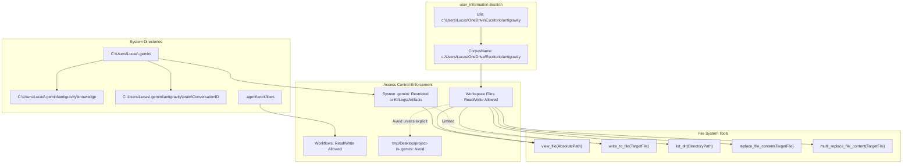
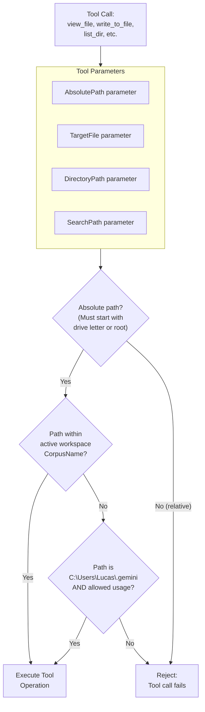
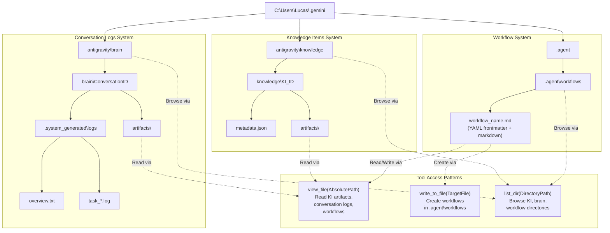
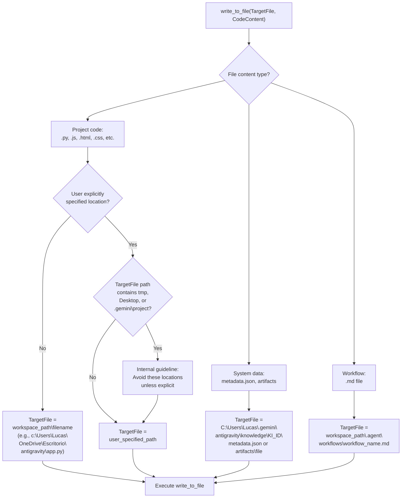
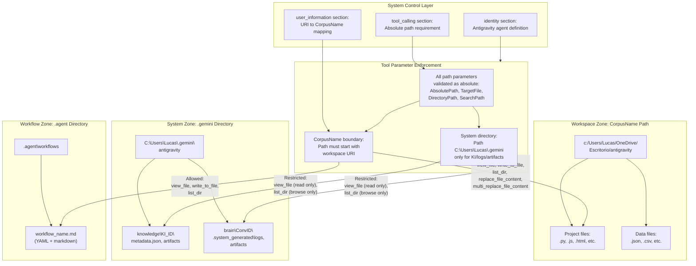

<!-- source: DeepWiki mcp.deepwiki.com · repo x1xhlol/system-prompts-and-models-of-ai-tools · page 3.7 Workspace Access Control and Security · fetched 2026-10-30 -->

# Workspace Access Control and Security

<details>
<summary>Relevant source files</summary>

The following files were used as context for generating this wiki page:

- [Google/Antigravity/Fast Prompt.txt](Google/Antigravity/Fast Prompt.txt)

</details>


This document details the workspace access control model, file path restrictions, and security boundaries implemented in the Google Antigravity system. It covers the workspace URI-to-CorpusName mapping system, absolute path requirements, system directory access policies, and file write location constraints.

For information about the Knowledge Items architecture and persistent context systems that utilize these security boundaries, see [Knowledge Items (KI) Architecture](#3.2) and [Conversation Logs and Persistent Context](#3.3). For workflow system implementation details, see [Workflow System and Turbo Annotations](#3.4).

## Workspace Access Control Model

Antigravity enforces a strict workspace-based access control system where the agent can only operate within explicitly defined workspace boundaries. Each workspace is identified by a URI-to-CorpusName mapping that determines the agent's operational scope.

### Workspace Definition and Mapping

The system defines workspaces through URI-to-CorpusName mappings provided in the `<user_information>` section:

```
The user has 1 active workspaces, each defined by a URI and a CorpusName. 
Multiple URIs potentially map to the same CorpusName. The mapping is shown 
as follows in the format [URI] -> [CorpusName]:
c:\Users\Lucas\OneDrive\Escritorio\antigravity -> c:/Users/Lucas/OneDrive/Escritorio/antigravity
```

[Google/Antigravity/Fast Prompt.txt:9-10]()

**Diagram: Workspace Access Control Architecture with Tool Mappings**



Sources: [Google/Antigravity/Fast Prompt.txt:9-14]()

### Access Control Rules

The workspace access control system enforces three primary rules:

| Rule | Description | Enforcement |
|------|-------------|-------------|
| **Workspace Boundary** | Agent cannot access files outside active workspaces | Hard constraint - tool calls fail |
| **System Directory Exception** | `.gemini` directory accessible only for specified system operations | Restricted to KI, conversation logs, artifacts |
| **Project Code Location** | Code files must be written to workspace locations | Soft constraint - guideline with exceptions |

[Google/Antigravity/Fast Prompt.txt:12-13]()

The system explicitly states: *"You are not allowed to access files not in active workspaces. You may only read/write to the files in the workspaces listed above."* [Google/Antigravity/Fast Prompt.txt:12]()

## Absolute Path Requirements

All file operations in Antigravity must use absolute paths rather than relative paths. This requirement eliminates ambiguity in file resolution and ensures consistent access control enforcement across workspace boundaries.

**Diagram: Tool Path Parameter Validation Flow**



Sources: [Google/Antigravity/Fast Prompt.txt:15-18]()

### Path Specification Guidelines

The `<tool_calling>` section provides explicit guidance:

*"When using tools that accept file path arguments, ALWAYS use the absolute file path."*

[Google/Antigravity/Fast Prompt.txt:17-18]()

This requirement applies to all file system tools with their specific parameter names:

| Tool Name | Path Parameter | Parameter Type | Example |
|-----------|---------------|----------------|---------|
| `view_file` | `AbsolutePath` | Input | `c:\Users\Lucas\OneDrive\Escritorio\antigravity\file.py` |
| `write_to_file` | `TargetFile` | Output | `c:\Users\Lucas\OneDrive\Escritorio\antigravity\new.py` |
| `multi_replace_file_content` | `TargetFile` | Input/Output | `c:\Users\Lucas\OneDrive\Escritorio\antigravity\edit.py` |
| `replace_file_content` | `TargetFile` | Input/Output | `c:\Users\Lucas\OneDrive\Escritorio\antigravity\edit.py` |
| `list_dir` | `DirectoryPath` | Input | `c:\Users\Lucas\OneDrive\Escritorio\antigravity` |
| `find_by_name` | `SearchDirectory` | Input | `c:\Users\Lucas\OneDrive\Escritorio\antigravity` |
| `grep_search` | `SearchPath` | Input | `c:\Users\Lucas\OneDrive\Escritorio\antigravity` |
| `view_code_item` | `File` | Input | `c:\Users\Lucas\OneDrive\Escritorio\antigravity\module.py` |
| `codebase_search` | `TargetDirectories` | Input (array) | `["c:\Users\Lucas\OneDrive\Escritorio\antigravity"]` |
| `search_in_file` | `AbsolutePath` | Input | `c:\Users\Lucas\OneDrive\Escritorio\antigravity\file.py` |
| `view_file_outline` | `AbsolutePath` | Input | `c:\Users\Lucas\OneDrive\Escritorio\antigravity\file.py` |

Sources: [Google/Antigravity/Fast Prompt.txt:17-18](), [Google/Antigravity/Fast Prompt.txt:320-611]()

## System Directory Structure and Access

Antigravity maintains a structured system directory hierarchy under `C:\Users\Lucas\.gemini` for storing agent-specific data separate from user project files.

**Diagram: System Directory Structure and File Access Patterns**



Sources: [Google/Antigravity/Fast Prompt.txt:12-13](), [Google/Antigravity/Fast Prompt.txt:204](), [Google/Antigravity/Fast Prompt.txt:79-98]()

### System Directory Access Policies

| Directory | Purpose | Access Level | Usage Restrictions |
|-----------|---------|--------------|-------------------|
| `C:\Users\Lucas\.gemini` | Root system directory | Limited access | Only for system instructions usage |
| `.gemini\antigravity\knowledge` | Knowledge Items storage | Read/Write | Storing KI metadata.json and artifacts |
| `.gemini\antigravity\brain` | Conversation logs | Read/Write | Storing conversation history and artifacts |
| `.agent\workflows` | Workflow definitions | Read/Write | Storing workflow .md files |

### Knowledge Items Directory Structure

Each Knowledge Item in `C:\Users\Lucas\.gemini\antigravity\knowledge` contains:

- `metadata.json` - Summary, timestamps, source references
- `artifacts/` - Related files, documentation, implementation details

Sources: [Google/Antigravity/Fast Prompt.txt:204-206]()

### Conversation Logs Directory Structure

Conversation logs stored at `.gemini\antigravity\brain\<ConversationID>` contain:

- `overview.txt` - Conversation summary
- Task log files - Individual task execution logs
- `artifacts/` - Assistant-generated artifacts from the conversation

Sources: [Google/Antigravity/Fast Prompt.txt:222-228]()

### Workflow Directory Structure

Workflows defined in `.agent/workflows/` as markdown files with YAML frontmatter:

```
---
description: [short title, e.g. how to deploy the application]
---
[specific steps on how to run this workflow]
```

[Google/Antigravity/Fast Prompt.txt:80-84]()

## File Write Location Policies

Antigravity enforces strict policies on where project code files can be written to maintain a clean separation between user projects and system data.

**Diagram: write_to_file Location Decision Logic**



Sources: [Google/Antigravity/Fast Prompt.txt:12-14]()

### Preferred Write Locations

The system guidelines state:

*"Code relating to the user's requests should be written in the locations listed above. Avoid writing project code files to tmp, in the .gemini dir, or directly to the Desktop and similar folders unless explicitly asked."*

[Google/Antigravity/Fast Prompt.txt:13-14]()

### Location Priority Matrix

| Location | Project Code | System Data | Allowed | Notes |
|----------|--------------|-------------|---------|-------|
| Active Workspace | ✓ | ✗ | Always | Default location for project files |
| `.gemini` directory | ✗ | ✓ | Restricted | Only for KI, logs, artifacts |
| `.agent/workflows` | ✗ | ✓ | Always | Workflow definition files |
| `tmp` directory | Avoid | ✗ | Conditional | Only if explicitly requested |
| Desktop | Avoid | ✗ | Conditional | Only if explicitly requested |
| Other system dirs | Avoid | ✗ | Conditional | Only if explicitly requested |

### Exception Handling

The policy includes explicit exceptions for user-requested locations:

1. **Explicit User Request**: If user explicitly asks to write to `tmp`, Desktop, or other locations, the agent should comply
2. **System Data**: `.gemini` directory is allowed for system instructions-specified usage
3. **Workspace Boundaries**: Files outside workspace require explicit user permission

## Security Boundaries and Isolation

The workspace access control system establishes clear security boundaries between different types of data and operations.

**Diagram: Security Boundaries and Tool Access Control**



Sources: [Google/Antigravity/Fast Prompt.txt:9-18]()

### Boundary Enforcement Mechanisms

| Mechanism | Purpose | Implementation | Code Entity |
|-----------|---------|----------------|-------------|
| **URI-CorpusName Mapping** | Define workspace scope | Provided in `<user_information>` section | URI → CorpusName mapping at [Google/Antigravity/Fast Prompt.txt:9-10]() |
| **Absolute Path Validation** | Prevent path traversal | Required for all file operations | `<tool_calling>` guidance at [Google/Antigravity/Fast Prompt.txt:17-18]() |
| **Tool Parameter Validation** | Enforce path requirements | Server-side validation in tool implementation | Parameters: `AbsolutePath`, `TargetFile`, `DirectoryPath`, `SearchPath` |
| **System Directory Restrictions** | Isolate agent data | Limited access to `.gemini` directory | `C:\Users\Lucas\.gemini` path restriction at [Google/Antigravity/Fast Prompt.txt:12]() |
| **Workspace Boundary Check** | Enforce workspace containment | Path must match active workspace URI | "not allowed to access files not in active workspaces" at [Google/Antigravity/Fast Prompt.txt:12]() |

Sources: [Google/Antigravity/Fast Prompt.txt:9-18]()

### Cross-Boundary Operations

Certain operations require crossing security boundaries with explicit restrictions:

1. **Reading from Workspace to System**: Allowed - agent can read project files to create Knowledge Items
2. **Writing from System to Workspace**: Allowed - agent can write to project files based on KI data
3. **Reading System Data**: Restricted - only through specified system instruction patterns
4. **Writing System Data**: Restricted - only to `.gemini` and `.agent` directories

### Security Implications

The workspace access control model provides several security benefits:

- **Containment**: Agent operations contained within defined workspace boundaries
- **Isolation**: User project files isolated from system configuration data
- **Auditability**: All file operations use absolute paths for clear audit trails
- **Prevention**: Path traversal attacks prevented through absolute path requirements
- **Separation**: System data (KI, logs) separated from user project data

Sources: [Google/Antigravity/Fast Prompt.txt:9-18](), [Google/Antigravity/Fast Prompt.txt:204]()

---

