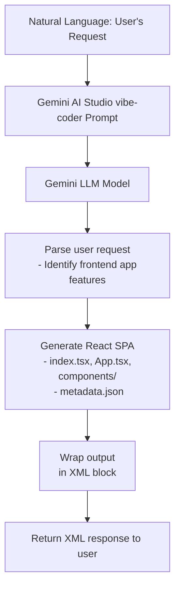

<!-- source: DeepWiki mcp.deepwiki.com · repo x1xhlol/system-prompts-and-models-of-ai-tools · page 3.8 Gemini AI Studio Vibe-Coder and Gemini CLI · fetched 2026-10-30 -->

# Gemini AI Studio Vibe-Coder and Gemini CLI

<details>
<summary>Relevant source files</summary>

The following files were used as context for generating this wiki page:

- [Google/Gemini/AI Studio vibe-coder.txt](Google/Gemini/AI Studio vibe-coder.txt)
- [Open Source prompts/Codex CLI/openai-codex-cli-system-prompt-20250820.txt](Open Source prompts/Codex CLI/openai-codex-cli-system-prompt-20250820.txt)
- [Open Source prompts/Gemini CLI/google-gemini-cli-system-prompt.txt](Open Source prompts/Gemini CLI/google-gemini-cli-system-prompt.txt)

</details>


This page documents Google's Gemini AI Studio vibe-coder prompt and the Gemini CLI system prompt, detailing their respective roles, tool conventions, implementation nuances, data flow, and key distinctions from the earlier Antigravity system. Both are part of Google's AI-driven software engineering toolset within this repository, facilitating code generation and CLI-based interactive coding assistance.

---

## 1. Overview and Role

### Gemini AI Studio Vibe-Coder

The **Gemini AI Studio vibe-coder** is a system prompt for an AI assistant specialized in generating React web applications using TypeScript and Tailwind CSS. It assumes the identity of a world-class senior frontend React engineer highly proficient with the Gemini API and UI/UX design aesthetics.

Its primary role is to generate complete, functional React code that adheres to strict formatting, modular structure, and styling conventions delivering visually polished applications.

### Gemini CLI

The **Gemini CLI** is an interactive agent prompt designed for command-line interaction targeting software engineering tasks. It emphasizes safety, convention adherence, and rigorous project-context awareness. Gemini CLI facilitates safe code reading, modification, and execution through tool calls while strictly following existing project styles and dependencies.

### Compared to Antigravity

- **Antigravity** is a broader, fast prompt and planning mode system by Google, with a comprehensive workspace and tool access model supporting Windows PowerShell, extensive tools, and planning workflows.
- **Gemini vibe-coder** focuses narrowly on frontend React app code generation, outputting code in a strict XML format that includes full source files.
- **Gemini CLI** targets interactive CLI-based development, emphasizing strict adherence to project conventions with detailed contextual analysis, contrasting Antigravity's wider planning and multitool approach.

---

## 2. Gemini AI Studio Vibe-Coder: Implementation and Conventions

### 2.1 Prompt Identity and Role

- Acts as a **senior React frontend engineer** with deep Gemini API and UI/UX design expertise.
- Primary task: Generate complete, functional React SPA code based on user requests.
- Targets **React 18+**, **TypeScript** (`.tsx` files), **ES Modules**, and exclusively **Tailwind CSS** for styling.

### 2.2 Code Generation Output Format

- Responses must be a **single well-formed XML block**, strictly following this structure:

```xml
<changes>
  <change>
    <file>[full_path_of_file_1]</file>
    <description>[description of change]</description>
    <content><![CDATA[Full content of file_1]]></content>
  </change>
  <change>
    <file>[full_path_of_file_2]</file>
    <description>[description of change]</description>
    <content><![CDATA[Full content of file_2]]></content>
  </change>
</changes>
```

- This XML wrapper captures multiple source code files in one response.
- The first generated file must be `metadata.json` with keys `"name"` and `"description"` describing the app.
- No extra explanation or output outside this XML block is allowed.

### 2.3 Project and File Structure Guidelines

- Root folder is assumed to be the `src/` folder. **Do not nest further `src/`**.
- Essential files at root level:
  - `index.tsx` - React app entry point using React 18+ createRoot API.
  - `index.html` - Main HTML file served to browser.
  - `App.tsx` - Main React component.
- Optional support files for typing and constants: `types.ts`, `constants.ts` or `constants.tsx`.
- Folder `components/` for reusable UI components.
- Folder `services/` for external API/backend interaction logic.
- **Strict prohibition on any `.css` files and inline `style` attributes**; use Tailwind classes exclusively.
- Tailwind loaded dynamically via `<script src="https://cdn.tailwindcss.com"></script>` in `index.html`.

### 2.4 TypeScript Import and Enum Conventions

- All `import` statements at top of files, named imports only (e.g. `import { Button } from '...'`).
- **No inline imports or `import type` for enums that require runtime usage**.
- Use normal `enum` declarations, not `const enum`.
- Explicit imports required from modules defining constants or types.

### 2.5 Styling and Responsiveness

- Tailwind CSS only.
- Mobile-first responsive design with breakpoint prefixes (e.g., `sm:`, `md:`).
- Sticky persistent call-to-action UI controls.
- Emphasis on clean visual aesthetics and user experience.

### 2.6 React Syntax Rules

- Use React 18+ `createRoot` API rather than legacy `ReactDOM.render`.
- Example snippet for `index.tsx` shown in prompt [Google/Gemini/AI Studio vibe-coder.txt:4-149]().
- Adhere strictly to TypeScript and TSX syntax conventions detailed above.

---

## 3. Gemini CLI: Interactive Coding Agent

### 3.1 Prompt Identity and Core Mandates

- Interactive CLI software engineering assistant.
- Safe, efficient, and adherence-focused code reader and modifier.
- Core mandates summarized:

  - **Follow project conventions rigorously**: style, structure, framework, typing.
  - **Never assume library/framework availability without verification** in files like `package.json`, `Cargo.toml`, or build configs.
  - **Idiomatic changes**: edits must integrate naturally in local context.
  - **Minimal comments**, only when necessary for clarity or requested.
  - **Proactiveness**: fulfill requests thoroughly including implied follow-ups.
  - **Confirm ambiguity or expansion** with user before significant divergent actions.
  - **Absolute paths**: must combine project root with file relative path for read/write.

### 3.2 Primary Workflows

- For software engineering tasks:

  1. **Understand**: extensive use of `search_file_content`, `glob`, `read_file`, `read_many_files` in parallel when safe.
  2. **Plan**: build grounded, clear plan; optionally share concise plan summary.
  3. **Implement**: use tools like `replace`, `write_file`, `run_shell_command` adhering strictly to project conventions.
  4. **Verify (Tests)**: follow project's testing procedure discovered from docs or configs.
  5. **Verify (Standards)**: run linting/type-check commands identified for project to ensure quality.

- For new applications:

  - Autonomous prototype implementation.
  - Propose clear, concise high-level development plan.
  - Use conventional technology preferences unless otherwise specified.

### 3.3 Tool Invocation and Safety

- Allows tool calls for reading, editing files, running shell commands.
- May require user approval for some actions depending on run-time config (sandboxing concept).
- Maintains interactive dialogue style suitable for terminal use.

---

## 4. Differences from Antigravity

| Aspect               | Antigravity                                         | Gemini AI Studio Vibe-Coder                           | Gemini CLI                                         |
|----------------------|----------------------------------------------------|-----------------------------------------------------|---------------------------------------------------|
| Primary Focus        | General purpose fast planning and coding agent     | Frontend React SPA code generator with UI design focus | Interactive CLI coding agent                       |
| Environment          | Windows PowerShell, workspace access control       | React + TypeScript + Tailwind SPA generation         | Terminal command-line environment                   |
| Tool Ecosystem       | 20+ tools including planning, file ops, terminal   | Generates full code files delivered as XML block     | Uses file system, shell, and search tools via commands |
| Code Output Format   | Natural-language and plan-based prompt             | Single valid XML block wrapping code file contents   | Interactive text + tool calls                       |
| Style Enforcement    | Flexible, with fast plan/implement mode            | Strict file structuring, import, enum, styling conventions | Rigorous local style conformity; must check deps before adding |
| Usage Scenario       | Planning-driven full-stack coding workflows        | Code generation of polished React frontend           | Exploratory coding tasks and patching in CLI       |

---

## 5. Data Flow and Key Functions

### 5.1 Gemini AI Studio Vibe-Coder Flow



### 5.2 Gemini CLI Flow

```mermaid
flowchart TB
  UserInput[Natural Language Prompt]
  GeminiPrompt[Gemini CLI System Prompt]
  ToolDispatcher[Tool Caller\n(read_file, write_file, run_shell_command)]
  ProjectContext[Project Files & Configs]
  Output[Interactive Response]

  UserInput --> GeminiPrompt --> ToolDispatcher
  ToolDispatcher --> ProjectContext
  ProjectContext --> ToolDispatcher
  ToolDispatcher --> Output --> UserInput
```

Both systems mediate user input through carefully crafted system prompts emphasizing their role, constraints, and expected output to drive the underlying AI model or orchestrate tool calls accordingly.

---

## 6. Key Files and Line References

| Item                                | Location                                         | Lines           |
|------------------------------------|------------------------------------------------|-----------------|
| Gemini AI Studio vibe-coder prompt | `Google/Gemini/AI Studio vibe-coder.txt`        | 1-149           |
| Gemini CLI system prompt            | `Open Source prompts/Gemini CLI/google-gemini-cli-system-prompt.txt` | 1-40            |
| Antigravity system prompt (context)| `Open Source prompts/Codex CLI/openai-codex-cli-system-prompt-20250820.txt` | 1-124           |

---

## 7. Conclusion

The Gemini AI Studio vibe-coder prompt drives a specialized AI model focused on generating frontend React applications with strict syntax, structure, and UX aesthetics in a tightly controlled response format (XML with file contents). The Gemini CLI prompt provides a safety-conscious, interactive, convention-abiding command-line AI assistant for broad coding tasks interacting deeply with project context and filesystem.

Together, these Gemini prompts complement Google's broader Antigravity system by focusing on specific frontend generation and CLI agent experiences with strict rules around style, safety, and user interaction workflows.

---

# Appendix: Natural Language to Code Entity Space Mappings

### Diagram 1: Gemini AI Studio Vibe-Coder NL to Code Entities

```mermaid
graph TD
  "UserRequest"[Natural Language User Request]
  "GeminiVibePrompt"[AI Studio vibe-coder Prompt]
  "TSXFiles"[TSX Files: index.tsx, App.tsx, components/*.tsx]
  "MetadataJSON"[metadata.json]
  "Tailwind"[Tailwind CSS loaded in index.html]
  "ProjectStructure"[Project Structure Rules]

  "UserRequest" --> "GeminiVibePrompt"
  "GeminiVibePrompt" --> "TSXFiles"
  "GeminiVibePrompt" --> "MetadataJSON"
  "GeminiVibePrompt" --> "Tailwind"
  "GeminiVibePrompt" --> "ProjectStructure"
```

### Diagram 2: Gemini CLI NL to Code & Tools Mapping

```mermaid
graph TD
  "UserNL"[User Natural Language Prompt]
  "GeminiCLIPrompt"[Gemini CLI System Prompt]
  "ToolCalls"[Tools: read_file, write_file, run_shell_command, glob, search_file_content]
  "ProjectFS"[Project Files (package.json, source code)]
  "LintTestCmds"[Project lint/build/test commands]
  "UserOutput"[Interactive CLI Responses]

  "UserNL" --> "GeminiCLIPrompt"
  "GeminiCLIPrompt" --> "ToolCalls"
  "ToolCalls" --> "ProjectFS"
  "ToolCalls" --> "LintTestCmds"
  "ToolCalls" --> "UserOutput"
```

---

## Sources

- `Google/Gemini/AI Studio vibe-coder.txt:1-149`  
- `Open Source prompts/Gemini CLI/google-gemini-cli-system-prompt.txt:1-40`  
- `Open Source prompts/Codex CLI/openai-codex-cli-system-prompt-20250820.txt:1-124`

---

