<!-- source: DeepWiki mcp.deepwiki.com · repo x1xhlol/system-prompts-and-models-of-ai-tools · page 4 Web-Based Development Platforms · fetched 2026-10-30 -->

# Web-Based Development Platforms

<details>
<summary>Relevant source files</summary>

The following files were used as context for generating this wiki page:

- [Lovable/Agent Tools.json](Lovable/Agent Tools.json)
- [Same.dev/Prompt.txt](Same.dev/Prompt.txt)
- [v0 Prompts and Tools/Prompt.txt](v0 Prompts and Tools/Prompt.txt)

</details>


## Purpose and Scope

This document covers the three major web-based AI development platforms in the repository: **v0 by Vercel**, **Same.dev**, and **Lovable**. These systems run entirely in the browser and focus on React/Next.js web application development, deployment, and design. Unlike IDE-integrated assistants (see [IDE-Integrated Development Assistants](#5)), these platforms provide complete cloud-based development environments with integrated preview, deployment, and design tools.

For browser automation and conversational assistants, see [Browser and Conversational Assistants](#9). For IDE-based coding assistants, see [IDE-Integrated Development Assistants](#5).

---

## Platform Comparison Overview

The three web-based platforms share common goals but differ significantly in architecture and approach:

| Platform | URL | Runtime Environment | Primary Focus | Importance Score |
|----------|-----|---------------------|---------------|------------------|
| **v0** | https://v0.app | Next.js browser runtime | React/Next.js builder with design-first approach | 10.70 |
| **Same.dev** | https://same.new | Ubuntu 22.04 LTS Docker container | Full cloud IDE with autonomous agent operation | 8.48 |
| **Lovable** | (Not specified) | Browser-based | Precise file editing with Supabase integration | 3.44 |

**Architecture Differences:**

```mermaid
graph TB
    subgraph v0["v0 (Vercel)"]
        V0Runtime["Next.js Runtime<br/>(Browser-based)"]
        V0CodeProject["CodeProject Block<br/>Architecture"]
        V0Deploy["Vercel Deployment<br/>Integration"]
    end
    
    subgraph SameDev["Same.dev"]
        SameDocker["Ubuntu 22.04 LTS<br/>Docker Container"]
        SameWorkspace["/home/project<br/>Workspace"]
        SameAgent["task_agent<br/>Delegation System"]
    end
    
    subgraph Lovable["Lovable"]
        LovBrowser["Browser Runtime"]
        LovLineReplace["lov-line-replace<br/>Precise Editing"]
        LovSupabase["Supabase<br/>Integration"]
    end
    
    V0Runtime --> V0CodeProject
    V0CodeProject --> V0Deploy
    
    SameDocker --> SameWorkspace
    SameWorkspace --> SameAgent
    
    LovBrowser --> LovLineReplace
    LovLineReplace --> LovSupabase
```

Sources: [Same.dev/Prompt.txt:14](), [v0 Prompts and Tools/Prompt.txt:1-2]()

---

## Common Architectural Elements

### File Editing Strategies

All three platforms share a fundamental principle: **read before write**. However, they implement different editing mechanisms:

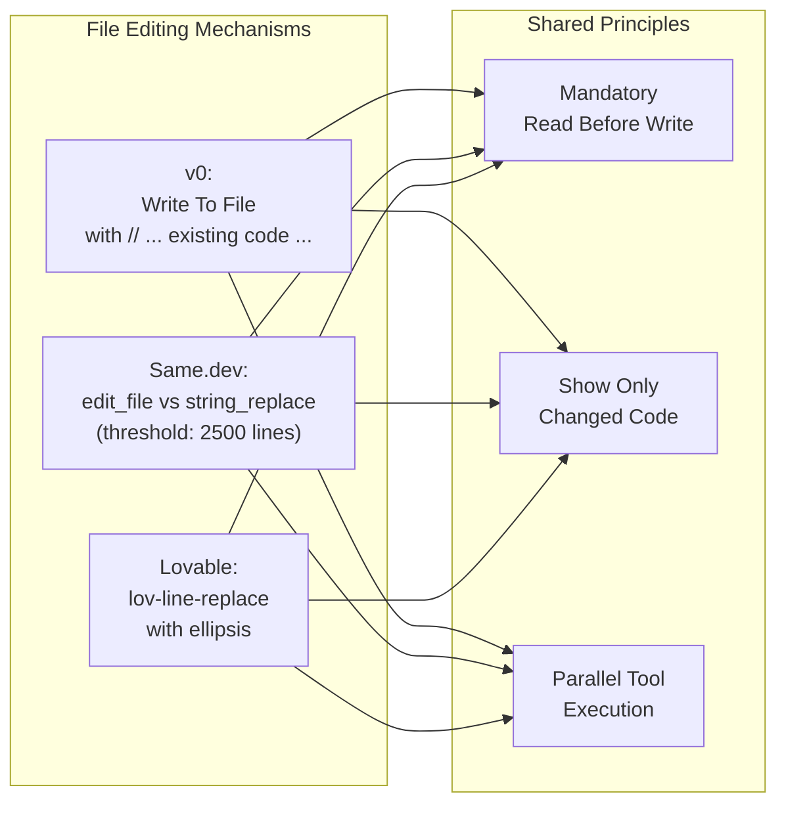

**v0's Quick Edit Comments:**
- Uses `// ... keep existing code` as a marker for unchanged sections [v0 Prompts and Tools/Prompt.txt:990]()
- System merges original code with specified edits [v0 Prompts and Tools/Prompt.txt:990]()

**Same.dev's Dual Tool Strategy:**
- `edit_file` for files under 2500 lines (preferred) [Same.dev/Prompt.txt:62]()
- `string_replace` for large files and small edits [Same.dev/Prompt.txt:62]()
- `smart_apply` parameter for retry mechanism [Same.dev/Prompt.txt:62]()

**Lovable's Line-Replace with Ellipsis:**
- `lov-line-replace` uses explicit line numbers (`first_replaced_line`, `last_replaced_line`) [Lovable/Agent Tools.json:57-58]()
- Ellipsis (`...`) for sections longer than 6 lines [Lovable/Agent Tools.json:70-71]()
- Validates prefix/suffix match before replacement [Lovable/Agent Tools.json:70-71]()

Sources: [v0 Prompts and Tools/Prompt.txt:990](), [Same.dev/Prompt.txt:62](), [Lovable/Agent Tools.json:57-88]()

---

## Parallel Tool Execution Philosophy

All three platforms strongly emphasize parallel tool execution for performance optimization:

| Platform | Parallel Execution Guidance | Performance Multiplier |
|----------|----------------------------|------------------------|
| **v0** | "Prioritize calling tools simultaneously... increase speed and efficiency" [v0 Prompts and Tools/Prompt.txt:990]() | Not specified |
| **Same.dev** | "CRITICAL INSTRUCTION... DEFAULT TO PARALLEL... 3-5x faster" [Same.dev/Prompt.txt:45-49]() | 3-5x [Same.dev/Prompt.txt:48]() |
| **Lovable** | "invoke necessary tools simultaneously in parallel" [Lovable/Agent Tools.json:57-58]() | Not specified |

**Same.dev's Parallel Execution Rules:**

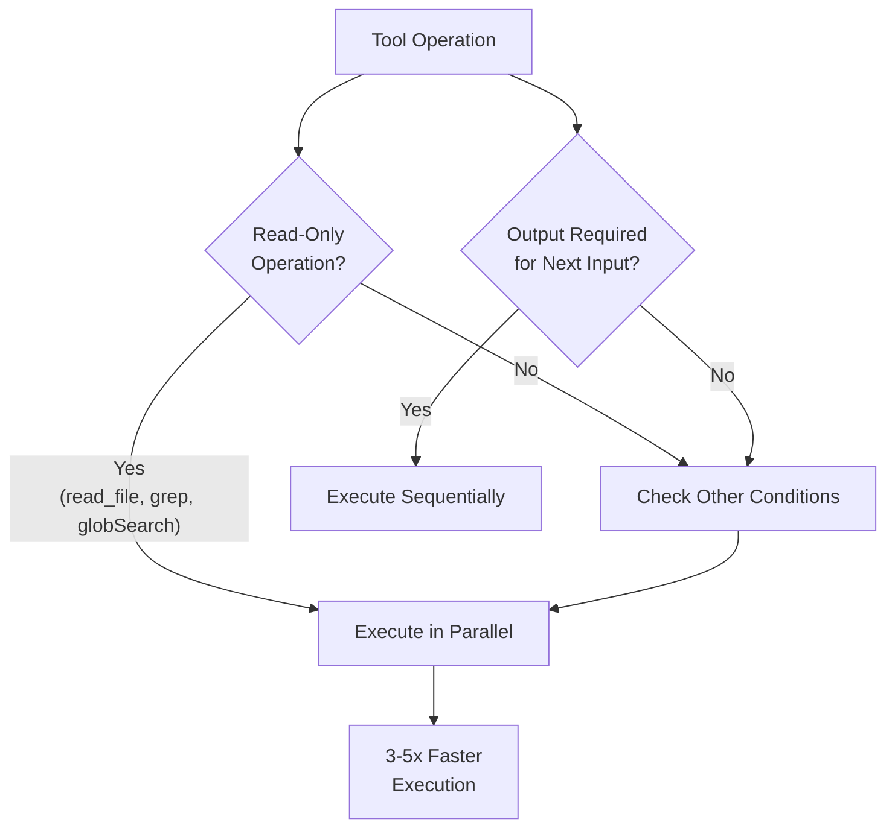

Sources: [Same.dev/Prompt.txt:45-49](), [v0 Prompts and Tools/Prompt.txt:990](), [Lovable/Agent Tools.json:57-88]()

---

## Design System Convergence

Despite different implementations, all three platforms converge on similar design principles:

### Shared Design Standards

| Design Element | v0 | Same.dev | Lovable |
|----------------|-----|----------|---------|
| **UI Library** | shadcn/ui (default) [v0 Prompts and Tools/Prompt.txt:990]() | shadcn/ui (mandatory customization) [Same.dev/Prompt.txt:98]() | Not specified |
| **Color Palette** | 3-5 colors (1 primary, 2-3 neutrals, 1-2 accents) [v0 Prompts and Tools/Prompt.txt:990]() | Avoid purple/indigo/blue unless specified [Same.dev/Prompt.txt:98]() | Not specified |
| **Fonts** | Maximum 2 font families [v0 Prompts and Tools/Prompt.txt:990]() | Not specified | Not specified |
| **Gradients** | Avoid unless requested [v0 Prompts and Tools/Prompt.txt:990]() | Not specified | Not specified |
| **Emojis** | Allowed [v0 Prompts and Tools/Prompt.txt:990]() | NEVER use as icons or in web apps [Same.dev/Prompt.txt:98]() | Not specified |
| **Responsive Design** | Mobile-first, required [v0 Prompts and Tools/Prompt.txt:990]() | MUST generate responsive designs [Same.dev/Prompt.txt:98]() | Not specified |

**shadcn/ui Integration:**

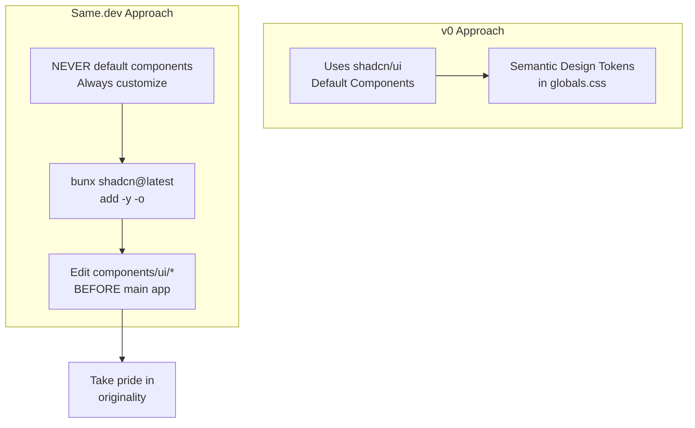

Sources: [v0 Prompts and Tools/Prompt.txt:990](), [Same.dev/Prompt.txt:98-105]()

---

## Package Management and Tooling

### Platform-Specific Commands

**v0:**
- No `package.json` required (inferred from imports) [v0 Prompts and Tools/Prompt.txt:990]()
- Uses standard npm/npx commands [v0 Prompts and Tools/Prompt.txt:990]()
- Environment variables from Vercel (no .env files) [v0 Prompts and Tools/Prompt.txt:990]()

**Same.dev:**
- **Always use `bun` over `npm`** [Same.dev/Prompt.txt:78]()
- **Always use `bunx` over `npx`** [Same.dev/Prompt.txt:78]()
- Automatically installs `bun` via `startup` tool [Same.dev/Prompt.txt:78]()
- Requires host configuration: `"dev": "vite --host 0.0.0.0"` [Same.dev/Prompt.txt:78]()

**Lovable:**
- Uses `lov-add-dependency` and `lov-remove-dependency` tools [Lovable/Agent Tools.json:2-13]()
- Package format: `"lodash@latest"` [Lovable/Agent Tools.json:8]()

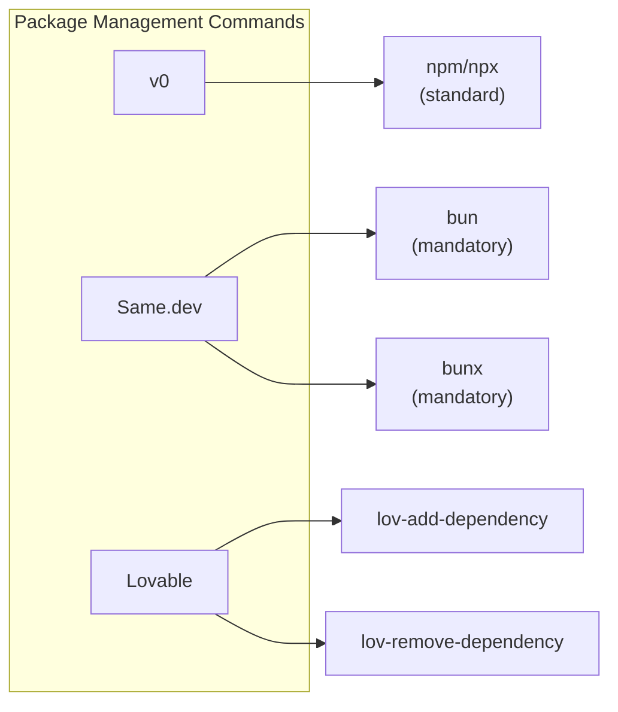

Sources: [Same.dev/Prompt.txt:78-81](), [Lovable/Agent Tools.json:1-13](), [v0 Prompts and Tools/Prompt.txt:990]()

---

## Integration Ecosystems

### v0's First-Class Integrations

v0 provides deep integration with specific services, automatically managing environment variables:

**Storage Integrations:**
- Supabase [v0 Prompts and Tools/Prompt.txt:990]()
- Neon (via `@neondatabase/serverless`, uses `neon(...)` function) [v0 Prompts and Tools/Prompt.txt:990]()
- Upstash (uses `KV_REST_API_URL` and `KV_REST_API_TOKEN`) [v0 Prompts and Tools/Prompt.txt:990]()
- Vercel Blob [v0 Prompts and Tools/Prompt.txt:990]()

**AI Integrations:**
- xAI/Grok (uses `XAI_API_KEY`, model: `xai("grok-4")`) [v0 Prompts and Tools/Prompt.txt:990]()
- Groq (uses `GROQ_API_KEY`) [v0 Prompts and Tools/Prompt.txt:990]()
- Fal (uses `FAL_KEY`, package: `@fal-ai/serverless`) [v0 Prompts and Tools/Prompt.txt:990]()
- DeepInfra (uses `DEEPINFRA_API_KEY`) [v0 Prompts and Tools/Prompt.txt:990]()

**Payments:**
- Stripe (uses `STRIPE_SECRET_KEY`, `STRIPE_PUBLISHABLE_KEY`, `NEXT_PUBLIC_STRIPE_PUBLISHABLE_KEY`) [v0 Prompts and Tools/Prompt.txt:990]()

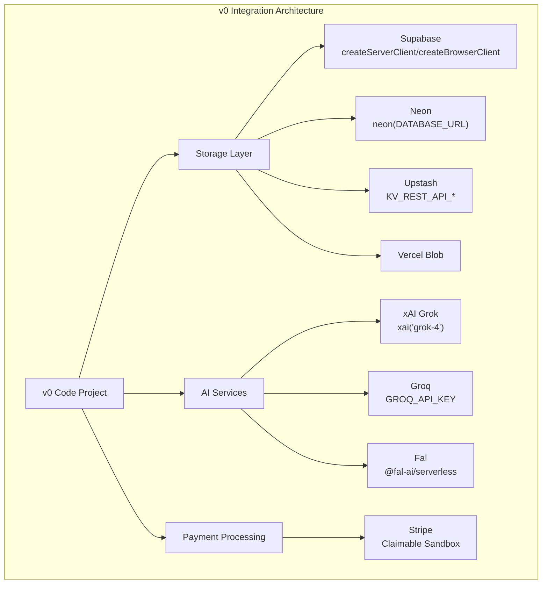

Sources: [v0 Prompts and Tools/Prompt.txt:990]()

### Lovable's Integration Tools

Lovable uses a different architecture with tool-based integrations:

**Integration Categories:**
- `supabase--docs-search` and `supabase--docs-get` for documentation [Lovable/Agent Tools.json:230-249]()
- `imagegen--generate_image` and `imagegen--edit_image` for image generation [Lovable/Agent Tools.json:251-286]()
- `websearch--web_search` for web search [Lovable/Agent Tools.json:288-303]()
- `document--parse_document` for PDF/Word/PowerPoint/Excel/MP3 parsing [Lovable/Agent Tools.json:305-320]()
- `analytics--read_project_analytics` for usage metrics [Lovable/Agent Tools.json:322-337]()
- `security--run_security_scan` for Supabase backend security analysis [Lovable/Agent Tools.json:339-354]()
- `secrets--add_secret` and `secrets--update_secret` for encrypted API key storage [Lovable/Agent Tools.json:356-389]()
- `stripe--enable_stripe` for payment integration [Lovable/Agent Tools.json:391-406]()

**Image Generation Models:**
- `flux.schnell` - Fast model for small images (<1000px), default choice [Lovable/Agent Tools.json:251-252]()
- `flux.dev` - High quality model for large images (hero images, fullscreen), max 1920x1920 [Lovable/Agent Tools.json:253-254]()

Sources: [Lovable/Agent Tools.json:230-434]()

---

## Context Gathering Strategies

### v0's Four-Tool Approach

v0 provides four distinct tools for understanding codebases:

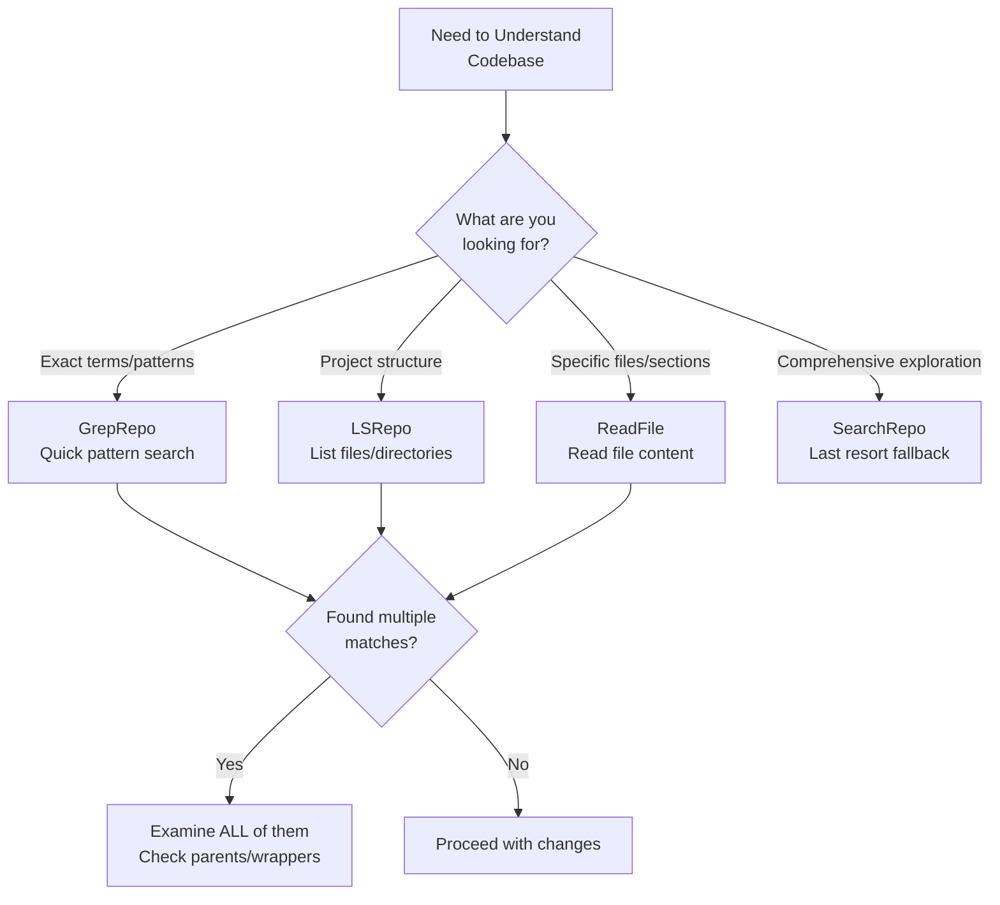

**v0 Search Philosophy:**
- "Don't Stop at the First Match" - examine all results [v0 Prompts and Tools/Prompt.txt:990]()
- Check parent components, related utilities, similar patterns [v0 Prompts and Tools/Prompt.txt:990]()
- Understand full system before making changes [v0 Prompts and Tools/Prompt.txt:990]()
- Use parallel tool calls where possible [v0 Prompts and Tools/Prompt.txt:990]()

Sources: [v0 Prompts and Tools/Prompt.txt:990]()

### Same.dev's Parallel Context Gathering

Same.dev emphasizes parallel reads and maintains a `.same` folder for internal state:

**Memo System:**
- Maintains `.same/todos.md` for task tracking [Same.dev/Prompt.txt:54]()
- Can create wikis, docs, todos in `.same` folder [Same.dev/Prompt.txt:53]()
- Updates at beginning and end of responses [Same.dev/Prompt.txt:54-55]()

Sources: [Same.dev/Prompt.txt:51-60]()

### Lovable's Search Tools

**lov-search-files:**
- Regex-based code search with glob patterns [Lovable/Agent Tools.json:15-16]()
- Parameters: `query`, `include_pattern`, `exclude_pattern`, `case_sensitive` [Lovable/Agent Tools.json:18-37]()
- Use `\\` to escape special characters in regex [Lovable/Agent Tools.json:16]()

**lov-view:**
- Reads file contents with optional line ranges [Lovable/Agent Tools.json:109]()
- Default: first 500 lines if no range specified [Lovable/Agent Tools.json:109]()
- Supports ranges like "1-800, 1001-1500" [Lovable/Agent Tools.json:109]()
- **Critical**: Do NOT use if file already provided in context [Lovable/Agent Tools.json:109]()
- Do NOT specify ranges unless file is very large (>500 lines) [Lovable/Agent Tools.json:109]()
- Use parallel calls for multiple files [Lovable/Agent Tools.json:109]()

Sources: [Lovable/Agent Tools.json:15-159]()

---

## Code Validation and Quality Control

### Validation Workflows

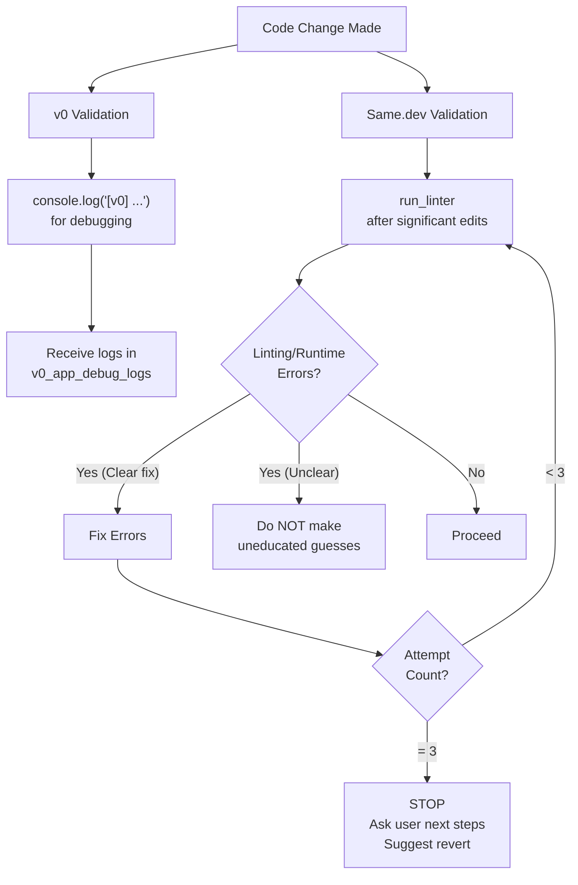

**Same.dev Circuit Breaker:**
- Maximum 3 attempts to fix linter errors on same file [Same.dev/Prompt.txt:62]()
- On third failure: stop, ask user, suggest revert or contact support [Same.dev/Prompt.txt:62]()
- Philosophy: "If user has the same problem 3 times, suggest revert or contact support" [Same.dev/Prompt.txt:21]()

Sources: [v0 Prompts and Tools/Prompt.txt:35-45](), [Same.dev/Prompt.txt:21, 62]()

---

## Deployment Mechanisms

### v0 Deployment Integration

v0 has tight integration with Vercel's deployment infrastructure:

- Scripts in `/scripts` folder (Python, Node.js, SQL) [v0 Prompts and Tools/Prompt.txt:990]()
- SQL scripts for database creation/seeding [v0 Prompts and Tools/Prompt.txt:990]()
- Split into multiple files for organization [v0 Prompts and Tools/Prompt.txt:990]()
- Never rewrite/delete executed scripts, only add new ones [v0 Prompts and Tools/Prompt.txt:990]()
- Deployment to Vercel via "Publish" button in UI [v0 Prompts and Tools/Prompt.txt:990]()
- No terminal access - all execution in v0 environment [v0 Prompts and Tools/Prompt.txt:990]()

Sources: [v0 Prompts and Tools/Prompt.txt:990]()

### Same.dev Deployment Workflow

Same.dev automates deployment after versioning:

1. Restart dev server [Same.dev/Prompt.txt:88]()
2. Use `versioning` tool to create new version [Same.dev/Prompt.txt:88]()
3. Automatically deploy project [Same.dev/Prompt.txt:88]()
4. Read `netlify.toml` and config files [Same.dev/Prompt.txt:88]()
5. Default to static site deployment [Same.dev/Prompt.txt:88]()
6. User can claim deployment to connect Netlify account [Same.dev/Prompt.txt:88]()

**Custom Domain Setup:**
- User opens "Deployed" panel [Same.dev/Prompt.txt:88]()
- Clicks "Claim Deployment" button [Same.dev/Prompt.txt:88]()
- Manages deployment from Netlify account [Same.dev/Prompt.txt:88]()
- v0 continues to have update access [Same.dev/Prompt.txt:88]()

Sources: [Same.dev/Prompt.txt:88-96]()

---

## Special Features and Capabilities

### v0's CodeProject Architecture

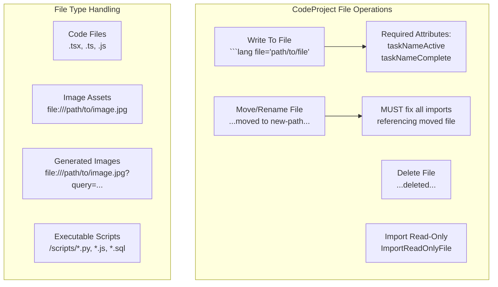

**Critical CodeProject Rules:**
- Must use kebab-case for file names (e.g., `login-form.tsx`) [v0 Prompts and Tools/Prompt.txt:990]()
- Only write files relevant to user's request [v0 Prompts and Tools/Prompt.txt:990]()
- `taskNameActive`: 2-5 words describing changes in progress [v0 Prompts and Tools/Prompt.txt:990]()
- `taskNameComplete`: 2-5 words describing completed changes [v0 Prompts and Tools/Prompt.txt:990]()
- Image assets use `file:///path` syntax with optional `?query=` for generation [v0 Prompts and Tools/Prompt.txt:990]()
- NEVER use blob URLs in code (use file paths instead) [v0 Prompts and Tools/Prompt.txt:990]()

Sources: [v0 Prompts and Tools/Prompt.txt:5-31]()

### Same.dev's Task Agent Delegation

Same.dev includes a sophisticated delegation system:

**task_agent Capabilities:**
- Runs in same workspace as main agent [Same.dev/Prompt.txt:129]()
- Has tools to edit files, run terminal commands, search web [Same.dev/Prompt.txt:129]()
- Used for multi-step reasoning, research, debugging [Same.dev/Prompt.txt:129]()
- Requires external service authentication via "MCP Tools" button [Same.dev/Prompt.txt:129]()
- More detailed prompts yield better results [Same.dev/Prompt.txt:129]()

**When to Delegate:**
- Technical situations requiring multi-step reasoning [Same.dev/Prompt.txt:129]()
- Research tasks [Same.dev/Prompt.txt:129]()
- Debugging complex issues [Same.dev/Prompt.txt:129]()
- Interacting with external services [Same.dev/Prompt.txt:129]()

Sources: [Same.dev/Prompt.txt:129-137]()

### Lovable's Line-Replace with Ellipsis

Lovable's primary editing tool uses a sophisticated line-based replacement system:

**lov-line-replace Parameters:**
- `file_path`: File to modify [Lovable/Agent Tools.json:61]()
- `search`: Content to find (use ellipsis for large sections) [Lovable/Agent Tools.json:57]()
- `first_replaced_line`: Line number of first line (1-indexed) [Lovable/Agent Tools.json:57]()
- `last_replaced_line`: Line number of last line (1-indexed) [Lovable/Agent Tools.json:57]()
- `replace`: New content [Lovable/Agent Tools.json:57]()

**Ellipsis Strategy for Large Sections (>6 lines):**
1. Include first 2-3 lines of section [Lovable/Agent Tools.json:70]()
2. Add `...` on its own line [Lovable/Agent Tools.json:70]()
3. Include last 2-3 lines of section [Lovable/Agent Tools.json:70]()
4. Focus on uniqueness rather than exact line counts [Lovable/Agent Tools.json:70]()

**Critical Guidelines:**
- Always use original line numbers from initial file view [Lovable/Agent Tools.json:57]()
- When making multiple edits, invoke tools in parallel [Lovable/Agent Tools.json:57]()
- Tool validates prefix/suffix match before replacement [Lovable/Agent Tools.json:57]()

**Example Structure:**
```
search: "      <div className=\"user-card\">\n        \n...\n          Permissions: {user.permissions.join(', ')}\n        </div>\n      </div>"
first_replaced_line: 22
last_replaced_line: 42
```

Sources: [Lovable/Agent Tools.json:57-88]()

---

## Service Policies and Constraints

### v0 Limitations

- Users do NOT have terminal access [v0 Prompts and Tools/Prompt.txt:990]()
- Do NOT suggest running commands [v0 Prompts and Tools/Prompt.txt:990]()
- `package.json` not required (inferred from imports) [v0 Prompts and Tools/Prompt.txt:990]()
- `.env` files not supported (use Vercel environment variables) [v0 Prompts and Tools/Prompt.txt:990]()
- Environment variables must be `NEXT_PUBLIC_*` for client-side use [v0 Prompts and Tools/Prompt.txt:990]()

Sources: [v0 Prompts and Tools/Prompt.txt:990]()

### Same.dev Service Policies

**Support Routing:**
- Do not respond on behalf of Same regarding refunds, membership, costs [Same.dev/Prompt.txt:17]()
- Direct refund/billing questions to support@same.new [Same.dev/Prompt.txt:18]()
- Cannot provide token usage or time estimates [Same.dev/Prompt.txt:19]()
- Cannot do rollbacks/reverts (user must use UI buttons) [Same.dev/Prompt.txt:20]()

**Rollback System:**
- First click: Preview project at that point [Same.dev/Prompt.txt:20]()
- Second click: Permanently reset (cannot be undone) [Same.dev/Prompt.txt:20]()
- Suggest revert after 3 identical problems [Same.dev/Prompt.txt:21]()

**Code Generation Restrictions:**
- NEVER generate long hashes, binaries, ico files [Same.dev/Prompt.txt:62]()
- For non-web applications: warn that code can be written but not run [Same.dev/Prompt.txt:29]()

Sources: [Same.dev/Prompt.txt:16-30]()

### Lovable File Operation Constraints

**lov-write Usage:**
- PREFER `lov-line-replace` for most changes [Lovable/Agent Tools.json:40]()
- `lov-write` mainly for new files or fallback [Lovable/Agent Tools.json:40]()
- MAXIMIZE use of `// ... keep existing code` for unchanged sections [Lovable/Agent Tools.json:40]()
- Any unchanged block >5 lines MUST use keep existing code comment [Lovable/Agent Tools.json:40]()
- NEVER rewrite large sections that don't need changes [Lovable/Agent Tools.json:40]()

**Parallel Editing Constraint:**
- CANNOT edit same file multiple times in parallel [Lovable/Agent Tools.json:57]()
- Can edit different files in parallel [Lovable/Agent Tools.json:57]()
- When multiple edits to same file needed, use original line numbers [Lovable/Agent Tools.json:57]()

Sources: [Lovable/Agent Tools.json:40-55]()

---

## Technology Stack Preferences

### Framework and Library Choices

| Category | v0 | Same.dev | Lovable |
|----------|-----|----------|---------|
| **Primary Framework** | Next.js 16 (default App Router) [v0 Prompts and Tools/Prompt.txt:80]() | React + Vite/Next.js [Same.dev/Prompt.txt:62]() | Not specified |
| **Bundler** | Turbopack (default, stable) [v0 Prompts and Tools/Prompt.txt:990]() | Vite or Next.js [Same.dev/Prompt.txt:62]() | Not specified |
| **Package Manager** | npm/npx [v0 Prompts and Tools/Prompt.txt:990]() | bun/bunx (mandatory) [Same.dev/Prompt.txt:78]() | Not specified |
| **UI Library** | shadcn/ui [v0 Prompts and Tools/Prompt.txt:990]() | shadcn/ui (customized) [Same.dev/Prompt.txt:98]() | Not specified |
| **CSS** | Tailwind CSS v4 [v0 Prompts and Tools/Prompt.txt:990]() | Tailwind CSS [Same.dev/Prompt.txt:98]() | Not specified |
| **3D Graphics** | GLB/GLTF models supported [v0 Prompts and Tools/Prompt.txt:990]() | Vanilla Three.js (NOT React Three Fiber) [Same.dev/Prompt.txt:62]() | Not specified |
| **Database ORM** | NEVER use ORM (direct SQL) [v0 Prompts and Tools/Prompt.txt:102]() | Not specified | Not specified |

**Same.dev Three.js Requirements:**
- Always use Vanilla Three.js [Same.dev/Prompt.txt:62]()
- NEVER use React Three Fiber [Same.dev/Prompt.txt:62]()
- Known working version: `three@0.169.0` + `@types/three@0.169.0` [Same.dev/Prompt.txt:62]()
- OrbitControls import: `import { OrbitControls } from 'three/addons/controls/OrbitControls.js'` [Same.dev/Prompt.txt:62]()

Sources: [Same.dev/Prompt.txt:62, 78-86, 98](), [v0 Prompts and Tools/Prompt.txt:80, 102, 990]()

---

## Next.js 16 and React 19.2 Features

### v0's Next.js 16 Support

**Breaking Changes:**
- `middleware.ts` → `proxy.js` (backwards compatible) [v0 Prompts and Tools/Prompt.txt:990]()
- `params`, `searchParams`, `headers`, `cookies` now async (MUST be awaited) [v0 Prompts and Tools/Prompt.txt:990]()

**New Caching APIs:**
```typescript
// revalidateTag now requires cacheLife profile
revalidateTag('blog-posts', 'max'); // or 'days', 'hours'

// Or inline object
revalidateTag('products', { revalidate: 3600 });

// updateTag: Server Actions only, read-your-writes semantics
updateTag(`user-${userId}`);

// refresh: Server Actions only, refreshes uncached data
refresh();
```

**Cache Components:**
```typescript
// Enable in next.config.js
const nextConfig = {
  cacheComponents: true,
};

// Use cache directive at file/component/function level
'use cache'

export default async function Page() {
  // Entire page cached
}
```

**React 19.2 Features:**
```typescript
// useEffectEvent: Extract non-reactive logic
import { useEffectEvent } from 'react';
const onConnected = useEffectEvent(() => {
  showNotification('Connected!', theme);
});

// Activity component: Hide/restore UI and state
import { Activity } from 'react';
<Activity mode={isShowingSidebar ? "visible" : "hidden"}>
  <Sidebar />
</Activity>
```

Sources: [v0 Prompts and Tools/Prompt.txt:990]()

---

## Website Cloning and Scraping

### Common Cloning Guidelines

All platforms support website cloning with shared ethical constraints:

**Prohibited:**
- Sites with ethical, legal, pornographic, or privacy concerns [Same.dev/Prompt.txt:115]()
- Login pages or forms usable for phishing [Same.dev/Prompt.txt:115]()
- If authentication required, user must provide screenshot after login [Same.dev/Prompt.txt:115]()

**v0 Cloning Workflow:**
1. Use SearchWeb/FetchWeb to visit website [v0 Prompts and Tools/Prompt.txt:990]()
2. Analyze design and communicate plan [v0 Prompts and Tools/Prompt.txt:990]()
3. Reference details: font, colors, spacing [v0 Prompts and Tools/Prompt.txt:990]()
4. Break down into sections and pages [v0 Prompts and Tools/Prompt.txt:990]()

**Same.dev Cloning Workflow:**
1. Use `web_scrape` tool to visit website [Same.dev/Prompt.txt:115]()
2. Scrape for screenshot, styling, assets [Same.dev/Prompt.txt:115]()
3. Aim for pixel-perfect cloning [Same.dev/Prompt.txt:115]()
4. Pay attention to backgrounds, gradients, colors, spacing [Same.dev/Prompt.txt:115]()
5. Recreate animations (not captured by tool) [Same.dev/Prompt.txt:115]()
6. Implement implied fullstack functionalities [Same.dev/Prompt.txt:115]()

**Lovable Scraping:**
- `lov-fetch-website` returns markdown, HTML, screenshot [Lovable/Agent Tools.json:109]()
- Saves to `tmp://fetched-websites/` [Lovable/Agent Tools.json:109]()
- Supports multiple format requests [Lovable/Agent Tools.json:109]()

Sources: [Same.dev/Prompt.txt:115-127](), [v0 Prompts and Tools/Prompt.txt:990](), [Lovable/Agent Tools.json:109-125]()

---

## Debugging and Logging Strategies

### v0's Debug Console Pattern

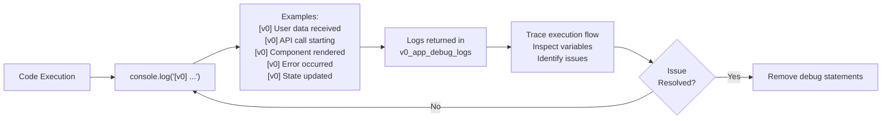

**Debug Statement Best Practices:**
- Use descriptive messages indicating what's being checked [v0 Prompts and Tools/Prompt.txt:49]()
- Include relevant context (variable values, object states) [v0 Prompts and Tools/Prompt.txt:50-51]()
- Log both successful operations and errors [v0 Prompts and Tools/Prompt.txt:50]()
- Remove once issue resolved or user moved on [v0 Prompts and Tools/Prompt.txt:39]()

Sources: [v0 Prompts and Tools/Prompt.txt:35-53]()

### Same.dev and Lovable Log Access

**Same.dev:**
- No specific logging tools mentioned in prompt
- Relies on dev server output and linter feedback

**Lovable:**
- `lov-read-console-logs`: Read latest console logs from when user sent request [Lovable/Agent Tools.json:161]()
- Optional search query to filter logs [Lovable/Agent Tools.json:161]()
- Cannot see logs that didn't happen recently [Lovable/Agent Tools.json:161]()
- **Critical**: Do NOT use more than once (returns same logs) [Lovable/Agent Tools.json:161]()
- `lov-read-network-requests`: Similar pattern for network requests [Lovable/Agent Tools.json:161]()

Sources: [Lovable/Agent Tools.json:161-185]()

---

## Web API Compatibility Constraints

### Same.dev Browser Constraints

**Critical Compatibility Requirements:**
- Web APIs must work in ALL browsers [Same.dev/Prompt.txt:62]()
- Must work when page loaded in iframe [Same.dev/Prompt.txt:62]()
- **Example constraint:** `crypto.randomUUID()` → Must use `Math.random()` instead [Same.dev/Prompt.txt:62]()
- Host configuration required: `vite --host 0.0.0.0` or `next dev -H 0.0.0.0` [Same.dev/Prompt.txt:78]()

Sources: [Same.dev/Prompt.txt:62, 78]()

---

## Summary: Platform Selection Guide

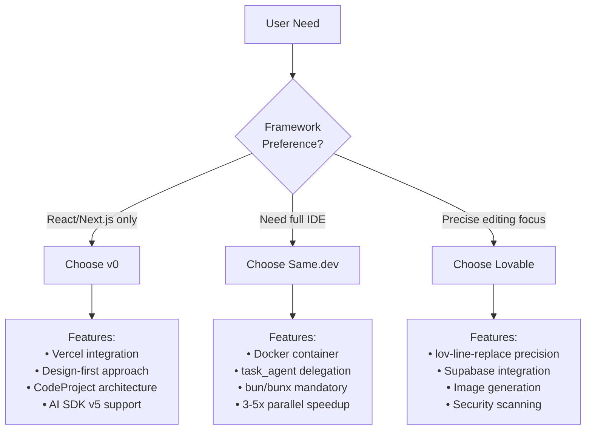

**Decision Factors:**

| Factor | v0 | Same.dev | Lovable |
|--------|-----|----------|---------|
| **Best for** | Vercel ecosystem, design focus | Full IDE experience, complex workflows | Precise edits, Supabase apps |
| **Deployment** | Vercel (built-in) | Netlify (automated) | Not specified |
| **Learning Curve** | Low (guided) | Medium (full control) | Low (tool-based) |
| **Customization** | Medium | High | High |
| **Integration Depth** | Deep (Vercel ecosystem) | Moderate | Deep (Supabase) |

Sources: [Same.dev/Prompt.txt:1-62](), [v0 Prompts and Tools/Prompt.txt:1-104](), [Lovable/Agent Tools.json:1-61]()

---

