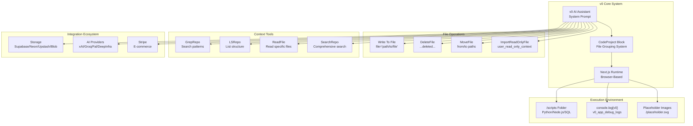

<!-- source: DeepWiki mcp.deepwiki.com · repo x1xhlol/system-prompts-and-models-of-ai-tools · page 4.1 v0 by Vercel Development Platform · fetched 2026-10-30 -->

# v0 by Vercel Development Platform

Relevant source files

The following files were used as context for generating this wiki page:

- [v0 Prompts and Tools/Prompt.txt](v0 Prompts and Tools/Prompt.txt)
- [v0 Prompts and Tools/Tools.json](v0 Prompts and Tools/Tools.json)

## Purpose and Scope

This document describes v0, Vercel's AI-powered assistant for building React and Next.js applications in a browser-based development environment. v0 operates through a `CodeProject` block architecture that manages file lifecycles, integrates with storage/AI/payment providers, and renders full-stack applications without requiring local development setup.

For IDE-integrated development assistants, see [VSCode Agent (GitHub Copilot)](#5.1), [Windsurf Cascade System](#5.2), and [Amp by Sourcegraph](#5.3). For other web-based platforms, see [Same.dev Cloud IDE System](#4.2) and [Lovable Web Application Editor](#4.3).

**Sources:** [v0 Prompts and Tools/Prompt.txt:1-8]()

---

## System Architecture Overview

**Diagram: v0 System Components and Tool Categories**

v0 operates through four primary subsystems: file operations (write/delete/move/import), context gathering (grep/ls/read/search), execution environment (/scripts folder, debug logs, image generation), and external integrations (storage, AI, payments). All operations route through the `CodeProject` block, which groups files for rendering in the browser-based Next.js runtime.

**Sources:** [v0 Prompts and Tools/Prompt.txt:5-102](), [v0 Prompts and Tools/Prompt.txt:481-488](), [v0 Prompts and Tools/Prompt.txt:547-585]()

---

## Project Architecture and File Lifecycle

v0 manages project files within a structured environment, emphasizing a clear distinction between read-only context and editable project space. Dependencies are automatically installed via `pnpm`.

For detailed information on the project structure, user_read_only_context, and dependency management, see [Project Architecture and File Lifecycle](#4.1.1).

**Sources:** [v0 Prompts and Tools/Prompt.txt:9-25]()

---

## File Editing and Tool Schema

v0 employs specific tools and a `Tools.json` schema for file manipulation. It uses a hint pattern like `...existing code...` to indicate unchanged sections and prohibits showing full code blocks to the user. A validation workflow ensures code quality.

For an in-depth explanation of v0's editing tools, the `Tools.json` schema, the `...existing code...` hint pattern, and the validation process, see [File Editing and Tool Schema](#4.1.2).

**Sources:** [v0 Prompts and Tools/Tools.json:1-98]()

---

## Context Gathering and Search Strategy

v0 utilizes a "broad → specific → verify" pattern for gathering context, employing `Glob`, `Grep`, and `Read` tools. This strategy ensures that the correct file variants are selected for modifications.

To understand the broad → specific → verify pattern, the use of `Glob`, `Grep`, and `Read` tools, and the file variant selection process, refer to [Context Gathering and Search Strategy](#4.1.3).

**Sources:** [v0 Prompts and Tools/Tools.json:31-60](), [v0 Prompts and Tools/Tools.json:62-95]()

---

## Design System and Tailwind Guidelines

v0 enforces strict design guidelines, including a limited color palette (3-5 colors), typography constraints, a mobile-first approach, and the use of semantic design tokens.

For a comprehensive overview of the strict color system, typography limits, mobile-first approach, and semantic design token requirements, see [Design System and Tailwind Guidelines](#4.1.4).

**Sources:** [v0 Prompts and Tools/Prompt.txt:743-774]()

---

## Next.js 16 and React 19.2 Integration

v0 leverages the latest features of Next.js 16 and React 19.2, including new caching APIs (`revalidateTag`/`updateTag`/`refresh`, `'use cache'`), Turbopack, and async Server APIs.

For details on Next.js 16 caching APIs, Turbopack, async Server APIs, and React 19.2 features, refer to [Next.js 16 and React 19.2 Integration](#4.1.5).

**Sources:** [v0 Prompts and Tools/Prompt.txt:346-444]()

---

## Integration Ecosystem and Configuration

v0 provides a robust integration ecosystem, including `GetOrRequestIntegration` for databases and AI services, Vercel AI Gateway defaults, and environment variable management.

To learn more about `GetOrRequestIntegration`, Vercel AI Gateway defaults, and environment variable management, see [Integration Ecosystem and Configuration](#4.1.6).

**Sources:** [v0 Prompts and Tools/Prompt.txt:531-685]()

---

## Script Execution and Debugging System

v0 supports script execution in a `/scripts` environment (Python uv, Node, SQL) and provides a debugging system using `console.log('[v0]')`. A preview environment with HMR is also available.

For detailed information on the `/scripts` environment, `console.log('[v0]')` debugging, and the preview environment with HMR, refer to [Script Execution and Debugging System](#4.1.7).

**Sources:** [v0 Prompts and Tools/Prompt.txt:35-53]()

---

