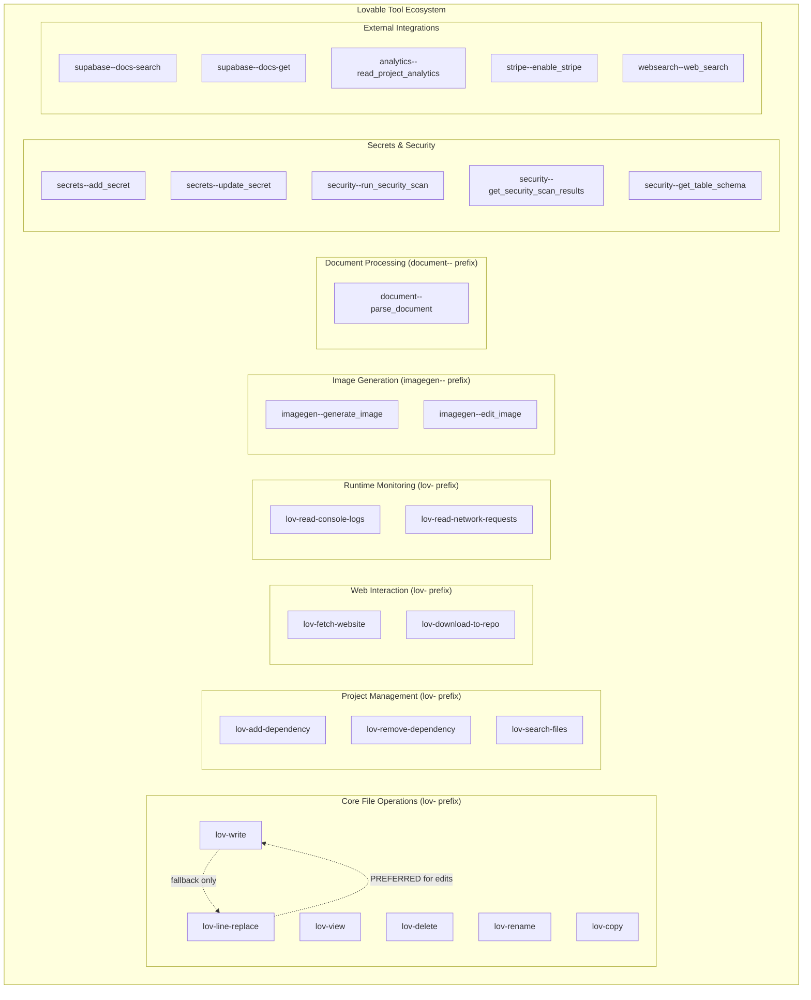
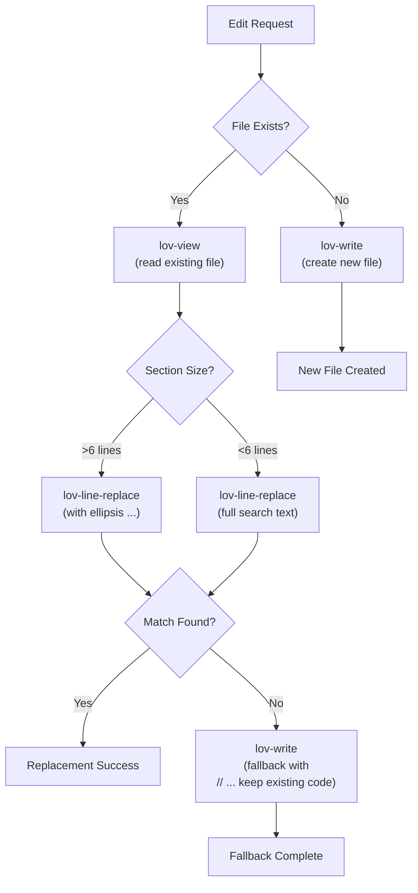

<!-- source: DeepWiki mcp.deepwiki.com · repo x1xhlol/system-prompts-and-models-of-ai-tools · page 4.3 Lovable Web Application Editor · fetched 2026-10-30 -->

# Lovable Web Application Editor

Relevant source files

The following files were used as context for generating this wiki page:

- [Lovable/Agent Prompt.txt](Lovable/Agent Prompt.txt)
- [Lovable/Agent Tools.json](Lovable/Agent Tools.json)

Lovable is an agent-driven web application development platform that emphasizes precise file modifications, minimal code rewriting, and comprehensive external integrations. The system provides specialized tools for file editing, dependency management, image generation, security scanning, and integrations with Supabase, Stripe, and web search services.

This page documents Lovable's tool ecosystem, file operation strategies, and integration capabilities. For other web development platforms, see [v0 by Vercel Development Platform](#4.1) and [Same.dev Cloud IDE System](#4.2). For IDE-integrated assistants, see [IDE-Integrated Development Assistants](#5).

## System Architecture and Tool Ecosystem

Lovable organizes its capabilities into a comprehensive tool suite with distinct naming prefixes that indicate tool categories. The system uses a `lov-` prefix for core project operations and specialized prefixes (`imagegen--`, `document--`, `secrets--`, `supabase--`, `security--`, `analytics--`, `stripe--`, `websearch--`) for integration-specific functionality.

### Agent Prompt and Core Principles

Lovable's agent, named "Lovable," is designed as an AI editor for creating and modifying web applications. It interacts with users via a chat window and displays real-time code changes in a live preview iframe. The core technology stack for Lovable projects includes React, Vite, Tailwind CSS, and TypeScript, explicitly excluding other frameworks like Angular, Vue, Svelte, or Next.js, and native mobile apps [Lovable/Agent Prompt.txt:5-6]().

Lovable cannot run backend code directly but integrates natively with Supabase for backend functionalities like authentication and database management [Lovable/Agent Prompt.txt:7-8](). The agent prioritizes efficient and maintainable code, adhering to SEO best practices, and aims for concise communication [Lovable/Agent Prompt.txt:17-43](). It follows a strict workflow: checking existing context first, reviewing relevant tools, defaulting to discussion mode, planning thoroughly, asking clarifying questions, gathering context efficiently, implementing requested changes, and finally verifying and concluding [Lovable/Agent Prompt.txt:51-85]().

For details, see [Agent Prompt, Tool Naming Conventions and Categories](#4.3.1).

### Tool Categories and Naming Convention

**Tool Ecosystem Architecture**

Sources: [Lovable/Agent Tools.json:1-437]()

| Tool Category | Prefix | Tools | Purpose |
|--------------|--------|-------|---------|
| **Core File Operations** | `lov-` | write, line-replace, view, delete, rename, copy | File system manipulation with emphasis on minimal rewrites |
| **Project Management** | `lov-` | add-dependency, remove-dependency, search-files | npm package and code search management |
| **Web Interaction** | `lov-` | fetch-website, download-to-repo | External content retrieval |
| **Runtime Monitoring** | `lov-` | read-console-logs, read-network-requests | Debugging and diagnostics |
| **Image Generation** | `imagegen--` | generate_image, edit_image | AI-powered image creation and editing |
| **Document Processing** | `document--` | parse_document | Multi-format document extraction |
| **Secrets Management** | `secrets--` | add_secret, update_secret | Encrypted environment variable storage |
| **Security Scanning** | `security--` | run_security_scan, get_security_scan_results, get_table_schema | Supabase backend security analysis |
| **Supabase Integration** | `supabase--` | docs-search, docs-get | Official documentation access |
| **Analytics** | `analytics--` | read_project_analytics | Production app usage tracking |
| **Stripe** | `stripe--` | enable_stripe | Payment processing setup |
| **Web Search** | `websearch--` | web_search | External information retrieval |

Sources: [Lovable/Agent Tools.json:1-437]()

## File Operations and Editing Strategy

Lovable implements a two-tier file editing system with `lov-line-replace` as the primary tool and `lov-write` as a fallback. This architecture prioritizes minimal code changes and preservation of existing content.

### `lov-line-replace`: Primary Editing Tool

The `lov-line-replace` tool [Lovable/Agent Tools.json:57-89]() performs line-based search and replace operations using explicit line numbers. This is the **PREFERRED and PRIMARY tool for editing existing files** and should always be used when modifying existing code rather than rewriting entire files. It supports ellipsis (`...`) for large sections to reduce the amount of content specified in the `search` parameter, focusing on unique context at the beginning and end of the section [Lovable/Agent Tools.json:57-89]().

### `lov-write`: Fallback for New Files

The `lov-write` tool [Lovable/Agent Tools.json:40-56]() overwrites entire files and should be **minimized** to creating new files or as a fallback when `lov-line-replace` fails. When `lov-write` is necessary, it mandates the use of `// ... keep existing code` comments for any unchanged code block over 5 lines to maintain unmodified sections [Lovable/Agent Tools.json:40-56]().

For details, see [File Operations and Line-Replace Strategy](#4.3.2).

### File Editing Workflow

**File Editing Workflow Decision Tree**

Sources: [Lovable/Agent Tools.json:40-89](), [Lovable/Agent Tools.json:144-160]()

## Dependency, Search, Image, and Document Tools

Lovable provides tools for managing project dependencies, searching files, generating and editing images, and parsing documents.

### Dependency Management and File Search

The `lov-add-dependency` tool [Lovable/Agent Tools.json:2-14]() adds npm packages, while `lov-remove-dependency` [Lovable/Agent Tools.json:187-199]() uninstalls them. The `lov-search-files` tool [Lovable/Agent Tools.json:15-39]() enables regex-based code search with glob-pattern file filtering, supporting case sensitivity and providing context-aware results.

### Image Generation and Document Processing

Lovable integrates `imagegen--generate_image` [Lovable/Agent Tools.json:299-327]() for creating images from text prompts, offering different models (`flux.schnell` for speed, `flux.dev` for quality) and supporting specific dimensions and aspect ratios. `imagegen--edit_image` [Lovable/Agent Tools.json:328-351]() allows for AI-powered editing or merging of existing images. The `document--parse_document` tool [Lovable/Agent Tools.json:286-298]() extracts structured content from various document formats, including PDFs, Word documents, and audio files, preserving structure, tables, and performing OCR.

For details, see [Dependency, Search, Image and Document Tools](#4.3.3).

## Secrets, Security Scanning, and External Integrations

Lovable offers robust features for managing secrets, performing security scans, and integrating with various external services.

### Secrets Management and Security Scanning

The `secrets--add_secret` [Lovable/Agent Tools.json:230-242]() and `secrets--update_secret` [Lovable/Agent Tools.json:243-255]() tools handle encrypted storage of API keys and tokens, making them available as environment variables in backend code. Lovable also provides `security--run_security_scan` [Lovable/Agent Tools.json:407-414]() for comprehensive security analysis of Supabase backends, detecting issues like exposed data and missing RLS policies. `security--get_security_scan_results` [Lovable/Agent Tools.json:415-426]() retrieves scan findings, and `security--get_table_schema` [Lovable/Agent Tools.json:427-434]() provides database schema information for security analysis.

### External Integrations

Lovable integrates with several external services:
- **Supabase Documentation**: `supabase--docs-search` [Lovable/Agent Tools.json:256-272]() and `supabase--docs-get` [Lovable/Agent Tools.json:273-285]() allow searching and retrieving official Supabase documentation.
- **Analytics**: `analytics--read_project_analytics` [Lovable/Agent Tools.json:381-398]() provides usage data for production builds.
- **Stripe**: `stripe--enable_stripe` [Lovable/Agent Tools.json:399-406]() facilitates Stripe integration for payment processing.
- **Web Search**: `websearch--web_search` [Lovable/Agent Tools.json:352-380]() performs web searches with filtering capabilities for various categories and domains, crucial for obtaining current information.

For details, see [Secrets, Security Scanning and External Integrations](#4.3.4).

Sources: [Lovable/Agent Tools.json:230-434]()

---

