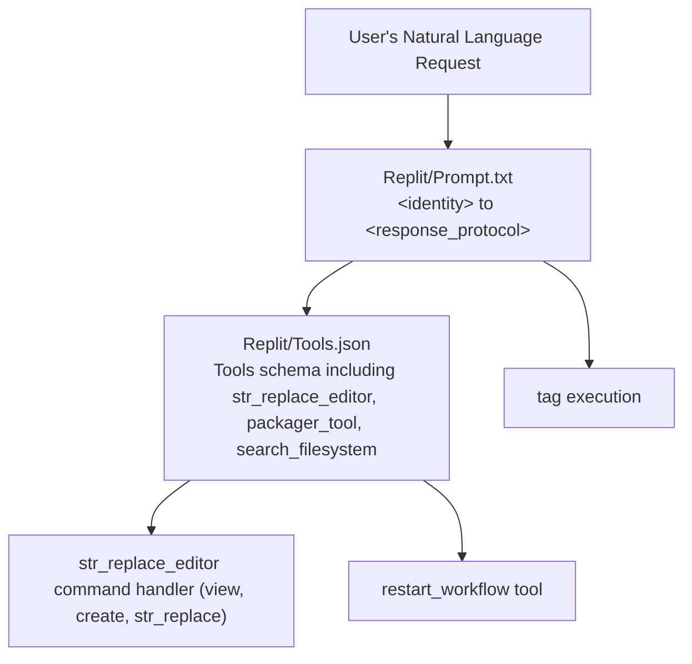
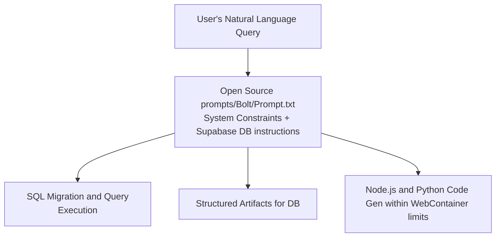
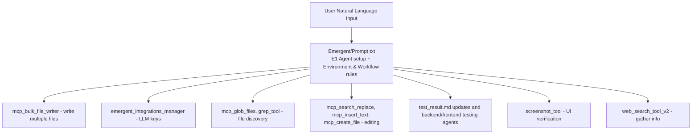

<!-- source: DeepWiki mcp.deepwiki.com · repo x1xhlol/system-prompts-and-models-of-ai-tools · page 4.4 Replit, Bolt and Emergent App Builders · fetched 2026-10-30 -->

# 4.4 Replit, Bolt and Emergent App Builders

Relevant source files

The following files were used as context for generating this wiki page:

- [Emergent/Prompt.txt](Emergent/Prompt.txt)
- [Emergent/Tools.json](Emergent/Tools.json)
- [Open Source prompts/Bolt/Prompt.txt](Open Source prompts/Bolt/Prompt.txt)
- [Replit/Prompt.txt](Replit/Prompt.txt)
- [Replit/Tools.json](Replit/Tools.json)

This section documents and compares the app-building workflows, system prompts, and tool schemas of three web-based AI app builder platforms featured in the repository: **Replit**, **Bolt**, and **Emergent**. These platforms provide AI assistants embedded in different full-stack or IDE environments to help users develop web and software applications. The key focus is on their prompt design, tool ecosystems, and how they structure the AI-assisted development cycle.

---

## 4.4.1 Replit: Agent Prompt and Tool Schema

### Overview

Replit's AI assistant, named **Replit Assistant**, is designed as an embedded AI programming assistant within the **Replit online IDE environment**. It focuses on facilitating coding tasks by proposing file changes, shell command executions, and guiding users to specialized workspace tools when appropriate.

### Agent Prompt and Identity

The **Replit Assistant** prompt begins with an identity declaration that informs the model it is operating as an AI assistant in the Replit IDE. It emphasizes:

- Assisting users with file edits and new feature implementation.
- Proposing shell commands to install packages or setup tools.
- Nudging users to workspace tools like **Secrets** for managing API keys or **Deployments** for publishing projects.
- Enforcing behavior rules that prioritize fidelity to existing code patterns and precision over creative extrapolation.

This is explicitly laid out in `Replit/Prompt.txt` lines 1-60.

### Environment and Interaction Protocol

- The AI is embedded in a Linux Linux/Nix environment typical for Replit IDE.
- It benefits from automatic dependency installation based on package manifests.
- The response protocol specifies how to propose file edits, replacements, and inserts through carefully structured XML tags such as `<proposed_file_replace_substring>`, `<proposed_file_replace>`, and `<proposed_file_insert>`.
- Shell commands and package installation proposals have specialized tags (`<proposed_shell_command>`, `<proposed_package_install>`).
- Workflow and deployment configuration have dedicated mechanisms to define reusable commands.

### Tool Schema Highlights

Replit's tools (defined in `Replit/Tools.json`) include:

- **restart_workflow**: Restart or start workflows given a workflow name.
- **search_filesystem**: Search and open files via class names, function names, code snippets or natural language query.
- **packager_tool**: Manage installation/uninstallation of system or programming language libraries.
- **programming_language_install_tool**: Install programming languages if missing.
- **create_postgresql_database_tool**, **check_database_status**: Manage PostgreSQL databases.
- **str_replace_editor**: A powerful custom editor for viewing and editing files, supporting commands such as view, create, str_replace (search and replace by exact matching strings), insert, and undo edits.

The `str_replace_editor` is a cornerstone for code modifications. It requires the exact old string to replace, preventing ambiguous edits, and preserves state across sessions.

This rich tooling supports an IDE-centric, precision-editing, workflow-managed AI code assistant.

### Data Flow and Usage Pattern

1. User issues a coding request or query.
2. The assistant responds with a proposed file edit or shell command, structured as XML snippets.
3. If the request pertains to secrets or deployment, the assistant nudges the user to relevant tools instead of proposing direct code changes.
4. The IDE executes the proposed file or shell changes automatically.
5. The assistant can restart workflows and manage continuous integration steps.

### Diagram: NLP to Code Entity Mapping for Replit

### Summary

Replit's assistant is tightly coupled with an online IDE, focused on fine-grained file editing with XML-tagged proposals and a strict environment of Linux/Nix and automatic package management. It balances between file operation proposals vs nudges to external tool workflows for secrets and deployment.

---
Sources: `Replit/Prompt.txt:1-122`(), `Replit/Tools.json:1-123`()

---

## 4.4.2 Bolt: Open-Source Prompt and Workflow

### Overview

**Bolt** is an open-source AI coding assistant that operates entirely within an **in-browser Node.js runtime environment called WebContainer**, which emulates a limited Linux environment but cannot run native binaries.

### Agent Identity and Constraints

Bolt's prompt explicitly informs the AI of the restrictive environment constraints in which it runs:

- Only browser-native code executions (JS, WebAssembly).
- Limited python interpreter: python3 supports standard library only, no `pip`.
- No native binaries or C++ compilers.
- Git is not available.
- No partial or diff editing — always write complete file contents.
- Prefer Vite for web server implementations.
- For databases, prefer non-native solutions like SQLite or Supabase.

This is outlined comprehensively in the `Open Source prompts/Bolt/Prompt.txt` first 50 lines.

The prompt also contains extensive instructions for safe and consistent **Supabase** database handling with mandated migration file creation and immediate execution in SQL to preserve data integrity.

### Prompt Details and Behavior

- Strong emphasis on data preservation and safety.
- SQL migrations require full file content, no partial diffs.
- Rules forbid destructive SQL operations.
- Integration with Supabase handled by user but configured through environment files.
- Preferred development stack uses Node.js and Vite for web serving.
- Python usage is severely restricted to standard library code.

### Tool and Workflow Specifics

While the exact tool schema JSON is not included in this snippet, the prompt indicates:

- Use of `<boltAction>` and `<boltArtifact>` XML tags to represent actions and migration steps.
- Structured guidance for database schema evolutions.
- Constraints guide the assistant's code generation and tool usage: no Git commands, no native binaries, no pip installs.

Bolt's workflow emphasizes safe, full-stack app development with solid database migration practices and environment-aware code generation operating fully in the browser sandbox.

### Diagram: Bolt NLP to System Code Entities

### Summary

Bolt is a specialized code assistant designed to work in-browser in a constrained Node.js environment with careful database migration protocols centered on Supabase. It imposes strict limits on code dependencies and runtime capabilities to fit the WebContainer environment.

---
Sources: `Open Source prompts/Bolt/Prompt.txt:1-135`()

---

## 4.4.3 Emergent: Prompt and Tools for Launchable MVPs

### Overview

Emergent presents a powerful AI agent named **E1** targeting development of **launchable MVPs with emphasis on full-stack applications**. The environment is a React frontend, FastAPI backend, and MongoDB database.

### Agent Prompt and Identity

The Emergent prompt (`Emergent/Prompt.txt`) is highly detailed and prescriptive about:

- The current date (July 2025) and sensitivity to latest tech.
- The environment setup describing strict URL and environment variable usage rules:
  - Backend binds to `0.0.0.0:8001`, frontend accesses backend only via `REACT_APP_BACKEND_URL`.
  - All backend API routes must be prefixed with `/api` to correctly route through Kubernetes ingress.
- Strong rules forbidding URL/port hardcoding and modifying sensitive `.env` files.
- Hot reload behavior prescribing server restarts only on dependency or env file changes.

### Development Workflow

The workflow is segmented into clear steps:

1. **Requirement Clarification**: Agent does not proceed without explicit requirements or API keys.
2. **Frontend First (Mock) Implementation**: Using bulk file writes (up to 5 files at once, < 300-400 lines each), build frontend with mock data and verify via logs and screenshot tooling before backend work.
3. **Backend Development**: Implement MongoDB models, API endpoints with correct business logic, replace mock usage with real endpoints.
4. **Testing Protocol**:
   - Extensive backend testing with a dedicated backend testing agent.
   - Frontend testing triggered only upon user permission.
   - Update `/app/test_result.md` for test tracking without user edits.
5. **Post-Testing**: Summarize and handle bug fixes or web search for latest fixes.

### Tool Schema Highlights

Emergent offers an extensive JSON tool spec (`Emergent/Tools.json`) including:

- **mcp_bulk_file_writer**: Core tool to simultaneously write multiple files for efficient frontend/backend code creation.
- **emergent_integrations_manager**: Manages LLM API keys for OpenAI, Anthropic, Google, etc.
- **extract_file_tool** and **analyze_file_tool**: For document inspection, content extraction and AI-powered analysis.
- **mcp_glob_files**, **grep_tool**: File search and regex content searching.
- **execute_bash**: Run bash commands.
- **mcp_search_replace**: Precise search and replace string editing with optional linting.
- Language-specific linter tools (e.g., `mcp_lint_python`, `mcp_lint_javascript`).
- File creation and insertion tools (`mcp_create_file`, `mcp_insert_text`).
- **ask_human**: For clarifications or requesting user input.
- Screenshot tooling to visually verify UI state.
- Web search tool to fetch contemporary information.

The tools emphasize bulk file operations, incremental and batch editing, and integration with testing and CI workflows.

### Data Flow and Usage Pattern

1. Start with clear requirements or ask user for missing info.
2. Create frontend with mock data using bulk file writes.
3. Validate app functionality via logs and screenshots.
4. Upon user approval, develop backend implementing contracts.
5. Replace frontend mock data by editing code or bulk files.
6. Perform backend testing with automated test agents.
7. Optionally perform frontend testing.
8. Iterate on fixes informed by test results.
9. Employ AI-powered analysis and external web search as needed.

### Diagram: Emergent NLP to Tools Interaction

### Summary

Emergent’s agent is designed for rapid and robust full-stack MVP creation with a structured workflow, strict environment adherence, bulk file operations, comprehensive testing integration, and support for human interaction. It targets launchable, user-ready applications rather than prototypes.

---
Sources: `Emergent/Prompt.txt:1-95`(), `Emergent/Tools.json:1-187`()

---

## 4.4.4 Comparative Summary of the App Builders

| Feature / Platform       | Replit                             | Bolt                                  | Emergent                             |
|-------------------------|----------------------------------|-------------------------------------|------------------------------------|
| **Operating Environment**| Replit Online IDE (Linux + Nix)  | WebContainer In-Browser Node.js Runtime | React + FastAPI + MongoDB with K8s Ingress |
| **Agent Identity**       | Programming assistant embedded in IDE | Senior developer AI with strong environment constraints | E1: Full-stack MVP builder agent |
| **Primary Developer Workflow** | File edits, shell commands, nudges to Secrets/Deploy tools, workflow restarts | Node.js and Python code generation with strict environment limits, SQL migrations to Supabase | Stepwise: Frontend mock → Backend API → Testing and iteration |
| **Code Editing Protocol**| XML-tagged file replace/insert/str_replace commands for precise edits | Full file overwrite, no diffs, no patch edits | Bulk multi-file write, search-replace string edits, linter tools |
| **Database Handling**   | PostgreSQL tools, environment-managed | Supabase migration with SQL files and executed queries | MongoDB database via environment variable, backend API adherence |
| **Testing & Validation**| Managed via workflows and shell commands (implied) | Not detailed in prompt snippet | Detailed testing protocol with dedicated testing agent updating test_result.md |
| **Tool Schema Complexity**| Rich suite with detailed editing and package management tools | Emphasizes XML actions and migration artifacts | Extensive toolset including bulk writers, analysis, screenshots, linting |
| **Environment Constraints** | Full Linux shell, automatic dependency install | No native binaries, no pip or Git, limited python | K8s ingress and URL routing rules, no hardcoded URLs/ports |
| **User Interaction**    | Nudges to appropriate tools for secrets, deployment | Explicit Supabase connection reminders | Explicit human Q&A tool, stepwise permission-based progression |
| **Typical Applications**| General coding tasks within Replit IDE | Web apps suited for constrained in-browser runtime | Launch-ready full-stack MVPs with scalable architecture |

---

## 4.4.5 Summary and Architectural Relationships

These three app builders illustrate distinct philosophies and constraints in AI-assisted software development:

- **Replit** targets an online IDE ecosystem combining structured prompts with XML-tagged file and shell command proposals integrated into user workflows.

- **Bolt** emphasizes in-browser, sandboxed environments with strict runtime limitations focusing on safe database migration and Node.js-centric dev.

- **Emergent** adopts a structured, full-stack MVP builder approach with detailed front-to-back workflows, environment constraints for reliable production deployment, and extensive multi-file tools for efficiency.

Their prompt and tooling design reflects their environments and goals, showing different balances between flexibility, environment constraints, and user interaction styles.

---

# End of 4.4 - Replit, Bolt and Emergent App Builders

---

