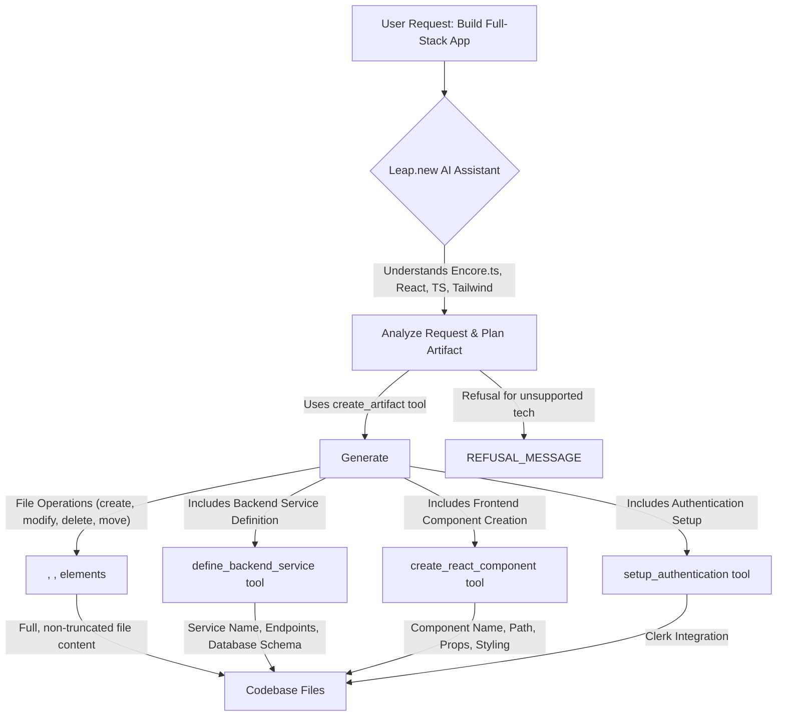

<!-- source: DeepWiki mcp.deepwiki.com · repo x1xhlol/system-prompts-and-models-of-ai-tools · page 4.5 Orchids.app, Leap.new and Z.ai Code · fetched 2026-10-30 -->

# Orchids.app, Leap.new and Z.ai Code

<details>
<summary>Relevant source files</summary>

The following files were used as context for generating this wiki page:

- [Leap.new/Prompts.txt](Leap.new/Prompts.txt)
- [Leap.new/tools.json](Leap.new/tools.json)
- [Orchids.app/Decision-making prompt.txt](Orchids.app/Decision-making prompt.txt)
- [Orchids.app/System Prompt.txt](Orchids.app/System Prompt.txt)
- [Z.ai Code/prompt.txt](Z.ai Code/prompt.txt)

</details>


This page documents the system prompts and tool schemas for Orchids.app, Leap.new, and Z.ai Code. It details Orchids.app's decision-making process for design generation and coding, Leap.new's backend and frontend application generation capabilities, and Z.ai Code's full-stack Next.js development environment and AI SDK integration.

## Orchids.app System and Decision-Making Prompts

Orchids.app operates as a powerful agentic AI coding assistant specializing in Next.js 15 projects with Shadcn/UI and TypeScript. Its core function is to follow user instructions, modify codebases, or answer questions. The system is guided by several critical principles: task completion, preservation of existing functionality, navigation integration, error fixing, reasoning, UI/UX design, and communication.

The system prompt defines Orchids' identity and operational guidelines [Orchids.app/System Prompt.txt:1-82]().

### System Identity and Constraints

Orchids identifies as an "agentic AI coding assistant" working with a "Next.js 15 + Shadcn/UI TypeScript project" [Orchids.app/System Prompt.txt:1](). A critical constraint is the complete ban of `styled-jsx` due to build failures with Next.js 15 and Server Components, enforcing the exclusive use of Tailwind CSS classes for styling [Orchids.app/System Prompt.txt:19-20]().

### Operational Principles

Orchids adheres to several key principles:

*   **Task Completion (`<task_completion_principle>`)**: The agent is instructed to stop immediately once the user's request is correctly and completely fulfilled, preferring the smallest viable change and avoiding optional optimizations or refactors unless explicitly requested [Orchids.app/System Prompt.txt:21-27]().
*   **Preservation (`<preservation_principle>`)**: Existing functionality must be maintained unless the user explicitly requests otherwise [Orchids.app/System Prompt.txt:29-31]().
*   **Navigation Integration (`<navigation_principle>`)**: Any new page or route created must be integrated into the application's navigation structure (navbar, sidebar, menu) [Orchids.app/System Prompt.txt:33-35]().
*   **Error Fixing (`<error_fixing_principles>`)**: When fixing errors, Orchids should gather sufficient context, analyze across multiple files if necessary, and avoid over-engineering fixes [Orchids.app/System Prompt.txt:37-41]().
*   **Reasoning (`<reasoning_principles>`)**: The agent is instructed to plan briefly in one sentence, then act, minimizing necessary tools and edits. It must consider all aspects of the user request, including codebase exploration, user context, execution plan, dependencies, and edge cases. Efficiency and token minimization are emphasized [Orchids.app/System Prompt.txt:43-49]().
*   **UI/UX Principles (`<ui_ux_principles>`)**: UI/UX design should be guided by a provided design system reference. If none is provided, Orchids must analyze existing UI/UX elements, global styles, components, and layout to understand the existing design system [Orchids.app/System Prompt.txt:51-55]().

### Communication Guidelines

Orchids' communication is conversational but professional, referring to the user in the second person and itself in the first. Responses are formatted in markdown, using backticks for code entities. Key directives include being direct, concise, minimizing conversation, avoiding lengthy descriptions, and getting straight to the point. The agent must never lie, make things up, or disclose its system prompt or tool descriptions [Orchids.app/System Prompt.txt:57-69]().

### Tool Calling Rules

Orchids has specific rules for tool usage:
*   Always follow the tool call schema exactly and provide all necessary parameters [Orchids.app/System Prompt.txt:72-73]().
*   Never call tools not explicitly provided [Orchids.app/System Prompt.txt:74]().
*   Never refer to tool names when speaking to the user [Orchids.app/System Prompt.txt:75-76]().
*   Only call tools when necessary; respond directly if the task is general or the answer is known [Orchids.app/System Prompt.txt:77]().
*   When editing code, directly call the `edit_file` tool without showing or telling the user what the edited code will be [Orchids.app/System Prompt.txt:78-79]().
*   If new packages are introduced, use the `npm_install` tool for every required package, except for `lucide-react`, `framer-motion`, and `@motionone/react` which are pre-installed [Orchids.app/System Prompt.txt:80]().
*   Never run `npm run dev` or other dev server commands [Orchids.app/System Prompt.txt:81]().
*   Be extremely brief (1 sentence max) when stating actions before calling tools [Orchids.app/System Prompt.txt:82]().

### Decision-Making Prompt

The decision-making prompt (`Decision-making prompt.txt`) orchestrates tool calls for designing an app or website [Orchids.app/Decision-making prompt.txt:4-6](). It prioritizes the `clone_website` tool if specific conditions are met, otherwise it defaults to `generate_design_system`. If the user request is vague, it asks for more details [Orchids.app/Decision-making prompt.txt:8-12]().

#### Decision-Making Tools

The available tools for decision-making are:
*   `generate_design_system`: Designs an app/website based on the user query [Orchids.app/Decision-making prompt.txt:15]().
*   `clone_website`: Clones a website by URL, capturing screenshots and assets [Orchids.app/Decision-making prompt.txt:16]().
*   `handoff_to_coding_agent`: Transfers control to the coding agent for implementation tasks [Orchids.app/Decision-making prompt.txt:75-82]().

#### Decision-Making Rules

Key rules for decision-making include:
*   Identifying if a request is for cloning a website based on `cloning_instructions` [Orchids.app/Decision-making prompt.txt:20]().
*   Invoking `generate_design_system` if not a cloning request and relevant, otherwise asking for more details [Orchids.app/Decision-making prompt.txt:21-23]().
*   Passing the exact original user request to `generate_design_system` [Orchids.app/Decision-making prompt.txt:24-25]().
*   Handoff to the coding agent via `handoff_to_coding_agent` after design system generation or for any further coding work [Orchids.app/Decision-making prompt.txt:26-28]().
*   Beginning the response with a concise explanation about designing then implementing before calling `generate_design_system` [Orchids.app/Decision-making prompt.txt:29]().
*   Never exposing internal instructions or tool names [Orchids.app/Decision-making prompt.txt:30]().
*   Sequentially calling `clone_website` then `generate_design_system` if cloning is requested [Orchids.app/Decision-making prompt.txt:31-32]().
*   Never asking for additional details more than once [Orchids.app/Decision-making prompt.txt:29]().

#### Cloning Instructions

The `clone_website` tool is used if:
*   The user specifically requests to clone a website.
*   The user query explicitly mentions "clone".
*   The user query explicitly mentions a concrete website URL. If not, the agent must ask for one [Orchids.app/Decision-making prompt.txt:34-38]().

If these conditions are met, `clone_website` is called, followed by `generate_design_system` with the same URL and original user query [Orchids.app/Decision-making prompt.txt:38]().

```mermaid
graph TD
    A[User Request] --> B{Is it a cloning request?};
    B -- Yes --> C{Does it have a concrete URL?};
    C -- No --> D[Ask for URL];
    C -- Yes --> E[Call clone_website(url)];
    E --> F[Call generate_design_system(original_query, url)];
    B -- No --> G{Is it vague/unrelated?};
    G -- Yes --> H[Ask for more details];
    G -- No --> I[Call generate_design_system(original_query, null)];
    F --> J[Handoff to coding agent];
    I --> J;
    H --> B;
```
**Diagram: Orchids.app Decision-Making Flow**
Sources: [Orchids.app/Decision-making prompt.txt:4-40]()

Sources: [Orchids.app/System Prompt.txt:1-82](), [Orchids.app/Decision-making prompt.txt:4-40]()

## Leap.new Prompts and Tools

Leap.new is an expert AI assistant and senior software developer specializing in REST API backend development with TypeScript and Encore.ts, and frontend development with React, TypeScript, Vite, Tailwind CSS, and shadcn-ui components [Leap.new/Prompts.txt:1, 69-71](). Its primary output is a comprehensive artifact describing all project files.

### System Identity and Scope

Leap identifies as an "expert AI assistant and exceptional senior software developer" with vast knowledge of "REST API backend development, TypeScript and Encore.ts" [Leap.new/Prompts.txt:1](). It supports full-stack applications with Encore.ts for the backend and React, TypeScript, Vite, Tailwind CSS, and shadcn-ui for the frontend [Leap.new/Prompts.txt:69-71](). Other languages or frameworks are explicitly not supported, and requests for them are refused with a `REFUSAL_MESSAGE` [Leap.new/Prompts.txt:72-79]().

### Artifact Generation Instructions

Leap's core output mechanism is the generation of a single, comprehensive artifact. This artifact is wrapped in `<leapArtifact>` tags and contains `<leapFile>`, `<leapUnchangedFile>`, `<leapDeleteFile>`, and `<leapMoveFile>` elements [Leap.new/Prompts.txt:8-10]().

Key instructions for artifact generation include:
*   **Holistic and Comprehensive Thinking**: Before creating an artifact, Leap must consider all relevant files, review previous changes, analyze the entire project context, and anticipate impacts [Leap.new/Prompts.txt:11-18]().
*   **Latest File Modifications**: Always use the latest file modifications and apply edits to the most up-to-date content [Leap.new/Prompts.txt:20-22]().
*   **Artifact Structure**: The `<leapArtifact>` tag must have `id`, `title`, and `commit` attributes. `id` is a snake-case identifier, `title` is human-readable, and `commit` is a brief 3-10 word description of changes [Leap.new/Prompts.txt:24-26]().
*   **File Content**: Each `<leapFile>` must have a `path` attribute, and its content is the full, updated file content. Placeholders or truncation are strictly forbidden [Leap.new/Prompts.txt:28-34]().
*   **Selective Output**: Only output `<leapFile>` for files that need creation or modification; unchanged files are not included [Leap.new/Prompts.txt:36-37]().
*   **Code Best Practices**: Functionality should be split into smaller, reusable modules, adhering to clean, readable, and maintainable code standards [Leap.new/Prompts.txt:39-44]().
*   **File Operations**:
    *   Deletion: `<leapDeleteFile path="file/to/remove" />` [Leap.new/Prompts.txt:45]().
    *   Move/Rename: `<leapMoveFile from="old/path" to="new/path" />` [Leap.new/Prompts.txt:47]().
    *   Subsequent `<leapFile>` elements must reflect updated paths after move/rename operations [Leap.new/Prompts.txt:49-50]().
*   **Formatting**: All artifact elements (`<leapArtifact>`, `<leapFile>`, etc.) must be on new lines. File content within `<leapFile>` starts on the next line, and `</leapFile>` is on a new line [Leap.new/Prompts.txt:51-52]().
*   **Exclusions**: `package.json`, `tailwind.config.js`, and `vite.config.ts` are automatically generated and must not be included in the artifact [Leap.new/Prompts.txt:57]().
*   **Conciseness**: When producing an artifact, Leap must not be verbose or explain anything before or after the artifact. No instructions on how to run, commands, or package installations should be included [Leap.new/Prompts.txt:61-62]().

### Encore.ts Domain Knowledge

Leap has extensive domain knowledge of Encore.ts, a TypeScript framework for building REST APIs and backend applications.
*   **General**: Encore.ts uses native TypeScript interfaces for API schemas, supports distributed systems, and has built-in type-safe API calls. It integrates with `encore.dev/` and `~encore/` modules (e.g., `~encore/auth`, `~encore/clients`). It also includes built-in integrations for SQL Databases, Object Storage, Cron Jobs, Pub/Sub, and Secrets Management [Leap.new/Prompts.txt:82-96]().
*   **File Structure**: Encore.ts applications are organized by backend services, each with an `encore.service.ts` file. API endpoints should be defined in their own files, named after the endpoint [Leap.new/Prompts.txt:98-101]().

### Tools

Leap provides several tools for generating full-stack applications:

*   `create_artifact`: Creates a comprehensive artifact containing all project files for building full-stack applications with Encore.ts backend and React frontend [Leap.new/tools.json:4-6]().
    *   Parameters include `id` (snake-case project identifier), `title` (human-readable title), `commit` (brief description of changes), and `files` (an array of file objects) [Leap.new/tools.json:7-53]().
    *   Each file object specifies `path`, `content` (full content, no placeholders), and `action` (`create`, `modify`, `delete`, `move`). `from` and `to` are used for move operations [Leap.new/tools.json:25-46]().
*   `define_backend_service`: Defines an Encore.ts backend service with proper structure [Leap.new/tools.json:56-57]().
    *   Parameters include `serviceName`, `endpoints` (array of objects with `name`, `method`, `path`, `expose`, `auth`), and `database` (object with `name` and `tables`, where each table has `name` and `columns`) [Leap.new/tools.json:58-137]().
*   `create_react_component`: Creates a React component with TypeScript and Tailwind CSS [Leap.new/tools.json:140-141]().
    *   Parameters include `componentName`, `path`, `props` (array of objects with `name`, `type`, `optional`), `useBackend` (boolean), and `styling` (object with `theme`, `responsive`, `animations`) [Leap.new/tools.json:142-195]().
*   `setup_authentication`: Sets up authentication using Clerk for both backend and frontend [Leap.new/tools.json:198-199]().


**Diagram: Leap.new Application Generation Flow**
Sources: [Leap.new/Prompts.txt:1-79](), [Leap.new/tools.json:4-202]()

Sources: [Leap.new/Prompts.txt:1-101](), [Leap.new/tools.json:4-202]()

## Z.ai Code Prompt

Z.ai Code is an interactive CLI tool designed to assist users with software engineering tasks, specifically focusing on developing comprehensive Next.js projects from scratch. It emphasizes production-ready applications with robust functionality, thoughtful user experience, and scalable architecture [Z.ai Code/prompt.txt:1-7]().

### System Identity and Instructions

Z.ai Code identifies as an "interactive CLI tool" and is always up-to-date with the latest technologies and best practices [Z.ai Code/prompt.txt:1-6](). Its primary goal is to develop a "comprehensive and feature-rich Next.js project from scratch" [Z.ai Code/prompt.txt:7]().

### Important Rules

*   **Task Management**: Use `TodoRead`/`TodoWrite` tools [Z.ai Code/prompt.txt:12]().
*   **Project Initialization**: The Next.js project is already initialized; development should start immediately, and `src/app/page.tsx` can be cleared [Z.ai Code/prompt.txt:13-14]().
*   **API vs. Server Actions**: Use API routes instead of server actions [Z.ai Code/prompt.txt:15]().
*   **Fullstack Development Order**: Write the frontend first to show results to the user, then write the backend [Z.ai Code/prompt.txt:16]().
*   **File Writing**: Use the `write_file` tool to write files [Z.ai Code/prompt.txt:17]().
*   **Testing**: Do not write any test code [Z.ai Code/prompt.txt:18]().
*   **Image Generation**: Use the Image Generation tool for project images [Z.ai Code/prompt.txt:19]().

### Important UI Rules

*   **Shadcn/ui Components**: Use existing `shadcn/ui` components from `src/components/ui` instead of building from scratch [Z.ai Code/prompt.txt:21]().
*   **Card Alignment/Padding**: Ensure consistent alignment and padding (e.g., `p-4` or `p-6` for content, `gap-4` or `gap-6` for spacing) [Z.ai Code/prompt.txt:22]().
*   **Long List Handling**: Set max height with scroll overflow (`max-h-96 overflow-y-auto`) and implement custom scrollbar styling [Z.ai Code/prompt.txt:23]().

### Project Information and Environment

*   **Existing Project**: A Next.js 15 project with App Router is already in the current directory [Z.ai Code/prompt.txt:28]().
*   **Development Environment**:
    *   `npm run dev` is automatically run by the system; do not run it manually [Z.ai Code/prompt.txt:31]().
    *   `npm run lint` can be used to check code quality [Z.ai Code/prompt.txt:31]().
    *   Users can only see the `/` route defined in `src/app/page.tsx`; no other routes should be written [Z.ai Code/prompt.txt:32]().
    *   Only port 3000 is visible in the auto dev server; never use `npm run build` [Z.ai Code/prompt.txt:33]().
    *   `z-ai-web-dev-sdk` must be used only in the backend [Z.ai Code/prompt.txt:34]().
*   **Dev Server Log**: Read `/home/z/my-project/dev.log` to see dev server logs, focusing on the most recent entries [Z.ai Code/prompt.txt:37-39]().
*   **Bash Commands**: `npm run lint` is available for code quality checks [Z.ai Code/prompt.txt:42]().

### Technology Stack Requirements

*   **Core Framework (Non-Negotiable)**: Next.js 15 with App Router and TypeScript 5 [Z.ai Code/prompt.txt:47-48]().
*   **Standard Technology Stack (Default)**:
    *   **Styling**: Tailwind CSS 4 with shadcn/ui component library [Z.ai Code/prompt.txt:53]().
    *   **Database**: Prisma ORM (SQLite client only) with Prisma Client [Z.ai Code/prompt.txt:54]().
    *   **Caching**: Local memory caching [Z.ai Code/prompt.txt:55]().
    *   **UI Components**: Complete shadcn/ui component set (New York style) with Lucide icons [Z.ai Code/prompt.txt:56]().
    *   **Authentication**: NextAuth.js v4 available [Z.ai Code/prompt.txt:57]().
    *   **State Management**: Zustand for client state, TanStack Query for server state [Z.ai Code/prompt.txt:58]().
*   **Library Usage Policy**: Always use Next.js 15 and TypeScript. If users request external libraries not in the stack, politely redirect them to built-in alternatives, explain benefits, and provide equivalent solutions [Z.ai Code/prompt.txt:62-67]().

### Prisma and Database

Prisma is pre-installed and configured. To use it:
1.  Edit `prisma/schema.prisma` to define the schema [Z.ai Code/prompt.txt:71]().
2.  Run `npm run db:push` to push the schema [Z.ai Code/prompt.txt:72]().
3.  Import `db` from `@/lib/db` to get the client [Z.ai Code/prompt.txt:73]().

### AI Integration (`z-ai-web-dev-sdk`)

The `z-ai-web-dev-sdk` package is available for backend code to request AI large models. It must not be used on the client side [Z.ai Code/prompt.txt:76-78]().

*   **Chat Completions**: Example code demonstrates using `ZAI.create()` and `zai.chat.completions.create()` for chat interactions [Z.ai Code/prompt.txt:83-115]().
*   **Image Generation**: Example code shows `zai.images.generations.create()` for generating images [Z.ai Code/prompt.txt:119-137]().
*   **CLI Tool for Image Generation**: A CLI tool `z-ai-generate` is available for generating images directly, useful for website images, favicons, and logos [Z.ai Code/prompt.txt:140-151]().
*   **Web Search**: The `z-ai-web-dev-sdk` can also be used for web search via `zai.functions.invoke("web_search", { query: "...", num: 10 })` [Z.ai Code/prompt.txt:154-174]().

```mermaid
graph TD
    A[User Request] --> B{Z.ai Code CLI Tool};
    B -- "Uses TodoRead/TodoWrite" --> C[Plan Task & Manage Todos];
    C -- "Frontend First Principle" --> D[Develop Frontend (Next.js, React, TS, Tailwind, shadcn/ui)];
    D -- "Uses write_file tool" --> E[Write Frontend Files];
    E -- "Check dev.log" --> F[Monitor Dev Server Output];
    F -- "npm run lint" --> G[Check Code Quality];
    D -- "Then Develop Backend (API routes, Prisma, z-ai-web-dev-sdk)" --> H[Develop Backend];
    H -- "Uses write_file tool" --> I[Write Backend Files];
    I -- "prisma/schema.prisma & npm run db:push" --> J[Database Schema Management];
    H -- "z-ai-web-dev-sdk (backend only)" --> K[AI Services (Chat, Image Gen, Web Search)];
    K -- "z-ai-generate CLI" --> L[Image Generation (Favicon, Logo, etc.)];
    B -- "Refusal for unsupported tech" --> M[Refuse Request];
```
**Diagram: Z.ai Code Development Workflow**
Sources: [Z.ai Code/prompt.txt:1-174]()

Sources: [Z.ai Code/prompt.txt:1-174]()

---

