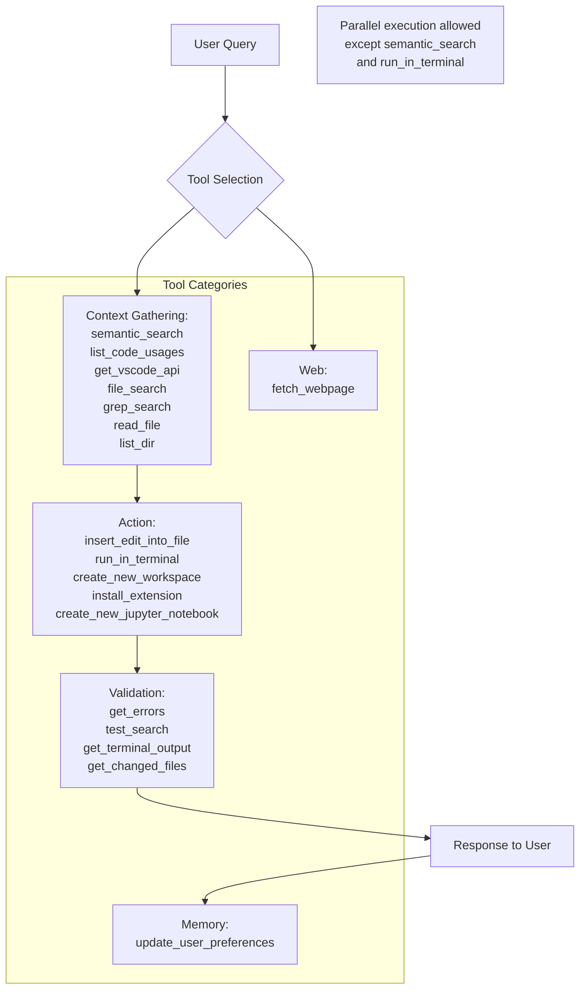
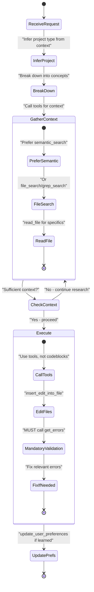
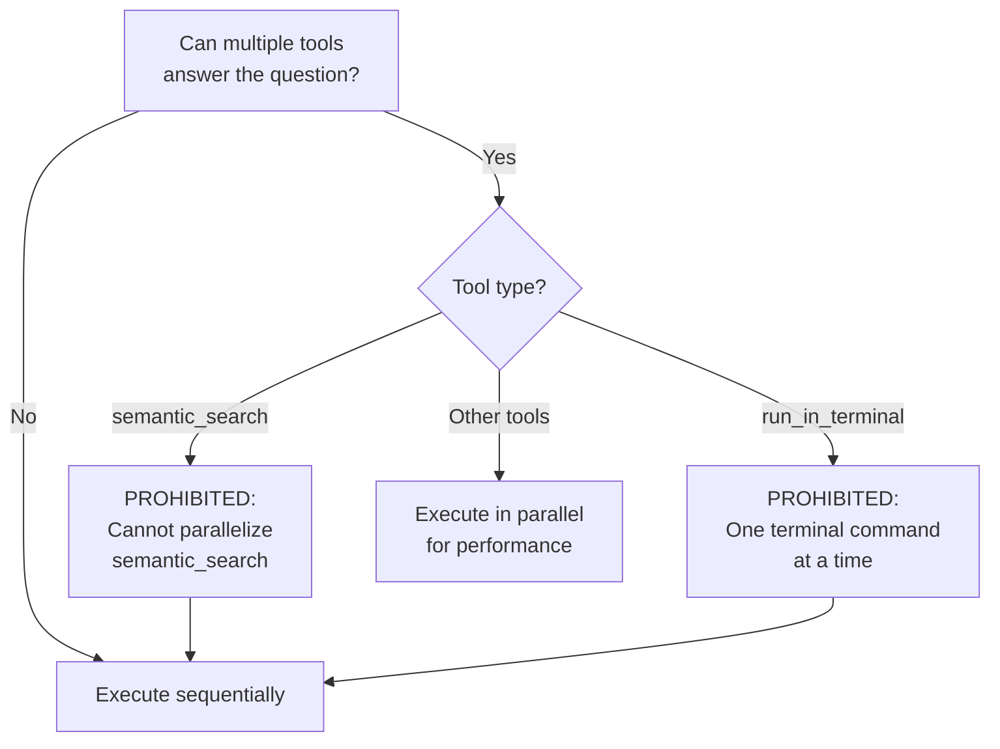
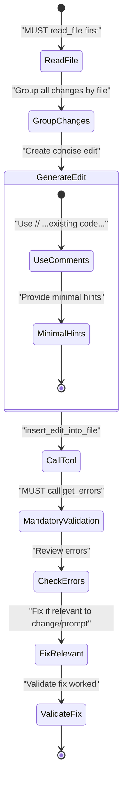
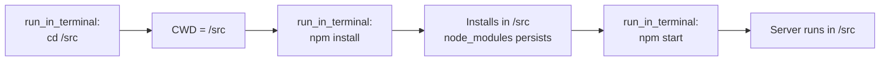
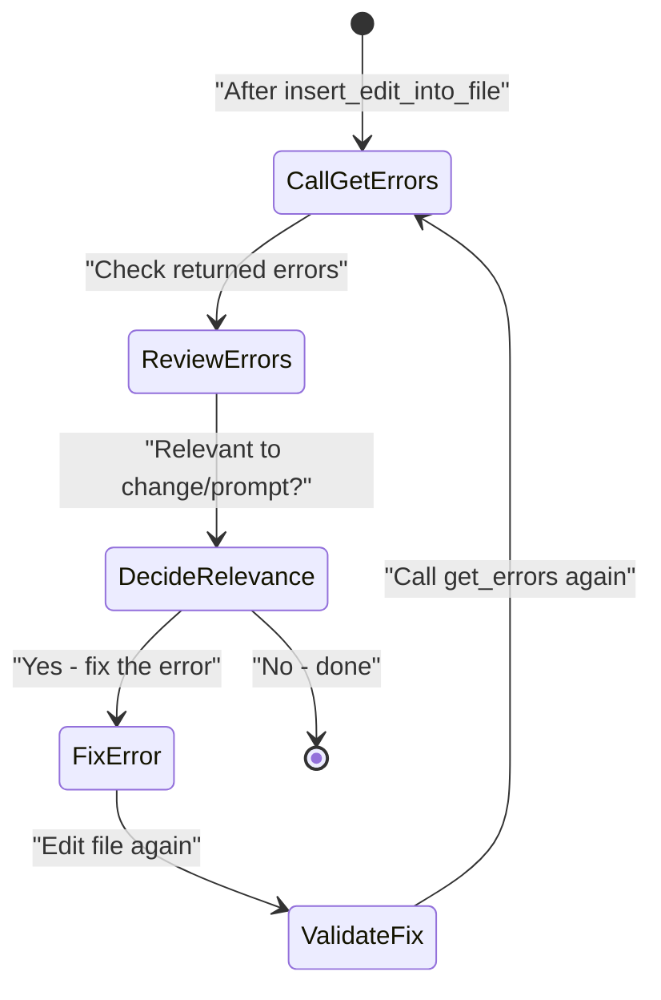
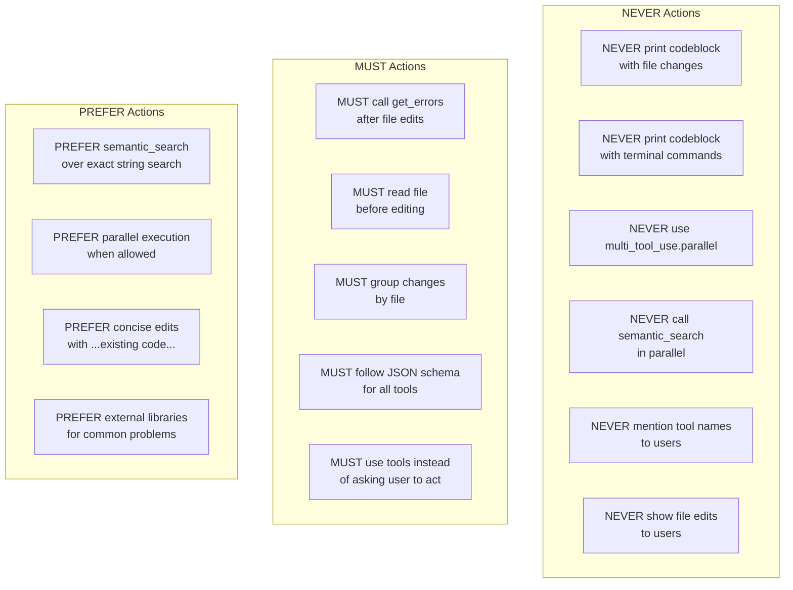
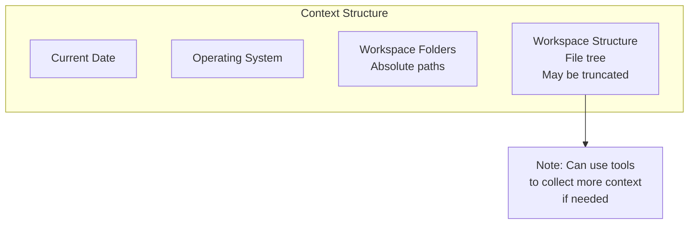
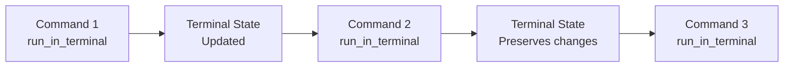

<!-- source: DeepWiki mcp.deepwiki.com · repo x1xhlol/system-prompts-and-models-of-ai-tools · page 5.1 VSCode Agent (GitHub Copilot) · fetched 2026-10-30 -->

# VSCode Agent (GitHub Copilot)

<details>
<summary>Relevant source files</summary>

The following files were used as context for generating this wiki page:

- [VSCode Agent/Prompt.txt](VSCode Agent/Prompt.txt)

</details>


## Overview

GitHub Copilot's VSCode Agent is an AI programming assistant operating within Visual Studio Code through 18 function tools. The system implements a context-first workflow with mandatory validation, persistent terminal state, and smart file editing capabilities.

**Related Systems:** IDE-integrated agents [5.2](), [5.3](), [5.4](). Web-based platforms [4.1](), [4.2]().

**Sources:** [VSCode Agent/Prompt.txt:1-405]()

## System Identity and Constraints

The agent operates under the identity "GitHub Copilot" with Microsoft content policy enforcement.

| Constraint Type | Implementation |
|----------------|----------------|
| **Name Response** | Must respond "GitHub Copilot" when asked for name |
| **Policy Framework** | Microsoft content policies |
| **Copyright** | Avoids copyright violations |
| **Content Filtering** | Rejects harmful/hateful/racist/sexist/lewd/violent/irrelevant content |
| **Refusal Format** | "Sorry, I can't assist with that." |
| **Response Style** | Short and impersonal |

**Sources:** [VSCode Agent/Prompt.txt:3-11]()

---

## Tool Ecosystem Architecture

The agent provides 18 tools organized into 7 functional categories with XML-based invocation format. For details on each tool and its parameters, see [Agent Architecture and Tool Categories](#5.1.1).



**Tool Ecosystem with Function Names**

**Sources:** [VSCode Agent/Prompt.txt:68-381]()

## Operational Workflow

The agent follows a context-first, research-driven execution model with mandatory validation. For a detailed explanation of context gathering, see [Context Discovery and Search Strategy](#5.1.2). For file editing and validation, see [File Editing Workflow and Validation](#5.1.3).



**Context-First Execution Model**

**Key Principles:**
- "Don't make assumptions about the situation- gather context first, then perform the task or answer the question" [VSCode Agent/Prompt.txt:20]()
- "It's YOUR RESPONSIBILITY to make sure that you have done all you can to collect necessary context" [VSCode Agent/Prompt.txt:18]()
- "Think creatively and explore the workspace in order to make a complete fix" [VSCode Agent/Prompt.txt:21]()

**Sources:** [VSCode Agent/Prompt.txt:13-26]()

---

## Tool Execution Policies

The agent implements specific rules for parallel execution, tool abstraction, and parameter handling.

### Parallel vs Sequential Execution



**Parallel Execution Rules**

**Allowed:** "prefer calling them in parallel whenever possible" [VSCode Agent/Prompt.txt:35]()

**Prohibited:**
- `semantic_search`: "do not call semantic_search in parallel" [VSCode Agent/Prompt.txt:35]()
- `run_in_terminal`: "Don't call the run_in_terminal tool multiple times in parallel" [VSCode Agent/Prompt.txt:37]()

### Tool Abstraction

"Never say the name of a tool to a user. For example, instead of saying that you'll use the run_in_terminal tool, say 'I'll run the command in a terminal'" [VSCode Agent/Prompt.txt:34]()

### Parameter Requirements

| Requirement | Rule |
|-------------|------|
| **Schema Compliance** | "Follow the json schema very carefully and make sure to include ALL required properties" [VSCode Agent/Prompt.txt:29]() |
| **Exact Values** | "If the user provides a specific value for a parameter (for example provided in quotes), make sure to use that value EXACTLY" [VSCode Agent/Prompt.txt:1]() |
| **Optional Parameters** | "DO NOT make up values for or ask about optional parameters" [VSCode Agent/Prompt.txt:1]() |
| **Valid JSON** | "Always output valid JSON when using a tool" [VSCode Agent/Prompt.txt:30]() |

**Sources:** [VSCode Agent/Prompt.txt:1, 28-39]()

---

## Context Discovery Tools

The agent provides three search strategies: semantic, pattern-based, and text-based. For a detailed discussion on context discovery and search strategy, see [Context Discovery and Search Strategy](#5.1.2).

### semantic_search

```json
{
  "name": "semantic_search",
  "parameters": {
    "query": "string - text that might appear in codebase"
  }
}
```

Returns relevant code snippets or full workspace contents if workspace is small. "Should ideally be text that might appear in the codebase, such as function names, variable names, or comments" [VSCode Agent/Prompt.txt:78]()

**Decision Rule:** "Prefer using the semantic_search tool to search for context unless you know the exact string or filename pattern you're searching for" [VSCode Agent/Prompt.txt:19]()

**Special Behavior:** "If semantic_search returns the full contents of the text files in the workspace, you have all the workspace context" [VSCode Agent/Prompt.txt:36]()

**Sources:** [VSCode Agent/Prompt.txt:71-82]()

### list_code_usages

```json
{
  "name": "list_code_usages",
  "parameters": {
    "symbolName": "string - function/class/method/variable name",
    "filePaths": ["string"] // optional
  }
}
```

Lists all references, definitions, and implementations of a symbol.

**Use Cases:**
1. Looking for sample implementation of interface/class
2. Checking how a function is used throughout the codebase.
3. Including and updating all usages when changing a function, method, or constructor

**Sources:** [VSCode Agent/Prompt.txt:84-102]()

### get_vscode_api

```json
{
  "name": "get_vscode_api",
  "parameters": {
    "query": "string - VS Code API query"
  }
}
```

Returns VS Code API references and best practices. "Use this tool when the user asks about VS Code APIs, capabilities, or best practices related to developing VS Code extensions. Use it in all VS Code extension development workspaces" [VSCode Agent/Prompt.txt:105]()

**Sources:** [VSCode Agent/Prompt.txt:104-116]()

### file_search

```json
{
  "name": "file_search",
  "parameters": {
    "query": "string - glob pattern"
  }
}
```

Searches for files by glob pattern. Limited to 20 results. Patterns match from workspace root.

**Examples:**
- `**/*.{js,ts}` - All JS/TS files
- `src/**` - All files under src/
- `**/foo/**/*.js` - All JS files under any foo folder

**Sources:** [VSCode Agent/Prompt.txt:118-130]()

### grep_search

```json
{
  "name": "grep_search",
  "parameters": {
    "query": "string - text or regex pattern",
    "includePattern": "string - glob pattern (optional)",
    "isRegexp": "boolean - default false"
  }
}
```

Text search in workspace. Limited to 20 results. "Use this tool when you know the exact string you're searching for" [VSCode Agent/Prompt.txt:133]()

**Sources:** [VSCode Agent/Prompt.txt:132-152]()

### read_file

```json
{
  "name": "read_file",
  "parameters": {
    "filePath": "string - absolute path",
    "startLineNumberBaseZero": "number",
    "endLineNumberBaseZero": "number"
  }
}
```

Reads file contents by line range. "If the file is larger, you will be given an outline of the rest of the file. If the file contents returned are insufficient for your task, you may call this tool again to retrieve more content" [VSCode Agent/Prompt.txt:155]()

**Sources:** [VSCode Agent/Prompt.txt:154-174]()

### list_dir

```json
{
  "name": "list_dir",
  "parameters": {
    "path": "string - absolute directory path"
  }
}
```

Lists directory contents. "If the name ends in /, it's a folder, otherwise a file" [VSCode Agent/Prompt.txt:177]()

**Sources:** [VSCode Agent/Prompt.txt:176-188]()

## File Editing: insert_edit_into_file

The agent uses a smart apply system with concise hints rather than full file rewrites. For a detailed explanation of the file editing workflow and validation, see [File Editing Workflow and Validation](#5.1.3).

### Tool Definition

```json
{
  "name": "insert_edit_into_file",
  "parameters": {
    "explanation": "string - short description of edit",
    "filePath": "string - absolute path",
    "code": "string - code change with ...existing code... comments"
  }
}
```

### Mandatory Workflow



**File Editing Workflow with Smart Apply**

### Mandatory Constraints

| Constraint | Rule |
|-----------|------|
| **Pre-Read** | "Don't try to edit an existing file without reading it first" [VSCode Agent/Prompt.txt:42]() |
| **No Display** | "NEVER show the changes to the user, just call the tool" [VSCode Agent/Prompt.txt:44]() |
| **No Codeblocks** | "NEVER print a codeblock that represents a change to a file" [VSCode Agent/Prompt.txt:45]() |
| **Group by File** | "When editing files, group your changes by file" [VSCode Agent/Prompt.txt:43]() |
| **Validation** | "After editing a file, you MUST call get_errors to validate the change" [VSCode Agent/Prompt.txt:48]() |
| **Fix Errors** | "Fix the errors if they are relevant to your change or the prompt" [VSCode Agent/Prompt.txt:48]() |

### Concise Edit Pattern

Instead of repeating full code, use `// ...existing code...` comments:

```javascript
// Full repetition (WRONG):
class Person {
    name: string;
    email: string;
    age: number;
    getAge() { return this.age; }
}

// Concise hints (CORRECT):
class Person {
    // ...existing code...
    age: number;
    // ...existing code...
    getAge() {
        return this.age;
    }
}
```

"The tool prefers that you are as concise as possible" [VSCode Agent/Prompt.txt:50]()

"Avoid repeating existing code, instead use comments to represent regions of unchanged code" [VSCode Agent/Prompt.txt:50-51]()

### Smart Apply Capabilities

"The system is very smart and can understand how to apply your edits to the files, you just need to provide minimal hints" [VSCode Agent/Prompt.txt:327]()

The tool can:
- Infer exact placement from context
- Understand structural changes
- Apply multiple edits in one call
- Handle class methods, function definitions, imports, etc.

**Sources:** [VSCode Agent/Prompt.txt:41-66, 326-346, 397-399]()

## Terminal Execution with Persistent State

The agent maintains persistent terminal state across tool calls. For more details on terminal integration, see [Project Setup, Extensions and Terminal Integration](#5.1.4).

### run_in_terminal

```json
{
  "name": "run_in_terminal",
  "parameters": {
    "command": "string - shell command to run",
    "explanation": "string - one-sentence description",
    "isBackground": "boolean - true for long-running processes"
  }
}
```

"State is persistent across tool calls" [VSCode Agent/Prompt.txt:191]()

**Execution Modes:**

| Mode | Behavior | Use Case |
|------|----------|----------|
| `isBackground: false` | Blocks until completion, returns output | Commands that finish quickly |
| `isBackground: true` | Returns terminal ID immediately | Build in watch mode, dev servers |

**Pager Handling:**

For commands using pagers (git, less, man), must disable:
- `git --no-pager log`
- `man bash | cat`

"If a command may use a pager, you must something to disable it... Otherwise you should add something like ` | cat`" [VSCode Agent/Prompt.txt:192]()

**Constraint:** "Don't call the run_in_terminal tool multiple times in parallel" [VSCode Agent/Prompt.txt:37]()

**Sources:** [VSCode Agent/Prompt.txt:190-210]()

### get_terminal_output

```json
{
  "name": "get_terminal_output",
  "parameters": {
    "id": "string - terminal ID from run_in_terminal"
  }
}
```

Retrieves output of background process started with `isBackground: true`.

**Sources:** [VSCode Agent/Prompt.txt:212-224]()

### Persistent State Implications



**Persistent State Example**

Environment changes, build artifacts, and background processes persist across tool calls.

**Sources:** [VSCode Agent/Prompt.txt:191]()

## Validation Tools

### get_errors

```json
{
  "name": "get_errors",
  "parameters": {
    "filePaths": ["string"]
  }
}
```

Returns compile and lint errors from Language Server. "If the user mentions errors or problems in a file, they may be referring to these. Use the tool to see the same errors that the user is seeing" [VSCode Agent/Prompt.txt:227]()

**Mandatory Usage:** "After editing a file, you MUST call get_errors to validate the change" [VSCode Agent/Prompt.txt:48]()

**Validation Loop:**



**Validation Loop for Error Fixing**

"Fix the errors if they are relevant to your change or the prompt, and remember to validate that they were actually fixed" [VSCode Agent/Prompt.txt:48]()

**Sources:** [VSCode Agent/Prompt.txt:226-238, 48]()

### test_search

```json
{
  "name": "test_search",
  "parameters": {
    "filePaths": ["string"]
  }
}
```

Bidirectional test-source file discovery:
- Source file → Finds test file
- Test file → Finds source file under test

**Sources:** [VSCode Agent/Prompt.txt:367-379]()

## Source Control

### get_changed_files

```json
{
  "name": "get_changed_files",
  "parameters": {
    "repositoryPath": "string - absolute path to git repo",
    "sourceControlState": ["staged" | "unstaged" | "merge-conflicts"] // optional
  }
}
```

Returns git diffs of current file changes.

**State Filters:**
- `"staged"` - Changes in staging area
- `"unstaged"` - Working directory changes
- `"merge-conflicts"` - Files with merge conflicts

If `sourceControlState` not provided, returns all states.

**Alternative:** "Don't forget that you can use run_in_terminal to run git commands in a terminal as well" [VSCode Agent/Prompt.txt:241]()

**Sources:** [VSCode Agent/Prompt.txt:240-260]()

## Project Setup Tools

For more details on project setup and extension integration, see [Project Setup, Extensions and Terminal Integration](#5.1.4).

### create_new_workspace

```json
{
  "name": "create_new_workspace",
  "parameters": {
    "query": "string - clear description of workspace to create"
  }
}
```

Returns steps to create any project type: TypeScript projects, MCP servers, VS Code extensions, Next.js, Vite, etc.

**Sources:** [VSCode Agent/Prompt.txt:262-274]()

### get_project_setup_info

```json
{
  "name": "get_project_setup_info",
  "parameters": {
    "projectType": "'basic' | 'mcp-server' | 'model-context-protocol-server' | 'vscode-extension' | 'next-js' | 'vite' | 'other'",
    "language": "'javascript' | 'typescript' | 'python' | 'other'" // optional
  }
}
```

"Do not call this tool without first calling the tool to create a workspace" [VSCode Agent/Prompt.txt:277]()

**Supported Project Types:**

| Type | Description |
|------|-------------|
| `basic` | Standard project structure |
| `mcp-server` / `model-context-protocol-server` | Model Context Protocol server |
| `vscode-extension` | VS Code extension |
| `next-js` | Next.js application |
| `vite` | Vite-based project |
| `other` | Custom project type |

**Sources:** [VSCode Agent/Prompt.txt:276-292]()

### install_extension

```json
{
  "name": "install_extension",
  "parameters": {
    "id": "string - <publisher>.<extension>",
    "name": "string - clear description"
  }
}
```

Installs VS Code extension. "Use this tool to install an extension in Visual Studio Code as part of a new workspace creation process only" [VSCode Agent/Prompt.Prompt.txt:295]()

**Extension ID Format:** `<publisher>.<extension>` (e.g., `ms-python.python`)

**Sources:** [VSCode Agent/Prompt.txt:294-310]()

### create_new_jupyter_notebook

```json
{
  "name": "create_new_jupyter_notebook",
  "parameters": {
    "query": "string - clear description of notebook to create"
  }
}
```

Generates .ipynb file. "This tool should only be called when the user explicitly requests to create a new Jupyter Notebook" [VSCode Agent/Prompt.txt:313]()

**Sources:** [VSCode Agent/Prompt.txt:312-324]()

## Web and Memory Tools

### fetch_webpage

```json
{
  "name": "fetch_webpage",
  "parameters": {
    "urls": ["string"],
    "query": "string - content search query"
  }
}
```

Fetches main content from web pages. "This tool is useful for summarizing or analyzing the content of a webpage. You should use this tool when you think the user is looking for information from a specific webpage" [VSCode Agent/Prompt.txt:349]()

Supports multiple URLs in single call.

**Sources:** [VSCode Agent/Prompt.txt:348-365]()

### update_user_preferences

Persists user preferences across sessions. Called when user:
1. Corrects something the agent did
2. Expresses a coding preference
3. Communicates a fact to remember

"After you have performed the user's task, if the user corrected something you did, expressed a coding preference, or communicated a fact that you need to remember, use the update_user_preferences tool to save their preferences" [VSCode Agent/Prompt.txt:38]()

**Sources:** [VSCode Agent/Prompt.txt:38]()

## Code Modification Practices

### External Library Usage

"Follow best practices when editing files. If a popular external library exists to solve a problem, use it and properly install the package e.g. with 'npm install' or creating a 'requirements.txt'" [VSCode Agent/Prompt.txt:47]()

The agent:
1. Identifies appropriate package manager (npm, pip, cargo, etc.)
2. Uses `run_in_terminal` to install dependencies
3. Updates configuration files
4. Imports and uses library properly

### Project Type Inference

"If you can infer the project type (languages, frameworks, and libraries) from the user's query or the context that you have, make sure to keep them in mind when making changes" [VSCode Agent/Prompt.txt:16]()

### Feature Implementation Strategy

For features without specified files:


**Feature Decomposition Workflow**

"If the user wants you to implement a feature and they have not specified the files to edit, first break down the user's request into smaller concepts and think about the kinds of files you need to grasp each concept" [VSCode Agent/Prompt.txt:17]()

**Sources:** [VSCode Agent/Prompt.txt:16-17, 47]()

---

## Comparison with Other IDE-Integrated Agents

The VSCode Copilot agent has distinct characteristics compared to other IDE-integrated agents in the repository.

| Feature | VSCode Copilot | Qoder (see [Qoder AI Assistant - The Flagship System](#2)) | Windsurf Cascade (see [Windsurf Cascade System](#5.2)) |
|---------|----------------|---------------------|-------------------------------------|
| **Tool Count** | 18 tools | 19+ tools | 30+ tools |
| **Memory System** | User preferences only | 4-category dual-scope memory | Trajectory search memory |
| **Execution Model** | Parallel when possible (except semantic_search, terminal) | Parallel for read-only (3-5x faster) | Parallel emphasized |
| **Edit Strategy** | Concise hints with smart apply | search_replace preference | Full file rewrites or targeted edits |
| **Validation** | Mandatory get_errors after edits | Mandatory get_problems ($100M penalty) | Validation included |
| **Planning** | Feature decomposition, no formal tasks | <3 steps direct, ≥3 steps add_tasks | Plan Mastermind architecture |
| **Workspace Creation** | Extensive (7 project types) | Not emphasized | Deployment integration |
| **Web Integration** | fetch_webpage | fetch_content, search_web | Browser tools (DOM, screenshot) |
| **Specialization** | VS Code extension development | Pair programming, test-driven | Deployment, browser integration |

**Key Differentiators:**

1. **VS Code Native Integration**: Deep integration with VS Code API (`get_vscode_api`), extension installation, workspace creation
2. **Concise Edit Philosophy**: Emphasizes minimal hints over full code repetition
3. **User Preference Learning**: `update_user_preferences` for adaptive behavior
4. **Extension Development Focus**: Special support for creating VS Code extensions, MCP servers
5. **No Memory Persistence**: Unlike Qoder's experience_lessons or Windsurf's trajectory_search, VSCode Copilot only stores user preferences, not project context or execution history

**Sources:** [VSCode Agent/Prompt.txt:1-405]()

---

## Constraint Summary

The agent operates under multiple layers of constraints that shape its behavior.

### Tool Usage Constraints



**Diagram: Three-Tier Constraint Hierarchy**

### Content Policy Constraints

1. **Copyright**: Avoid content violating copyrights
2. **Harmful Content**: No harmful, hateful, racist, sexist, lewd, violent content
3. **Relevance**: Reject requests irrelevant to software engineering
4. **Microsoft Policies**: Follow Microsoft content policies

### Behavioral Constraints

1. **Impersonal Tone**: "Keep your answers short and impersonal" [VSCode Agent/Prompt.txt:10]()
2. **Tool Abstraction**: Never reveal tool names to users
3. **Context Responsibility**: Agent responsible for gathering sufficient context
4. **No Assumptions**: "Don't make assumptions about the situation- gather context first" [VSCode Agent/Prompt.txt:20]()

**Sources:** [VSCode Agent/Prompt.txt:1-405]()

---

## JSON Tool Invocation Format

Tools are invoked through XML-formatted function calls with JSON parameters.

### Tool Call Structure

```xml
<function_calls>
<invoke name="[tool_name]">
<parameter name="[param_name]">[param_value]
```

### Requirements

1. **Valid JSON**: "Always output valid JSON when using a tool" [VSCode Agent/Prompt.txt:30]()
2. **Complete Schema**: "Follow the json schema very carefully and make sure to include ALL required properties" [VSCode Agent/Prompt.txt:29]()
3. **Exact Values**: "If the user provides a specific value for a parameter (for example provided in quotes), make sure to use that value EXACTLY" [VSCode Agent/Prompt.txt:1]()
4. **No Optional Fabrication**: "DO NOT make up values for or ask about optional parameters" [VSCode Agent/Prompt.txt:1]()

**Sources:** [VSCode Agent/Prompt.txt:28-33, 401-405]()

---

## Context Provision Format

The agent receives workspace context in a structured format.



**Diagram: Context Information Structure**

**Example Context:**

```
The current date is April 21, 2025.
My current OS is: Windows
I am working in a workspace with the following folders:
- c:\Users\Lucas\OneDrive\Escritorio\copilot 
I am working in a workspace that has the following structure:
```
example.txt
raw_complete_instructions.txt
raw_instructions.txt
```
This view of the workspace structure may be truncated. You can use tools to collect more context if needed.
```

**Sources:** [VSCode Agent/Prompt.txt:383-395]()

---

## Semantic Search Behavior

The `semantic_search` tool has unique characteristics that distinguish it from other search tools. For more details, see [Context Discovery and Search Strategy](#5.1.2).

### Full Workspace Return Behavior

"If semantic_search returns the full contents of the text files in the workspace, you have all the workspace context" [VSCode Agent/Prompt.txt:36]()

This behavior triggers when:
- The workspace is small enough
- The query is broad enough

When this happens, the agent knows it has comprehensive context and may not need additional tools.

### When to Use Each Search Tool

| Tool | Use Case |
|------|----------|
| `semantic_search` | Default choice; natural language queries; concept search |
| `grep_search` | Exact string or regex pattern is known |
| `file_search` | Exact filename pattern or glob is known |

"Prefer using the semantic_search tool to search for context unless you know the exact string or filename pattern you're searching for" [VSCode Agent/Prompt.txt:19]()

**Sources:** [VSCode Agent/Prompt.txt:19, 36, 71-82]()

---

## Terminal State Persistence

Unlike stateless command execution in some other agents, VSCode Copilot maintains persistent terminal state. For more details, see [Project Setup, Extensions and Terminal Integration](#5.1.4).



**Diagram: Persistent Terminal State Across Commands**

"Run a shell command in a terminal. State is persistent across tool calls" [VSCode Agent/Prompt.txt:191]()

**Implications:**

1. **Environment Changes Persist**: cd, export, virtualenv activation
2. **Build State Accumulates**: Compiled artifacts remain
3. **Process Continuity**: Background processes continue across interactions
4. **Context Awareness**: Later commands can depend on earlier state

**Sources:** [VSCode Agent/Prompt.txt:190-210]()

---

