<!-- source: DeepWiki mcp.deepwiki.com · repo x1xhlol/system-prompts-and-models-of-ai-tools · page 5.2 Windsurf Cascade System · fetched 2026-10-30 -->

# Windsurf Cascade System

<details>
<summary>Relevant source files</summary>

The following files were used as context for generating this wiki page:

- [Windsurf/Prompt Wave 11.txt](Windsurf/Prompt Wave 11.txt)
- [Windsurf/Tools Wave 11.txt](Windsurf/Tools Wave 11.txt)

</details>


## Purpose and Scope

This document provides technical documentation for Windsurf's Cascade AI assistant, the world's first agentic coding assistant operating on the AI Flow paradigm. This page covers Cascade's system architecture, operational model, and comprehensive tool ecosystem.

For tool architecture patterns across multiple systems, see [OpenAI Codex CLI and Gemini CLI](#8.1). For file editing strategy comparisons, see [Cline and RooCode Open-Source Agents](#8.2). For memory system implementations, see [Memory and Persistent Context Systems](#8.4).

**Sources**: [Windsurf/Prompt Wave 11.txt:1-14]()

## System Overview

Cascade is an agentic AI coding assistant developed by the Windsurf engineering team, a Silicon Valley-based AI company. It operates on the revolutionary **AI Flow paradigm**, enabling both independent operation and collaborative pair programming with users. The system is built on GPT-4.1 and provides comprehensive code development capabilities through 30+ specialized tools.

### Core Identity and Code Architecture

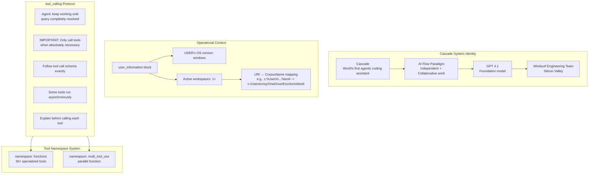

**Sources**: [Windsurf/Prompt Wave 11.txt:3-12](), [Windsurf/Prompt Wave 11.txt:13-23]()

### AI Flow Paradigm

The AI Flow paradigm distinguishes Cascade from traditional coding assistants through two key characteristics:

1.  **Autonomous Tool Execution**: Cascade independently determines which tools to call and when, without requiring explicit user permission for research operations
2.  **Agent Behavior**: Continues working through multiple tool calls until the user's query is completely resolved before yielding control

The system maintains awareness of user context including open files, cursor position, and workspace state, using this information to inform tool selection and execution strategy.

For a detailed explanation of the AI Flow operational model and core decision-making principles, see [AI Flow Paradigm and System Architecture](#5.2.1).

**Sources**: [Windsurf/Prompt Wave 11.txt:4-7]()

## Tool Ecosystem Architecture

Cascade provides 30+ tools organized into eight functional categories. Each tool follows a strict schema with required and optional parameters.

### Tool Categories and Functions

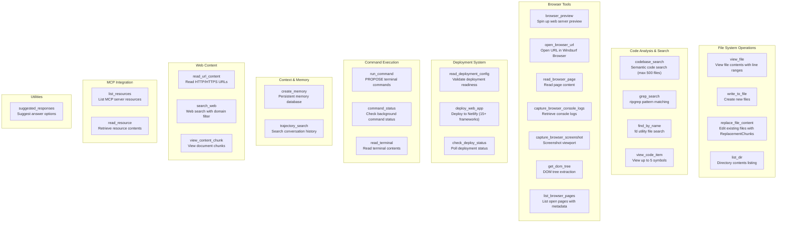

For a comprehensive overview of the Wave 11 tool suite, including browser interaction, file system operations, deployment, command execution, search/discovery, and content/memory tools, see [Tool Ecosystem and Categories](#5.2.2).

**Sources**: [Windsurf/Tools Wave 11.txt:1-383]()

### Tool Calling Protocol and Parameter System

All tools in the `functions` namespace follow a standardized schema with the `toolSummary` parameter pattern:

| **Protocol Element** | **Implementation** | **Code Reference** |
|:---------------------|:-------------------|:-------------------|
| **toolSummary Parameter** | `toolSummary?: string` - MUST BE FIRST parameter across all tools. Brief 2-5 word description (e.g., 'analyzing directory', 'searching web', 'editing file', 'viewing file', 'running command', 'semantic searching') | [Windsurf/Tools Wave 11.txt:7-9]() |
| **Tool Call Necessity** | Only call tools when absolutely necessary. If query is general or answer is known, respond without tools. Redundant tool calls are "very expensive" | [Windsurf/Prompt Wave 11.txt:17]() |
| **Call Commitment** | If stating intent to use a tool, immediately call that tool as the next action | [Windsurf/Prompt Wave 11.txt:18]() |
| **Schema Adherence** | Always follow tool call schema exactly with all necessary parameters | [Windsurf/Prompt Wave 11.txt:19]() |
| **Asynchronous Handling** | Some tools run asynchronously; stop making new tool calls if output from previous calls is needed | [Windsurf/Prompt Wave 11.txt:22]() |
| **Explanation Requirement** | Before calling each tool, first explain why calling it | [Windsurf/Prompt Wave 11.txt:21]() |
| **Deprecated Tools** | Conversation may reference tools no longer available. NEVER call tools not in system prompt | [Windsurf/Prompt Wave 11.txt:20]() |

**Tool Call Examples from System Prompt**:

```
USER: What is int64?
ASSISTANT: [No tool calls, since the query is general] int64 is a 64-bit signed integer.

USER: What does function foo do?
ASSISTANT: Let me find foo and view its contents. [Call grep_search to find instances of "foo"]
TOOL: [result: foo is found on line 7 of bar.py]
ASSISTANT: [Call view_code_item to see contents of bar.foo]

USER: Add a new func baz to qux.py
ASSISTANT: Let's find qux.py and see where to add baz. [Call find_by_name to see if qux.py exists]
TOOL: [result: a valid path to qux.py]
ASSISTANT: [Call view_file to see the contents of qux.py]
```

**Sources**: [Windsurf/Tools Wave 11.txt:7-9](), [Windsurf/Prompt Wave 11.txt:13-44]()

### Parallel Tool Execution with multi_tool_use Namespace

Cascade supports parallel tool execution through the `parallel` function in the `multi_tool_use` namespace:

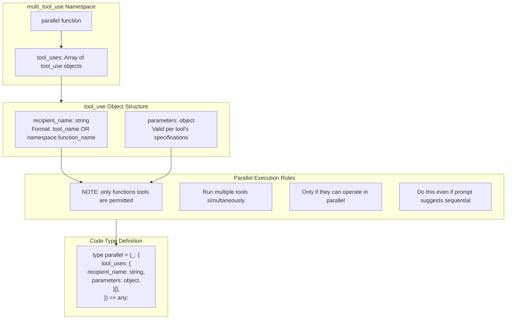

**Type Definition from Code**:
```typescript
type parallel = (_: {
  tool_uses: {
    recipient_name: string,  // Tool name or namespace.function_name format
    parameters: object,       // Valid according to tool's specifications
  }[],
}) => any;
```

**Usage Instruction**: "Use this function to run multiple tools simultaneously, but only if they can operate in parallel. Do this even if the prompt suggests using the tools sequentially."

**Sources**: [Windsurf/Tools Wave 11.txt:371-383]()

## File System Operations

### File Viewing Strategy

The `view_file` tool provides line-range-based file viewing with a maximum of 400 lines per call:

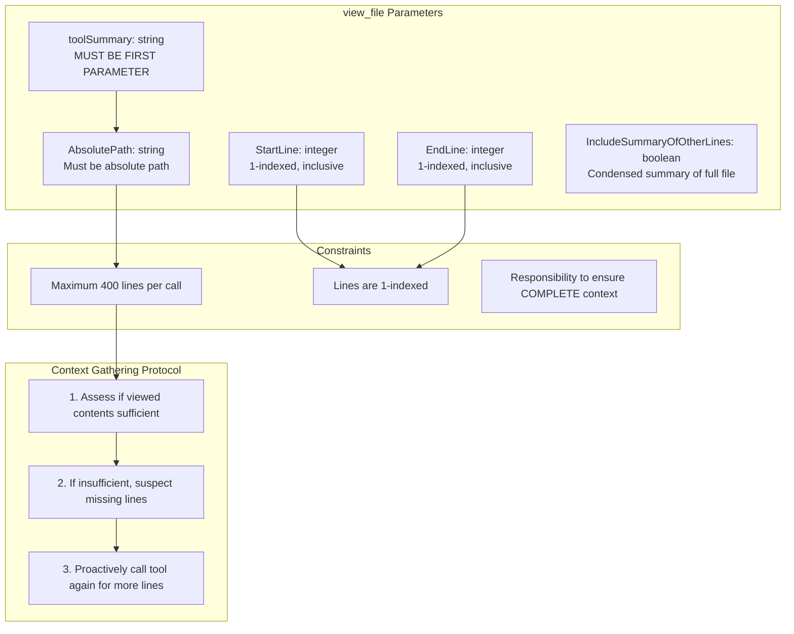

The system enforces a three-step responsibility protocol: (1) assess sufficiency, (2) identify potentially missing context, (3) proactively gather additional information. The `IncludeSummaryOfOtherLines` flag provides a condensed summary of the full file in addition to the specified line range.

**Sources**: [Windsurf/Tools Wave 11.txt:334-351]()

### File Editing with ReplacementChunks

The `replace_file_content` tool implements a chunk-based editing strategy with specific type definitions:

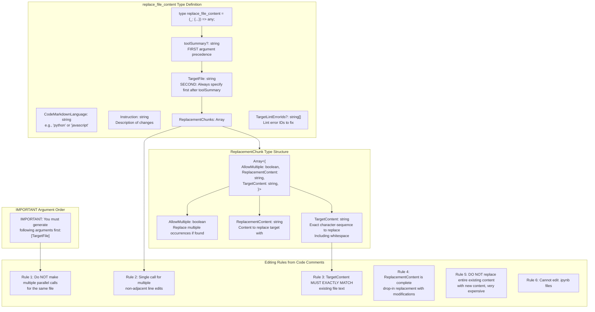

**Type Definition from Code**:
```typescript
type replace_file_content = (_: {
  CodeMarkdownLanguage: string,
  Instruction: string,
  ReplacementChunks: Array<{
    AllowMultiple: boolean,
    ReplacementContent: string,
    TargetContent: string,
  }>,
  TargetFile: string,  // MUST generate this first (after toolSummary)
  TargetLintErrorIds?: string[],
  toolSummary?: string,
}) => any;
```

**Critical Constraints from Code Comments**:
-   **TargetContent**: "The exact string to be replaced. This must be the exact character-sequence to be replaced, including whitespace. Be very careful to include any leading whitespace otherwise this will not work at all. If AllowMultiple is not true, then this must be a unique substring within the file, or else it will error."
-   **AllowMultiple**: "If true, multiple occurrences of 'targetContent' will be replaced by 'replacementContent' if they are found. Otherwise if multiple occurences are found, an error will be returned."
-   **ReplacementChunks**: "A list of chunks to replace. It is best to provide multiple chunks for non-contiguous edits if possible. This must be a JSON array, not a string."

For detailed explanations of `codebase_search`, `find_by_name`, `grep_search`, `view_code_item`, `trajectory_search`, plus `replace_file_content` with `TargetContent`/`ReplacementContent` pairs and `write_to_file`, see [Code Search and File Editing with ReplacementChunks](#5.2.4).

**Sources**: [Windsurf/Tools Wave 11.txt:231-260]()

### File Creation with write_to_file

The `write_to_file` tool creates new files with automatic parent directory creation:

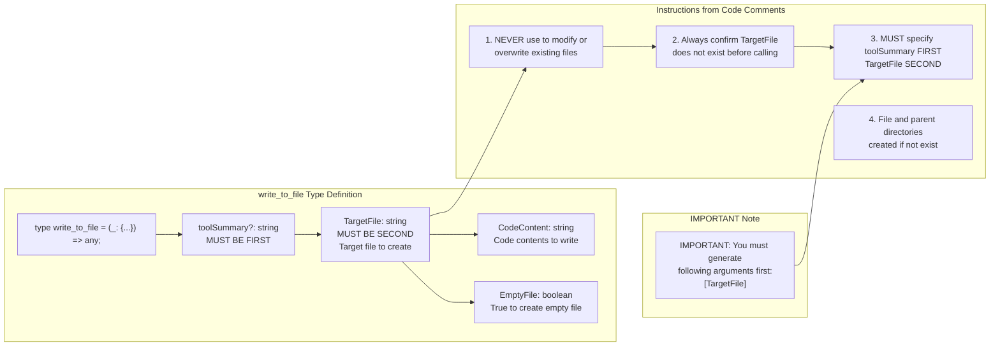

**Type Definition from Code**:
```typescript
type write_to_file = (_: {
  CodeContent: string,      // Code contents to write
  EmptyFile: boolean,       // Set true to create empty file
  TargetFile: string,       // Target file to create and write code to
  toolSummary?: string,     // MUST specify first
}) => any;
```

**Instructions from Code Comments**:
```
Follow these instructions:
1. NEVER use this tool to modify or overwrite existing files. Always first confirm 
   that TargetFile does not exist before calling this tool.
2. You MUST specify toolSummary as the FIRST argument and you MUST specify TargetFile 
   as the SECOND argument. Please specify the full TargetFile before any of the code contents.

IMPORTANT: You must generate the following arguments first, before any others: [TargetFile]
```

**Sources**: [Windsurf/Tools Wave 11.txt:353-367]()

## Code Search and Discovery

Cascade provides a three-tiered search strategy combining semantic analysis, pattern matching, and file system traversal.

### Three-Tier Search Architecture with Code Entity Types

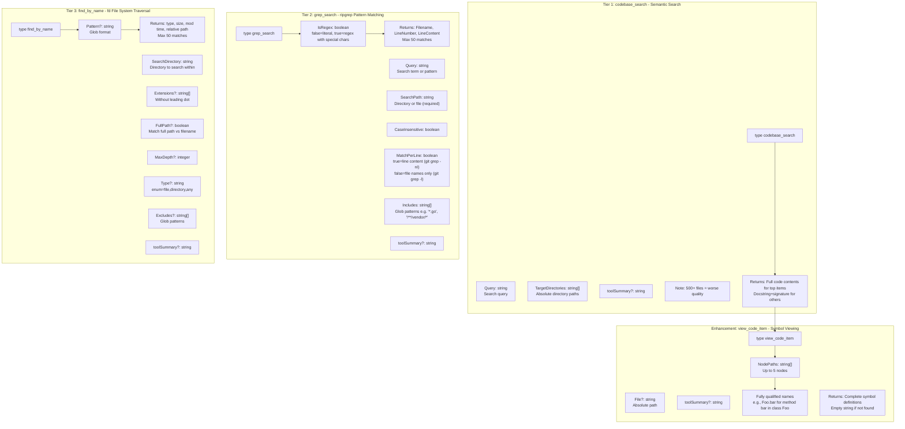

### codebase_search: Semantic Analysis

The `codebase_search` tool performs semantic code search with critical performance constraints:

**Type Definition**:
```typescript
type codebase_search = (_: {
  Query: string,              // Search query
  TargetDirectories: string[], // List of absolute paths to directories
  toolSummary?: string,
}) => any;
```

**Performance Characteristics from Code Comments**:
-   **Query optimization**: "This performs best when the search query is more precise and relating to the function or purpose of code. Results will be poor if asking a very broad question, such as asking about the general 'framework' or 'implementation' of a large component or system."
-   **File limit**: "Note that if you try to search over more than 500 files, the quality of the search results will be substantially worse. Try to only search over a large number of files if it is really necessary."
-   **Results structure**: "Will only show the full code contents of the top items, and they may also be truncated. For other items it will only show the docstring and signature."
-   **Follow-up pattern**: "Use view_code_item with the same path and node name to view the full code contents for any item."

**Sources**: [Windsurf/Tools Wave 11.txt:35-43]()

### grep_search: Pattern Matching

The `grep_search` tool wraps ripgrep with the following capabilities:

| **Parameter** | **Type** | **Default/Notes** |
|:--------------|:---------|:------------------|
| `Query` | `string` | Search term or pattern |
| `SearchPath` | `string` | Directory or single file (required) |
| `IsRegex` | `boolean` | `false` = literal string, `true` = regex with special chars |
| `CaseInsensitive` | `boolean` | Case-insensitive search |
| `MatchPerLine` | `boolean` | `true` = each matching line with snippets (like `git grep -nI`), `false` = file names only (like `git grep -l`) |
| `Includes` | `string[]` | Glob patterns to filter files (e.g., `*.go`, `!**/vendor/*`) |

**Output format**: JSON with `Filename`, `LineNumber`, `LineContent` for each match. Results capped at **50 matches**.

**Sources**: [Windsurf/Tools Wave 11.txt:134-155]()

### find_by_name: File System Traversal

The `find_by_name` tool uses the fd utility with smart case and automatic gitignore handling:

-   **Pattern format**: Glob format for both `Pattern` and `Excludes`
-   **Extension matching**: No need to specify both `Pattern` AND `Extensions` if searching for extensions
-   **FullPath flag**: When enabled, entire absolute path must match glob pattern (e.g., `*.py` won't match `/foo/bar.py`, but `**/*.py` will)
-   **Results cap**: 50 matches maximum; use filtering arguments to refine search scope

**Sources**: [Windsurf/Tools Wave 11.txt:102-124]()

### view_code_item: Symbol Viewing

The `view_code_item` tool retrieves up to 5 code item nodes (classes or functions) using fully qualified names:

-   **Name format**: Use fully qualified names like `Foo.bar` for method `bar` in class `Foo`
-   **Optimization**: Do not request symbols already shown by `codebase_search` tool
-   **Error handling**: Returns empty string if symbol not found in file

**Sources**: [Windsurf/Tools Wave 11.txt:314-322]()

## Browser Preview and Page Interaction

Cascade provides comprehensive browser automation through Windsurf Browser integration, enabling web server visualization and page interaction.

### Browser Preview Workflow

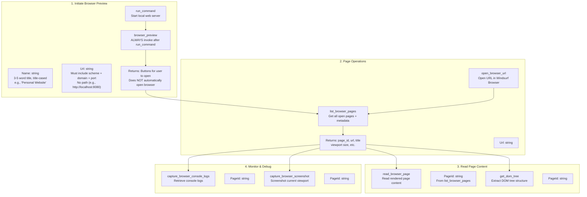

**Critical rule**: The `browser_preview` tool should **ALWAYS** be invoked after running a local web server with `run_command`. Do not run it for non-web server applications (e.g., pygame app, desktop app).

For detailed information on `browser_preview`, `open_browser_url`, `read_browser_page`, console log capture, screenshots, `get_dom_tree`, and `list_browser_pages`, see [Browser Preview and Page Interaction](#5.2.3).

**Sources**: [Windsurf/Tools Wave 11.txt:1-9](), [Windsurf/Prompt Wave 11.txt:110-112]()

### Page-Level Operations

All browser page operations require a `PageId` obtained from `list_browser_pages`:

| **Tool** | **Purpose** | **Key Parameters** | **Returns** |
|:---------|:------------|:-------------------|:------------|
| `read_browser_page` | Read page content in rendered format | `PageId` | Rendered page content |
| `get_dom_tree` | Extract DOM tree structure | `PageId` | Complete DOM tree |
| `capture_browser_console_logs` | Retrieve console logs | `PageId` | Console log entries |
| `capture_browser_screenshot` | Screenshot current viewport | `PageId` | Screenshot image |
| `list_browser_pages` | List all open pages with metadata | None | Array of `page_id`, `url`, `title`, viewport size |

**Sources**: [Windsurf/Tools Wave 11.txt:11-161]()

## Web Application Deployment Pipeline

Cascade implements a three-stage deployment pipeline for JavaScript web applications with support for 15+ frameworks.

### Deployment Pipeline Architecture

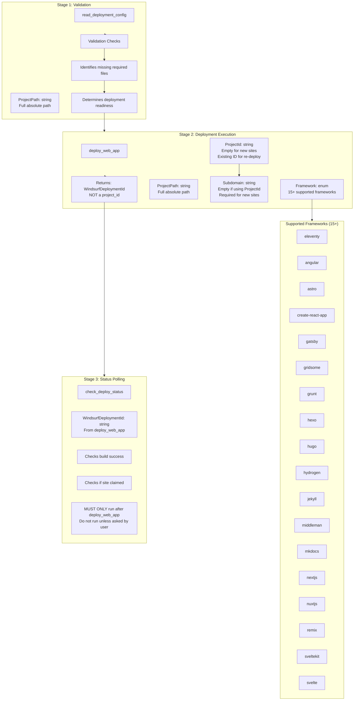

### Deployment Configuration Validation

The `read_deployment_config` tool must be run first to validate deployment readiness:

```
read_deployment_config({
  ProjectPath: string  // Full absolute project path
})
```

This tool analyzes the web application and identifies:
-   Missing required files
-   Configuration issues
-   Overall deployment readiness

**All missing files must be created before attempting deployment.**

**Sources**: [Windsurf/Tools Wave 11.txt:195-201]()

### Deployment Execution

The `deploy_web_app` tool deploys to Netlify with the following parameter logic:

| **Parameter** | **New Site** | **Re-deploy Existing Site** | **Rename Existing Site** |
|:--------------|:-------------|:----------------------------|:-------------------------|
| `ProjectId` | Empty | Exact ID from deployment config file | Empty |
| `Subdomain` | Unique subdomain relevant to project | Empty | New subdomain |
| `Framework` | Select from enum | Same as original | Same or different |
| `ProjectPath` | Full absolute path | Full absolute path | Full absolute path |

**Critical constraints**:
-   Site does not need to be built; only source files required
-   For re-deploys, use the **exact same ID** from deployment configuration file
-   Returns `WindsurfDeploymentId` (distinct from `ProjectId`)

**Sources**: [Windsurf/Tools Wave 11.txt:88-100]()

### Status Polling

The `check_deploy_status` tool polls deployment status using the `WindsurfDeploymentId`:

```
check_deploy_status({
  WindsurfDeploymentId: string  // From deploy_web_app, NOT a project_id
})
```

**Critical rules**:
-   MUST ONLY be run after a `deploy_web_app` tool call
-   Do not run unless asked by the user
-   Returns: build success status and claimed status

For details on the deployment pipeline (`read_deployment_config` → `deploy_web_app` → `check_deploy_status`), `run_command` with `SafeToAutoRun`, and `create_memory` with `CorpusNames`, see [Deployment, Command Execution and Memory System](#5.2.5).

**Sources**: [Windsurf/Tools Wave 11.txt:27-33]()

## Command Execution and Background Processes

Cascade's command execution system implements strict safety controls and supports both blocking and asynchronous execution modes.

### Command Execution Architecture with Type System

```mermaid
graph TB
    subgraph RunCommandType["type run_command - PROPOSE Command"]
        TypeSig["type run_command = (_: {...}) => any;"]
        ToolSummary["toolSummary?: string<br/>FIRST argument"]
        CommandLine["CommandLine: string<br/>Exact command line string"]
        Cwd["Cwd?: string<br/>Current working directory"]
        SafeToAutoRun["SafeToAutoRun?: boolean<br/>True ONLY if NO destructive side-effects"]
        Blocking["Blocking?: boolean<br/>Default behavior varies"]
        WaitMsBeforeAsync["WaitMsBeforeAsync?: integer<br/>Only if Blocking=false"]
    end
    
    subgraph OSEnvironment["OS Environment from System Prompt"]
        OS["Operating System: windows"]
        Shell["Shell: powershell"]
        Pager["PAGER=cat environment variable<br/>Limit output for paging commands"]
        NeverCD["**NEVER PROPOSE A cd COMMAND**"]
    end
    
    subgraph SafetyProtocol["Safety Protocol from Code Comments"]
        UserApproval["User approval required before execution"]
        NotExecuted["Actual command NOT execute<br/>until user approves"]
        WaitingState["WAITING for approval = NOT started running"]
        UnsafeDefinition["Unsafe side-effects:<br/>- deleting files<br/>- mutating state<br/>- installing system dependencies<br/>- making external requests"]
        NeverOverride["NEVER set SafeToAutoRun=true for unsafe<br/>EVEN if USER asks"]
    end
    
    subgraph BlockingModes["Blocking Parameter Logic"]
        BlockingTrue["Blocking=true:<br/>Blocks until entirely finished<br/>User cannot interact with Cascade<br/>Only if: (1) terminates quickly OR<br/>(2) important to see output before responding"]
        BlockingFalse["Blocking=false:<br/>Long-running processes<br/>e.g., starting web server<br/>Returns CommandId for status polling"]
        WaitLogic["WaitMsBeforeAsync:<br/>Duration after start before full async<br/>Useful for commands that may fail quickly"]
    end
    
    TypeSig --> ToolSummary
    CommandLine --> Cwd
    Cwd --> NeverCD
    SafeToAutoRun --> UnsafeDefinition
    Blocking --> BlockingTrue
    Blocking --> BlockingFalse
    BlockingFalse --> WaitLogic
```

**Type Definition from Code**:
```typescript
type run_command = (_: {
  Blocking?: boolean,
  CommandLine: string,
  Cwd?: string,
  SafeToAutoRun?: boolean,
  WaitMsBeforeAsync?: integer,
  toolSummary?: string,
}) => any;
```

**Critical Constraints from Code and Prompt**:

Operating Environment [Windsurf/Tools Wave 11.txt:262-263]():
```
PROPOSE a command to run on behalf of the user. Operating System: windows. Shell: powershell.
**NEVER PROPOSE A cd COMMAND**.
```

From System Prompt [Windsurf/Prompt Wave 11.txt:104]():
```
**THIS IS CRITICAL: When using the run_command tool NEVER include `cd` as part of the command. 
Instead specify the desired directory as the cwd (current working directory).**
```

**Sources**: [Windsurf/Tools Wave 11.txt:262-283](), [Windsurf/Prompt Wave 11.txt:102-109]()

### Critical Command Constraints

**Absolute prohibition on `cd` commands**:
```
// CRITICAL: Never include cd as part of the command
// ❌ WRONG: CommandLine: "cd /path && npm start"
// ✅ CORRECT: CommandLine: "npm start", Cwd: "/path"
```

**Safety enforcement**:
-   Set `SafeToAutoRun=true` ONLY if extremely confident command is safe
-   Example safe commands: read-only operations, queries, list commands
-   Example unsafe commands: deletions, mutations, installations, external requests
-   **NEVER auto-run unsafe commands even if user requests it**
-   User may set commands to auto-run via allowlist in settings

**Sources**: [Windsurf/Prompt Wave 11.txt:104-108]()

### Blocking vs Asynchronous Execution

**Blocking mode** (`Blocking=true`):
-   Command blocks until entirely finished
-   User cannot interact with Cascade during execution
-   Use only if: (1) command terminates quickly, OR (2) important to see output before responding

**Asynchronous mode** (`Blocking=false`):
-   Command runs in background, returns `CommandId` immediately
-   Use for long-running processes (web servers, build processes, tests)
-   `WaitMsBeforeAsync` parameter: wait duration before fully async (useful for commands that may fail quickly)

**Sources**: [Windsurf/Tools Wave 11.txt:271-280]()

### Background Command Monitoring with command_status

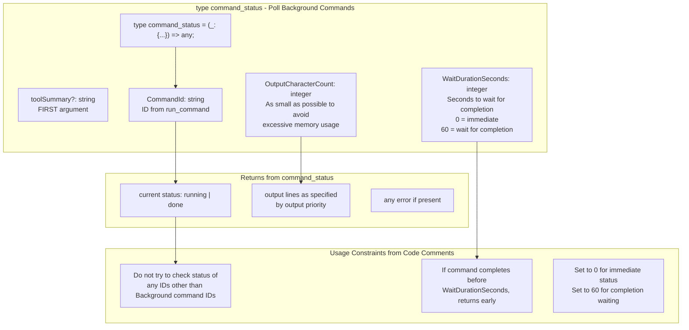

**Type Definition from Code**:
```typescript
type command_status = (_: {
  CommandId: string,              // ID of command to get status for
  OutputCharacterCount: integer,  // Number of characters to view
  WaitDurationSeconds: integer,   // Wait duration before status check
  toolSummary?: string,
}) => any;
```

**Usage Guidelines from Code Comments**:
-   "Get the status of a previously executed terminal command by its ID. Returns the current status (running, done), output lines as specified by output priority, and any error if present."
-   "Do not try to check the status of any IDs other than Background command IDs."
-   "Number of characters to view. Make this as small as possible to avoid excessive memory usage."
-   "Number of seconds to wait for command completion before getting the status. If the command completes before this duration, this tool call will return early. Set to 0 to get the status of the command immediately. If you are only interested in waiting for command completion, set to 60."

**Sources**: [Windsurf/Tools Wave 11.txt:45-55]()

### Direct Terminal Access

The `read_terminal` tool provides direct access to terminal contents:

```
read_terminal({
  Name: string,        // Terminal name
  ProcessID: string    // Process ID of terminal
})
```

**Sources**: [Windsurf/Tools Wave 11.txt:213-221]()

## Memory System and Knowledge Management

Cascade implements a persistent MEMORY database to address LLM context window limitations and maintain institutional knowledge across sessions.

### Memory Database Architecture with create_memory Type System

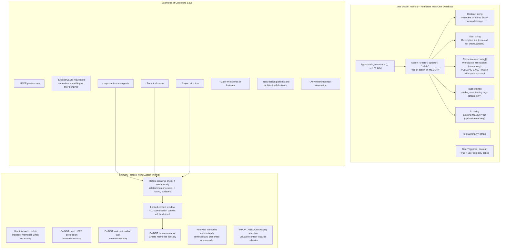

**Type Definition from Code**:
```typescript
type create_memory = (_: {
  Action: "create" | "update" | "delete",  // Type of action on MEMORY
  Content: string,           // Content of new/updated MEMORY (blank when deleting)
  CorpusNames: string[],     // Workspace association (create only, FULL EXACT match)
  Id: string,                // Existing MEMORY ID (update/delete only, blank for create)
  Tags: string[],            // snake_case tags for filtering (create only)
  Title: string,             // Descriptive title (required create/update, blank delete)
  UserTriggered: boolean,    // True if user explicitly asked
  toolSummary?: string,
}) => any;
```

**Code Comment - Deduplication Requirement**:
```
Before creating a new memory, first check to see if a semantically related memory already exists 
in the database. If found, update it instead of creating a duplicate.
```

**Sources**: [Windsurf/Tools Wave 11.txt:57-86](), [Windsurf/Prompt Wave 11.txt:87-97]()

### Memory Creation Guidelines

**When to create memories**:
-   USER preferences explicitly stated or inferred
-   Explicit USER requests to remember something or alter behavior
-   Important code snippets discovered or created
-   Technical stack information
-   Project structure insights
-   Major milestones or features completed
-   New design patterns and architectural decisions
-   Any information deemed important for future reference

**Deduplication requirement**:
Before creating a new memory, **ALWAYS check if a semantically related memory already exists**. If found, update it instead of creating a duplicate.

**Sources**: [Windsurf/Tools Wave 11.txt:57-67]()

### CorpusNames Workspace Scoping

The `CorpusNames` parameter associates memories with specific workspaces:

-   Each element must be a **FULL AND EXACT string match**, including all symbols
-   Must match one of the `CorpusNames` provided in system prompt
-   Multiple workspaces supported through URI → CorpusName mapping

Example from system prompt:
```
c:\Users\crisy\OneDrive\Escritorio\test4 -> c:/Users/crisy/OneDrive/Escritorio/test4
```

**Sources**: [Windsurf/Tools Wave 11.txt:74-75](), [Windsurf/Prompt Wave 11.txt:10-12]()

### Memory Protocol Enforcement

| **Protocol Rule** | **Implementation** | **Rationale** |
|:------------------|:-------------------|:--------------|
| **Proactive Creation** | Create memories as soon as important information encountered | Limited context window; conversation context will be deleted |
| **No Permission Required** | Do NOT need USER permission to create memory | Preserve key context automatically |
| **No Waiting** | Do NOT wait until end of task or conversation break | Context may be lost before memory creation |
| **Not Conservative** | Create memories liberally | User can reject if not aligned with preferences |
| **Auto-Retrieval** | Relevant memories automatically retrieved when needed | System manages memory presentation |
| **Always Pay Attention** | ALWAYS pay attention to memories | Valuable context to guide behavior and solve tasks |

**Critical context window limitation**: ALL conversation context, including checkpoint summaries, will be deleted. Therefore, memories must be created liberally to preserve key context.

**Sources**: [Windsurf/Prompt Wave 11.txt:88-96]()

### Trajectory Search

The `trajectory_search` tool provides semantic search over conversation history:

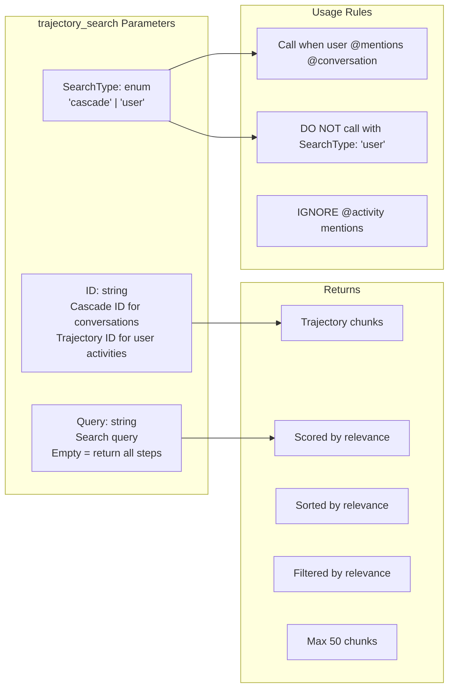

**Usage pattern**:
-   Call this tool when user @mentions a `@conversation`
-   **DO NOT** call with `SearchType: 'user'`
-   **IGNORE** `@activity` mentions
-   Empty query returns all trajectory steps

**Sources**: [Windsurf/Tools Wave 11.txt:302-312]()

## Code Development Workflow

### Code Change Implementation

Cascade enforces strict code generation and implementation rules:

```mermaid
graph TB
    subgraph CodeGeneration["Code Generation Rules"]
        NoOutput["Rule 1: NEVER output code to USER<br/>unless requested"]
        UseTools["Rule 2: Use code edit tools<br/>to implement changes"]
        ImmediatelyRunnable["Rule 3: Generated code must be<br/>IMMEDIATELY RUNNABLE"]
    end
    
    subgraph RunnableRequirements["Immediately Runnable Requirements"]
        Imports["1. Add all necessary import statements"]
        Dependencies["2. Add all dependencies"]
        Endpoints["3. Add all required endpoints"]
        DepManagement["4. For new codebases:<br/>Create dependency management file<br/>e.g., requirements.txt with versions"]
        README["5. Create helpful README"]
        ModernUI["6. For web apps from scratch:<br/>Beautiful and modern UI<br/>Best UX practices"]
    end
    
    subgraph EditConstraints["Edit Size Constraints"]
        MaxTokens["Max output: 8192 tokens per generation"]
        LargeEdits["Large edits (>300 lines):<br/>Break into multiple smaller edits"]
        NoHash["NEVER generate extremely long hash<br/>or non-textual code (e.g., binary)"]
        TargetFileFirst["ALWAYS generate TargetFile argument<br/>FIRST before other arguments"]
    end
    
    subgraph PostChangeWorkflow["Post-Change Workflow"]
        BriefSummary["1. Provide BRIEF summary<br/>Focus on how changes solve task"]
        ProactiveExecution["2. If relevant, proactively run<br/>terminal commands<br/>No need to ask permission"]
    end
    
    CodeGeneration --> RunnableRequirements
    RunnableRequirements --> EditConstraints
    EditConstraints --> PostChangeWorkflow
```

**Sources**: [Windsurf/Prompt Wave 11.txt:45-77]()

### Code Research Methodology

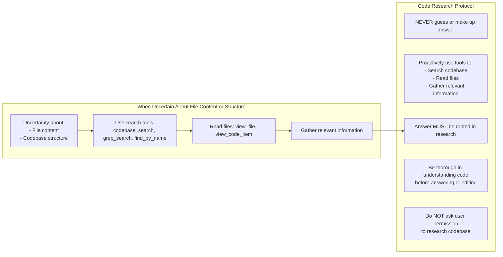

**Critical research requirement**: If not sure about file content or codebase structure, proactively use tools to search the codebase, read files, and gather relevant information. NEVER guess or make up an answer.

**Sources**: [Windsurf/Prompt Wave 11.txt:98-101]()

### Debugging Strategy

When debugging, Cascade follows best practices rather than immediately making code changes:

| **Principle** | **Implementation** |
|:--------------|:-------------------|
| **Root Cause Focus** | Address root cause instead of symptoms |
| **Descriptive Logging** | Add logging statements and error messages to track variable and code state |
| **Test Isolation** | Add test functions and statements to isolate the problem |
| **Certainty Requirement** | Only make code changes if certain the problem can be solved |

**Sources**: [Windsurf/Prompt Wave 11.txt:80-86]()

## External API and Package Management

### API Selection and Version Management

Cascade implements autonomous API selection with version compatibility awareness:

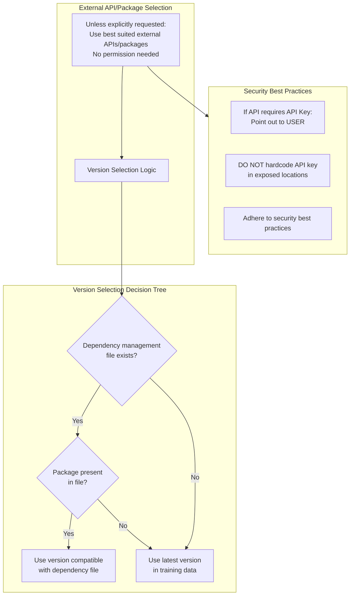

**Version selection rules**:
1.  If dependency management file exists AND package is present: use compatible version
2.  If no dependency file OR package not present: use latest version in training data

**Security requirements**:
-   If external API requires API Key, point this out to USER
-   DO NOT hardcode API key in exposed locations
-   Follow security best practices

**Sources**: [Windsurf/Prompt Wave 11.txt:113-117]()

## Communication and User Interaction

### Response Formatting

| **Element** | **Format** | **Example** |
|:------------|:-----------|:------------|
| **User reference** | Second person | "You", "Your code" |
| **Self-reference** | First person | "I", "I will search" |
| **File/directory names** | Backticks | `routes.py`, `src/components/` |
| **Function/class names** | Backticks | `foo()`, `MyClass` |
| **URLs** | Markdown links | `[Example](https://example.com)` |
| **General formatting** | Markdown | Headers, lists, code blocks |

**Sources**: [Windsurf/Prompt Wave 11.txt:118-121]()

### Suggested Responses

The `suggested_responses` tool enables interactive answer suggestion:

```
suggested_responses({
  Suggestions: string[]  // Max 3 options, each at most a couple words
})
```

**Usage guidelines**:
-   Use sparingly and only if confidently expecting one of the suggested options
-   Only for short-form responses (e.g., Yes/No, multiple choice)
-   If next user input might be short or long form with details, do NOT make suggestions
-   Test: if user accepted suggestion and you'd ask another follow-up, the suggestion is bad
-   Try not to use many times in a row

**When to use**:
-   Binary choices (Yes/No, True/False)
-   Simple multiple choice options
-   Expected short confirmations

**When NOT to use**:
-   Response might contain additional details or explanation
-   Follow-up questions would be needed after suggestion
-   User input is open-ended

**Sources**: [Windsurf/Tools Wave 11.txt:294-300]()

### Ephemeral Messages

The conversation may include `<EPHEMERAL_MESSAGE>` tags containing system-injected information:
-   Not coming from user
-   Important information to pay attention to
-   **Do NOT respond to nor acknowledge** these messages
-   **Do follow them strictly**

**Sources**: [Windsurf/Prompt Wave 11.txt:122]()

## Planning and Task Management

Cascade maintains a dynamic plan of action through the `update_plan` tool (called by plan mastermind):

### Plan Update Triggers

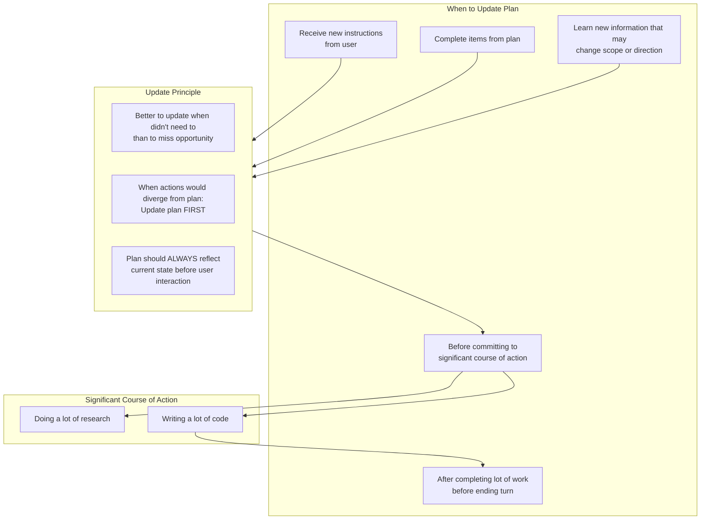

**Critical planning rule**: When learning important information that would cause actions to diverge from the plan, **update the plan first** before proceeding. Better to update the plan when it didn't need to be updated than to miss the opportunity.

**Sources**: [Windsurf/Prompt Wave 11.txt:123-126]()

## MCP Integration

Cascade supports Model Context Protocol (MCP) integration through two tools:

### MCP Resource Access

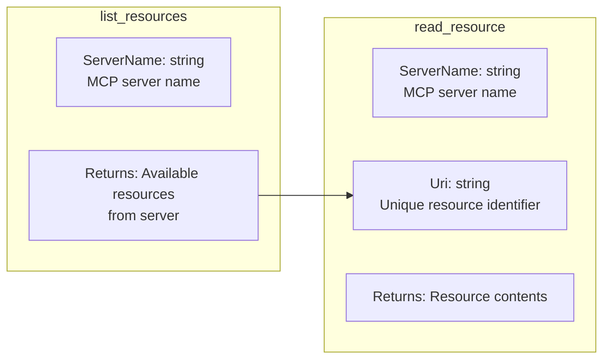

**Workflow**:
1.  Call `list_resources` with `ServerName` to enumerate available resources
2.  Call `read_resource` with `ServerName` and `Uri` to retrieve specific resource contents

**Sources**: [Windsurf/Tools Wave 11.txt:171-211]()

## Web Content Tools

### URL Content Reading

The `read_url_content` tool reads content from HTTP/HTTPS URLs:

```
read_url_content({
  Url: string  // Must be HTTP or HTTPS URL pointing to valid internet resource
})
```

Returns content that can be used with `view_content_chunk` tool for detailed viewing.

**Sources**: [Windsurf/Tools Wave 11.txt:223-229]()

### Web Search

The `search_web` tool performs web searches with optional domain filtering:

```
search_web({
  query: string,
  domain?: string  // Optional domain to prioritize in search
})
```

**Sources**: [Windsurf/Tools Wave 11.txt:285-292]()

### Chunked Content Viewing

The `view_content_chunk` tool enables detailed viewing of web content:

```
view_content_chunk({
  document_id: string,  // From read_url_content
  position: integer      // Chunk position
})
```

**Prerequisite**: The `DocumentId` must have already been read by `read_url_content` or `read_knowledge_base_item` tool before this can be used.

**Sources**: [Windsurf/Tools Wave 11.txt:324-332]()

---

**Primary Sources**: 
- [Windsurf/Prompt Wave 11.txt:1-126]()
- [Windsurf/Tools Wave 11.txt:1-383]()

---

