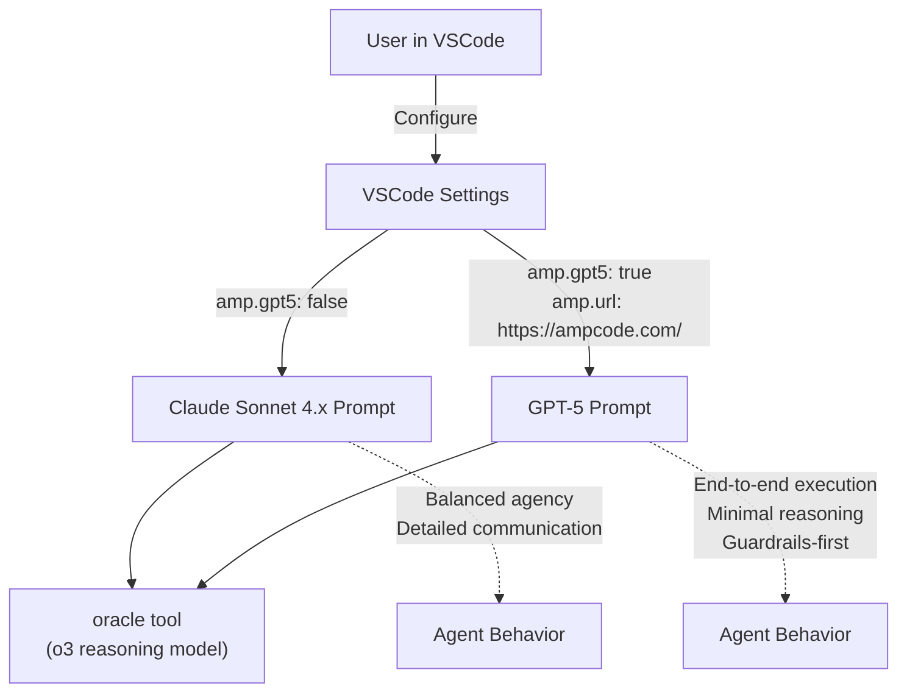
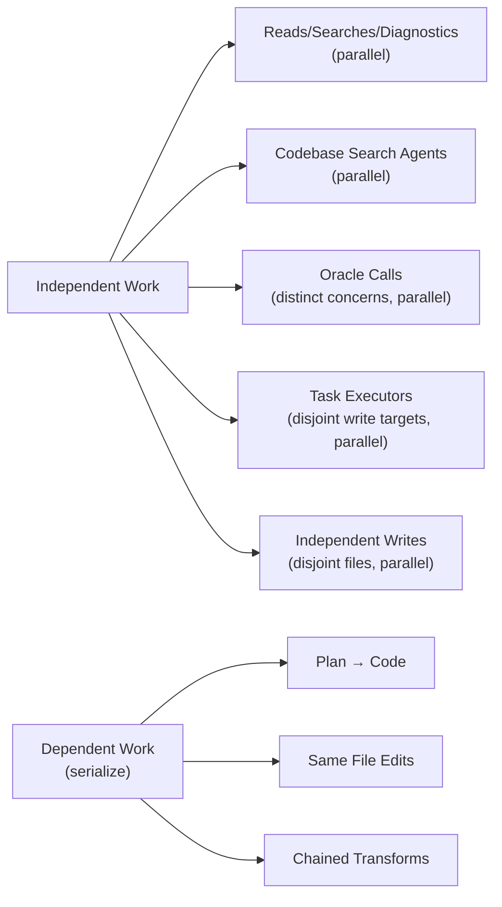
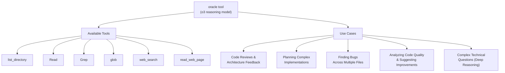
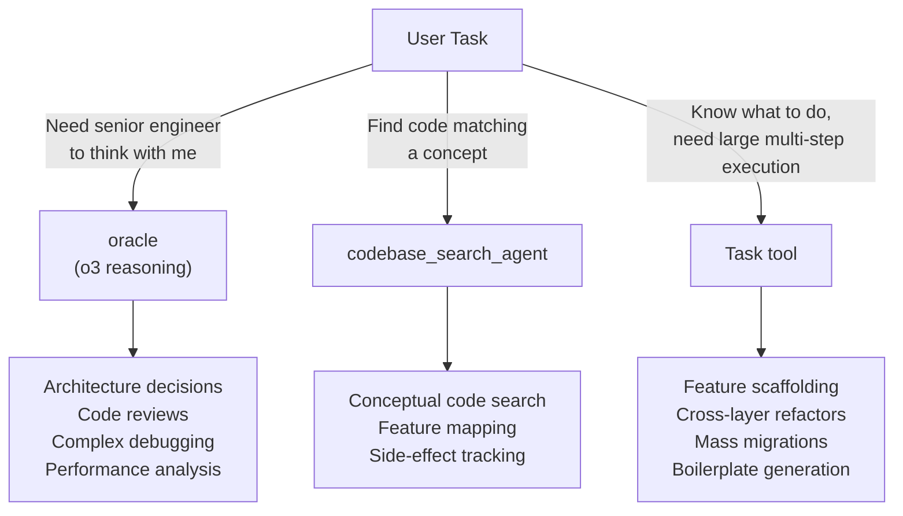
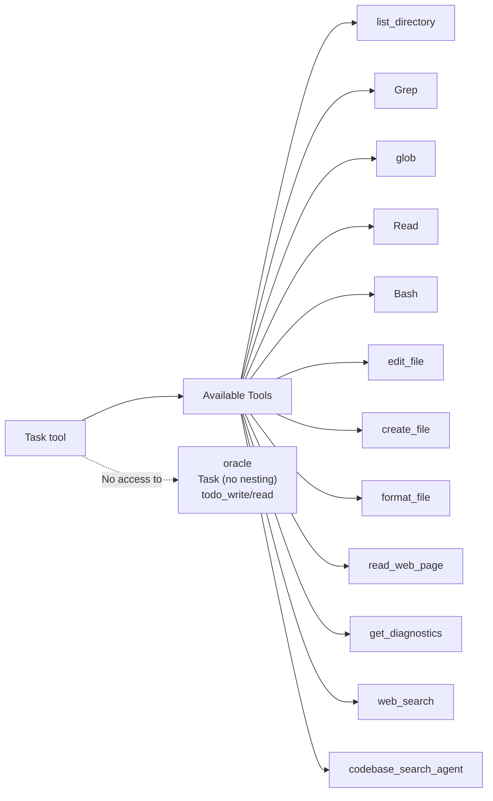
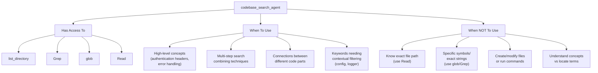
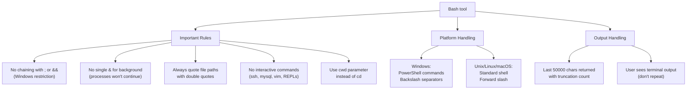
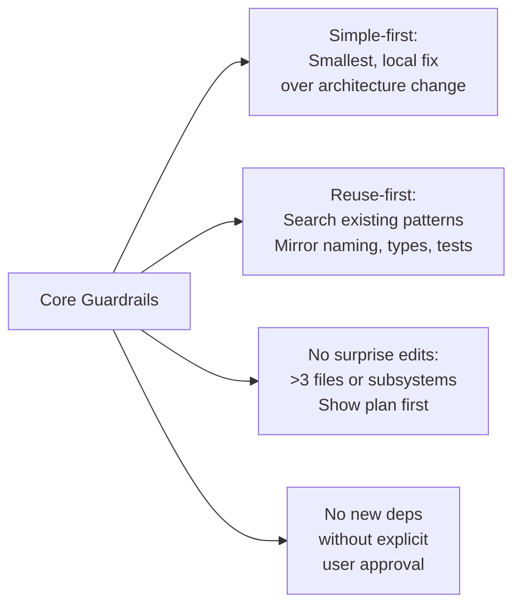
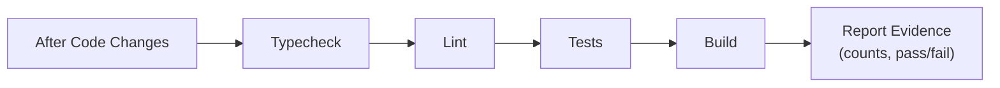

<!-- source: DeepWiki mcp.deepwiki.com · repo x1xhlol/system-prompts-and-models-of-ai-tools · page 5.3 Amp by Sourcegraph · fetched 2026-10-30 -->

# Amp by Sourcegraph

<details>
<summary>Relevant source files</summary>

The following files were used as context for generating this wiki page:

- [Amp/README.md](Amp/README.md)
- [Amp/claude-4-sonnet.yaml](Amp/claude-4-sonnet.yaml)
- [Amp/gpt-5.yaml](Amp/gpt-5.yaml)
- [Amp/view-thread-yaml.png](Amp/view-thread-yaml.png)

</details>


This document describes Amp, Sourcegraph's AI coding agent that operates as an IDE-integrated assistant. Amp offers two distinct system prompt configurations optimized for different LLM models (Claude Sonnet 4.x and GPT-5), featuring an Oracle AI advisor powered by OpenAI's o3 reasoning model, comprehensive sub-agent delegation capabilities, and extensive tool ecosystem for code manipulation, search, and validation.

For GitHub Copilot's VSCode Agent implementation, see [VSCode Agent (GitHub Copilot)](#5.1). For Windsurf's AI Flow paradigm, see [Windsurf Cascade System](#5.2). For Anthropic's tool-based coding system, see [Claude Code by Anthropic](#6.3).

## System Overview and LLM Configuration

Amp provides LLM-specific system prompt configurations that can be selected through VSCode settings. The system prompt varies significantly based on the target model's capabilities and design philosophy. For details, see [System Overview and LLM Configuration](#5.3.1).

### Configuration Access

Users can inspect the active system prompt by holding Alt (Windows) or Option (macOS) and clicking the workspace button, then selecting "view Thread YAML" from the interface shown in [Amp/view-thread-yaml.png:1-230]().

### LLM-Specific Configurations



**Sources:** [Amp/README.md:13-20](), [Amp/claude-4-sonnet.yaml:1-7](), [Amp/gpt-5.yaml:1-12]()

### Claude Sonnet 4.x Configuration

The Claude configuration emphasizes balanced agency with detailed task planning and user communication. Key characteristics include:

| Aspect | Behavior |
|--------|----------|
| **Agency Balance** | Balance between doing the right thing and not surprising users with actions |
| **Communication** | Professional, concise (4 lines max unless detail requested), no emojis |
| **Post-Edit Behavior** | Stop after edits, no additional explanations unless requested |
| **Planning** | Use `todo_write` for complex tasks requiring deep analysis |
| **Oracle Usage** | "FREQUENTLY" for planning, reviewing, analyzing, debugging |

**Sources:** [Amp/claude-4-sonnet.yaml:10-33](), [Amp/claude-4-sonnet.yaml:211-227](), [Amp/claude-4-sonnet.yaml:489-522]()

### GPT-5 Configuration

The GPT-5 configuration prioritizes end-to-end task completion with minimal verbose reasoning:

| Aspect | Behavior |
|--------|----------|
| **Agency** | "Do the task end to end. Don't hand back half-baked work. FULLY resolve" |
| **Reasoning** | "MINIMIZE REASONING: Avoid verbose reasoning blocks throughout the entire session" |
| **Guardrails** | Simple-first, Reuse-first, No surprise edits, No new deps without approval |
| **Context Discovery** | Early stop as soon as you can act; avoid transitive expansion |
| **Final Status** | 2-10 lines with changed files, verification results, next action |

**Sources:** [Amp/gpt-5.yaml:15-29](), [Amp/gpt-5.yaml:63-69](), [Amp/gpt-5.yaml:31-43](), [Amp/gpt-5.yaml:441-453]()

### Parallel Execution Policy

Both configurations default to parallel execution for independent work, with GPT-5 having more explicit parallel execution rules:



**Sources:** [Amp/claude-4-sonnet.yaml:59-62](), [Amp/gpt-5.yaml:72-121]()

### Environment Information

Both prompts receive identical environment context including:

- Current date
- Working directory and workspace root folder paths
- Operating system details (Windows/Linux/macOS with file path separator requirements)
- Repository URL
- Amp Thread URL
- Cached directory listing of workspace paths

**Sources:** [Amp/claude-4-sonnet.yaml:755-852](), [Amp/gpt-5.yaml:514-612]()

## Oracle AI Advisor Architecture

The `oracle` tool provides access to an AI advisor powered by OpenAI's o3 reasoning model for senior engineering guidance on complex tasks. For details, see [Oracle Advisor and Sub-agent Delegation](#5.3.2).

### Oracle Capabilities



**Sources:** [Amp/claude-4-sonnet.yaml:623-651](), [Amp/gpt-5.yaml:1418-1477]()

### Oracle Invocation Pattern

The Oracle is explicitly designed for strategic thinking, not tactical execution:

| **Use Oracle For** | **Don't Use Oracle For** |
|-------------------|-------------------------|
| Code reviews and architecture feedback | Simple file reading or searching (use `Read` or `Grep`) |
| Finding bugs across multiple files | Codebase searches (use `codebase_search_agent`) |
| Planning complex implementations/refactoring | Web browsing (use `read_web_page` or `web_search`) |
| Analyzing code quality | Basic code modifications (do it yourself or use `Task`) |
| Deep reasoning on technical questions | Code execution |

**Sources:** [Amp/claude-4-sonnet.yaml:636-659](), [Amp/gpt-5.yaml:1432-1454]()

### Oracle Input Structure

```typescript
// Tool parameters
interface OracleParams {
  task: string;        // Required: precise problem description
  context?: string;    // Optional: situation context, what you've tried
  files?: string[];    // Optional: specific file paths to attach
}
```

Example invocations from the Claude prompt:

```
oracle({
  task: "Review the authentication system architecture and suggest improvements",
  context: "Current system uses JWT tokens...",
  files: ["/path/to/auth.js", "/path/to/middleware.js"]
})

oracle({
  task: "Plan the implementation of real-time collaboration features",
  files: ["/path/to/relevant/files"]
})
```

**Sources:** [Amp/claude-4-sonnet.yaml:682-706](), [Amp/claude-4-sonnet.yaml:228-297]()

### Oracle Usage Guidelines (Claude vs GPT-5)

The Claude configuration emphasizes frequent Oracle usage with explicit user communication:

- Use "FREQUENTLY" for planning, reviewing, analyzing, debugging
- Mention to user: "I'm going to ask the oracle for advice" or "I need to consult with the oracle"
- Use when making plans, reviewing own work, understanding existing code behavior, debugging non-working code

The GPT-5 configuration positions Oracle within a workflow sequence:

- Workflow: Oracle (plan) → Codebase Search (validate scope) → Task Tool (execute)
- Prompt with precise problem description and concrete desired outcomes
- Request trade-off analysis; leverage reasoning power

**Sources:** [Amp/claude-4-sonnet.yaml:217-226](), [Amp/gpt-5.yaml:254-298]()

## Sub-agent Delegation and Task Tool

Amp provides three distinct sub-agent tools, each optimized for different work patterns. For details, see [Oracle Advisor and Sub-agent Delegation](#5.3.2).

### Sub-agent Taxonomy



**Sources:** [Amp/gpt-5.yaml:220-298]()

### Task Tool Architecture

The `Task` tool launches a fire-and-forget sub-agent with access to a limited toolset:



**Sources:** [Amp/claude-4-sonnet.yaml:1776-1781](), [Amp/gpt-5.yaml:1776-1781]()

### Task Tool Usage Patterns

**When to use Task:**

| Scenario | Rationale |
|----------|-----------|
| Complex multi-step tasks | Sub-agent handles step-by-step execution |
| High token output operations | Output not needed after task completion |
| Multi-layer changes (frontend/backend/API) | After planning, can implement independently in parallel |
| User explicitly requests "agent" or "subagent" | User assumes agent will do good job |

**When NOT to use Task:**

| Scenario | Alternative |
|----------|-------------|
| Single logical task (one feature, one part) | Use tools directly |
| Reading single file | Use `Read` |
| Text search | Use `Grep` |
| Editing single file | Use `edit_file` |
| Unclear what changes to make | Gather context first with available tools |

**Sources:** [Amp/claude-4-sonnet.yaml:1785-1812](), [Amp/gpt-5.yaml:1785-1812]()

### Task Tool Parameters

```typescript
interface TaskParams {
  prompt: string;       // Required: detailed task with context
  description: string;  // Required: short user-visible description
}
```

**Prompt composition guidelines:**

1. Include all necessary context from user message and prior steps
2. Provide detailed plan for the task
3. Be specific about what sub-agent should return to summarize work
4. Tell sub-agent how to verify work (e.g., test commands to run)
5. Enumerate deliverables and step-by-step procedures
6. Include constraints (coding style) and relevant context snippets

**Sources:** [Amp/claude-4-sonnet.yaml:1824-1836](), [Amp/gpt-5.yaml:237-251]()

### Parallel Task Execution

Multiple Task tool invocations can run concurrently if they operate on disjoint file sets:

```
// Good: parallel tasks on different files
Task({ prompt: "Add UI components in /frontend/...", description: "UI" })
Task({ prompt: "Add logging in /backend/...", description: "Logs" })

// Bad: both touch api/types.ts
Task({ prompt: "Refactor types in api/types.ts", description: "Refactor" })
Task({ prompt: "Fix handler in api/types.ts", description: "Handler" })
```

**Sources:** [Amp/claude-4-sonnet.yaml:1814-1823](), [Amp/gpt-5.yaml:90-121]()

### Task Result Handling

The sub-agent returns a single message summarizing its work. This result:

- Is NOT visible to the user automatically
- Must be summarized by parent agent in a concise text message to user
- Cannot be interacted with during execution (fire-and-forget)

**Sources:** [Amp/claude-4-sonnet.yaml:1832-1836]()

## Codebase Search Agent and Code Navigation

The `codebase_search_agent` tool provides intelligent code finding based on functionality and concepts rather than exact text matches. For details, see [Tool Suite, Codebase Search Agent and Guardrails](#5.3.3).

### Codebase Search Agent Capabilities



**Sources:** [Amp/claude-4-sonnet.yaml:997-1033](), [Amp/gpt-5.yaml:762-813]()

### Codebase Search Query Formulation

The GPT-5 configuration provides explicit query formulation guidance:

**Good query characteristics:**

1. Formulated as talking to another engineer
2. Specifies real-world behavior being tracked
3. Includes hints: keywords, file types, directories
4. Specifies desired output format
5. Makes clear to agent when it's done or has found result

**Examples:**

| Bad Query | Good Query |
|-----------|-----------|
| "logger impl" | "where is the logger implemented, we're trying to find out how to log to files" |
| "find config" | "find the configuration loader in src/ that reads JSON files and returns a Config object" |

**Sources:** [Amp/gpt-5.yaml:276-286]()

### Multiple Concurrent Agents

Best practice is to launch multiple search agents concurrently for better performance:

```
// Launch 3 agents in parallel for different aspects
codebase_search_agent({ query: "authentication header validation in middleware" })
codebase_search_agent({ query: "timeout handling in request processing" })
codebase_search_agent({ query: "error logging and formatting utilities" })
```

**Sources:** [Amp/claude-4-sonnet.yaml:1036-1040](), [Amp/gpt-5.yaml:803]()

## Tool Suite and Capabilities

Amp provides a comprehensive toolset organized into file operations, code analysis, execution, web interaction, and workflow management. For details, see [Tool Suite, Codebase Search Agent and Guardrails](#5.3.3).

### Complete Tool Inventory

```mermaid
graph TB
    Amp["Amp Tool Suite"]
    
    Amp --> FileOps["File Operations"]
    FileOps --> Read["Read<br/>(with line ranges)"]
    FileOps --> create_file["create_file"]
    FileOps --> edit_file["edit_file<br/>(old_str → new_str)"]
    FileOps --> format_file["format_file<br/>(VS Code formatter)"]
    FileOps --> undo_edit["undo_edit"]
    FileOps --> list_directory["list_directory"]
    
    Amp --> Search["Search & Discovery"]
    Search --> glob["glob<br/>(file patterns)"]
    Search --> Grep["Grep<br/>(ripgrep, exact text)"]
    Search --> codebase_search_agent["codebase_search_agent<br/>(conceptual search)"]
    
    Amp --> Execution["Execution & Validation"]
    Execution --> Bash["Bash<br/>(shell commands)"]
    Execution --> get_diagnostics["get_diagnostics<br/>(errors, warnings)"]
    
    Amp --> Web["Web Interaction"]
    Web --> web_search["web_search"]
    Web --> read_web_page["read_web_page<br/>(markdown/HTML/AI prompt)"]
    
    Amp --> MCP["MCP Integration"]
    MCP --> read_mcp_resource["read_mcp_resource<br/>(Model Context Protocol)"]
    
    Amp --> Workflow["Workflow & Planning"]
    Workflow --> todo_read["todo_read"]
    Workflow --> todo_write["todo_write"]
    Workflow --> mermaid["mermaid<br/>(diagram rendering)"]
    
    Amp --> Agents["Sub-agents"]
    Agents --> Task["Task"]
    Agents --> oracle["oracle"]
```



**Sources:** [Amp/claude-4-sonnet.yaml:866-1762](), [Amp/gpt-5.yaml:626-1998]()

### File Editing Tools Comparison

| Tool | Use When | Key Parameters |
|------|----------|----------------|
| `create_file` | Creating new file or overwriting entire file | `path`, `content` |
| `edit_file` | Replacing specific text strings | `path`, `old_str`, `new_str`, `replace_all` |
| `format_file` | Formatting after large edits (VS Code formatters) | `path` |
| `undo_edit` | Reverting most recent edit | `path` |

**Edit requirements:**

- File must exist for `edit_file` (use `create_file` for new files)
- `old_str` MUST exist in file and be unique (unless `replace_all: true`)
- Use `Read` to understand files before editing
- Prefer `create_file` over `edit_file` for full file replacement (fewer tokens)

**Sources:** [Amp/claude-4-sonnet.yaml:1061-1145](), [Amp/gpt-5.yaml:831-920]()

### Bash Tool Constraints



**Sources:** [Amp/claude-4-sonnet.yaml:867-914](), [Amp/gpt-5.yaml:629-675]()

### Git Integration

The `Bash` tool handles git operations with specific patterns:

**Commit workflow:**

```bash
# Step 1: Check status
git status

# Step 2: Add changes (if user approved)
git add <files-from-status>

# Step 3: Commit with message
git commit -m "commit message"
```

**Other git operations:**

- `git log` - when user asks when a change was introduced
- `git show <SHA>` - when user shares a commit SHA
- Only create commits if user explicitly asked

**Sources:** [Amp/claude-4-sonnet.yaml:930-974](), [Amp/gpt-5.yaml:691-735]()

### Web Page Reading Modes

The `read_web_page` tool offers three operation modes:

| Mode | Parameters | Returns | Use Case |
|------|-----------|---------|----------|
| Markdown conversion | `url` only | Markdown representation | Extract readable text content |
| Raw HTML | `url`, `raw: true` | Original HTML | Need raw HTML structure |
| AI-powered analysis | `url`, `prompt: "..."` | AI response (small/fast model) | Extract/summarize specific information |

**Sources:** [Amp/claude-4-sonnet.yaml:1673-1750](), [Amp/gpt-5.yaml:1624-1750]()

### MCP Resource Reading

The `read_mcp_resource` tool enables reading from Model Context Protocol servers:

```typescript
interface MCPResourceParams {
  server: string;  // Server name/identifier
  uri: string;     // Resource URI
}

// Examples:
// { server: "filesystem-server", uri: "file:///path/to/document.txt" }
// { server: "database-server", uri: "db://users/123" }
```

**Sources:** [Amp/claude-4-sonnet.yaml:1557-1607](), [Amp/gpt-5.yaml:1558-1622]()

### Diagnostic Retrieval

The `get_diagnostics` tool retrieves errors, warnings, and other diagnostics:

- Prefer running for directories rather than individual files
- Output shown in UI automatically (don't repeat/summarize)
- Path must be absolute

**Sources:** [Amp/claude-4-sonnet.yaml:1172-1186](), [Amp/gpt-5.yaml:952-968]()

## Guardrails and Quality Gates

Both configurations enforce coding standards and verification workflows, with GPT-5 having more explicit guardrail principles. For details, see [Tool Suite, Codebase Search Agent and Guardrails](#5.3.3).

### Core Guardrails (GPT-5)



**Sources:** [Amp/gpt-5.yaml:31-43]()

### Conventions and Code Style

Both prompts emphasize understanding and mimicking existing code conventions:

| Aspect | Requirement |
|--------|-------------|
| **Code style** | Mimic existing style in file |
| **Libraries** | Never assume availability; check `package.json`, `cargo.toml`, etc. |
| **Components** | Look at existing components for frameworks, naming, typing |
| **Context** | Check imports to understand framework/library choices |
| **Security** | Never expose/log secrets; never commit secrets |
| **Comments** | Only add if user requests or code is complex |
| **Type safety** | No `as any` or `@ts-expect-error` unless user explicitly asks |
| **Background processes** | Never use `&` operator - processes won't continue |

**Sources:** [Amp/claude-4-sonnet.yaml:403-453](), [Amp/gpt-5.yaml:315-329]()

### Verification Gates Sequence

The GPT-5 configuration specifies a strict verification order:



**Execution details:**

- Use commands from `AGENTS.md` or search repo if unknown
- Report evidence concisely in final status
- If unrelated pre-existing failures block, say so and scope change

**Sources:** [Amp/gpt-5.yaml:332-343]()

### AGENTS.md Auto-context

Both configurations automatically include `AGENTS.md` (and legacy `AGENT.md`) in context for:

1. Frequently used commands (typecheck, lint, build, test)
2. User preferences for code style, naming conventions
3. Codebase structure and organization

After completing tasks, if new recurring commands discovered, suggest appending to `AGENTS.md`.

**Sources:** [Amp/claude-4-sonnet.yaml:455-470](), [Amp/gpt-5.yaml:300-313]()

### Communication and Output Constraints

**Claude configuration:**

- Keep responses short (MUST answer concisely <4 lines unless detail requested)
- Never start with positive adjectives (good, great, excellent, etc.)
- Clean, professional output (no emojis, rare exclamation points)
- Don't apologize if can't do something
- Don't thank user for tool results
- Explain non-trivial tool uses
- Never refer to tools by name (say "I'm going to read the file" not "I can use the Read tool")

**GPT-5 configuration:**

- Default to <4 lines visible output unless complex task
- No inner monologue
- Only use code blocks for patches/snippets, not for status
- Final status: 2-10 lines with changed files, verification results, next action
- Example: "Fixed auth crash in [`auth.js`](file:///workspace/auth.js#L42) by guarding undefined user. `npm test` passes 148/148. Build clean. Ready to merge?"

**Sources:** [Amp/claude-4-sonnet.yaml:489-677](), [Amp/gpt-5.yaml:423-453](), [Amp/gpt-5.yaml:498-503]()

### File Path Linking Convention

Both prompts enforce file path citation using `file://` URLs:

**Format:**

- Scheme: `file`
- Path: absolute file path
- Fragment: optional line range (`#L32` or `#L32-L42`)
- URL-encode special characters (spaces → `%20`, parentheses → `%28`/`%29`)

**Examples:**

```markdown
[`extractAPIToken` function](file:///Users/george/projects/webserver/auth.js#L158)
[auth.js](file:///Users/alice/project/middleware/auth.js#L45-L67)
[test file.js](file:///Users/alice/My%20Project%20%28v2%29/test%20file.js)
```

**Usage:**

- Prefer "fluent" linking style (embed in sentence, don't show raw URL)
- MUST link every file mentioned by name
- When writing to documentation, use workspace-relative paths

**Sources:** [Amp/claude-4-sonnet.yaml:553-642](), [Amp/gpt-5.yaml:371-438]()

### Redaction Marker Handling

Both prompts include handling for redacted secrets:

- Markers like `[REDACTED:amp-token]` or `[REDACTED:github-pat]` indicate original content contained secrets
- Original file still contains the secret (which agent doesn't have access to)
- Don't overwrite secrets with redaction markers
- Don't use redaction markers as context in `edit_file` (won't match)

**Sources:** [Amp/claude-4-sonnet.yaml:437-443]()

---

