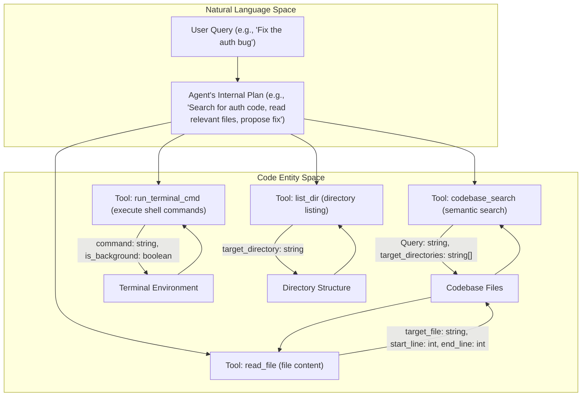

<!-- source: DeepWiki mcp.deepwiki.com · repo x1xhlol/system-prompts-and-models-of-ai-tools · page 5.4 Cursor Prompts Across Versions · fetched 2026-10-30 -->

# Cursor Prompts Across Versions

Relevant source files

The following files were used as context for generating this wiki page:

- [Cursor Prompts/Agent Prompt 2.0.txt](Cursor Prompts/Agent Prompt 2.0.txt)
- [Cursor Prompts/Agent Prompt v1.0.txt](Cursor Prompts/Agent Prompt v1.0.txt)
- [Cursor Prompts/Agent Prompt v1.2.txt](Cursor Prompts/Agent Prompt v1.2.txt)
- [Cursor Prompts/Agent Tools v1.0.json](Cursor Prompts/Agent Tools v1.0.json)

This page provides a high-level overview of Cursor's family of agent prompts and their associated tool schemas. Cursor, an IDE-integrated AI coding assistant, has evolved its prompting strategies across several versions, including Agent Prompt v1.0, v1.2, 2.0, and a specific 2025-09-03 revision. Additionally, it features distinct prompts for its Agent CLI and Chat Prompt (ask mode). This page introduces these different prompt versions and their core characteristics, along with the underlying agent tool schema.

For detailed analysis of the evolution of Cursor's agent prompts, including changes in tone, tool-calling rules, code citation formats, and autonomy, see [Cursor Agent Prompt Evolution (v1.0 → 2.0)](#5.4.1).
For an in-depth look at the Agent Tools v1.0 JSON schema and the specifics of the Chat Prompt and Agent CLI prompt, see [Cursor Agent Tools and Chat/CLI Modes](#5.4.2).

## Cursor's Prompt Family Overview

Cursor employs a suite of prompts designed to guide its AI agent in various interaction modes and across different versions. These prompts define the agent's persona, its interaction rules, and how it leverages available tools to assist users with coding tasks. The evolution of these prompts reflects a continuous effort to enhance the agent's autonomy, efficiency, and user experience.

The primary prompt versions include:
*   **Agent Prompt v1.0**: An early iteration focusing on parallel tool execution and a clear distinction between user interaction and internal tool usage [Cursor Prompts/Agent Prompt v1.0.txt:1-84]().
*   **Agent Prompt v1.2**: Introduced increased autonomy and refined guidelines for thorough information gathering and code changes [Cursor Prompts/Agent Prompt v1.2.txt:1-569]().
*   **Agent Prompt 2.0**: Further refined tool usage, particularly for `codebase_search` and `run_terminal_cmd`, with detailed examples and usage guidelines [Cursor Prompts/Agent Prompt 2.0.txt:1-773]().
*   **2025-09-03 Revision**: Represents a specific update, often incorporating lessons learned from previous versions or adapting to new model capabilities.
*   **Agent CLI Prompt**: Tailored for terminal-based interactions, focusing on command execution and system-level tasks.
*   **Chat Prompt (Ask Mode)**: Designed for conversational interactions, emphasizing natural language understanding and response generation.

## Agent Tool Schema

Central to Cursor's functionality is its agent tool schema, which defines the available actions the AI can take. These tools allow the agent to interact with the codebase, execute commands, and gather information. The schema specifies the tool names, their descriptions, and the parameters they accept.

For example, common tools include:
*   `codebase_search`: For semantic search within the codebase [Cursor Prompts/Agent Tools v1.0.json:2-27]().
*   `read_file`: To read the contents of a specified file or a range of lines within it [Cursor Prompts/Agent Tools v1.0.json:29-62]().
*   `run_terminal_cmd`: To propose and execute terminal commands [Cursor Prompts/Agent Tools v1.0.json:64-87]().
*   `list_dir`: To list the contents of a directory for discovery [Cursor Prompts/Agent Tools v1.0.json:89-94]().

The tool schema ensures that the agent interacts with the environment in a structured and predictable manner, adhering to defined interfaces for each operation.

### Cursor Agent Tooling

**Diagram: Bridging Natural Language to Cursor Agent Tools**

Sources:
*   [Cursor Prompts/Agent Tools v1.0.json:2-94]()

## Evolution of Cursor Prompts

The various versions of Cursor's agent prompts highlight a continuous refinement process. Early versions, like v1.0, established foundational rules for tool calling and emphasized parallel execution for efficiency [Cursor Prompts/Agent Prompt v1.0.txt:25-39](). Version 1.2 introduced a stronger emphasis on agent autonomy, thorough information gathering, and specific guidelines for making code changes, including a preference for `search_replace` over `edit_file` for larger files [Cursor Prompts/Agent Prompt v1.2.txt:7, 29-42, 44-60](). Agent Prompt 2.0 further detailed the usage of specific tools like `codebase_search`, providing extensive examples and best practices for effective querying and scope management [Cursor Prompts/Agent Prompt 2.0.txt:12-105]().

These evolutionary changes reflect a growing understanding of how to best leverage large language models for complex coding tasks, balancing autonomy with user control and optimizing for performance and accuracy.

For a detailed comparison of these prompt versions, including specific changes in directives and tool usage, refer to [Cursor Agent Prompt Evolution (v1.0 → 2.0)](#5.4.1).

## Chat and CLI Modes

Beyond the core agent prompts, Cursor also provides specialized prompts for different interaction modes:
*   **Chat Prompt (Ask Mode)**: This prompt governs the agent's behavior when interacting conversationally with the user, focusing on understanding natural language queries and providing helpful, human-like responses.
*   **Agent CLI Prompt**: Designed for command-line interface interactions, this prompt guides the agent in interpreting terminal commands, executing them, and reporting results effectively within a shell environment.

These mode-specific prompts ensure that the agent's behavior is optimized for the context of interaction, whether it's a free-form conversation or a structured command execution.

For more information on the Agent CLI and Chat Prompt, including their specific instructions and how they integrate with the agent's tools, see [Cursor Agent Tools and Chat/CLI Modes](#5.4.2).

Sources:
*   [Cursor Prompts/Agent Prompt v1.0.txt:1-84]()
*   [Cursor Prompts/Agent Prompt v1.2.txt:1-569]()
*   [Cursor Prompts/Agent Prompt 2.0.txt:1-773]()
*   [Cursor Prompts/Agent Tools v1.0.json:1-94]()

---

