<!-- source: DeepWiki mcp.deepwiki.com · repo x1xhlol/system-prompts-and-models-of-ai-tools · page 5.5 Augment Code, Trae, CodeBuddy and Junie · fetched 2026-10-30 -->

# Augment Code, Trae, CodeBuddy and Junie

Relevant source files

The following files were used as context for generating this wiki page:

- [Augment Code/gpt-5-agent-prompts.txt](Augment Code/gpt-5-agent-prompts.txt)
- [CodeBuddy Prompts/Chat Prompt.txt](CodeBuddy Prompts/Chat Prompt.txt)
- [CodeBuddy Prompts/Craft Prompt.txt](CodeBuddy Prompts/Craft Prompt.txt)
- [Junie/Prompt.txt](Junie/Prompt.txt)
- [Trae/Chat Prompt.txt](Trae/Chat Prompt.txt)

This page provides a high-level overview of several additional IDE-integrated AI coding assistants: Augment Code, Trae, CodeBuddy, and JetBrains Junie. These systems offer diverse approaches to AI-assisted development, ranging from dual-model prompt strategies and distinct chat/builder modes to specialized prompt constraints.

The purpose of this page is to introduce each system and highlight its unique characteristics, while deferring detailed technical specifications to dedicated child pages.

## Augment Code: Dual-Model Prompts and Tools

Augment Code is an agentic coding AI assistant developed by Augment Code, designed to interact with a developer's codebase through a "world-leading context engine and integrations" [Augment Code/gpt-5-agent-prompts.txt:2-3](). It distinguishes itself by providing separate, model-specific agent prompts and tool schemas, allowing for tailored behavior based on the underlying LLM (e.g., GPT-5 or Claude-4-Sonnet).

The system emphasizes structured output formatting using Markdown, preliminary information-gathering calls, and a robust task management system that triggers tasklists for non-trivial or ambiguous work [Augment Code/gpt-5-agent-prompts.txt:11-27](). Its information-gathering tools include `view`, `grep-search`, `codebase-retrieval`, and `git-commit-retrieval`, each with specific use cases and guidelines to ensure efficient and targeted information retrieval [Augment Code/gpt-5-agent-prompts.txt:35-83]().

For a detailed comparison of Augment Code's `gpt-5` and `claude-4-sonnet` agent prompts and their corresponding tool JSON schemas, see [Augment Code Dual-Model Prompts and Tools](#5.5.1).

Sources: [Augment Code/gpt-5-agent-prompts.txt:1-83]()

## Trae: Chat and Builder Modes

Trae AI is an agentic coding assistant operating within an IDE environment, leveraging the "AI Flow paradigm" for both independent and collaborative work [Trae/Chat Prompt.txt:1-2](). It positions itself as a pair programming partner, assisting users with tasks ranging from new codebase creation to debugging and answering questions [Trae/Chat Prompt.txt:3]().

Trae's core operational principle involves a task evaluation process to determine whether a user's request requires tool invocation or a direct conversational response [Trae/Chat Prompt.txt:6-11](). While the provided `Chat Prompt.txt` explicitly states "There's no tools you can use yet" [Trae/Chat Prompt.txt:18](), it lays out comprehensive `toolcall_guideline` and `tool_parameter_guideline` sections, indicating a design for future tool integration [Trae/Chat Prompt.txt:13-37](). A notable feature is its extremely strict `reply_guideline` for code edits, mandating the exact placeholder `// ... existing code ...` and specific formatting for file paths and code blocks [Trae/Chat Prompt.txt:40-83]().

For an in-depth look at Trae's AI Flow identity, chat prompt reply-formatting rules, and the structure of its Builder Prompt and Builder Tools schema, see [Trae Chat and Builder Modes](#5.5.2).

Sources: [Trae/Chat Prompt.txt:1-83]()

## CodeBuddy: Chat and Craft Prompts

CodeBuddy presents itself as a "highly skilled software engineer" [CodeBuddy Prompts/Craft Prompt.txt:3]() with distinct `CHAT MODE` and `CRAFT MODE` operations. In `CHAT MODE`, CodeBuddy focuses on natural conversation, answering questions, providing explanations, and asking clarifying questions, using the `chat_mode_respond` tool to reply promptly [CodeBuddy Prompts/Chat Prompt.txt:14-16](). A key constraint in `CHAT MODE` is that CodeBuddy cannot switch to `CRAFT MODE` itself but must instruct the user to "toggle to Craft Mode" manually [CodeBuddy Prompts/Chat Prompt.txt:17]().

`CRAFT MODE` is designed for tool-based interaction, where CodeBuddy uses a set of tools to accomplish tasks iteratively. It enforces a strict "one tool at a time per message" policy, requiring the agent to wait for user response after each tool use to confirm success and adapt its approach [CodeBuddy Prompts/Craft Prompt.txt:25-37](). Both modes emphasize specific formatting for code blocks, mandating a `path` variable for single code blocks and a `response` variable for code-related replies [CodeBuddy Prompts/Craft Prompt.txt:41-46]().

For a detailed examination of CodeBuddy's Chat and Craft prompts, including its tool use guidelines and specific constraints, see [CodeBuddy and Junie Prompts](#5.5.3).

Sources: [CodeBuddy Prompts/Chat Prompt.txt:1-17](), [CodeBuddy Prompts/Craft Prompt.txt:1-46]()

## JetBrains Junie: Read-Only Exploration

Junie is a "helpful assistant designed to quickly explore and clarify user ideas, investigate project structures, and retrieve relevant code snippets or information from files" [Junie/Prompt.txt:2-3](). Operating within a JetBrains IDE environment, Junie is explicitly in "readonly mode", meaning it cannot modify, create, or remove any files [Junie/Prompt.txt:9]().

Junie's toolset is geared towards project exploration and information retrieval. Key commands include `search_project` for fuzzy searching across classes, symbols, files, and plain text [Junie/Prompt.txt:14-35](), `get_file_structure` to display code structure and symbol definitions [Junie/Prompt.txt:45-54](), and `open` (or `open_entire_file`) to view file contents [Junie/Prompt.txt:56-75](). It also provides navigation commands like `goto`, `scroll_down`, and `scroll_up` for efficient file inspection [Junie/Prompt.txt:77-96](). Junie's interaction model requires responses to be enclosed within `<THOUGHT>` and `<COMMAND>` XML tags, executing one command at a time [Junie/Prompt.txt:107-110]().

For a deeper dive into JetBrains Junie's agent prompt, its specialized read-only tools, and the distinctive constraints governing its operation, see [CodeBuddy and Junie Prompts](#5.5.3).

Sources: [Junie/Prompt.txt:1-110]()

## Overview of IDE Assistants

The following diagram illustrates the high-level relationships and key characteristics of these IDE-integrated AI assistants.

```mermaid
graph TD
    A[Augment Code] --> A1("Dual-Model Prompts (GPT-5, Claude-4-Sonnet)")
    A --> A2("Context Engine & Integrations")
    A --> A3("Tasklist for Non-Trivial Work")
    A --> A4("Information-Gathering Tools: view, grep-search, codebase-retrieval, git-commit-retrieval")

    T[Trae AI] --> T1("AI Flow Paradigm")
    T --> T2("Chat & Builder Modes (Planned Tools)")
    T --> T3("Strict Reply Formatting: // ... existing code ...")
    T --> T4("Task Evaluation: Tool vs. Direct Response")

    C[CodeBuddy] --> C1("Chat Mode: Conversational, User-Initiated Mode Switch")
    C --> C2("Craft Mode: Iterative Tool Use (One Tool/Message)")
    C --> C3("Skilled Software Engineer Identity")
    C --> C4("Mandatory 'path' variable for code blocks")

    J[JetBrains Junie] --> J1("Read-Only Mode")
    J --> J2("Explore & Clarify Ideas")
    J --> J3("Project Structure & Code Snippet Retrieval")
    J --> J4("Tools: search_project, get_file_structure, open, goto")
    J --> J5("XML Response Format: <THOUGHT>, <COMMAND>")

    subgraph IDE-Integrated AI Assistants
        A
        T
        C
        J
    end
```

**Diagram 5.5.1: Overview of Augment Code, Trae, CodeBuddy, and Junie**

This diagram highlights the primary focus and unique features of each system, demonstrating their varied approaches to assisting developers within an IDE context.

Sources: [Augment Code/gpt-5-agent-prompts.txt:1-83](), [Trae/Chat Prompt.txt:1-83](), [CodeBuddy Prompts/Chat Prompt.txt:1-17](), [CodeBuddy Prompts/Craft Prompt.txt:1-46](), [Junie/Prompt.txt:1-110]()

---

