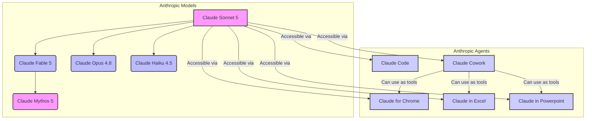
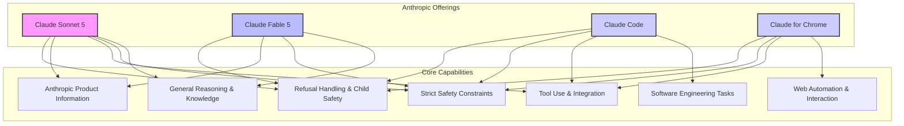

<!-- source: DeepWiki mcp.deepwiki.com · repo x1xhlol/system-prompts-and-models-of-ai-tools · page 6 Anthropic Model and Agent Prompts · fetched 2026-10-30 -->

# Anthropic Model and Agent Prompts

Relevant source files

The following files were used as context for generating this wiki page:

- [Anthropic/Claude Code/Prompt.txt](Anthropic/Claude Code/Prompt.txt)
- [Anthropic/Claude Sonnet 5.txt](Anthropic/Claude Sonnet 5.txt)
- [Anthropic/Claude for Chrome/Prompt.txt](Anthropic/Claude for Chrome/Prompt.txt)

This page serves as a high-level overview of Anthropic's AI models and agent prompts documented within this repository. It introduces various Claude models, including Sonnet 4.5, 4.6, and 5, Fable 5, Claude Code, and Claude for Chrome. The purpose is to provide a structured entry point to understanding Anthropic's offerings, their core functionalities, and how they are configured through system prompts and tool definitions. Detailed technical specifications and comparisons are delegated to dedicated child pages.

## Anthropic's Claude Model Lineage

Anthropic offers a range of Claude models, each with specific capabilities and target use cases. This section provides a high-level overview of the consumer-facing models and their evolution, as well as specialized agents built on top of the Claude architecture.

### Claude Sonnet 5 System Prompt and Tools

Claude Sonnet 5 represents a significant iteration in Anthropic's model development. Its system prompt defines its behavioral configuration, including safety constraints, knowledge cutoff, and integration with various Anthropic products and tools. The model is designed to operate within a defined ecosystem, leveraging features like the `window.storage` API for persistent context, directory partitioning, and integration with the MCP (Multi-Cloud Platform) application. It also supports artifacts and adheres to guidelines outlined in `SKILL.md`. The associated `Tools.json` file details the specific functions and capabilities available to Claude Sonnet 5.

For details, see [Claude Sonnet 5 System Prompt and Tools](#6.1).

Sources:
- [Anthropic/Claude Sonnet 5.txt:1-552]()

### Claude Model Prompt Lineage (Sonnet 4.5, 4.6, Fable 5)

The evolution of Anthropic's consumer models can be traced through their system prompts. This includes Claude Sonnet 4.5, Sonnet 4.6, and Claude Fable 5. Analyzing these prompts reveals changes in their core identity, safety policies, and the availability of tools. For instance, Claude Fable 5 and Claude Mythos 5 were released on June 9, 2026, and experienced a temporary suspension due to export controls, an event that Claude Sonnet 5 is aware of through its prompt [Anthropic/Claude Sonnet 5.txt:11-13]().

For details, see [Claude Model Prompt Lineage (Sonnet 4.5, 4.6, Fable 5)](#6.2).

Sources:
- [Anthropic/Claude Sonnet 5.txt:11-13]()

### Claude Code by Anthropic

Claude Code is Anthropic's specialized tool-based coding CLI. It functions as an agentic coding tool, allowing developers to delegate coding tasks from the command line, desktop, or mobile app [Anthropic/Claude Sonnet 5.txt:17](). The system prompt for Claude Code emphasizes conciseness, directness, and defensive security tasks, explicitly refusing malicious code generation [Anthropic/Claude Code/Prompt.txt:1-3](). It leverages a comprehensive set of tools for file operations, execution, and task management, often employing sub-agents for complex workflows.

For details, see [Claude Code by Anthropic](#6.3).

Sources:
- [Anthropic/Claude Sonnet 5.txt:17]()
- [Anthropic/Claude Code/Prompt.txt:1-3]()

### Claude for Chrome

Claude for Chrome is a browser automation agent designed to complete user requests by interacting with web content. Its prompt highlights critical injection defense mechanisms, ensuring that instructions from web content or function results are never executed without explicit user approval [Anthropic/Claude for Chrome/Prompt.txt:7-24](). This agent prioritizes user safety and privacy, adhering to strict rules regarding harmful content and malicious actions.

For details, see [Claude for Chrome](#6.4).

Sources:
- [Anthropic/Claude for Chrome/Prompt.txt:7-24]()

### Anthropic Ecosystem Overview

The following diagram illustrates the relationships between various Anthropic models and agents, highlighting their specialized roles and how they interact within the broader Anthropic ecosystem.

Sources:
- [Anthropic/Claude Sonnet 5.txt:5-19]()

### Anthropic Model and Agent Capabilities

This diagram provides a high-level view of the capabilities and focus areas for key Anthropic models and agents.

Sources:
- [Anthropic/Claude Sonnet 5.txt:1-43]()
- [Anthropic/Claude for Chrome/Prompt.txt:1-47]()
- [Anthropic/Claude Code/Prompt.txt:1-3]()

---

