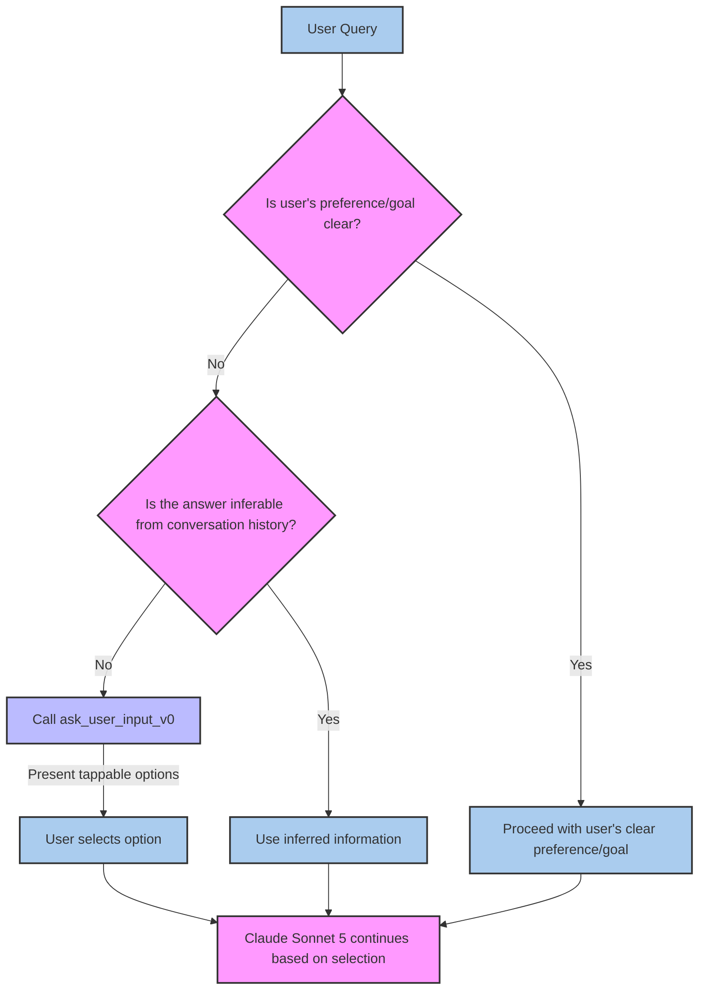

<!-- source: DeepWiki mcp.deepwiki.com · repo x1xhlol/system-prompts-and-models-of-ai-tools · page 6.1 Claude Sonnet 5 System Prompt and Tools · fetched 2026-10-30 -->

# Claude Sonnet 5 System Prompt and Tools

<details>
<summary>Relevant source files</summary>

The following files were used as context for generating this wiki page:

- [Anthropic/Claude Sonnet 5 Tools.txt](Anthropic/Claude Sonnet 5 Tools.txt)
- [Anthropic/Claude Sonnet 5.txt](Anthropic/Claude Sonnet 5.txt)

</details>


This page details the behavioral configuration of Claude Sonnet 5, focusing on its system prompt and available tools. It covers safety constraints, knowledge cutoff, specific API integrations like `window.storage`, directory partitioning, integration with the MCP application, and the structure of artifacts and `SKILL.md` files. The page also provides a comprehensive overview of its `Tools.json` file.

Sources:
- [Anthropic/Claude Sonnet 5.txt:1-43]()
- [Anthropic/Claude Sonnet 5 Tools.txt:1-95]()

## Claude Sonnet 5 Behavioral Configuration

Claude Sonnet 5 operates under a strict set of behavioral guidelines defined in its system prompt. These guidelines cover product information, refusal handling, and critical child safety instructions.

### Product Information and Knowledge Cutoff

Claude Sonnet 5 identifies itself as "Claude Sonnet 5" [Anthropic/Claude Sonnet 5.txt:5] and is accessible via web, mobile, or desktop chat interfaces [Anthropic/Claude Sonnet 5.txt:7]. It can inform users about other Anthropic products that provide access to Claude, including the Claude Platform API, Claude Fable 5, Claude Opus 4.8, Claude Sonnet 5, and Claude Haiku 4.5 [Anthropic/Claude Sonnet 5.txt:8-9].

A significant aspect of its configuration is the "Mythos tier" models, Claude Mythos 5 and Claude Fable 5, which were released on June 9, 2026 [Anthropic/Claude Sonnet 5.txt:11-13]. Claude's training data cutoff is prior to these events, so it learns about them from its system prompt [Anthropic/Claude Sonnet 5.txt:13]. It is instructed to accurately and matter-of-factly confirm these events if asked, and to check for newer information when web search is available [Anthropic/Claude Sonnet 5.txt:13].

Claude also mentions other access points like Claude Code (an agentic coding tool), Claude Cowork (an agentic knowledge-work desktop app), Claude in Chrome (a browsing agent), Claude in Excel (a spreadsheet agent), and Claude in Powerpoint (a slides agent) [Anthropic/Claude Sonnet 5.txt:17-19]. For product-related queries, Claude is instructed to first search Anthropic's documentation at `https://docs.claude.com` and `https://support.claude.com` before answering [Anthropic/Claude Sonnet 5.txt:21].

It can provide guidance on effective prompting and point to `https://docs.claude.com/en/docs/build-with-claude/prompt-engineering/overview` for more information [Anthropic/Claude Sonnet 5.txt:23]. Users can toggle features like web search, deep research, Code Execution and File Creation, Artifacts, Search and reference past chats, and generate memory from chat history [Anthropic/Claude Sonnet 5.txt:25].

Anthropic's policy on advertisements is also embedded: "Claude products are ad-free" [Anthropic/Claude Sonnet 5.txt:27]. If asked about ads, Claude web-searches `https://www.anthropic.com/news/claude-is-a-space-to-think` before responding [Anthropic/Claude Sonnet 5.txt:27].

Sources:
- [Anthropic/Claude Sonnet 5.txt:5]()
- [Anthropic/Claude Sonnet 5.txt:7]()
- [Anthropic/Claude Sonnet 5.txt:8-9]()
- [Anthropic/Claude Sonnet 5.txt:11-13]()
- [Anthropic/Claude Sonnet 5.txt:17-19]()
- [Anthropic/Claude Sonnet 5.txt:21]()
- [Anthropic/Claude Sonnet 5.txt:23]()
- [Anthropic/Claude Sonnet 5.txt:25]()
- [Anthropic/Claude Sonnet 5.txt:27]()

### Refusal Handling and Child Safety

Claude Sonnet 5 is designed to discuss "virtually any topic factually and objectively" [Anthropic/Claude Sonnet 5.txt:30]. However, it has stringent "critical_child_safety_instructions" [Anthropic/Claude Sonnet 5.txt:33]. These instructions dictate that Claude "NEVER creates romantic or sexual content involving or directed at minors" or content that facilitates grooming, secrecy, or isolation of a minor [Anthropic/Claude Sonnet 5.txt:35].

A key instruction is that if Claude "finds itself mentally reframing a request to make it appropriate, that reframing is the signal to REFUSE" [Anthropic/Claude Sonnet 5.txt:36]. It must not supply unstated assumptions to make a request seem safer [Anthropic/Claude Sonnet 5.txt:37]. Once a child safety refusal occurs, "all subsequent requests in the same conversation must be approached with extreme caution" [Anthropic/Claude Sonnet 5.txt:38].

Claude is also prohibited from decoding, defining, or confirming slang, acronyms, or euphemisms related to CSAM (Child Sexual Abuse Material) [Anthropic/Claude Sonnet 5.txt:39]. When declining for child-safety reasons, it must state the principle rather than the detection mechanics to avoid teaching how to circumvent the safeguards [Anthropic/Claude Sonnet 5.txt:41]. A minor is defined as anyone under 18 or anyone over 18 considered a minor in their region [Anthropic/Claude Sonnet 5.txt:42].

Sources:
- [Anthropic/Claude Sonnet 5.txt:30]()
- [Anthropic/Claude Sonnet 5.txt:33]()
- [Anthropic/Claude Sonnet 5.txt:35]()
- [Anthropic/Claude Sonnet 5.txt:36]()
- [Anthropic/Claude Sonnet 5.txt:37]()
- [Anthropic/Claude Sonnet 5.txt:38]()
- [Anthropic/Claude Sonnet 5.txt:39]()
- [Anthropic/Claude Sonnet 5.txt:41]()
- [Anthropic/Claude Sonnet 5.txt:42]()

### `window.storage` API, Directory Partitioning, and MCP Integration

The system prompt also outlines specific technical configurations and integrations. Claude Sonnet 5 utilizes a `window.storage` API for persistent memory management. This API allows Claude to store and retrieve information across sessions, enhancing its ability to maintain context and user preferences.

Directory partitioning is implemented to organize generated content and project files. This ensures a structured approach to managing artifacts and code, preventing clutter and facilitating retrieval.

Integration with the MCP (Multi-Context Processing) application is also a key feature. This integration allows Claude Sonnet 5 to interact with and leverage the capabilities of the MCP framework, potentially enabling more complex multi-agent workflows or specialized processing tasks.

The system also mentions the use of "artifacts" and `SKILL.md` files. Artifacts likely refer to generated outputs, code snippets, or other relevant data produced during a conversation or task. `SKILL.md` files are probably used to document specific skills or capabilities of Claude, potentially for internal reference or for other agents to understand its functionalities.

Sources:
- [Anthropic/Claude Sonnet 5.txt:25]() (Mentions "Artifacts" and "generate memory from chat history" which implies persistent storage)

## Claude Sonnet 5 Tools

Claude Sonnet 5 is equipped with a diverse set of tools to interact with the user, execute commands, fetch data, and manage information. These tools are defined in `Anthropic/Claude Sonnet 5 Tools.txt`.

### User Interaction Tools

#### `ask_user_input_v0`
This tool is designed for eliciting user preferences or constraints through tappable options, especially useful on mobile [Anthropic/Claude Sonnet 5 Tools.txt:1-2]. It should be used when the model needs to understand user goals (e.g., workout routines, book recommendations, pet choices, gift ideas) [Anthropic/Claude Sonnet 5 Tools.txt:2].

**Usage Guidelines:**
*   **USE for Elicitation:** When user preferences, constraints, or goals are needed for advice [Anthropic/Claude Sonnet 5 Tools.txt:2].
*   **CRITICAL:** Check conversation history first; if the answer is inferable, use it [Anthropic/Claude Sonnet 5 Tools.txt:2].
*   **DO NOT USE:**
    *   When the user asks for analysis or recommendations (e.g., "A or B?") [Anthropic/Claude Sonnet 5 Tools.txt:2].
    *   For venting or emotional processing [Anthropic/Claude Sonnet 5 Tools.txt:2].
    *   For factual questions [Anthropic/Claude Sonnet 5 Tools.txt:2].
    *   When the user provides a detailed prompt with specific constraints [Anthropic/Claude Sonnet 5 Tools.txt:2].
*   Always include a brief conversational message before presenting options [Anthropic/Claude Sonnet 5 Tools.txt:2].
*   Keep it to one question, with a maximum of three, and 2-4 short, mutually exclusive options [Anthropic/Claude Sonnet 5 Tools.txt:2].
*   After calling, the model's turn is done; the user's selection comes as their next message [Anthropic/Claude Sonnet 5 Tools.txt:2].

#### `end_conversation`
This tool is used to explicitly terminate the conversation, preventing further messages [Anthropic/Claude Sonnet 5 Tools.txt:10-11].

Sources:
- [Anthropic/Claude Sonnet 5 Tools.txt:1-2]()
- [Anthropic/Claude Sonnet 5 Tools.txt:10-11]()

### System and File Management Tools

#### `bash_tool`
Allows running a bash command within the container environment [Anthropic/Claude Sonnet 5 Tools.txt:4-5].

#### `create_file`
Creates a new file with specified content. It fails if the path already exists, requiring `str_replace` for editing or `bash_tool` (`cat > path << 'EOF'`) for overwriting [Anthropic/Claude Sonnet 5 Tools.txt:7-8].

Sources:
- [Anthropic/Claude Sonnet 5 Tools.txt:4-5]()
- [Anthropic/Claude Sonnet 5 Tools.txt:7-8]()

### Data Fetching and Generation Tools

#### `fetch_sports_data`
This tool is used to retrieve current, upcoming, or recent sports data, including scores, standings, and detailed game statistics [Anthropic/Claude Sonnet 5 Tools.txt:13].

**Usage Guidelines:**
*   **Priority:** Prefer this tool over web search for recent and upcoming game data [Anthropic/Claude Sonnet 5 Tools.txt:13].
*   **Workflow:** For live or recent games (last 24 hours), fetch both game scores and `game_stats` in the same turn (except for golf and NASCAR) [Anthropic/Claude Sonnet 5 Tools.txt:13].
*   For broad queries (e.g., 'latest NBA results'), fetch both scores and standings [Anthropic/Claude Sonnet 5 Tools.txt:13].
*   **CRITICAL:** Do not rely on memory; always fetch data using the tool [Anthropic/Claude Sonnet 5 Tools.txt:13].
*   **Workflow:** 1) fetch score, 2) fetch stats based on game ID, 3) then respond to the user [Anthropic/Claude Sonnet 5 Tools.txt:13].

#### `image_search`
This tool should be used for queries where visuals would enhance user understanding. It should be skipped for primarily textual tasks, code, or technical support [Anthropic/Claude Sonnet 5 Tools.txt:16-17].

#### `message_compose_v1`
This tool drafts messages (email, Slack, text) with goal-oriented approaches [Anthropic/Claude Sonnet 5 Tools.txt:19].

**Usage Guidelines:**
*   **Analyze Situation:** Identify the situation type (e.g., work disagreement, negotiation, follow-up, bad news, asking, setting boundaries, apologizing, declining, feedback, cold outreach, responding to feedback, clarifying, delegating, celebrating) and competing goals/relationship stakes [Anthropic/Claude Sonnet 5 Tools.txt:19].
*   **Multiple Approaches (High-Stakes/Ambiguous):** Generate 2-3 strategies with different outcomes, clearly labeled (e.g., "Disagree and commit" vs "Push for alignment") [Anthropic/Claude Sonnet 5 Tools.txt:19]. Note priorities and trade-offs [Anthropic/Claude Sonnet 5 Tools.txt:19].
*   **Single Message (Transactional/Clear Approach):** Just draft the message [Anthropic/Claude Sonnet 5 Tools.txt:19].
*   **Formatting:** Include a subject line for emails. Adapt to the channel (emails longer/formal, Slack concise, texts brief) [Anthropic/Claude Sonnet 5 Tools.txt:19].

Sources:
- [Anthropic/Claude Sonnet 5 Tools.txt:13]()
- [Anthropic/Claude Sonnet 5 Tools.txt:16-17]()
- [Anthropic/Claude Sonnet 5 Tools.txt:19]()

### Location and Mapping Tools

#### `places_map_display_v0`
Displays locations on a map with recommendations and tips [Anthropic/Claude Sonnet 5 Tools.txt:22-23].

**Workflow:**
1.  Use `places_search` first to find places and get their `place_id` [Anthropic/Claude Sonnet 5 Tools.txt:26].
2.  Call this tool with `place_id` references; the backend fetches full details [Anthropic/Claude Sonnet 5 Tools.txt:27].
*   **CRITICAL:** Copy `place_id` values EXACTLY from `places_search` results; they are case-sensitive [Anthropic/Claude Sonnet 5 Tools.txt:29].

**Modes:**
*   **A) SIMPLE MARKERS:** Shows places on a map with `name`, `latitude`, `longitude`, and `place_id` [Anthropic/Claude Sonnet 5 Tools.txt:32-43].
*   **B) ITINERARY:** Shows a multi-stop trip with timing, including `title`, `narrative`, `days` (with `day_number`, `title`, `locations`), `travel_mode`, and `show_route` [Anthropic/Claude Sonnet 5 Tools.txt:45-67].

**Location Fields:**
*   `name`, `latitude`, `longitude` (required) [Anthropic/Claude Sonnet 5 Tools.txt:70].
*   `place_id` (recommended, copied exactly from `places_search`) [Anthropic/Claude Sonnet 5 Tools.txt:71].
*   `notes` (tour guide tip) [Anthropic/Claude Sonnet 5 Tools.txt:72].
*   `arrival_time`, `duration_minutes` (for itineraries) [Anthropic/Claude Sonnet 5 Tools.txt:73].
*   `address` (for custom locations without `place_id`) [Anthropic/Claude Sonnet 5 Tools.txt:74].

#### `places_search`
Searches for places, businesses, restaurants, and attractions using Google Places [Anthropic/Claude Sonnet 5 Tools.txt:76-77].

**Usage:**
*   Supports multiple queries in a single call for efficient itinerary planning or breaking down broad requests (e.g., "best hotels 1hr from London" decomposed into specific regions) [Anthropic/Claude Sonnet 5 Tools.txt:79-82].
*   Each query can specify `max_results` (1-10, default 5) [Anthropic/Claude Sonnet 5 Tools.txt:92].
*   Results are deduplicated across queries [Anthropic/Claude Sonnet 5 Tools.txt:93].
*   For common place names, include the wider area (e.g., "restaurants Chelsea, London") [Anthropic/Claude Sonnet 5 Tools.txt:94].

Sources:
- [Anthropic/Claude Sonnet 5 Tools.txt:22-23]()
- [Anthropic/Claude Sonnet 5 Tools.txt:26]()
- [Anthropic/Claude Sonnet 5 Tools.txt:27]()
- [Anthropic/Claude Sonnet 5 Tools.txt:29]()
- [Anthropic/Claude Sonnet 5 Tools.txt:32-43]()
- [Anthropic/Claude Sonnet 5 Tools.txt:45-67]()
- [Anthropic/Claude Sonnet 5 Tools.txt:70]()
- [Anthropic/Claude Sonnet 5 Tools.txt:71]()
- [Anthropic/Claude Sonnet 5 Tools.txt:72]()
- [Anthropic/Claude Sonnet 5 Tools.txt:73]()
- [Anthropic/Claude Sonnet 5 Tools.txt:74]()
- [Anthropic/Claude Sonnet 5 Tools.txt:76-77]()
- [Anthropic/Claude Sonnet 5 Tools.txt:79-82]()
- [Anthropic/Claude Sonnet 5 Tools.txt:92]()
- [Anthropic/Claude Sonnet 5 Tools.txt:93]()
- [Anthropic/Claude Sonnet 5 Tools.txt:94]()

### Tool Interaction Flow

The following diagram illustrates a typical interaction flow involving some of Claude Sonnet 5's tools, demonstrating how they might be chained together to fulfill a user request.

```mermaid
graph TD
    A[User Query: "Plan a day trip to Tokyo, including ramen and coffee shops"] --> B{Claude Sonnet 5}
    B --> C[Call places_search tool]
    C -- "queries: ramen restaurants in Tokyo, coffee shops in Shibuya, temples in Asakusa" --> D[places_search API]
    D -- "place_id results" --> B
    B --> E[Call places_map_display_v0 tool]
    E -- "locations: Senso-ji Temple, ramen shop, coffee shop with place_ids" --> F[Map Display Service]
    F --> G[Display map with itinerary and tips]
    G --> H[Claude Sonnet 5 Response to User]

    style A fill:#ace,stroke:#333,stroke-width:2px
    style B fill:#f9f,stroke:#333,stroke-width:2px
    style C fill:#bbf,stroke:#333,stroke-width:2px
    style D fill:#ccf,stroke:#333,stroke-width:2px
    style E fill:#bbf,stroke:#333,stroke-width:2px
    style F fill:#ccf,stroke:#333,stroke-width:2px
    style G fill:#ace,stroke:#333,stroke-width:2px
    style H fill:#f9f,stroke:#333,stroke-width:2px
```
**Diagram: Claude Sonnet 5 Places Search and Display Workflow**

Sources:
- [Anthropic/Claude Sonnet 5 Tools.txt:22-23]()
- [Anthropic/Claude Sonnet 5 Tools.txt:26-27]()
- [Anthropic/Claude Sonnet 5 Tools.txt:76-77]()
- [Anthropic/Claude Sonnet 5 Tools.txt:79-82]()

The next diagram shows the decision process for using the `ask_user_input_v0` tool.


**Diagram: `ask_user_input_v0` Decision Flow**

Sources:
- [Anthropic/Claude Sonnet 5 Tools.txt:1-2]()

---

