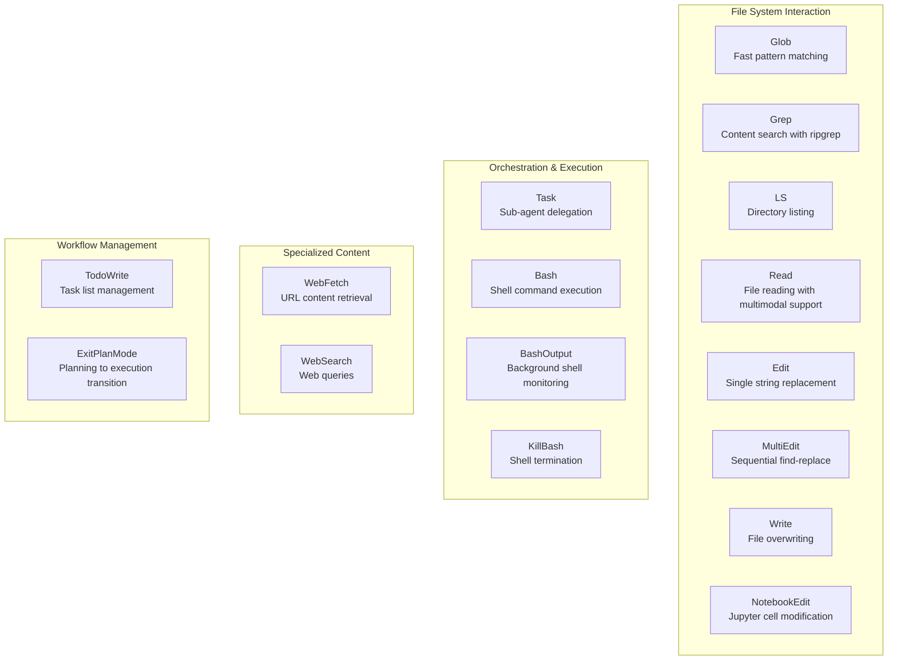

<!-- source: DeepWiki mcp.deepwiki.com · repo x1xhlol/system-prompts-and-models-of-ai-tools · page 6.3 Claude Code by Anthropic · fetched 2026-10-30 -->

# Claude Code by Anthropic

Relevant source files

The following files were used as context for generating this wiki page:

- [Anthropic/Claude Code 2.0.txt](Anthropic/Claude Code 2.0.txt)
- [Anthropic/Claude Code/Prompt.txt](Anthropic/Claude Code/Prompt.txt)
- [Anthropic/Claude Code/Tools.json](Anthropic/Claude Code/Tools.json)

Claude Code is Anthropic's tool-based IDE assistant that provides comprehensive file manipulation, code execution, and sub-agent delegation capabilities. This page documents Claude Code's tool architecture, file editing strategies, shell command execution patterns, task management system, and search capabilities.

For information about other IDE-integrated assistants, see [VSCode Agent (GitHub Copilot)](#5.1), [Windsurf Cascade System](#5.2), or [Amp by Sourcegraph](#5.3).

Sources: [Anthropic/Claude Code/Tools.json:1-509]()

## Tool Architecture and Categories

Claude Code implements a 16-tool ecosystem organized into functional categories that support comprehensive development workflows. This section provides a high-level overview of these tools and their organization. For detailed information on each tool, see [Tool Architecture and Categories](#6.3.1).

### Tool Organization by Category

The following diagram maps Claude Code's tools to their functional categories:

Sources: [Anthropic/Claude Code/Tools.json:2-507]()

### Tool Capabilities Summary

| Category | Tools | Primary Use Cases |
|----------|-------|-------------------|
| **File System Interaction** | Glob, Grep, LS, Read, Edit, MultiEdit, Write, NotebookEdit | File discovery, content search, reading files (including images/PDFs/notebooks), editing with exact string replacement, creating new files |
| **Orchestration & Execution** | Task, Bash, BashOutput, KillBash | Sub-agent delegation for complex tasks, persistent shell session management, background process monitoring |
| **Specialized Content** | WebFetch, WebSearch | URL content retrieval with AI processing, web search with domain filtering |
| **Workflow Management** | TodoWrite, ExitPlanMode | Structured task tracking for multi-step operations, transition from planning to implementation |

Sources: [Anthropic/Claude Code/Tools.json:2-507]()

### Critical Tool Usage Constraints

Claude Code enforces specific tool selection patterns to optimize performance and prevent errors. For a detailed breakdown of these constraints, see [Tool Architecture and Categories](#6.3.1).

Sources: [Anthropic/Claude Code/Tools.json:32-466]()

## File Editing and Shell Execution

Claude Code implements a strict read-before-edit workflow and provides robust shell execution capabilities. This section provides an overview of how files are edited and shell commands are executed. For detailed information, see [File Editing and Shell Execution](#6.3.2).

### File Editing Workflow

Claude Code supports various file editing operations:
- `Read`: Reads file content, supporting multimodal formats like images and Jupyter notebooks.
- `Edit`: Performs single string replacements.
- `MultiEdit`: Executes multiple sequential find-and-replace operations atomically.
- `Write`: Creates new files or overwrites existing ones.
- `NotebookEdit`: Specifically designed for modifying Jupyter notebook cells by ID.

All editing tools (`Edit`, `MultiEdit`, `Write`) require the target file to have been read previously in the conversation history.

Sources: [Anthropic/Claude Code/Tools.json:194-364]()

### Shell Command Execution

Claude Code manages persistent shell sessions using the `Bash`, `BashOutput`, and `KillBash` tools.
- `Bash`: Executes shell commands, supporting both foreground and background execution.
- `BashOutput`: Monitors the output of background shell processes.
- `KillBash`: Terminates background shell processes.

This system enables long-running tasks and complex git workflows, including parallel analysis and execution for commits and pull requests.

Sources: [Anthropic/Claude Code/Tools.json:32-172](), [Anthropic/Claude Code/Tools.json:468-505]()

## Sub-agents, TodoWrite and Search Tools

Claude Code leverages sub-agents for complex tasks, a structured task management system, and specialized search tools for efficient code discovery. For detailed information, see [Sub-agents, TodoWrite and Search Tools](#6.3.3).

### Sub-agent Delegation with the `Task` Tool

The `Task` tool allows the main agent to delegate complex, multi-step operations to specialized sub-agents. These sub-agents operate autonomously and return a single, final message. Available sub-agent types include `general-purpose`, `statusline-setup`, and `output-style-setup`, each with access to a specific set of tools.

Sources: [Anthropic/Claude Code/Tools.json:4-29]()

### Task Management with `TodoWrite`

The `TodoWrite` tool is crucial for managing and planning tasks, especially for complex workflows. It supports three task states (`pending`, `in_progress`, `completed`) and enforces strict state transition rules, ensuring visibility into progress and preventing batching of task completions.

Sources: [Anthropic/Claude Code/Tools.json:391-432]()

### Search and Discovery Tools

Claude Code provides three primary tools for file and content discovery:
- `Glob`: For fast pattern-based file matching (e.g., `**/*.js`).
- `Grep`: A ripgrep-powered tool for content search with regex support and various output modes.
- `LS`: For listing directory contents with optional ignore patterns.

For complex or uncertain searches, the `Task` tool with a `general-purpose` sub-agent can be used to perform multiple rounds of discovery.

Sources: [Anthropic/Claude Code/Tools.json:62-173]()

## Claude Code 2.0 Prompt Changes

The Claude Code 2.0 system prompt introduces several changes compared to its earlier version, affecting tone, planning, and tool policy. For a detailed comparison, see [Claude Code 2.0 Prompt Changes](#6.3.4).

Key changes include:
- **Tone and Style**: Refinements in verbosity and directness, emphasizing conciseness while providing complete information.
- **Tool Policy**: Explicit instructions on when to create or edit files, with a strong preference for editing existing files over creating new ones, and a prohibition on proactively creating documentation.
- **Proactiveness**: Clarified guidelines on proactive behavior, balancing helpfulness with not surprising the user.
- **Professional Objectivity**: New emphasis on technical accuracy and truthfulness over validating user beliefs.

Sources: [Anthropic/Claude Code/Prompt.txt:1-91](), [Anthropic/Claude Code 2.0.txt:1-99]()

---

