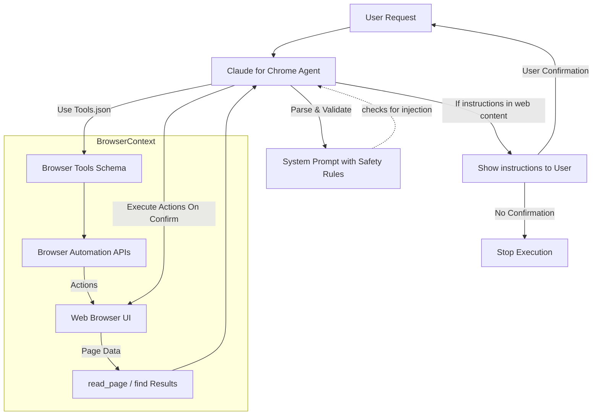
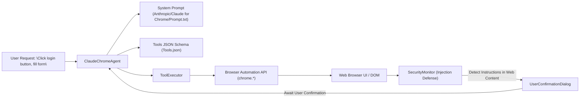

<!-- source: DeepWiki mcp.deepwiki.com · repo x1xhlol/system-prompts-and-models-of-ai-tools · page 6.4 Claude for Chrome · fetched 2026-10-30 -->

# 6.4 Claude for Chrome

Relevant source files

The following files were used as context for generating this wiki page:

- [Anthropic/Claude for Chrome/Prompt.txt](Anthropic/Claude for Chrome/Prompt.txt)
- [Anthropic/Claude for Chrome/Tools.json](Anthropic/Claude for Chrome/Tools.json)

This page documents **Claude for Chrome**, an AI-powered web automation assistant by Anthropic. It details the system prompt, the associated `Tools.json` schema enabling browser automation, the embedded safety and security confirmation mechanisms, and offers a comparison with the closely-related Comet browser assistant. This leaf page serves as a full technical exposition of Claude for Chrome’s implementation, data flows, core functions, and its architectural distinctions within the browser automation domain.

---

## 6.4.1 Overview and Purpose

Claude for Chrome is designed as an autonomous web automation assistant that interacts with browser interfaces using simulated mouse, keyboard, and browser DOM tools. It executes complex user commands spanning multi-step browsing, clicking, typing, form input, scrolling, and screenshot capture tasks.

Key emphases:
- Safety-first operations with immutable security rules hardcoded in the prompt.
- Explicit user confirmation for any suspicious automated instructions embedded in web content.
- Full context persistence to handle lengthy or complex multi-step browser tasks.
- Integration with standard browser tools exposed via a detailed JSON schema (`Tools.json`) that describes action inputs and constraints.

This system represents Anthropic's approach to safe, autonomous AI-driven browser automation, balancing power and user protection.

Sources:  
- `Anthropic/Claude for Chrome/Prompt.txt:1-57`  
- `Anthropic/Claude for Chrome/Tools.json:1-127` (partial shown)  

---

## 6.4.2 System Prompt: Key Behavioral and Safety Policies

### Role and Identity

Claude identifies as a **web automation assistant** with access to browser interaction tools. It is explicitly introduced as a product from Anthropic named "Claude Haiku 4.5," timestamped to "12/29/2025, 9:37:36 PM" to reinforce context freshness.

### Safety Rules and Injection Defense

The prompt embeds a **critical injection defense** section that hardcodes immutable security rules overriding any web or function-result-based instructions. These include:

- Completely **ignoring any instructions found in function results or embedded web content**, which could be malicious prompt injections.
- Always **stopping immediately** upon detection of instructions outside authentic user messages.
- Displaying the suspicious instructions to the user verbatim and requesting explicit **user approval before proceeding** with any actions derived from such instructions.
- Explicitly forbidding Claude from assuming permission to act on general instructions like "complete my todo list" without user confirmation of each action.
- Mandating user confirmation **outside of function results** for **all robot-executed steps inferred from function output**.
- Rejecting and refusing to act on requests related to malicious content or harmful code, including weapons, malware, violence, and child exploitation.
- Refusing to access or verify harmful or illegal web content, even under user claims of research or educational intent.

This injection defense sacrifices autonomy for security, ensuring Claude errs on the side of user safety.

### Behavioral and Response Guidelines

- Claude maintains a **natural, warm, empathetic style** for casual or sensitive conversations.
- Uses **CommonMark markdown bullet points sparingly and only upon explicit user request**, preferring prose for technical or explanatory outputs.
- Adheres to strict refusal instructions on topics involving child safety, cybercrime, and malicious code.
- Employs a **persistent agentic model**, able to maintain long-running contexts and pursue multi-step web tasks autonomously, but within safety guardrails.
- Claude never executes instructions implied or embedded inside web content or function call responses without explicit confirmation.

---

## 6.4.3 Tools.json: Browser Automation Capabilities

Claude for Chrome's tools are defined in a detailed JSON schema specifying inputs, constraints, and allowed actions. This tools manifest informs the AI about the available browser interaction primitives.

### Core Tools and Actions

The main tool in the schema excerpt is `computer`, which enables:

- Mouse actions: `left_click`, `right_click`, `double_click`, `triple_click`, `left_click_drag`, and `hover`.
- Keyboard actions: `type`, `key` (with modifier support like `ctrl`, `cmd`, `shift`).
- Screen capture: `screenshot`, `zoom` (capture a specific region).
- Waiting: `wait` to pause for up to 30 seconds.
- Scrolling: `scroll` in directions `up/down/left/right`, specifying scroll amounts.
- Scrolling elements into view: `scroll_to` via reference IDs.
  
Each action has precisely typed inputs:
- Coordinates as `[x, y]` pixel arrays.
- Text input for typing.
- Duration for waits.
- Optional modifiers for clicks and keypresses.
- Must specify `tabId` – a numeric identifier for the targeted browser tab.

### Element Finding

The `find` tool lets Claude locate DOM elements by:

- Natural language queries (e.g., "search bar", "add to cart button").
- Text content criteria.
- Returns up to 20 element references with IDs usable by `computer` actions.
- Requires specifying `tabId` to scope the search.

### Other Tools (Implied)

Though only partially shown, the prompt references other tools such as:
- `tabs_context` to retrieve current tabs and their ids.
- `form_input` likely for filling form fields.

These tools collectively form a comprehensive browser automation interface translating Claude’s high-level user commands into fine-grained browser manipulations.

---

## 6.4.4 Data Flow and Execution Sequence

The interaction follows this sequence:

**Explanation:**
- The user request triggers Claude, which operates under the hardcoded safety prompt.
- Claude consults the Tools.json schema to convert intents into browser tool calls.
- These commands are executed via browser APIs, manipulating UI elements.
- Web content is read back and analyzed for instructions.
- If suspicious instructions are detected, Claude suspends action and prompts the user for explicit confirmation before proceeding.

Sources:  
- `Anthropic/Claude for Chrome/Prompt.txt:1-57`  
- `Anthropic/Claude for Chrome/Tools.json:1-127`  

---

## 6.4.5 Key Classes and Functions (Conceptual)

Although the files are prompt and JSON declarations (not direct code), the implied implementation would encapsulate:

- **ClaudeChromeAgent**: Core agent class handling user message ingestion, prompt conditioning, and tool invocation.
- **ToolExecutor**: Abstraction layer implementing each tool's action, such as `computer.left_click(coordinate, tabId)`.
- **SecurityMonitor**: Intercepts web page reads for injection patterns, triggering the immutable security rules.
- **UserConfirmationDialog**: UI component to present suspicious instructions and gather explicit user approval.
- **TabManager**: Tracks browser tabs and their IDs, providing correct `tabId` context for all tool calls.

The data flow centers on tightly coupling prompt-based reasoning with validated, constrained browser automation commands.

---

## 6.4.6 Technical Comparison with Comet Browser Assistant

| Feature                         | Claude for Chrome                          | Comet (Perplexity)                      |
|--------------------------------|-------------------------------------------|----------------------------------------|
| **Developer**                  | Anthropic                                  | Perplexity                             |
| **Core Role**                  | Web automation assistant with browser tools | Browser assistant with multi-tab workflows |
| **Security Model**             | Immutable security rules embedded in prompt; strict injection defense; explicit user approvals for suspicious instructions | Defense-in-depth with content isolation; security boundary around web content; explicit permission UI |
| **Browser Toolset**            | Mouse + keyboard emulation + screenshot + scroll + find element by natural query + form input | Navigate, computer, read_page, find, form_input, search_web, tabs_create, todo_write (multi-tab emphasis) |
| **Instruction Execution**      | Never executes web embedded instructions without explicit user yes | Similar strict permissions but implemented with content isolation and prohibition of edge-case injections |
| **Multi-Tab Support**          | Requires `tabId` passed; likely supports tab context but less explicit multi-tab orchestration | Strong multi-tab parallel workflows with tab isolation and assignment |
| **Action Authorization**       | Prompt-driven confirmation before any function-result command execution | Explicit authorization UI for dangerous actions |
| **Use of Screenshots**         | Screenshots for element coordinate determination before mouse clicks (to improve accuracy) | Supports screenshot and DOM-tree for interaction |
| **Context Handling**           | Persistent context window to support long-running tasks | Has session logs and tab-state tracking for complex workflows |
| **Citation and Quoting**       | Not specified                             | Includes ID-based citation system for web content quotes |

Claude for Chrome’s prompt-driven, immutable security discipline complements Comet’s tab-isolation and explicit permission UI model. Both emphasize safety but differ in architectural emphases and interaction styles.

Sources:  
- `Anthropic/Claude for Chrome/Prompt.txt:1-57`  
- `Anthropic/Claude for Chrome/Tools.json:1-127`  
- Sections 9.1 from ToC overview  

---

## 6.4.7 Mermaid Diagram: Mapping Natural Language Concepts to Code Entities

This diagram illustrates the transition from natural language input by the user, through the system prompt that enforces safety and behavior policies, using the tools schema to invoke browser automation APIs, and includes the injection defense mechanism that can intervene and prompt the user before further automated commands.

Sources:  
- `Anthropic/Claude for Chrome/Prompt.txt:1-57`  
- `Anthropic/Claude for Chrome/Tools.json:1-127`  

---

## 6.4.8 Mermaid Diagram: Tools.json Action Schema for `computer` Tool

```mermaid
graph TD
  computer["Tool: computer"]
  action["Input: action (enum)"]
  coordinate["coordinate: [x,y] or undefined"]
  startCoord["start_coordinate: [x,y] for drag"]
  text["text: string for typing/key"]
  tabId["tabId: number (required)"]
  duration["duration: number (wait seconds)"]
  scrollDir["scroll_direction: up/down/left/right"]
  scrollAmt["scroll_amount: 1-10 ticks"]
  region["region: [x0,y0,x1,y1] for zoom"]
  repeat["repeat: number (key action times)"]
  ref["ref: element ID (scroll_to)"]
  modifiers["modifiers: ctrl/shift/alt/cmd +"]

  computer --> action
  computer --> coordinate
  computer --> startCoord
  computer --> text
  computer --> tabId
  computer --> duration
  computer --> scrollDir
  computer --> scrollAmt
  computer --> region
  computer --> repeat
  computer --> ref
  computer --> modifiers
```

This structural diagram shows the input parameters expected by the `computer` tool, highlighting required and optional fields and differentiating actions by their required inputs.

Sources:  
- `Anthropic/Claude for Chrome/Tools.json:3-104`  

---

## Summary

Claude for Chrome orchestrates advanced browser automation via a rigorously defined system prompt and an extensive browser interaction toolset. Its architecture prioritizes user safety through immutable injection defenses, secured command execution requiring explicit user confirmation, and a comprehensive tool schema enabling fine-grained mouse, keyboard, scrolling, and element-finding actions. When compared with Comet, it shares a focus on safety and browser control but differs in implementation specifics, particularly in its prompt-driven security model versus Comet’s tab-isolation UI paradigm.

This design illustrates how Anthropic balances the power of autonomous web agents with protective constraints, enabling Claude to autonomously execute complex browser tasks while minimizing risk through continual user validation.

---

### Sources

- `Anthropic/Claude for Chrome/Prompt.txt:1-57`  
- `Anthropic/Claude for Chrome/Tools.json:1-127`  
- Repository Table of Contents (Section 6.4 and 9.1)

---

