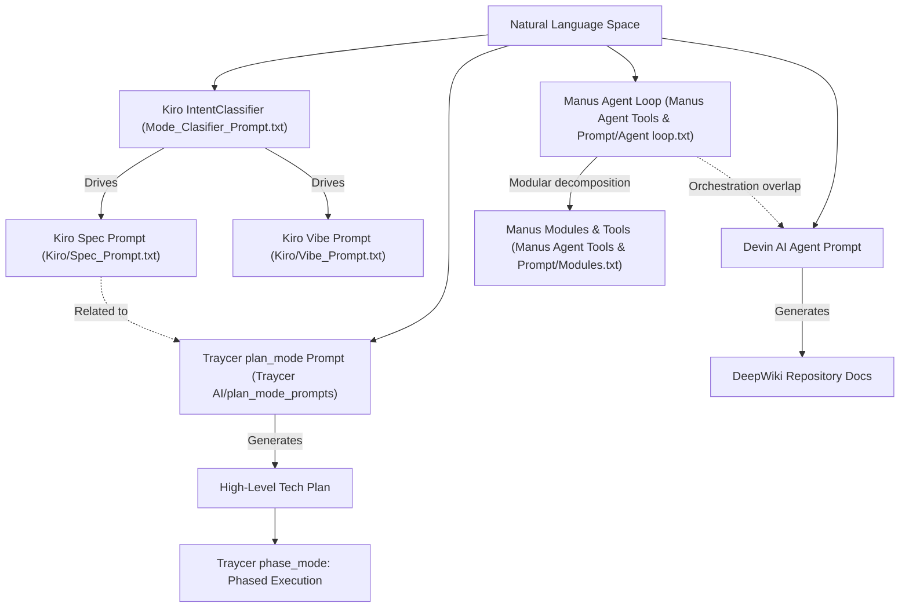

<!-- source: DeepWiki mcp.deepwiki.com · repo x1xhlol/system-prompts-and-models-of-ai-tools · page 7 Planning, Spec and Orchestration Agents · fetched 2026-10-30 -->

# 7. Planning, Spec and Orchestration Agents

Relevant source files

The following files were used as context for generating this wiki page:

- [Kiro/Mode_Clasifier_Prompt.txt](Kiro/Mode_Clasifier_Prompt.txt)
- [Kiro/Spec_Prompt.txt](Kiro/Spec_Prompt.txt)
- [Kiro/Vibe_Prompt.txt](Kiro/Vibe_Prompt.txt)
- [Manus Agent Tools & Prompt/Agent loop.txt](Manus Agent Tools & Prompt/Agent loop.txt)
- [Manus Agent Tools & Prompt/Modules.txt](Manus Agent Tools & Prompt/Modules.txt)
- [Traycer AI/plan_mode_prompts](Traycer AI/plan_mode_prompts)

This section introduces AI systems within the repository designed around planning, specification workflows, and multi-agent orchestration architectures. These agents emphasize structured task planning, specification-driven development, modular task execution, and collaborative or autonomous orchestration of complex workflows. The key systems covered include Kiro, Traycer AI, Manus, and Devin AI.

They form a distinct category in the repository focused on advancing the workflow intelligence and coordination capabilities of AI assistants, going beyond direct coding assistance towards higher-level reasoning, specification handling, and task decomposition.

This is a PARENT page providing a high-level overview with links to detailed child pages for each system.

---

## 7.1 Kiro: Mode Classification, Specification and Vibe Prompts

**Kiro** is an AI assistant and IDE agent built to assist developers by understanding the user's intent and switching between different modes of interaction. Central to Kiro’s operation is an *intent classifier* which distinguishes user input into three confidence scores: `chat`, `do`, and `spec`.

- The **Mode Classifier** determines if the user's current request is a typical chat interaction, a command/action-oriented "do" request, or a *specification* ("spec") oriented request for creating or working with formal design documents and plans.
- This classification drives how Kiro formulates responses and the prompts it uses internally.
- Kiro's **Spec mode prompt** focuses on formal specs, project design, and planning workflows, emphasizing understanding and generating specification or requirements documents.
- In contrast, Kiro's **Vibe mode prompt** is for typical actionable coding assistance, including code suggestions, edits, CLI commands, and debugging help.
- Both modes share a warm, conversational style, aiming to reflect the user’s tone and maintain high technical precision without condescension. Kiro never writes code directly but recommends changes, shell commands, and best practices.
- Kiro is managed by an autonomous process that executes its requested actions under human supervision.

Kiro thus functions as a planning-aware AI assistant capable of distinguishing between high-level specification tasks and immediate coding actions, enabling a spec-driven development experience.

For detailed documentation of Kiro's mode classification logic as well as the full specs and vibe prompts, see the child page:  
[Kiro Mode Classifier, Spec and Vibe Prompts](#7.1)

---

## 7.2 Traycer AI: Two-Stage Planning and Phased Execution

**Traycer AI** embodies a *two-stage agent architecture* for large-scale software task planning and phased execution:

- The first stage is the **`plan_mode`**, where Traycer acts as a technical lead preparing a high-level design plan for the user’s task. This mode:
  - Avoids any code writing or low-level implementation details.
  - Emphasizes clarity, simplicity, and strict alignment to user goals without unnecessary complexity.
  - Uses tags for internal monologue to ruminate on exploration and plan the next steps.
  - Is built to work in read-only mode with the codebase to avoid premature code changes.
  
- The second stage is the **`phase_mode`**, which consumes the plan produced earlier and carries out phased implementation in iterative steps.

Traycer’s system prompt stresses the role of a senior technical lead providing architecture and design guidance rather than coding or naive explorations. It prioritizes careful, incremental reasoning and strictly follows coding best practices in planning.

Traycer also employs schema definitions for its tools and prompts to cleanly separate concerns between exploration, plan generation, and phased action execution.

This design enables long-term task management and scaling by separating planning (design) from execution (coding), allowing high confidence and reviewability at each stage.

See the child page for full prompt text, tool schemas, and architectural rationale:  
[Traycer AI Plan and Phase Modes](#7.2)

---

## 7.3 Manus: Agent Loop, Modular Decomposition, and Tools

**Manus** is a general-purpose autonomous AI agent designed for complex multi-domain workflows including:

- Information gathering, fact-checking, and documentation
- Data processing, analysis, and visualization
- Writing multi-chapter articles and research reports
- Creating websites, applications, and various tooling
- Programming beyond development into diverse problem-solving

Manus operates using a structured **agent loop** composed of the following iterative steps:

1. **Analyze Events**: Understand user intents and current state from an event stream that includes messages, actions, observations, plans, knowledge, data sources, and other events.
2. **Select Tools**: Choose the most appropriate tool call considering the current context, planning, and available knowledge or APIs.
3. **Wait for Execution**: Execute the selected tool via a sandbox or external environment.
4. **Iterate**: Make one tool call per iteration, patiently working through tasks step-by-step.
5. **Submit Results**: Provide outputs and deliverables to the user as attachments rather than inline text.
6. **Enter Standby**: Idle when tasks are done, awaiting new instructions.

Manus heavily modularizes its system into:

- A **Planner module** that drives overall task planning and step numbering using pseudocode.
- A **Knowledge module** that provides best practices and relevant information scoped to current tasks.
- A **Datasource module** which enables calling external data APIs directly through code with no user login needed, promoting authoritative data use.
- A **Message communication** subsystem distinguishing notify vs ask messages to optimize user interactions.

The agent is designed with language adaptability, avoiding terse bullet lists, and prefers to communicate in user-specified or English by default.

Manus constitutes a robust multi-modal, multi-step, multi-tool orchestration system suited for advanced autonomous workflows.

For details about Manus's agent loop, module architecture, prompt design, and tool schema, consult:  
[Manus Agent Loop, Modules and Tools](#7.3)

---

## 7.4 Devin AI and DeepWiki

**Devin AI** is an orchestration agent specialized in documentation generation and repository knowledge management.

- Devin’s agent prompt focuses on producing detailed and structured repository documentation.
- The **DeepWiki** prompt is used alongside Devin AI to create deep, well-structured wiki content that documents the repository thoroughly.
- Devin AI integrates understanding of source structure, code semantics, and developer intent to maintain clear repository knowledge bases.
- It supports dynamic updating and generation of documentation through natural language inputs and multi-step reasoning.
- Devin AI is also equipped to interpret existing files and generate rich knowledge artifacts systematically.

Together, Devin AI and the DeepWiki prompt enable scalable, automated repository documentation and knowledge hub construction within the ecosystem.

For comprehensive descriptions of Devin AI’s agent prompt and DeepWiki prompt, visit:  
[Devin AI and DeepWiki](#7.4)

---

## Architectural Context and Relationships

The four agents collectively represent the state-of-the-art in planning, spec-driven design, and multi-agent orchestration AI within this repository. Each has distinct strengths and roles:

This diagram maps how natural language inputs flow into different system prompts and agent processes within code entities, providing a bridge from user intents to system-specific workflows.

---

## Summary

- **Kiro** specializes in adaptive intent classification between specification and coding modes, supporting spec-driven developer assistance.
- **Traycer AI** implements a disciplined two-stage plan-then-phase architecture for large team project design and phased execution.
- **Manus** is a general autonomous agent looping through event analysis, tool selection, and iterative task execution across multiple domains.
- **Devin AI** focuses on repository documentation orchestration and knowledge generation with DeepWiki.

Together they extend the repository’s ecosystem beyond direct coding to support planning, specification, and autonomous orchestration workflows foundational to scaling AI system intelligence.

For detailed explanations and technical prompts, see the respective child pages:  
- [Kiro Mode Classifier, Spec and Vibe Prompts](#7.1)  
- [Traycer AI Plan and Phase Modes](#7.2)  
- [Manus Agent Loop, Modules and Tools](#7.3)  
- [Devin AI and DeepWiki](#7.4)

---

### Sources

- Kiro/Mode_Clasifier_Prompt.txt  
- Kiro/Spec_Prompt.txt  
- Kiro/Vibe_Prompt.txt  
- Traycer AI/plan_mode_prompts  
- Manus Agent Tools & Prompt/Agent loop.txt  
- Manus Agent Tools & Prompt/Modules.txt

---

