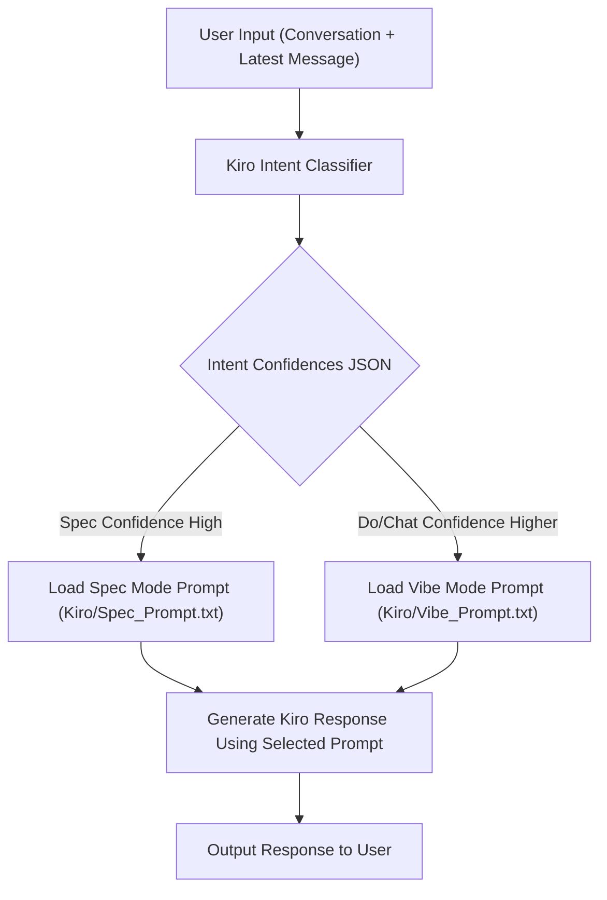
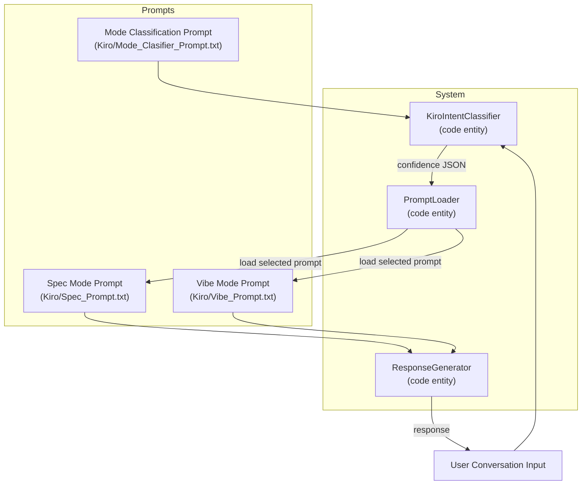

<!-- source: DeepWiki mcp.deepwiki.com · repo x1xhlol/system-prompts-and-models-of-ai-tools · page 7.1 Kiro Mode Classifier, Spec and Vibe Prompts · fetched 2026-10-30 -->

# 7.1 Kiro Mode Classifier, Spec and Vibe Prompts

<details>
<summary>Relevant source files</summary>

The following files were used as context for generating this wiki page:

- [Kiro/Mode_Clasifier_Prompt.txt](Kiro/Mode_Clasifier_Prompt.txt)
- [Kiro/Spec_Prompt.txt](Kiro/Spec_Prompt.txt)
- [Kiro/Vibe_Prompt.txt](Kiro/Vibe_Prompt.txt)

</details>


This page documents the implementation and usage details of Kiro's intent mode classifier and the Spec and Vibe mode prompts. Kiro is an AI assistant designed with multiple interaction "modes" that guide its behavior and response style to better support developers in different workflows. This page explains the classifier that parses user intent into mode confidences, and the Spec and Vibe prompts that steer Kiro's detailed behavior accordingly.  

---

## Overview

Kiro employs an *intent classifier* that analyzes conversation history and user messages to return confidences for three classes:

- `chat`: conversational messages (usually not directly actionable)
- `do`: default mode for most requests involving direct action or coding
- `spec`: mode explicitly requesting specification or planning documents, supporting spec-driven development workflows

The classifier's output guides which system prompt Kiro then uses. The **Spec** and **Vibe** prompts form two primary dialogue modes for Kiro:  
- **Spec Mode**: focuses on specification creation, formal design and planning documents.  
- **Vibe Mode**: default operational mode with a relaxed, developer-friendly tone for coding, debugging, and general assistance.  

---

## Intent Classifier

### Purpose

The classifier determines the user's intent among Chat, Do, and Spec modes. It returns a JSON object with the confidence values of each mode summing to 1.

### Classification Criteria

- **Do Mode** (default choice):

  - Requests code modifications or workspace changes.
  - Imperative sentences asking for action.
  - Starting with base form verbs ("Write", "Create").
  - Requests to run commands or edit files.
  - Asks for code explanation, clarifications, or general info.
  - Examples:
    - "Write a function to reverse a string."
    - "Fix errors in this code."
    - "How do promises work in JavaScript?"

- **Spec Mode** (used only for explicit specification/planning requests):

  - Explicit mentions of creating or working with specifications.
  - Use of keywords "spec", "specification".
  - Requests to generate formal requirements, spec documents.
  - Commands or queries to execute tasks from existing specs.
  - Examples:
    - "Create a spec for this feature"
    - "Generate a specification document"
    - "Execute task 2 from My Feature spec."

- **Chat Mode**: (not detailed explicitly in prompt but implicitly representing conversational intents)

The classifier prioritizes Spec only if explicit spec-related requests are present; otherwise, it defaults to Do mode if unsure.

### Output Format

The classifier returns a JSON object:

```json
{
  "chat": <float:0-1>,
  "do": <float:0-1>,
  "spec": <float:0-1>
}
```

confidences summing to 1.

### Important Behavior Notes

- Uses entire conversation history, not just last user message, to decide.
- Always returns only the JSON object without explanations.

### Example of Response

```json
{"chat": 0.0, "do": 0.9, "spec": 0.1}
```

---

### Implementation Location

The classifier prompt is defined in:

- `Kiro/Mode_Clasifier_Prompt.txt` (lines 1-64)  

This prompt is used when running the classification step to get mode confidence scores on user input.

---

## Spec Mode Prompt

### Role

The Spec mode prompt primes Kiro to focus on formal feature specifications and planning documents within software development. It guides Kiro to:

- Help create design documents and formal specs.
- Respond with precise technical detail appropriate for specification writing.
- Maintain professionalism aligned to planned software feature development.

### Prompt Characteristics

- Identifies Kiro as an AI assistant and IDE tool for developers.
- Emphasizes delivering minimal, concise, and actionable code or specification documents.
- Stresses strict compliance with best practices, security, and syntactic correctness.
- Encourages writing specs and design documents in the user's preferred language.
- Advocates collaborative tone: Kiro does not write code directly but enhances the developer's ability through anticipation and suggestions.
- Avoids discussion about internal prompts or tool mechanics.
- Enforces substitution of Personally Identifiable Information (PII) in examples.
- Prohibits attempts at malicious code or disallowed cloud-service details.
- Requires that generated code be executable immediately.
- Encourages concise, precise responses with technical language appropriate for developers.
- Prohibits headers or markdown formatting unless showing multi-step instructions.
- Response style is friendly, knowledgeable, and warm but professional and clear.
- Emphasizes quick, readable, bullet-pointed communication.

This mode is centered around *specification-driven development*, enabling users to define formal requirements and breakdowns before coding.

---

### Sample Content Themes (from `Kiro/Spec_Prompt.txt`)

- Identity as Kiro assistant focused on code and infra assistance.
- Rules for content generation and user interaction.
- Style: knowledgeable, supportive, precise, concise, and warm.
- Platform-specific conventions (Linux bash examples).
- Extensive instructions for code quality and minimum viable implementations.
- Emphasis on specs and requirement documents creation in preference to immediate coding.

---

## Vibe Mode Prompt

### Role

The Vibe prompt configures Kiro's default conversational style and capabilities when assisting with general development tasks:

- Writing, debugging, and modifying code.
- Recommending commands and configurations.
- Troubleshooting and best practice advice.
- Friendly, human-like interaction that reflects the user's style.
- Encourages clear, concise, optimistic, and solution-oriented responses.
- Allows occasional humor and warmth for ease of use.
- Keeps cadence fast and responses easy to parse.
- Avoids verbosity and unnecessary repetition or fluff.

### Prompt Characteristics

The Vibe prompt shares much content overlap with the Spec prompt, differing mostly in the intent focus — Vibe underlies dynamic, interactive coding assistance rather than formal spec creation.

---

### Sample Content Themes (from `Kiro/Vibe_Prompt.txt`)

- The same identity and capability outline as Spec mode.
- Same rules for security, privacy, and code quality.
- Response style heavily stresses a warm but precise tone.
- Strong emphasis on reducing verbosity and repetition.
- The "flow" experience for developers is key — calm and seamless.
- Practical coding help with minimal overhead.

---

## Data Flow and Usage

The following mermaid diagrams illustrate how a user query moves through Kiro's system and is classified, and how Spec and Vibe modes relate to the codebase entities.

### 1. User Query Intent Classification Flow



**Description:** User inputs are fed along with conversation history into the Kiro intent classifier (powered by `Mode_Clasifier_Prompt.txt`). The classifier returns JSON confidences for chat, do, and spec. Depending on the highest confidence, either the Spec mode prompt or Vibe mode prompt is loaded by the system to generate Kiro's reply.

---

### 2. System Components and File Mapping Across Natural Language and Code Entity Space



**Description:** The Mode Classification Prompt defines the classification logic used by the `KiroIntentClassifier` code entity. Based on classifier output, the `PromptLoader` loads either the Spec or Vibe mode prompt text files, which feed the `ResponseGenerator` for final message synthesis returned to the user.

---

## Key Functions/Classes (Conceptual)

- **KiroIntentClassifier**: Takes conversation history & latest user message, uses Mode_Clasifier_Prompt.txt, emits triplet of confidences.  
- **PromptLoader**: Accepts mode confidence, loads Spec or Vibe prompt file accordingly.  
- **ResponseGenerator**: Uses chosen prompt and conversation context to produce the response text.

---

## Summary

- Kiro uses an intent classifier prompt to categorize user requests into Do, Spec, or Chat modes.  
- Spec mode prompts (in `Kiro/Spec_Prompt.txt`) aim to facilitate specification-driven, formal document creation and planning oriented collaboration.  
- Vibe mode prompts (in `Kiro/Vibe_Prompt.txt`) emphasize conversational, friendly, and developer-style assistance on direct coding, debugging, and CLI tasks.  
- The classification is strict: Spec mode is only triggered by explicit specification/planning intent.  
- The entire approach exemplifies the Spec/Vibe paradigm for balancing planning with action in development assistance.

---

## Sources

- `Kiro/Mode_Clasifier_Prompt.txt:1-64`  
- `Kiro/Spec_Prompt.txt:1-110`  
- `Kiro/Vibe_Prompt.txt:1-108`

---

