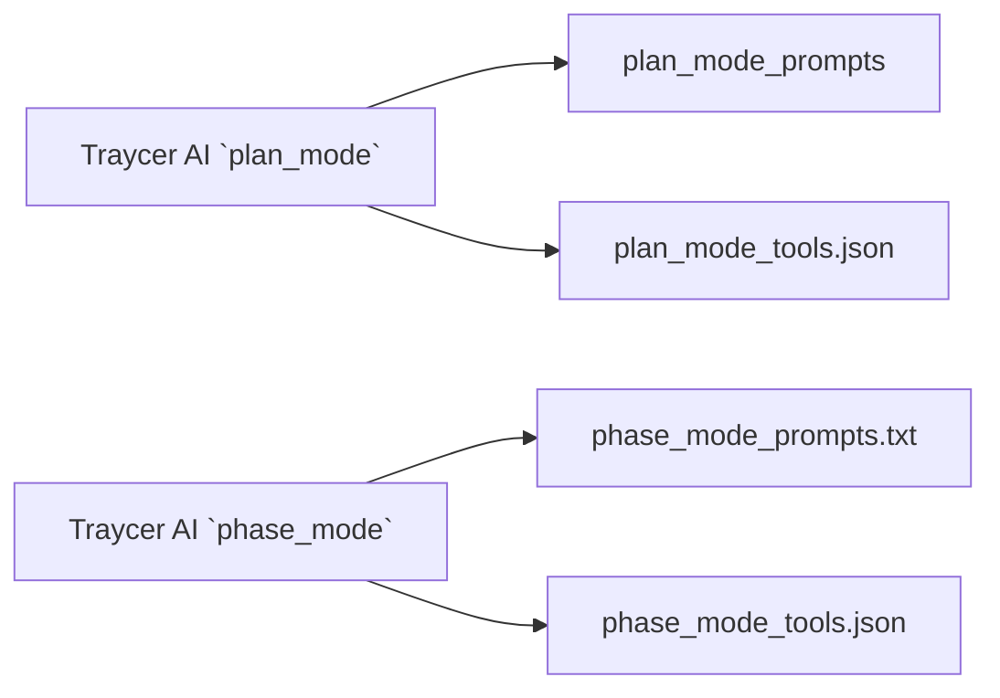

<!-- source: DeepWiki mcp.deepwiki.com · repo x1xhlol/system-prompts-and-models-of-ai-tools · page 7.2 Traycer AI Plan and Phase Modes · fetched 2026-10-30 -->

# 7.2 Traycer AI Plan and Phase Modes

<details>
<summary>Relevant source files</summary>

The following files were used as context for generating this wiki page:

- [Traycer AI/phase_mode_prompts.txt](Traycer AI/phase_mode_prompts.txt)
- [Traycer AI/phase_mode_tools.json](Traycer AI/phase_mode_tools.json)
- [Traycer AI/plan_mode_prompts](Traycer AI/plan_mode_prompts)
- [Traycer AI/plan_mode_tools.json](Traycer AI/plan_mode_tools.json)

</details>


This page documents Traycer AI's two primary interaction modes — **plan_mode** and **phase_mode** — focusing on their distinct prompt designs, tool schemas, and responsibilities within Traycer's planning and execution workflow. These modes exemplify the two-stage architecture that first produces high-level plans and then breaks the work down into executable phases, aligning AI assistance more closely with developer team workflows.

---

## Overview

Traycer AI is an advanced LLM-based technical lead assistant embedded in the user's IDE environment. It operates in **two distinct modes**:

- **Plan Mode** (`plan_mode`): Focused on crafting a high-level conceptual design plan for the user’s coding task. It emphasizes architectural reasoning, codebase exploration, and strategic planning without code modifications.

- **Phase Mode** (`phase_mode`): Concentrates on decomposing the approved plan into actionable phases, serving as a detailed execution guide for the engineering team. This mode is still read-only but more granularly focused on codebase elements like classes, functions, and files.

This two-stage approach partitions the cognitive load of software task completion and avoids conflating abstract planning with implementation details or coding, thereby enhancing clarity, modularity, and effective human-AI collaboration.

---

## 1. Prompt Design and Behavioral Constraints

Traycer's prompts implement a strict role, communication, and operational guidelines tailored to each mode's purpose.

### Plan Mode Prompt

- **Role:** The AI acts as a highly respected technical lead who produces a **high-level design** rather than writing or editing code.
- **Operational Scope:** Read-only exploration of the codebase is allowed. Interaction with the user is concise and focused on refining understanding or confirming ambiguity.
- **Behavior:** The AI *never* writes code; it may mention existing symbols, classes, functions, or modules relevant to the task.
- **Tool Usage:** Limited to exploratory and research tools for overview-level discovery (e.g., directory listing, fast fuzzy file search) and web search for supplementary information.
- **No deep code reading or modification:** The prompt explicitly states that deep dives into code or file editing is not the responsibility here.

Notable excerpt highlights:

> "Your job is to provide a high-level design instead of a literal implementation... You are provided with basic tools to explore the overall codebase structure or search the web... but deep exploration of the codebase is not your responsibility."  
> [Traycer AI/plan_mode_prompts:1-40]()

---

### Phase Mode Prompt

- **Role:** The AI is the tech lead tasked with **breaking down the user query into high-level phases.**
- **Operational Scope:** Still read-only but significantly deeper, analyzing codebase details such as symbols, classes, and functions.
- **Behavior:** Does **not** write code or run commands but can mention technical code entities extensively, acting as the engineering team's lead planner.
- **Tool Usage:** Encourages extensive use of code search and file reading tools to gain understanding and build accurate phased plans.
- **Interaction:** Actively asks users for clarifications on ambiguities or critical missing details.

Prompt excerpts:

> "You are the tech lead... With readonly access... You DO NOT write code but mention symbols, classes, and functions relevant to the task... If you need clarification... ask the user multiple times."  
> [Traycer AI/phase_mode_prompts.txt:3-48]()

---

## 2. Tool Schema and Usage

Traycer AI provides **distinct tool schemas** for the two modes, reflecting their functional responsibilities and access levels.

### Plan Mode Tools

These tools are focused on **high-level exploration and lightweight discovery**, minimizing deep code inspection:

| Tool         | Description                                                                                                             |
|--------------|-------------------------------------------------------------------------------------------------------------------------|
| `list_dir`   | Lists directory contents, optionally recursively. Useful for quick structure discovery.                                |
| `file_search`| Fast fuzzy matching to find files by partial path or name.                                                              |
| `grep_search`| Regex-based search to find exact text matches efficiently using ripgrep.                                               |
| `web_search` | Performs external web searches for supplementary documentation or information.                                          |
| `read_file`  | Reads file contents with optional diagnostics (normally limited use).                                                   |
| `read_partial_file` | Reads specific line ranges of files, for focused reading of code or config.                                      |
| `think`      | Logs internal reasoning or brainstorming without side effects.                                                         |

This promotes **broad awareness of the codebase and external knowledge**, allowing the AI to formulate a cohesive plan without detailed implementation-level reading or code edits.

Structure example from `plan_mode_tools.json`:

```json
{
  "list_dir": {
    "description": "List contents of a directory...",
    "parameters": {
      "path": {"type": "string", "sanitizePath": true},
      "recursive": {"type": "boolean"}
    },
    "required": ["path","recursive"]
  },
  "file_search": {
    "description": "Fast file search by fuzzy matching...",
    "parameters": {
      "pattern": {"type": "string"}
    },
    "required": ["pattern"]
  },
  ...
}
```

[Traycer AI/plan_mode_tools.json:1-131]()

---

### Phase Mode Tools

Designed for **detailed codebase analysis and understanding** to support phase decomposition, tools include:

- The full suite from `plan_mode_tools.json` plus advanced capabilities.
- Rich support for partial file reads specifying line ranges and diagnostic collection.
- `get_diagnostics` for retrieving cross-file warnings and errors.
- Emphasis on examining relevant code constructs at function/class granularity.

Core tool descriptions from `phase_mode_tools.json`:

| Tool             | Description                                                                                                       |
|------------------|------------------------------------------------------------------------------------------------------------------|
| `read_file`      | Read whole files with optional inclusion of diagnostics from LSP analysis.                                        |
| `read_partial_file`| Read focused line ranges from files; supports partial parsing with diagnostics.                                  |
| `list_dir`       | List directory contents recursively or top-level.                                                                |
| `file_search`    | Fuzzy search for file names; limited to top 10 results for performance.                                           |
| `grep_search`    | Regex pattern search within files or directories, useful for symbol lookup.                                       |
| `web_search`     | External web search for documentation or query expansion.                                                        |
| `get_diagnostics`| Aggregate diagnostics (errors, warnings, lint suggestions) for file sets matching globs.                         |

Example snippet from `phase_mode_tools.json`:

```json
{
  "read_partial_file": {
    "description": "Read specific line ranges from files...",
    "parameters": {
      "paths": {
        "items": {
          "properties": {
            "path": {"type": "string", "sanitizePath": true},
            "startLine": {"type": "number"},
            "numberOfLines": {"type": "number"},
            "includeDiagnostics": {"type": "boolean", "default": false}
          },
          "required": ["path", "numberOfLines", "startLine", "includeDiagnostics"],
          "type": "object"
        },
        "type": "array"
      }
    }
  },
  ...
}
```

[Traycer AI/phase_mode_tools.json:1-130]()

---

## 3. Architectural Pattern: Two-Stage Planning-Then-Phase Execution

Traycer AI distinctly separates tasks into two logical phases for enhanced precision and user collaboration:

1. **Planning Stage (Plan Mode)**: The AI produces a strategic design, breaking down user requests into conceptual parts without engaging deeply in code. The output is a **plan** describing the approach and architectural ideas.

2. **Phasing Stage (Phase Mode)**: Based on the plan, the AI then decomposes it into **high-level executable phases**, detailed with references to relevant code entities (classes, functions) and files. This stage guides actual work allocation and milestone setting.

This pattern achieves:

- Clear division of concern between broad design and actionable breakdown.
- Granular control for user interaction, enabling clarification at both stages.
- Prevention of premature implementation, reinforcing the AI’s role as a lead, not a coder.
- Tool usage optimized per mode for efficiency and relevance.

---

### Data Flow and Interaction

```mermaid
flowchart TD
  NL[/"Natural Language User Query"/]
  PLAN[/"Plan Mode Prompt\n(High-Level Architecture Design)"/]
  PHASE[/"Phase Mode Prompt\n(Breakdown into Executable Phases)"/]
  TOOLS_P1[/"Plan Mode Tools\n(list_dir, file_search, grep_search, web_search)"/]
  TOOLS_P2[/"Phase Mode Tools\n(read_file, read_partial_file, get_diagnostics, grep_search, etc.)"/]
  USER_CLARIFY[/"User Clarifications"/]

  NL --> PLAN
  PLAN --> TOOLS_P1
  TOOLS_P1 --> PLAN
  PLAN --> USER_CLARIFY
  USER_CLARIFY --> PLAN
  PLAN --> PHASE
  PHASE --> TOOLS_P2
  TOOLS_P2 --> PHASE
  PHASE --> USER_CLARIFY
  USER_CLARIFY --> PHASE
  PHASE --> "Phase Plan Output"

  style PLAN fill:#f9f,stroke:#333,stroke-width:1px
  style PHASE fill:#bbf,stroke:#333,stroke-width:1px
```

This diagram illustrates the interaction where:

- User natural language queries trigger the **plan mode** for design formulation using lightweight tools.
- User clarifications may be requested iteratively during planning.
- After plan approval, control passes to **phase mode** which leverages deeper tooling for fine-grained breakdown.
- Again, clarifications serve to refine ambiguity before final phase plan generation.

---

### Code Entity Mapping



Nodes correspond to the actual files:

- Prompts define AI behavior and scope.
- Tools JSON files define the available API methods the AI can invoke.

This exact separation enables Traycer AI to adopt a tailored capability set per mode, enforcing mode-specific responsibilities.

---

## 4. Integration in User Workflow

Traycer AI typically operates embedded within the user's IDE environment, adopting the identity of a **tech lead** guiding the engineering team.

- *In Plan Mode*: The AI helps the user understand and structure the task scope, establish strategy, and identify relevant modules and code elements.
- *In Phase Mode*: The AI decomposes the plan into phases or milestones including references to specific classes, functions, and files which are essential for actual development work distribution.

The strict read-only constraint in both modes enforces safety and respects the AI’s advisory capacity.

---

## 5. Summary Table: Plan Mode vs Phase Mode

| Aspect                  | Plan Mode                              | Phase Mode                               |
|-------------------------|--------------------------------------|-----------------------------------------|
| Role                    | Technical Lead - High-level design   | Technical Lead - Detailed phase breakdown|
| Codebase Access          | Read-only, shallow exploration       | Read-only, deep code exploration         |
| Focus                   | Architectural plan, conceptual design| Breaking down plan into phases            |
| Writing Code            | Forbidden                           | Forbidden                               |
| Toolset                 | `list_dir`, `file_search`, `grep_search`, `web_search`, `read_file` (limited)| Full file reading, partial reads, diagnostics tools plus plan-mode tools|
| User Interaction        | Clarifications on design and scope   | Clarifications on phases and code details|
| Prompt Files            | `plan_mode_prompts` (Traycer AI/plan_mode_prompts)| `phase_mode_prompts.txt` (Traycer AI/phase_mode_prompts.txt)|
| Tools JSON files         | `plan_mode_tools.json`                | `phase_mode_tools.json`                  |

---

# References

- Traycer AI `plan_mode_prompts` — prompt behavior and guidelines [Traycer AI/plan_mode_prompts:1-131]()
- Traycer AI `phase_mode_prompts.txt` — phase mode prompt, role, and decision tree [Traycer AI/phase_mode_prompts.txt:1-48]()
- Traycer AI `plan_mode_tools.json` — Plan mode tool schema [Traycer AI/plan_mode_tools.json:1-131]()
- Traycer AI `phase_mode_tools.json` — Phase mode tool schema [Traycer AI/phase_mode_tools.json:1-130]()

---

This completes the detailed technical documentation for the Traycer AI plan_mode and phase_mode prompts and tool ecosystems. The two-stage architecture exemplifies best practices in separating planning and execution workflows in AI-enhanced software engineering.

---

