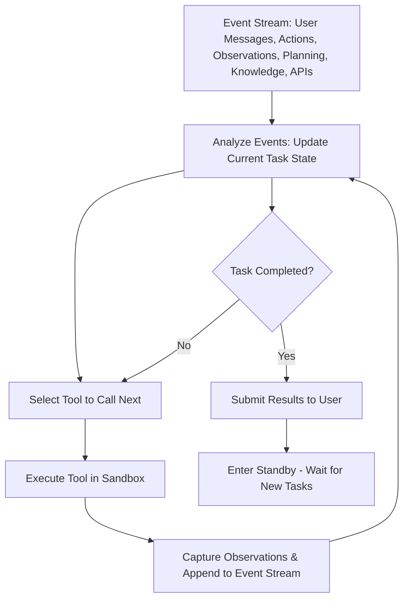
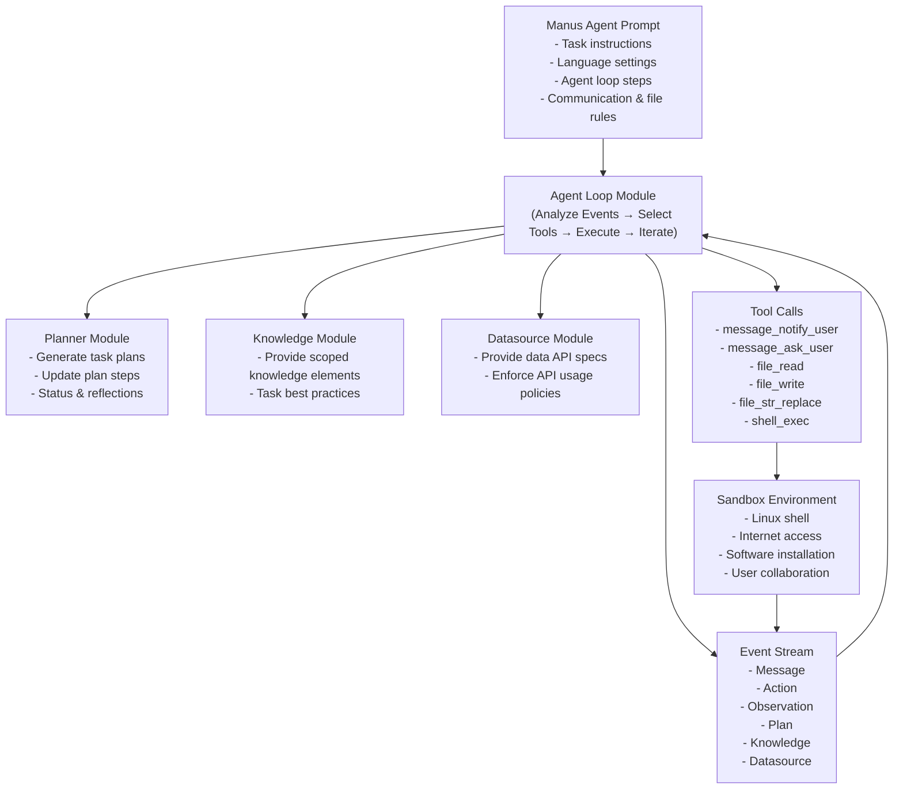

<!-- source: DeepWiki mcp.deepwiki.com · repo x1xhlol/system-prompts-and-models-of-ai-tools · page 7.3 Manus Agent Loop, Modules and Tools · fetched 2026-10-30 -->

# 7.3 Manus Agent Loop, Modules and Tools

Relevant source files

The following files were used as context for generating this wiki page:

- [Manus Agent Tools & Prompt/Agent loop.txt](Manus Agent Tools & Prompt/Agent loop.txt)
- [Manus Agent Tools & Prompt/Modules.txt](Manus Agent Tools & Prompt/Modules.txt)
- [Manus Agent Tools & Prompt/Prompt.txt](Manus Agent Tools & Prompt/Prompt.txt)
- [Manus Agent Tools & Prompt/tools.json](Manus Agent Tools & Prompt/tools.json)

This page provides a detailed technical overview of the Manus autonomous AI agent architecture as implemented in the `system-prompts-and-models-of-ai-tools` repository. It covers the Manus agent loop, its modular decomposition, and the usage of its prompt and `tools.json` schema. Manus is designed as a general-purpose autonomous AI agent capable of iteratively completing complex multi-step tasks by leveraging a sandbox environment, multiple tool invocations, and modular components for planning, knowledge, and data APIs.

---

## Overview and Purpose of Manus Architecture

Manus is implemented as a versatile AI assistant capable of handling diverse tasks including:

- Information gathering, fact-checking, and documentation
- Data processing, analysis, and visualization
- Writing multi-chapter articles and research reports
- Creating websites, applications, and software tools
- General programming beyond development
- Multi-domain computer and internet usage

It operates in an iterative agent loop within a Linux sandbox environment providing controlled internet access and tool execution capabilities. Manus proactively plans and executes tasks step by step, updating the user regularly and requesting clarifications when needed. This architecture enables Manus to serve as an autonomous agent supporting broad workflows requiring reasoning, planning, tool use, and user interaction [Manus Agent Tools & Prompt/Agent loop.txt:1-33]().

---

## Manus Agent Loop Architecture

Manus runs in a continuous **agent loop** that follows a strict operational sequence:

1. **Analyze Events**  
   Manus receives a chronological event stream containing user messages, tool actions, observations, planning updates, knowledge, and data API documentation. It uses the latest user messages and prior execution feedback to update its understanding of the current task state.

2. **Select Tool**  
   Based on the current state, ongoing plan, relevant knowledge, and available data APIs, Manus selects a single appropriate tool call to perform next.

3. **Wait for Execution**  
   The selected tool is executed in the Linux sandbox environment, producing observations which are appended to the event stream.

4. **Iterate**  
   Manus continues this loop choosing exactly one tool invocation per cycle until all task steps are completed.

5. **Submit Results**  
   Once the task is finished, Manus communicates final results to the user through messaging tools, including attachments as necessary.

6. **Enter Standby**  
   Manus remains idle, awaiting new tasks or user input after completion or explicit stop commands.

This iterative approach ensures controlled, step-wise task execution with continuous feedback integration, minimizing errors and improving responsiveness [Manus Agent Tools & Prompt/Agent loop.txt:27-33; Manus Agent Tools & Prompt/Modules.txt:43-51]().

### Agent Loop Diagram

Sources: Manus Agent Tools & Prompt/Agent loop.txt:27-33, Manus Agent Tools & Prompt/Modules.txt:43-51

---

## Modular Decomposition of Manus System

Manus architecture is decomposed into several core modules working cooperatively to support autonomous operation:

| Module        | Responsibilities                                                                                  |
|---------------|-------------------------------------------------------------------------------------------------|
| **Planner**   | Provides overall task planning, generating numbered pseudocode style execution steps, and status updates. Ensures all steps are completed and re-plans if objectives change. |
| **Knowledge** | Supplies task-specific knowledge, best practices, and memory items with scoped applicability. Delivers continual knowledge event updates used for inference. |
| **Datasource**| Manages access to authoritative data APIs exposed as Python callable libraries. Mandates API usage over web scraping for data retrieval and enforces API usage policies. |
| **Agent Loop**| Core iterative logic selecting tools, executing them, updating state, communicating with users, and deciding when to idle. |

Each module contributes event types into the event stream that form the basis for iterative reasoning and tool selection. For example, the Planner injects `Plan` events describing the next steps; Knowledge provides `Knowledge` events with relevant insights; Datasource defines and documents usable Data API interfaces as `Datasource` events. Manus integrates all these asynchronously to make context-aware decisions [Manus Agent Tools & Prompt/Modules.txt:52-77]().

---

## Event Stream Model

Manus operates on a **chronological event stream** that represents the full dialogue and execution history as a sequence of typed events:

- **Message:** User text inputs
- **Action:** Tool call requests by the agent
- **Observation:** Results returned from tool executions
- **Plan:** Task step plans/status updates from Planner
- **Knowledge:** Best practice and memory data from Knowledge module
- **Datasource:** Documentation and metadata of available data APIs
- **Other:** Miscellaneous system-generated events

This structure provides a single source of truth for tracking the state and progress of each task through message communication and tool calls. The event stream is incrementally added to as Manus operates, enabling continuous re-analysis and adaptive planning [Manus Agent Tools & Prompt/Modules.txt:32-41]().

---

## Tools System: `tools.json`

Manus exposes a rich set of typed tools defined in the `tools.json` file. Tools are invoked via a function-calling interface specifying parameters as JSON. Tools can be categorized broadly as:

| Tool Category      | Description                                                            |
|--------------------|------------------------------------------------------------------------|
| **Messaging**       | `message_notify_user` and `message_ask_user` for asynchronous notifications and user clarification queries. |
| **File Operations** | Tools like `file_read`, `file_write`, `file_str_replace`, `file_find_in_content`, `file_find_by_name` allow reading, writing, editing, searching within the filesystem. |
| **Shell Execution** | `shell_exec` allows running arbitrary shell commands in named sessions to install software, run scripts, or manipulate files. |
| **Browser Control** | (Not fully listed here) Assumed capabilities include reading pages, clicking, etc. |
| **Deployment**      | Tools to expose services and provide public URLs for deployed projects (implied capabilities). |

The precise tools defined in Manus are highly granular to support complex workflows requiring fine control over file contents, shell sessions, messaging, and external data retrieval.

### Example Tools

- `message_notify_user(text, attachments=[])` — Send non-blocking informational messages to users.
- `message_ask_user(text, attachments=[], suggest_user_takeover="none"|"browser")` — Ask user for input, optionally suggesting browser takeover for security-sensitive steps.
- `file_read(file, start_line=0, end_line=null, sudo=false)` — Read partial or full file contents.
- `file_write(file, content, append=false, leading_newline=false, trailing_newline=false, sudo=false)` — Overwrite or append file content.
- `file_str_replace(file, old_str, new_str, sudo=false)` — Replace string occurrences in a file.
- `shell_exec(id, exec_dir, command, timeout_seconds, sudo)` — Execute shell command within a named shell session, supporting persistent environment between commands.

This robust tool ecosystem enables Manus to autonomously plan, execute, verify, and communicate its work in a multi-modal fashion [Manus Agent Tools & Prompt/tools.json:1-208; Manus Agent Tools & Prompt/Agent loop.txt:1-33]().

---

## Manus Prompt Summary

The Manus prompt instructs the agent with these key points:

- Introduces Manus identity and broad task competencies.
- Specifies default working language management.
- Lists system capabilities: message communication, Linux sandbox access, programming languages, software installation, deployment, and user collaboration.
- Details the iterative agent loop steps to be strictly followed.
- Emphasizes no use of bulleted lists or pure lists in responses.
- Notes the requirement to use message tools (notify, ask) for communicating with users, attaching files as needed.
- Details planning, knowledge, and datasource event usage within the event stream.
- Stresses usage of file tools for editing and saving data.
- Provides guidelines on priority of information sources:
  - Data APIs > web search > internal model knowledge.
- Encourages saving intermediate results and maintaining todo.md checklists based on planner output.
- Defines message sequencing rules (initial brief reply, progress notifications, minimizing blocking asks).

The prompt focuses Manus on its iterative autonomous problem-solving workflow driven by modular planning and data integration, ensuring compliance with operational constraints and user communication policies [Manus Agent Tools & Prompt/Prompt.txt:1-120]().

---

## Interaction Between Modules, Prompt, and Tool Calls

The following diagram bridges the natural language agent instructions (prompt) and its implementation in code entities such as modules and tool call functions.

### Manus System: Natural Language to Code Entity Mapping

This illustrates how the Manus prompt configures the agent loop that coordinates planner, knowledge, and datasource modules. The loop selects and invokes tools defined in `tools.json`, which execute in the sandbox environment producing observations. These observations feed back into the event stream for continued reasoning and iteration [Manus Agent Tools & Prompt/Modules.txt:3-125; Manus Agent Tools & Prompt/tools.json:1-208; Manus Agent Tools & Prompt/Agent loop.txt:1-33; Manus Agent Tools & Prompt/Prompt.txt:1-120]().

---

## Summary Table: Manus Modules, Prompt, and Tools

| Component         | Role / Responsibility                                                            | Code Artifact / File                    |
|-------------------|---------------------------------------------------------------------------------|---------------------------------------|
| Agent Loop        | Iterative task execution: analyze event stream, select and run one tool per iteration, submit results, enter standby | Manus Agent Tools & Prompt/Modules.txt:43-51, Manus Agent Tools & Prompt/Agent loop.txt:27-33 |
| Planner Module    | Overall task planning, generates numbered pseudocode steps, status and reflections| Manus Agent Tools & Prompt/Modules.txt:53-60 |
| Knowledge Module  | Provides best practice knowledge and relevant memory items per task             | Manus Agent Tools & Prompt/Modules.txt:62-66 |
| Datasource Module | Authoritative external data APIs with usage policy, Python client libs          | Manus Agent Tools & Prompt/Modules.txt:68-77, lines 79-91 (sample code) |
| Messaging Tools   | Notify and ask user asynchronously/synchronously with optional attachments      | Manus Agent Tools & Prompt/tools.json:2-54 |
| File Tools        | Read, write, append, replace, search file contents                              | Manus Agent Tools & Prompt/tools.json:55-195 |
| Shell Execution   | Run commands in persistent shell sessions                                      | Manus Agent Tools & Prompt/tools.json:196-208+ |

---

## Conclusion

The Manus AI agent architecture exemplifies an autonomous general-purpose agent based on an iterative agent loop design integrating modular components for planning, knowledge, and data APIs. The prompt strictly controls its operational behavior and communication style, while the rich tool schema enables fine-grained control over filesystem, shell, messaging, and data retrieval. Manus’s decomposition into modules interacting over an event stream facilitates continual contextual reasoning and adaptive problem solving, supporting diverse complex task workflows in a safe, sandboxed Linux environment.

---

### Sources

- `Manus Agent Tools & Prompt/Agent loop.txt:1-33`  
- `Manus Agent Tools & Prompt/Modules.txt:1-125`  
- `Manus Agent Tools & Prompt/Prompt.txt:1-120`  
- `Manus Agent Tools & Prompt/tools.json:1-208`

---

