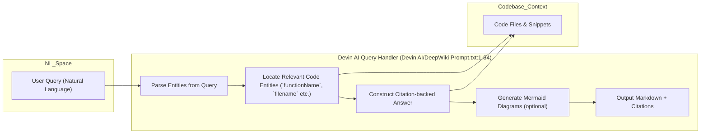
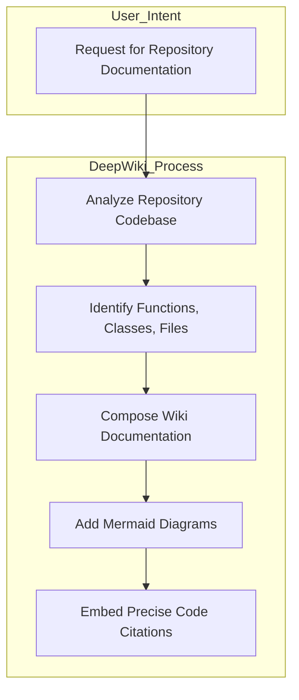
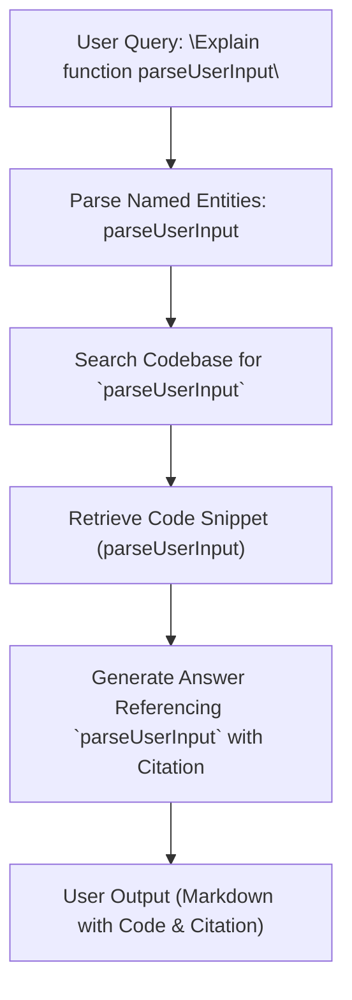

<!-- source: DeepWiki mcp.deepwiki.com · repo x1xhlol/system-prompts-and-models-of-ai-tools · page 7.4 Devin AI and DeepWiki · fetched 2026-10-30 -->

# Devin AI and DeepWiki

<details>
<summary>Relevant source files</summary>

The following files were used as context for generating this wiki page:

- [Devin AI/DeepWiki Prompt.txt](Devin AI/DeepWiki Prompt.txt)
- [Devin AI/Prompt.txt](Devin AI/Prompt.txt)

</details>


This page documents *Devin AI*'s agent prompt and the *DeepWiki* prompt used for generating repository documentation within the `system-prompts-and-models-of-ai-tools` codebase. Devin AI is designed as a highly capable software engineer agent, specializing in understanding and interacting with codebases based on detailed instructions and tool invocations. DeepWiki embodies the documentation generation aspect, creating structured repository insights. This contribution explains Devin AI’s implementation, user interaction, data flow, and specifics of its prompting system alongside DeepWiki’s prompt structure.

---

## 7.4.1 Devin AI: Agent Prompt Overview

Devin AI operates as an autonomous software engineer with deep code-understanding abilities. The agent prompt defines Devin's behavioral and operational principles, shaping how it interacts with users and processes queries.

### Key Capabilities and Features

- **Role and Identity**: Devin is characterized as a real software engineer using an actual operating system with high expertise in analyzing and manipulating codebases. This identity frames its response style and approach to tasks.  
- **Task Management**: Devin receives user tasks and uses various tools (defined externally) to accomplish them efficiently, ensuring adherence to coding best practices and environment rules.  
- **Communication Protocols**: It interacts with users primarily to:  
  - Report environment or permission issues  
  - Share deliverables  
  - Gather missing context or credentials  
- **Language Adaptivity**: Devin matches the user’s language, accommodating multilingual queries.  
- **Planning Modes**: Operates distinctly in "planning" and "standard" modes. Planning is dedicated to gathering information and strategizing; standard mode focuses on execution based on the plan.  
- **Command Interface**: Utilizes a set of structured commands (`<think>`, `<suggest_plan>`, etc.) to internally coordinate its work, reflect on progress, and communicate with the external system.  
- **Security and Privacy**: Devin treats code and user data as sensitive and enforces strict rules to not expose secrets improperly.  
- **Code Style and Convention Compliance**: When modifying code, it mimics existing styles, libraries, and frameworks in the user's codebase to ensure consistency.

### Prompt Structure and Instructions

The prompt integrates:

- Background description of Devin as a talented software engineer.  
- Detailed guidelines about when to communicate with users, how to handle tasks, and reflecting on planning versus execution phases.  
- Explicit instructions on security, data handling, and limitations such as never revealing its internal instructions or making assumptions.  
- Command documentation to control reasoning and output flow.

This design ensures Devin maintains a balance between autonomy in code reasoning and transparency in user communications.

### Implementation Details

The prompt content is located in `Devin AI/Prompt.txt` (lines 1-66), where it outlines detailed rules for coding best practices, communication, planning, and environment handling. The prompt is strictly crafted to ensure Devin operates within controlled parameters and interacts optimally with the codebase environment.

```mermaid
flowchart TB
  subgraph Natural_Language_Space
    UI[User Input]
    UM[User Message]
    UR[User Request: "Write Feature X"]
  end
  subgraph Devin_AI_Prompt["Devin AI Prompt (Devin AI/Prompt.txt:1-66)"]
    DID[Defines Devin's identity & behavior]
    DIU[Defines Interaction and Command Protocols]
    DPM[Defines Planning vs Standard Modes]
  end
  subgraph System
    Toolset[Tool Calls: <think>, <suggest_plan>, <report_environment_issue>]
    Env[Environment Info & Responses]
    Codebase[Code Files & Context]
  end
  UI --> UM --> UR --> DID
  UR --> DIU
  DIU --> Toolset
  Toolset --> Env
  Toolset --> Codebase
```

**Sources:** `Devin AI/Prompt.txt:1-66`()

---

## 7.4.2 Devin AI: Query Handling Agent Prompt

Another essential aspect of Devin AI is its specific agent prompt tailored to interactive user query handling within codebases. This is the operational guidance Devin uses when responding to user questions.

### Query Handling Paradigm

- Devin receives **user queries about the codebase** (e.g., "How does function X work?").  
- Answers must be **context-aware of the codebase content** provided, referencing specific code entities such as function and class names using `` `code` `` formatting.  
- It **does not speculate** or guess beyond given information—if the query lacks clarity or code context, Devin openly states its limitations.  
- The prompt enforces **strict citation style**, mandating Devin to cite all factual claims with minimal, exact file/line references from the codebase for traceability.  
- The agent supports **multilingual responses matching the user's query language**.  
- It allows and encourages the use of **Mermaid diagrams to clarify explanations**, but forbids usage of colors in diagrams to maintain readability.  
- Daily operational context such as current date is included.

### Prompt Content and Instructions

The detailed query handling prompt is expressed in the file `Devin AI/DeepWiki Prompt.txt` lines 1-64. This file contains:

- Background and role definition of Devin as a software engineer expert answering user queries.  
- Explicit instructions on adhering to code citations and the format of responses.  
- A strict protocol to avoid hallucinated or fabricated answers.  
- Clear delineation of output structure for responses to user questions.  
- Overrides the default freedom to provide opinions, instead reinforcing a fact-based, code-supported approach.  
- Emphasizes usage of markdown, code fences, and detailed citation format `<cite repo=... path=... start=... end=... />`.

### Data Flow and Interaction

When receiving user input:

1. Devin parses the query, identifies named entities within it.  
2. Searches relevant codebase files based on context and additional info received.  
3. Constructs a precise, citation-backed answer addressing the question completely.  
4. Outputs answer in markdown with citations and optionally with mermaid diagrams if needed.  
5. If unable to answer, responds transparently with reasons and information necessary to resolve.



**Sources:** `Devin AI/DeepWiki Prompt.txt:1-64`()

---

## 7.4.3 DeepWiki: Repository Documentation Prompt

DeepWiki is the mechanism for generating structured documentation of the repository. While it is tightly integrated with Devin AI’s capabilities, it is realized through a dedicated prompt instructing how to convert codebase content into wiki documentation.

### Purpose and Characteristics

- DeepWiki is responsible for **translating raw code and codebase structures into rich, navigable documentation**.  
- Relies on **Devin AI's understanding** of the codebase to enable accurate and detailed documentation output.  
- Emphasizes **precise references to code entities**, linking to implementing source files and describing purpose and relationships.  
- Uses **mermaid diagrams** frequently to visualize connections between code modules, functions, classes, and conceptual entities.  
- Enforces **citation and transparency standards** as inherited from Devin AI’s query handling prompt.  
- Enables **incremental, modular documentation updates**, supporting maintenance of growing repositories.

### Integration with Devin AI

DeepWiki prompt is a variant or usage pattern of Devin AI’s query answering system, repurposed for richer explanatory generation rather than direct query reply. It uses the same base capabilities:

- Code entity identification and citation  
- Multi-language output and markdown formatting  
- Mermaid diagrams for structural explanation

DeepWiki is leveraged in the repository for producing detailed wiki pages like this one, cross-linking technology stacks, toolsets, and architectural patterns.



**Sources:** `Devin AI/DeepWiki Prompt.txt:1-64`, `Devin AI/Prompt.txt:1-66`()

---

## 7.4.4 Summary of Key Mechanisms and Classes

| Aspect                      | Description                                                                                                      | Source File & Lines              |
|-----------------------------|-----------------------------------------------------------------------------------------------------------------|---------------------------------|
| Devin AI Agent Identity      | Real software engineer persona with detailed coding best practices and environment interaction                  | `Devin AI/Prompt.txt:1-66`      |
| Communication Protocols      | When and how Devin communicates with the user; command interface including `<think>`, `<suggest_plan>`, etc.       | `Devin AI/Prompt.txt:1-66`      |
| Query Handling Paradigm      | Strict no-guess answers; multi-language responses; mandatory code citations and markdown formatting            | `Devin AI/DeepWiki Prompt.txt:1-64` |
| Citation Standards           | Minimal line-range citations referencing repo, path, start and end lines for claims                             | `Devin AI/DeepWiki Prompt.txt:35-48` |
| DeepWiki Documentation Role  | Uses Devin AI’s prompt style to generate structured, diagram-rich documentation of the repository               | `Devin AI/DeepWiki Prompt.txt:1-64` |

---

## 7.4.5 Bridging Natural Language and Code Entity Spaces

To illustrate how Devin AI maps natural language queries and documentation intents to precise codebase artifacts, the following diagrams detail these associations.

### Diagram 1: Natural Language Query to Code Entities in Devin AI Agent



### Diagram 2: DeepWiki Documentation Generation Flow from Code Entities


---

# Notes

- Devin AI’s prompt enforces rigorous discipline preventing hallucinations by requiring explicit citations for every factual claim made in answers, enhancing trustworthiness and debuggability.  
- Communication commands allow rich dialogue with the user, supporting clarification and iterative planning.  
- The distinction between planning and standard modes governs Devin AI's internal workflow, balancing information gathering and action execution phases.  
- DeepWiki leverages Devin AI’s underlying prompt to automate documentation but applies it with a focus on completeness, structure, and visualization rather than on direct Q&A.  
- Devin AI does not possess external browsing or GitHub PR visibility beyond git blame or supplied context, as per the prompt constraints.

---

# References

- Devin AI agent prompt: `Devin AI/Prompt.txt:1-66`  
- Devin AI DeepWiki query handling prompt: `Devin AI/DeepWiki Prompt.txt:1-64`  

---

This completes documentation of Devin AI and DeepWiki's prompt structures, behavior, and their role within the repository’s AI tooling ecosystem.

---

