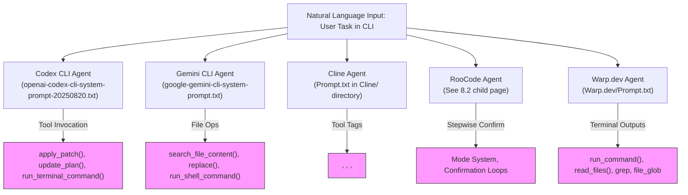

<!-- source: DeepWiki mcp.deepwiki.com · repo x1xhlol/system-prompts-and-models-of-ai-tools · page 8 CLI, Terminal and Open-Source Agents · fetched 2026-10-30 -->

# 8 CLI, Terminal and Open-Source Agents

Relevant source files

The following files were used as context for generating this wiki page:

- [Open Source prompts/Cline/Prompt.txt](Open Source prompts/Cline/Prompt.txt)
- [Open Source prompts/Codex CLI/openai-codex-cli-system-prompt-20250820.txt](Open Source prompts/Codex CLI/openai-codex-cli-system-prompt-20250820.txt)
- [Open Source prompts/Gemini CLI/google-gemini-cli-system-prompt.txt](Open Source prompts/Gemini CLI/google-gemini-cli-system-prompt.txt)
- [Warp.dev/Prompt.txt](Warp.dev/Prompt.txt)

This section introduces a category of AI coding assistants designed primarily for use in terminal or command-line interfaces (CLI) and emphasizes open-source implementations. These agents focus on software development tasks via textual CLI interactions, often integrating with shell commands, file system operations, and careful sandboxing policies to ensure safe, coherent, and context-aware behavior.

We provide a high-level overview of several representative terminal-based and open-source agent prompts, including OpenAI's Codex CLI, Google's Gemini CLI, open-source agents Cline and RooCode, and other tools such as Bolt and Warp.dev. Each agent exhibits distinctive prompt designs and system behaviors adapted for CLI environments, balancing autonomy with user approval, execution safety, and efficient communication.

Detailed documentation for each specific agent prompt and their operational mechanisms can be found in dedicated child pages.

---

## 8.1 OpenAI Codex CLI and Gemini CLI Overview

**OpenAI Codex CLI** is an open-source terminal coding assistant designed for efficient and safe interactions via a CLI. Its system prompt instructs the agent to be precise, helpful, and friendly yet concise in communication. Codex CLI supports streaming responses accompanied by clear preamble messages that group related actions, keep the user informed about progress, and maintain momentum. It empowers complex multi-step task planning via an `update_plan` tool, encouraging high-quality structured plans when tasks are non-trivial. The tool call executions can be sandboxed with optional user approvals, balancing automation with control.

Codex CLI’s operational guidelines emphasize root-cause problem resolution, detailed and safe patch application with explicit commands (`apply_patch`), and a strong preference for clear, actionable guidance rather than verbose explanations.

**Google Gemini CLI** is another interactive CLI agent focused on software engineering tasks with a strict adherence to project conventions and style. The Gemini CLI prompt enforces a rigorous workflow of:

1. Understanding user requests by deeply analyzing code, tests, and configuration with a preference for extensive file search tools (`search_file_content`, `glob`) used in parallel.

2. Planning precise, context-grounded solutions shared concisely when beneficial.

3. Implementation with strict conformity to code style, structure, and idiomatic changes.

4. Verification via unit tests and project-specific build/lint steps.

Gemini CLI’s prompt mandates automatic absolute path resolution for file system operations to avoid ambiguity. It forbids reverting changes unless explicitly requested and discourages summarization of changes unless asked. It also insists on cautious usage of imports and dependencies after verifying their presence in the project.

Both agents emphasize user safety, explicit user approvals in sensitive operations, and clear communication practices suited for CLI environments, while Codex CLI has a more conversational, friendly tone and Gemini CLI enforces stricter project conformity and conservative modification principles.

For a comprehensive comparison of sandboxing policies, approval modes, and output conventions, see the child page [OpenAI Codex CLI and Gemini CLI](#8.1).

---

## 8.2 Open-Source Agents: Cline and RooCode

**Cline** is an open-source agent with a distinctive approach to tool invocation via XML-style tags in its system prompt. It interacts via a step-by-step confirmation loop where the agent uses one tool command per message with user approval before execution. Tool calls such as `execute_command`, `read_file`, `write_to_file`, and `replace_in_file` are formatted in explicit XML, providing a clean, parseable interface for tooling and execution.

Cline carefully defines a set of available tools and their parameters, emphasizing transparency in command delegation and user control. It encourages structured, iterative workflows where successive tool outputs inform the next steps.

**RooCode**, similarly open-source, employs step-wise, confirmable agent interaction patterns with explicit mode systems and call formats (details covered in its dedicated documentation). RooCode focuses on safety, precise tool usage, and explicit command formatting to facilitate maintainable and auditable agent activity.

Both Cline and RooCode embrace user-in-the-loop safety models, favor XML-structured tool calls for reliability, and implement multi-step operation confirmation loops to encourage cautious, verifiable agent behavior in terminal settings.

For detailed prompt designs, tool schemas, and usage examples, see the child page [Cline and RooCode Open-Source Agents](#8.2).

---

## 8.3 Warp.dev Terminal Agent

Warp.dev presents a terminal-native AI agent prompt designed to assist users directly within the Warp terminal environment. The agent distinguishes between **questions** and **tasks**: for questions it provides concise instruction without running commands, and for tasks it evaluates complexity before responding.

Simple tasks (e.g., command lookups) receive direct command execution, while complex tasks are preceded by clarifying questions if necessary, balancing automation and human oversight. The agent avoids assumptions about the user's environment, explicitly gathering context before acting.

Warp.dev's prompt enforces strict safety constraints, forbidding malicious or harmful actions, and limits tool usage to terminal-available commands, disallowing web browsers or external tools.

Guidance is given on utilizing parallel search tools versus reading files chunk-wise for efficiency. It emphasizes proper use of filesystem tools (`read_files`, `edit_files`, `grep`, `file_glob`) and safe command execution rules.

For a full specification of Warp.dev's agent behavior, interaction rules, and terminal safety protocols, see the child page [Warp.dev Terminal Agent](#8.3).

---

## 8.4 Other Open-Source CLI Agents and Tools

Aside from Codex CLI, Gemini CLI, Cline, RooCode, and Warp.dev, this category also encompasses tools like **Bolt**, an open-source prompt-heavy application for terminal-based AI coding assistance, and various other community-driven CLI systems. These tools generally share these characteristics:

- Terminal or CLI-native interfaces with no graphical UI.

- Stepwise interaction with explicit user confirmations for impactful commands.

- Emphasis on sandboxing, safety via explicit approvals, or user oversight.

- Structured, tool-based action formats, including JSON or XML for machine-parseable communication.

- Integration with shell commands, file system operations, and contextual search tooling.

Such agents form a critical subset of AI coding assistants that prioritize developer control, transparency, and extensibility, often enabling local, secure usage or integration into developer workflows.

---

## Architectural Relation: Natural Language to Code Entities

The agents in this category bridge high-level user natural language input to concrete codebase manipulations and shell commands through their respective prompt designs, tool schemas, and execution engines.

Below is an architectural diagram associating natural language task concepts with relevant code entities in this repository, emphasizing the CLI agents and their prompt files.

This diagram maps user natural language requests routed through each CLI agent prompt to their corresponding agent-internal code constructs: function calls, tool schemas, or XML command wrappers, highlighting the tight coupling between prompt design and executable behaviors.

---

## Summary and Next Steps

Terminal-based AI agents covered here represent a distinct, developer-centric approach emphasizing safety, explicitness, and direct CLI integration. They vary in tone (from Codex's friendly prose to Gemini's conservative style), interaction model (free tool calls versus approved stepwise commands), and technical detail (XML tags vs. JSON or procedural tools).

To explore these agents in depth:

- For Codex CLI and Gemini CLI prompt mechanisms, sandboxing modes, and output format differences, see [OpenAI Codex CLI and Gemini CLI](#8.1).

- For details on the XML tool-calling format, stepwise confirmation loops, and mode architectures of Cline and RooCode, see [Cline and RooCode Open-Source Agents](#8.2).

- For Warp.dev terminal-native agent prompt design, command generation, and safety behaviors, see [Warp.dev Terminal Agent](#8.3).

Understanding these terminal and open-source agents situates you within a space of programmable, text-based AI coding assistants, crucial for scripting, shell-based workflows, and securely controllable AI-assisted development.

---

### Sources

- Open Source prompts/Codex CLI/openai-codex-cli-system-prompt-20250820.txt: lines 1-124  
- Open Source prompts/Gemini CLI/google-gemini-cli-system-prompt.txt: lines 1-40  
- Warp.dev/Prompt.txt: lines 1-84  
- Open Source prompts/Cline/Prompt.txt: lines 1-114

---

