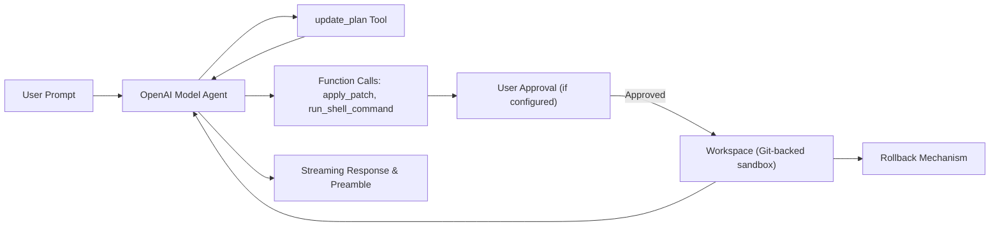
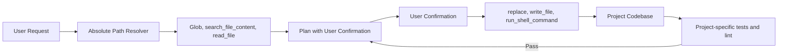
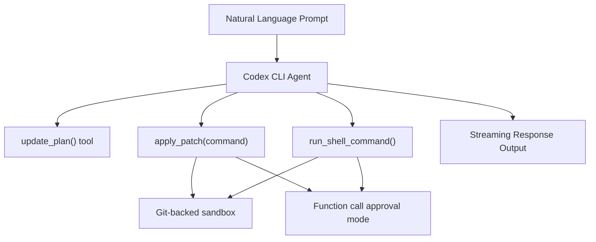
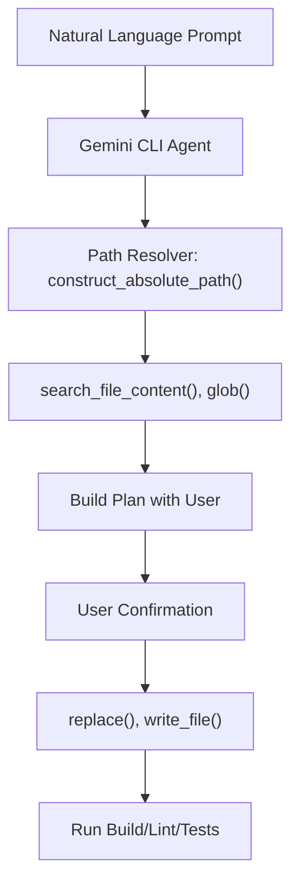

<!-- source: DeepWiki mcp.deepwiki.com · repo x1xhlol/system-prompts-and-models-of-ai-tools · page 8.1 OpenAI Codex CLI and Gemini CLI · fetched 2026-10-30 -->

# 8.1 OpenAI Codex CLI and Gemini CLI

Relevant source files

The following files were used as context for generating this wiki page:

- [Open Source prompts/Codex CLI/Prompt.txt](Open Source prompts/Codex CLI/Prompt.txt)
- [Open Source prompts/Codex CLI/openai-codex-cli-system-prompt-20250820.txt](Open Source prompts/Codex CLI/openai-codex-cli-system-prompt-20250820.txt)
- [Open Source prompts/Gemini CLI/google-gemini-cli-system-prompt.txt](Open Source prompts/Gemini CLI/google-gemini-cli-system-prompt.txt)

This page documents two prominent CLI-based AI coding assistants: **OpenAI Codex CLI** and **Google's Gemini CLI**. Both are terminal-driven intelligent coding agents designed to interact with local codebases, execute commands, and provide automated or semi-automated software engineering assistance. Here we provide a detailed technical comparison of their system prompts, sandboxing and approval modes, output conventions, and architectural design principles. The purpose is to equip developers and integrators with the knowledge to understand their workflows and differences.

---

## 1. Overview and Purpose

### 1.1 OpenAI Codex CLI

The **Codex CLI** is an open-source terminal coding assistant developed by OpenAI. It is not to be confused with the original Codex language model from many years ago—the CLI denotes a new "agentic coding interface" wrapping OpenAI's models. It provides a natural language interface to a local code repository, allowing users to ask for fixes, enhancements, or explanations executed directly in the terminal environment.

Key high-level capabilities of Codex CLI:
- Receives user requests and contextual workspace files.
- Streams user communication and emits function calls (such as applying code patches or running shell commands).
- Supports sandboxed execution and rollback via a git-backed workspace.
- Supports user permissions and approval modes for running potentially impactful commands.
- Strong emphasis on precision, safety, and helpfulness.

This CLI is explicitly oriented towards autonomous or semi-autonomous task resolution using a well-defined planning and execution workflow.

### 1.2 Google Gemini CLI

The **Gemini CLI** is Google's interactive terminal AI agent specialized in software engineering tasks. It emphasizes strict adherence to existing project conventions, idiomatic coding style, and cautious workflow management. It stresses verification and confirmation, avoiding any assumptions about libraries or frameworks not explicitly used in the project. Gemini CLI uses a suite of codebase search and file manipulation tools and insists on absolute file paths for all operations.

Gemini's workflow is engineered for:
- Safe, efficient code edits and feature additions.
- Deep contextual understanding of local project structure and tests.
- Planning with clear user communication with a conservative approach to ambiguous requests.
- Verification includes running project-specific build, lint, and type checks.
- Never reverting changes unless explicitly instructed.
  
---

## 2. System Prompt Comparisons

System prompts define the agent's identity, behavioral expectations, and operational constraints. Below is a side-by-side summary of the key elements from their respective system prompts.

| Aspect                  | Codex CLI (2025-08-20 Prompt)                              | Gemini CLI Prompt                                    |
|-------------------------|------------------------------------------------------------|-----------------------------------------------------|
| Identity                | Terminal-based coding agent wrapping OpenAI models.         | Interactive CLI agent specialized in software engineering tasks. |
| Personality             | Concise, direct, friendly tone.                             | Strict, professional, safety-conscious, no verbosity or user-talk in comments. |
| Communication Style     | Sends preambles before commands (concise 1-2 sentences).  | Minimal user summaries; no unsolicited explanations. |
| Execution Model         | Functions call `apply_patch` for code edits and supports tool calls (terminal, patches). | Uses explicit commands like `replace`, `write_file`, `run_shell_command`. |
| Approval Mode           | Function calls can be escalated for user approval before execution based on config. | User confirmation required for ambiguous or out-of-scope actions. |
| Workspace Model         | Git-backed sandbox with rollback.                          | Root directory treated as absolute base; careful path resolution. |
| Coding Guidelines       | Fix root causes, avoid complexity, update docs if needed. | Adhere strictly to project style/formatting/library use; no guesswork. |
| Planning                | Supports `update_plan` API calls to break tasks into steps. | Clear, concise plan summaries shared with the user as needed. |
| Response Termination    | Continue autonomously until task complete; don’t guess.    | Confirm with user before significant expansions; only end after thorough task completion. |
| Tool Examples           | `apply_patch`, run shell commands.                        | `replace`, `write_file`, `run_shell_command` with absolute paths validation. |

### Excerpts from the 2025-08-20 Codex CLI Prompt

- Capabilities include receiving user prompts, streaming responses, emitting function calls to run terminal commands and applying patches with possible approval escalation.
- Preamble messaging guidelines stress concise, logical grouping, and light tone.
- Planning rules emphasize breaking down complex queries into meaningful steps using the `update_plan` tool.
- Autonomous task execution without guessing; ensure all steps and code edits are validated or rolled back as needed.

### Excerpts from Gemini CLI Prompt

- Rigorously adhere to project conventions and verify library usage via explicit checks (imports, configuration).
- Mimic style and patterns exactly, avoid extraneous comments except for complex logic explanations.
- Writing plans includes unit testing and verification loops.
- Absolute file path enforcement before any file operation.
- Avoid reverting unless told; confirm any ambiguous scope requests with the user.

Sources:  
- `Open Source prompts/Codex CLI/openai-codex-cli-system-prompt-20250820.txt:1-124`  
- `Open Source prompts/Gemini CLI/google-gemini-cli-system-prompt.txt:1-40`  
- `Open Source prompts/Codex CLI/Prompt.txt:1-47`  

---

## 3. Sandboxing and Approval Modes

| Feature                  | Codex CLI                                        | Gemini CLI                                       |
|--------------------------|-------------------------------------------------|-------------------------------------------------|
| Sandboxing Method        | Git-backed sandbox workspace enabling rollback. | No explicit sandbox stated; operates on absolute root path with caution. |
| User Approval            | Optional escalation of function calls for user approval before running commands or patches. | Requests user confirmation before ambiguous or significant actions; cautious with large changes. |
| Safety Mechanisms        | Scoped by policy to avoid dangerous commands; rollback supported. | Verification by code and test runs required after changes; no assumption on tool availability. |

The Codex CLI explicitly mentions running commands or patches that may require user approval based on configuration, creating an approval sandbox. This model enhances safety when automating code modification or terminal command execution.

Gemini CLI enforces strict verification via project-specific checks and does not proceed without explicit user confirmation if the requested task scope is ambiguous or too invasive.

---

## 4. Output Conventions and Communication Protocols

### Codex CLI Output Style

- Uses **preamble messages** to briefly inform the user before executing related command groups.
- Keeps messages concise (8–12 words), grouped logically rather than flooding with messages on trivial reads.
- Tone is light, friendly, and curious to create a collaborative atmosphere.
- Summarizes task progress verbally after plan updates but does not repeat the entire plan.

Example preambles include:  
- “I’ve explored the repo; now checking the API route definitions.”  
- “Next, I’ll patch the config and update the related tests.”  

### Gemini CLI Output Style

- Communication is terse with no unsolicited summaries unless the user explicitly asks.
- Avoids talking "through comments" or explaining changes within the code comments.
- When ambiguity exists, Gemini explains the approach first rather than directly acting.
- After code modifications, no automatic prose summary is provided unless requested.
- Operates conservatively, confirming detailed plans with the user before execution.

---

## 5. Detailed Implementation and Data Flow

### 5.1 Codex CLI Key Components and Data Flow

The Codex CLI operates as a system wrapping OpenAI large language models, interacting with:

- **User input**: Accepts natural language queries and context such as files within the local workspace.
- **Plan management**: Uses a specialized `update_plan` tool to maintain a to-do list representing task decomposition.
- **Tool calls**: Emits function calls to apply patches (`apply_patch`), run shell commands, or inspect files.
- **Sandbox**: Uses a git-backed environment enabling rollbacks and user approval modes.
- **Streaming response**: Communicates in a streaming fashion using preamble messages and continuous status updates.

#### Key Functional Actions:

### 5.2 Gemini CLI Key Components and Data Flow

The Gemini CLI is designed around strict adherence to established project standards and safety:

- Receives precise user requests.
- Extensively uses file system tools like `search_file_content`, `glob`, `replace`, all requiring absolute paths.
- Builds plans with user confirmation before potent code changes.
- Verifies code quality using project-specific lint/build commands.
- Avoids assumptions about environment and frameworks; verifies usage explicitly.
- Does not revert changes unless instructed.

#### Key Functional Actions:

Sources:  
- `Open Source prompts/Codex CLI/openai-codex-cli-system-prompt-20250820.txt:1-124`  
- `Open Source prompts/Gemini CLI/google-gemini-cli-system-prompt.txt:1-40`

---

## 6. Summary Table: Codex CLI vs Gemini CLI

| Feature/Aspect               | Codex CLI                                             | Gemini CLI                                           |
|-----------------------------|-------------------------------------------------------|-----------------------------------------------------|
| System Context              | Terminal agent with streaming responses and plan tool | Interactive CLI with absolute paths and strict code style adherence |
| Personality & Tone           | Concise, friendly, collaborative                      | Strict, cautionary, minimal user-talk               |
| Sandboxing                  | Git-backed sandbox with rollback and approvals        | No explicit sandbox; cautious fileops with path resolution |
| Approval Model              | Function calls can be escalated for user approval     | Confirms major tasks with user before performing    |
| Output/Communication        | Preamble messages before tool calls; minor verbosity | Minimal unsolicited summaries; only explain when asked |
| Planning                   | Uses `update_plan` tool; breaks down steps for long tasks | Clear plan summaries; loop with verification and confirmation |
| Code Modification Tooling   | Uses `apply_patch` for edits and shell commands       | Uses specific commands like `replace`, `write_file` |
| Style and Conventions       | Follows coding guidelines provided                     | Verifies styles/framework use from project files    |
| Error Handling             | Rolling back via git on errors, no guesses             | Verification loops with tests and lint tools        |

---

## 7. Natural Language to Code Entity Mapping

The following diagrams illustrate how the system prompt descriptions correspond to specific code entities and functions within the codebase for each CLI:

### 7.1. Codex CLI: Natural Language to Code Entity Flow

### 7.2. Gemini CLI: Natural Language to Code Entity Flow

Sources:  
- `Open Source prompts/Codex CLI/openai-codex-cli-system-prompt-20250820.txt:1-124`  
- `Open Source prompts/Gemini CLI/google-gemini-cli-system-prompt.txt:1-40`

---

## 8. Conclusion

OpenAI Codex CLI and Google Gemini CLI represent two terminal-based AI coding assistant systems sharing a high emphasis on safety, precision, and context-awareness but diverging in operational philosophies. Codex CLI leverages an agentic, autonomous model with streaming responses, sandbox rollback, and flexible approval modes offering a balance of independence and control.

In contrast, Gemini CLI demands strict style adherence, explicit verification, and absolute path resolution, favoring cautious, user-confirmed progress without unsolicited commentary or guesses. Both employ detailed planning approaches to handle complex tasks effectively.

This detailed comparison clarifies system prompt design rationales, tool conventions, and workflow architectures, offering users and developers in-depth insight into their CLI-based AI agents.

---

### References

- OpenAI Codex CLI system prompt (2025-08-20 revision): `Open Source prompts/Codex CLI/openai-codex-cli-system-prompt-20250820.txt:1-124`  
- OpenAI Codex CLI base prompt: `Open Source prompts/Codex CLI/Prompt.txt:1-47`  
- Google Gemini CLI system prompt: `Open Source prompts/Gemini CLI/google-gemini-cli-system-prompt.txt:1-40`

---

