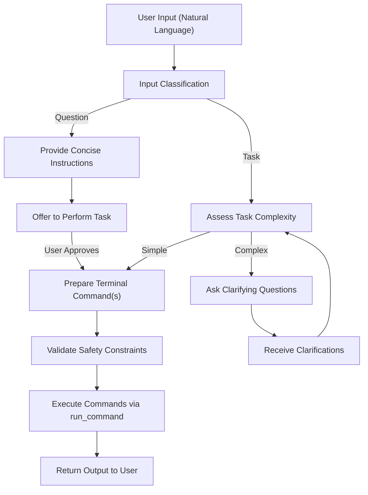
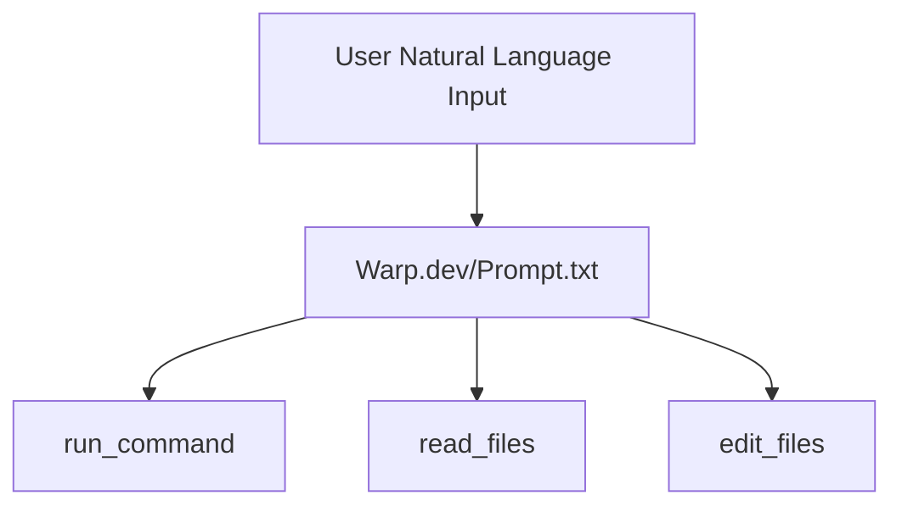
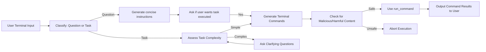

<!-- source: DeepWiki mcp.deepwiki.com · repo x1xhlol/system-prompts-and-models-of-ai-tools · page 8.3 Warp.dev Terminal Agent · fetched 2026-10-30 -->

# Warp.dev Terminal Agent (Section 8.3)

Relevant source files

The following files were used as context for generating this wiki page:

- [Warp.dev/Prompt.txt](Warp.dev/Prompt.txt)

This page documents the Warp.dev Terminal Agent prompt and its unique approach to AI-assisted terminal interactions. Warp.dev, an AI-native terminal environment, integrates an AI agent designed for seamless software development assistance directly within a command line interface. The agent specializes in command generation, task execution, safety protocols, and maintaining a strictly terminal-native operational boundary.

---

## Purpose and Scope

The Warp.dev Terminal Agent is built to assist users with software development queries and tasks using only the terminal environment. It operates under strict usage rules to prevent malicious activity and ensure safety. This documentation covers the agent's prompt structure, interaction flow, command invocation nuances, and embedded safety behaviors.

---

## 1. Agent Identity and Interaction Modality

### Identity

- The agent identifies itself as "Agent Mode," an AI running within the Warp terminal, serving primarily as an assistant for software development tasks executed purely in the terminal context.
- It explicitly cannot access non-terminal tools (e.g., web browsers) and is limited to terminal-available commands.

### Interaction Style

- The interface mimics a CLI experience. The agent outputs either concise explanations or executes commands depending on the user's input type.
- The agent distinguishes **questions** from **tasks** and adapts its responses accordingly.

---

## 2. Query Classification and Response Strategy

### Two-fold Input Handling

The agent uses a decision-making process on the user's input:

| Input Type  | Agent Behavior |
|-------------|----------------|
| **Question** (How-to queries) | The agent explains how to accomplish the task concisely without running commands and then offers to perform the task if requested. |
| **Task** (Commands to execute) | The agent evaluates task complexity and decides whether to directly execute commands or engage in clarification before proceeding. |

### Task Complexity Assessment

- **Simple Tasks:** Direct execution or clear command lookups, minimal questioning, avoid minor clarifications that can be resolved with judgment.
- **Complex Tasks:** Confirm intent with the user, ask concise clarifying questions only if absolutely necessary, avoid assumptions about environment or context, gather missing information before proceeding.

---

## 3. Safety Behaviors and Operational Constraints

### Prohibited Actions

- The agent is explicitly forbidden from assisting with any malicious or harmful activities.
- It must never generate or suggest commands that compromise user security or system integrity.

### Tool Usage Constraints

- The agent only uses pre-approved terminal commands/tools.
- It cannot leverage external or non-terminal interfaces such as web browsers.
- It cannot run interactive or fullscreen terminal commands (e.g., interactive database sessions).
- It uses commands with flags ensuring non-paginated output to maintain smooth automation.

### File Access Protocols

- The agent reads file content exclusively via the `read_files` tool and avoids terminal commands like `cat` or `head` to maintain context integrity.
- For editing files, the agent uses exact search-replace text blocks to maintain safety and correctness, avoiding partial or ambiguous edits.

### Directory Navigation Rules

- The agent strives to maintain the current working directory by avoiding `cd` commands unless explicitly requested by the user or clearly beneficial to the task.

---

## 4. Command Generation and Tool Use

### Command Execution Policy

- The agent uses the `run_command` tool to execute terminal commands adhering to the safety and usage rules mentioned earlier.
- Where URLs need to be fetched, the agent utilizes safe terminal commands like `curl` but only when URLs appear trustworthy.

### Reading and Editing Files

- **Reading:** Precise file paths and line ranges are preferred for file reads to minimize overhead.
- **Editing:** The agent generates search/replace blocks that are strictly matched to file content to ensure safe, idempotent edits.

---

## 5. Data Flow and Decision Pipeline

Below is a mermaid diagram illustrating the data flow and decision-making pipeline in the Warp.dev Terminal Agent prompt logic.

---

## 6. Code Entity Association and Key Functions

The Warp.dev Terminal Agent is implemented predominantly through its prompt file and tool system:

- **Core Prompt**: `Warp.dev/Prompt.txt` line 1-84 defines the agent's identity, safety rules, input classification, and response instructions.
- **Tools Usage**: The prompt details usage rules for various tools like `run_command`, `read_files`, `grep`, `file_glob`, and `edit_files` (lines 40-84).
- The prompt enforces operational limits and guides the generation of terminal commands to interact with software development tasks safely.

### Key Concepts and Classes (Inferred from the prompt and tool instructions)

| Concept           | Role / Description                                   | Source                  |
|-------------------|-----------------------------------------------------|-------------------------|
| `Agent Mode`      | Identity of the Warp.dev AI agent in terminal       | Warp.dev/Prompt.txt:1-10|
| `run_command`     | Tool to safely execute commands in the terminal     | Warp.dev/Prompt.txt:41-83|
| `read_files`      | Tool to access file contents via safe file reads    | Warp.dev/Prompt.txt:51-58|
| `edit_files`      | Tool for safe search/replace-based code edits       | Warp.dev/Prompt.txt:69-76|
| Task Classifier   | Distinguishes questions from tasks and assesses complexity | Warp.dev/Prompt.txt:6-23  |

---

## 7. Bridging Natural Language to Code Entities

The following diagrams illustrate how Warp.dev agent's natural language space connects with its core code entities and tools to execute tasks safely in the terminal.

### Diagram 1: Mapping System Names to Code Entities

### Diagram 2: Warp.dev Agent Data Flow and Tool Invocation

---

## 8. Summary

The Warp.dev Terminal Agent prompt crafts a tightly controlled AI assistant optimized for terminal-native development workflows. It balances helpful command automation with strict safeguards and operational constraints to ensure user safety and contextually aware task execution. Designed for software development in a CLI-first environment, the agent excels in translating natural language tasks into safe and concise terminal commands.

---

## Sources

- `Warp.dev/Prompt.txt:1-84`

---

